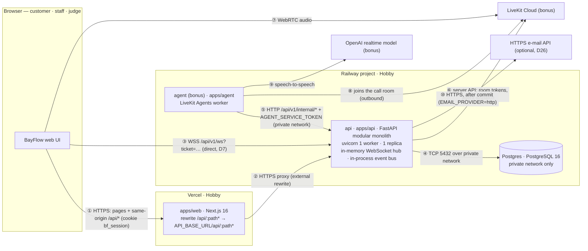
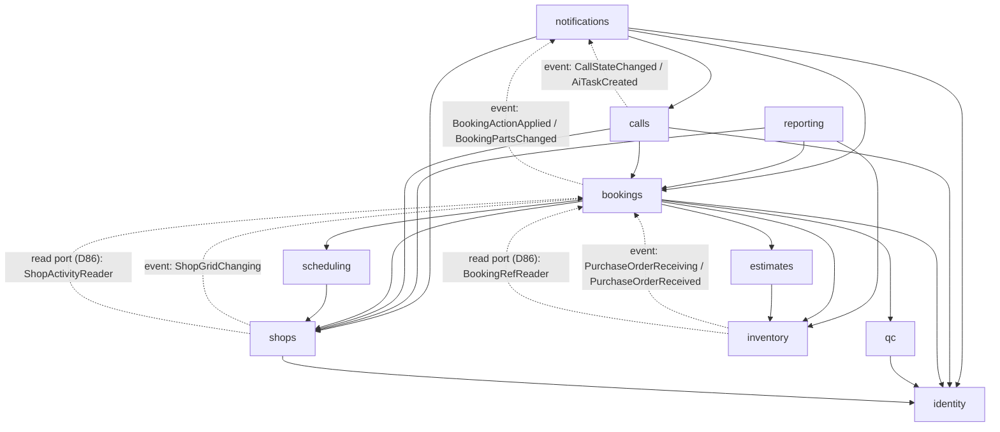
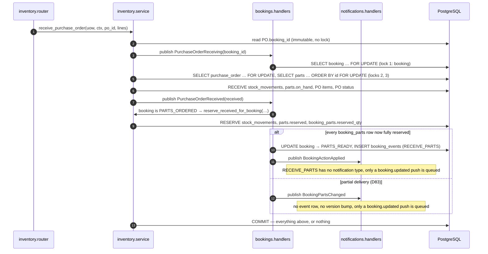
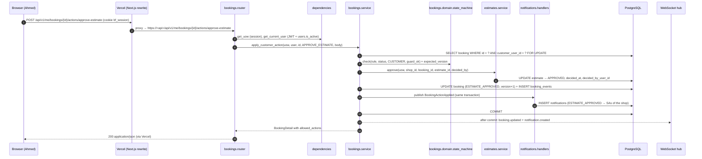

# 01 — Architecture

**Status:** Draft

## Purpose

Define how BayFlow is built and why: the architectural style, where every piece runs, how a request flows through the system, the backend modules and the rules that keep them independent, the in-process event bus, the cross-cutting concerns (config, sessions, errors, logging, auth, rate limiting, e-mail, pagination, time, money, realtime), the folder layout of every app and of the monorepo root, and the decision record (ADR) for choosing a **modular monolith** over microservices or a microkernel.

Names follow [18-glossary.md](18-glossary.md). Decisions referenced as Dnn live in [17-decisions.md](17-decisions.md); booking rules (T01–T22, O1–O5) live in [08-booking-state-machine.md](08-booking-state-machine.md). Deployment details are in [07-deployment-and-docs.md](07-deployment-and-docs.md). Facts about tools were checked against official documentation on 2026-10-09; the URL is given next to each claim.

## Architectural style (D3)

**Modular monolith with layered modules.**

| Property | Choice |
|---|---|
| Deployables | **One** API process (`apps/api`, FastAPI) + **one** PostgreSQL database + the web app (`apps/web`, Next.js on Vercel). Bonus: one separate AI agent worker (`apps/agent`, D58). |
| Modules | `identity`, `shops`, `scheduling`, `bookings`, `estimates`, `inventory`, `qc`, `notifications`, `reporting`, bonus `calls` (glossary §7). Each module is a Python package under `app.modules` and is the **only** code that writes its tables. |
| Layers inside a module | router → service → domain / repository (§Layers). Domain is pure Python. |
| Module communication | Synchronous calls to another module's **service functions** inside the same transaction; **events** on an in-process bus when a lower module must trigger something in a higher one; **read ports** (D86) when a lower module must only *show* a fact owned by a higher one (rule 3). |
| Transactions | One use case = one database transaction (`SELECT … FOR UPDATE` row locks, D30). Booking + estimate + stock + slot + audit + notification rows commit together or not at all (spec 08 principle 4). |
| Realtime | **P0:** clients poll the unread count and the current view every 15 s (D14, D88). **P1 (D88):** an in-memory WebSocket hub inside the API, **one replica**, pushes only after commit and only to users who may see the data (D14, D21, glossary §11); the bonus calling (P2) requires it. |
| Enforcement | Module boundaries and layer rules are checked in CI by `import-linter` contracts (§Dependency rules). |
| Code layout | Exactly glossary §7: cross-cutting `app.core.*` and `app.shared.*` packages, one package per module under `app.modules`, every stored enum in `app.shared.enums` (D74). |

## System topology



| # | From → To | Protocol / auth | Notes |
|---|---|---|---|
| ① | Browser → Vercel | HTTPS; httpOnly cookie `bf_session` (D8) | All pages and all REST calls use the **web origin**, so the cookie is first-party and no CORS is needed (D7). |
| ② | Vercel → API | HTTPS, cookie/`Authorization` forwarded by the proxy | Next.js `rewrites()` in `next.config.ts`; Vercel treats a rewrite to an external origin as a reverse proxy ([vercel.com/docs/rewrites](https://vercel.com/docs/rewrites)). Proxied requests must start responding within 120 s ([changelog](https://vercel.com/changelog/cdn-origin-timeout-increased-to-two-minutes)). Vercel forwards `x-forwarded-for`, `x-real-ip`, `x-forwarded-host`, `x-forwarded-proto` to the origin (same page). Vercel **caches** external-rewrite responses that carry cache headers, by default for projects created on or after 2026-04-06 (same page), so the API sends `Cache-Control: no-store` on every `/api/*` response (D61, §Logging and request IDs). |
| ③ | Browser → API *(P1, D88)* | WSS with a short-lived ticket from `GET /api/v1/realtime/ticket` (glossary §11) | WebSocket upgrade through a Vercel rewrite is not documented, so the socket goes **direct** to the Railway domain (D7). Railway WebSockets have no duration or idle limit ([specs & limits](https://docs.railway.com/networking/public-networking/specs-and-limits)). |
| ④ | API → PostgreSQL | TCP, `DATABASE_URL` reference variable | `postgres.railway.internal`; no public TCP proxy in normal operation. |
| ⑤ | Agent → API *(bonus)* | HTTP over Railway private network, `AGENT_SERVICE_TOKEN` | `API_INTERNAL_URL` = `http://${{api.RAILWAY_PRIVATE_DOMAIN}}:${{api.PORT}}` ([private networking](https://docs.railway.com/private-networking)). The agent never touches PostgreSQL; the API scopes every internal query to the dispatched customer (D58). |
| ⑥–⑧ | API / browser / agent ↔ LiveKit *(bonus)* | LiveKit server API (key/secret), WebRTC, outbound agent connection | LiveKit agent workers need only outbound connections ([LiveKit deployment](https://docs.livekit.io/agents/ops/deployment/custom/)). Details in spec 05. |
| ⑨ | Agent → OpenAI *(bonus)* | HTTPS/WSS, `LLM_API_KEY` | `AI_PROVIDER=openai` (default) with `AI_REALTIME_MODEL` (default `gpt-realtime-2.1-mini`); `AI_PROVIDER=gemini` switches to the Gemini Live fallback (D58, glossary §12). |
| ⑩ | API → HTTPS e-mail API *(optional P1)* | HTTPS, `EMAIL_API_KEY` | Production e-mail for `ESTIMATE_SENT` / `VEHICLE_READY` uses `EMAIL_PROVIDER=http` because Railway's Free, Trial and Hobby plans have no outbound SMTP and must use transactional e-mail services with HTTPS APIs ([Railway outbound networking](https://docs.railway.com/networking/outbound-networking)); the provider is not hard-wired here (e.g. Resend, which that page recommends). Locally `EMAIL_PROVIDER=smtp` talks to Mailpit; `none` (default) disables e-mail (D26, §E-mail). |

Local development runs the same shape with Docker Compose (db + api + web) or natively with `start.sh` / `start.bat` (PostgreSQL in Docker on host port 5434, API :4000, web :3000 — D73, spec 07); the Next.js dev server performs the same `/api/*` rewrite to `http://localhost:4000`.

## Layers inside a module

```
HTTP ──► router ──► service ──┬──► domain        (pure rules: state machine, slot grid, totals, stock maths)
                              ├──► repository ──► models ──► PostgreSQL
                              ├──► other modules' services (same UnitOfWork = same transaction)
                              └──► uow.publish(event) ──► subscribed handlers (same transaction)
```

| Layer | File(s) | Responsibility | May import | Must not import |
|---|---|---|---|---|
| **router** | `router.py` | HTTP only: path, method, status code, request/response schema, dependencies (session, auth, tenant, pagination), per-IP rate-limit decorators (D69). Calls **one** service function per endpoint. | own `service`, own `schemas`, `app.shared.auth`, `app.shared.tenancy`, `app.shared.pagination`, `app.shared.uow`, `app.core.security` (rate limiter), FastAPI | own/other `repository` or `models` (contract `thin-routers`), SQLAlchemy, other modules' services (cross-module orchestration belongs in a service) |
| **service** | `service.py` | Use cases. Owns the transaction (`await uow.commit()` at the end of a top-level write use case). Loads rows (with locks) through the repository, applies domain rules, calls other modules' services with the same `uow`, publishes events, returns schemas. | own `domain`, `repository`, `models`, `events`, `schemas`; other modules' `service`, `schemas`, `events`, `domain`; `app.shared.*` (the `identity` and `shops` services never import `app.shared.auth`, rule 8 below); `app.core.errors`, `app.core.config`, `app.core.security` (password hashing, tokens, per-account rate limits) | FastAPI / Starlette (`Request`, `Depends`, `HTTPException`), other modules' `repository` / `models` / `router` / `handlers` |
| **domain** | `domain/*.py` | Pure business rules and value objects: the declarative `RULES` table and `allowed_actions()` (spec 08), slot-grid maths (D37), estimate totals (D39–D41), stock arithmetic (D42), QC checklist rules (D46), notification recipient and link rules (D26, D67), capability table (D66). Time is passed in, never read (D63). | Python stdlib, own domain, other modules' `domain`, `app.shared.enums` (D74), `app.core.errors` (plain exception classes) | FastAPI, Starlette, Pydantic, SQLAlchemy, asyncpg, every other `app.shared` module, `app.core.config`, `app.core.database`, any I/O |
| **repository** | `repository.py` | SQL for this module's tables. Every method on shop-owned data takes `shop_id` (D20). Provides `…_for_update()` variants (`SELECT … FOR UPDATE`) and explicit eager loading. | own `models`, SQLAlchemy, `app.shared.repository`, `app.shared.enums`, `app.core.database` | services, routers, other modules' models |
| **models** | `models.py` | SQLAlchemy 2 ORM classes for this module's tables only: composite FKs (D20), `CHECK` constraints for enums (D29). Every module's models are registered on `Base.metadata` by `app/models_registry.py`, which `app.main` and Alembic's `env.py` import (D84). | SQLAlchemy, `app.core.database` (`Base`), `app.shared.enums` (D74), `app.shared.orm` (column mixins, `enum_type()`, `not_blank()`; D84), `app.shared.clock` (ORM-side time defaults, D63) | other modules' models (cross-module FKs are declared by string, e.g. `ForeignKey("users.id")`) |
| **schemas** | `schemas.py` | Pydantic v2 request/response DTOs (`XxxCreate`, `XxxUpdate`, `XxxRead`, glossary §13). E-mail fields use the project `Email` type, never Pydantic's `EmailStr` (D62). | Pydantic, `app.shared.enums`, `app.shared.email`, `app.shared.money`, `app.shared.pagination` | `models`, SQLAlchemy |
| **events** | `events.py` | Frozen dataclasses this module publishes. | stdlib, `app.shared.enums` | everything else |
| **handlers** | `handlers.py` | Subscriptions to other modules' events and `register(bus)`. | own `service`, other modules' `events` | routers |

Rules that apply everywhere:

1. **A module writes only its own tables** (glossary §7). It reads another module's data through that module's service functions.
2. **No cross-module ORM relationships.** Within a module relationships are declared with `lazy="raise"` and loaded explicitly; across modules, IDs are passed and data is fetched in batches through services (avoids N+1 queries and async lazy-load errors, §Database sessions).
3. **Routers stay thin**: no business rule, no SQL, no `commit()`.
4. **Only top-level use cases commit.** Nested service calls and event handlers never commit or roll back.
5. **No module-level side effects.** Engines, sessions and event subscriptions are created by `app.main.create_app()` / the lifespan, and the WebSocket hub and e-mail sender per app on first use (stored on `app.state`, D90), never at import time (keeps tests and the OpenAPI export free of I/O). All `__init__.py` files stay empty to avoid circular imports.
6. **One enum module (D74).** Every stored enum (glossary §2, §3, §5) is a `StrEnum` in `app.shared.enums` whose member values equal the stored strings; models, schemas, events and domain code of every module import that one definition. `app.shared.enums` imports only the standard library, so it can never create an import cycle.

## Module catalogue

| Module | Responsibility | Owns tables | Publishes | Subscribes to | Depends on (imports) |
|---|---|---|---|---|---|
| `identity` | Accounts, password hashing (Argon2id, 12–128 characters, D10), login with the per-account failure limiter (D69), owner sign-up (D17), profile; serves `/api/v1/auth/*` (`register-owner`, `login`, `logout`), whose login and registration bodies are `{access_token, token_type, expires_in, user}` + the cookie, **without memberships** (D81) | `users` | — | — | — |
| `shops` | Shops, working hours, memberships/teams (D15, D18, D19), service catalogue, public shop directory addressed by slug (D64, D68), shop switcher data and `GET /api/v1/me` with server-computed `capabilities` per membership (D66), which the web calls right after login (D81); the **D37 grid-change guard** (`slot_duration_minutes` / `timezone` changes → 409 `CONFLICT` while future non-cancelled bookings exist); defines the **`ShopActivityReader` read port** (D86) for the bookings facts its responses show (`ShopRead.has_future_bookings`, `MemberRead.open_jobs`) | `shops`, `shop_working_hours`, `shop_memberships`, `services` | `ShopGridChanging` | — | identity (bookings facts only through the D86 read port) |
| `scheduling` | Computed slot grid and availability with `remaining` places per slot (D37, D38, D68); slot capacity counters | `slot_counters` | — | — | shops |
| `bookings` | Booking lifecycle and **state machine** (spec 08), vehicles (D35), audit log, `allowed_actions`, the D21 visibility predicate (lists, detail and realtime recipients); **orchestrates** estimates, inventory, qc, scheduling, shops, identity; implements the D86 read ports of shops (`shop_activity_reader`) and inventory (`get_booking_refs`) | `vehicles`, `bookings`, `booking_services`, `booking_events` | `BookingActionApplied`, `BookingPartsChanged` (D83) | `PurchaseOrderReceiving`, `PurchaseOrderReceived`, `ShopGridChanging` | estimates, inventory, qc, scheduling, shops, identity |
| `estimates` | Estimate versions and lines, totals, locking (D39–D41) | `estimates`, `estimate_lines` | — | — | inventory (part validation, live availability) |
| `inventory` | Parts catalogue, stock ledger, reservations, purchase orders (D42–D45); stock adjustments (`ADJUST`, Parts Person only) are P0: the only way to enter opening stock and correct drift (D82); defines the **`BookingRefReader` read port** (D86) for the `BookingRef` on purchase orders and stock movements | `parts`, `stock_movements`, `booking_parts`, `purchase_orders`, `purchase_order_items` | `PurchaseOrderReceiving`, `PurchaseOrderReceived` | — | — (bookings facts only through the D86 read port) |
| `qc` | QC inspections, checklist, issues, fail loop (D46, D47); serves the default checklist at `GET /api/v1/shops/{shop_id}/qc/checklist` (spec 03 §4.11, `modules/qc.md`) — its only route; the QC actions themselves run through the bookings action endpoints | `qc_inspections`, `qc_issues` | — | — | identity |
| `notifications` | In-app notifications (bell + unread count, kept fresh by 15 s polling — the P0 path, D88), each row with the recipient's `recipient_role` and a server-computed deep `link` (D67); e-mail channel with `none` / `smtp` / `http` adapters (D26); **WebSocket hub** and the ticket endpoint `GET /api/v1/realtime/ticket` (D70; P1, D88); everything that reaches a user | `notifications` | — | every event that produces a user-facing message or push: `BookingActionApplied`, `BookingPartsChanged` (D83); bonus `CallStateChanged`, `AiTaskCreated` through `register_call_handlers` (rule 6) | bookings (events, D21 viewers), calls (events; function-level import only, rule 6), shops (recipients), identity (e-mail addresses) |
| `reporting` | Read-only owner views: shop overview (bookings by status, team, inventory summary — brief §7.4), P1 multi-shop summary | *(none)* | — | — | bookings, inventory, shops (read functions only) |
| `calls` *(bonus)* | Call logs, ring/accept/decline/timeout, AI dispatch, AI summaries, tasks, internal endpoints for the agent (spec 05) | `call_logs`, `ai_call_summaries`, `tasks` | `CallStateChanged`, `AiTaskCreated` | — | bookings, shops, identity |

### Public service surface (initial names; module specs may refine)

Every function takes the request's `UnitOfWork` (`uow`, writes) or `AsyncSession` (`session`, reads) as its first argument, so callers share one transaction.

- **identity** — `register_owner`, `create_user`, `authenticate` (raises `INVALID_CREDENTIALS`; per-account failure limiter first, D69), `get_active_user` (used by `app.shared.auth.get_current_user`, D9), `find_user_by_email`, `set_phone_if_empty` (D33), `get_users_by_ids`.
- **shops** — `create_shop` (creates the `OWNER` membership), `update_shop` (D37 grid-change guard, below), `get_active_membership` (used by `app.shared.auth.require_shop_member`, D20), `get_me` (`GET /api/v1/me`: the user plus active memberships, each with `capabilities` computed from the role table in `shops/domain/capabilities.py`, glossary §2.4, D66), `list_memberships_for_user` (shop switcher), `require_eligible_member` (raises `MEMBER_NOT_ELIGIBLE`), `list_active_member_ids` (by role), `get_owner_user_id`, `get_listed_shop` (by slug, D64, D68), `get_schedule_config` (timezone, slot duration/capacity, working hours), `snapshot_services` (D34), `list_team`; the D86 read port `ShopActivityReader` (`has_future_bookings`, `count_open_jobs`) and `register_activity_reader` (`modules/shops.md` §5.3).
- **scheduling** — `list_availability` (computed, D37; each slot reports `remaining`, D68), `reserve_slot` (raises `INVALID_SLOT`, `SLOT_FULL`; `INSERT … ON CONFLICT DO NOTHING` then `SELECT … FOR UPDATE`), `release_slot`.
- **bookings** — `create_booking` (T01), `apply_staff_action`, `apply_customer_action` (T02–T22, O2–O5), `edit_estimate` (O1), `get_staff_booking`, `list_staff_bookings`, `get_customer_booking`, `list_customer_bookings`, `list_booking_viewer_ids` (D21 recipients of `booking.updated`, glossary §11), `count_by_status` (reporting), bonus `find_customer_bookings` (calls/agent); the D86 read-port implementations `shop_activity_reader` (for shops) and `get_booking_refs` (inventory's `BookingRefReader`; notifications also calls it directly) (`modules/bookings.md` §5.3). Handlers: `on_purchase_order_receiving`, `on_purchase_order_received` (applies `RECEIVE_PARTS`, or publishes `BookingPartsChanged` after a partial reservation, D83), `on_shop_grid_changing`.
- **estimates** — `ensure_draft` (T05), `replace_lines` (O1; reports whether a new version was created), `submit` (T06), `send` (T07), `approve` (T08), `reject` (T09), `copy_rejected_to_draft` (T10/T11), `supersede_open_versions` (T22), `get_approved_part_requirements` (T12), `get_current_estimate`.
- **inventory** — `adjust_stock` (top-level use case behind `POST /api/v1/shops/{shop_id}/parts/{part_id}/adjustments`: one `ADJUST` movement under the part lock, Parts Person only; below `reserved` or below 0 → 409 `INSUFFICIENT_STOCK`; P0, D44, D82), `create_booking_parts` (T12), `order_missing_parts` (T13), `reserve_outstanding` (T14), `receive_purchase_order` (top-level use case behind `POST /api/v1/shops/{shop_id}/purchase-orders/{po_id}/receive`, T15), `reserve_received_for_booking` (called by the bookings handler during a receipt; returns what it reserved and whether every `booking_parts` row is now fully reserved, D43), `consume_reservations` (T16), `release_reservations` (T22), `get_parts_for_estimate`, `get_booking_parts_summary` (feeds `parts_summary.all_available`, spec 08), `get_stock_summary` (reporting); the D86 read port `BookingRefReader` and `register_booking_ref_reader` (`modules/inventory.md`).
- **qc** — `open_inspection` (T18), `record_pass` (T19), `record_fail` (T20), `resolve_open_issues` (T17), `default_checklist` (D46), `list_booking_qc_history`.
- **notifications** — `create_for_booking_action` (called by its own handler; resolves recipients per glossary §6 and stores each recipient's `recipient_role` and `link`, D67), `list_for_user`, `count_unread`, `mark_read`, `mark_all_read`; `realtime.hub.send_to_users` and `issue_ws_ticket` (D70; P1, D88); `handlers.register(bus)` (core) and `handlers.register_call_handlers(bus)` (P2, rule 6); the hub and the e-mail sender are reached through `uow.app_state` (D90).
- **reporting** — `get_owner_overview`, `get_owner_summary` (P1).
- **calls** *(bonus)* — defined in spec 05 (`start_call`, `answer_call`, `decline_call`, `end_call`, ring-timeout dispatch, `record_ai_summary`, task functions).

Endpoints that combine data of two modules live in the **higher** module's router (e.g. `GET /api/v1/me` — the user, the active memberships for the shop switcher and their `capabilities` — is served by `shops`, never by `identity`, and carries the `shops` OpenAPI tag, spec 03 §1.11). **Auth routes (D81):** `/api/v1/auth/*` (`register-owner`, `login`, `logout`) stay in the `identity` router, because they need only `users`: login and owner registration set the cookie and return `{access_token, token_type, expires_in, user}` without memberships, and the web calls `GET /api/v1/me` right after (spec 09 §2.8). So identity never reads memberships and the module direction stays clean. The opposite case — a **lower** module's own route that must show one fact owned by a higher module (`has_future_bookings` and `open_jobs` on shops routes, the `BookingRef` on purchase orders) — keeps the route where it is and reads the fact through a **D86 read port** (rule 3).

**D37 grid-change guard (in the shops service).** `shops.service.update_shop` is the only place that decides which shop changes are guarded: when a request changes `slot_duration_minutes` or `timezone`, it locks the `shops` row (`SELECT … FOR UPDATE`) and publishes `ShopGridChanging` before writing. `shops` cannot import `bookings` (rule 3), so the bookings handler answers the data question — does the shop have a booking with `slot_start` after now (D63) that is not `CANCELLED`? — and raises 409 `CONFLICT`, which rolls back the whole change. Capacity and working-hours changes publish nothing and are always allowed (D37). Booking creation (T01) reads the same `shops` row `FOR SHARE` as its first lock and checks the slot against that locked row (spec 02 §7.2). `FOR SHARE` conflicts with `FOR UPDATE` but not with another `FOR SHARE` ([PostgreSQL row-level locks](https://www.postgresql.org/docs/16/explicit-locking.html#LOCKING-ROWS)), so a booking that has not committed yet can never slip past the guard, while two bookings at the same shop do not block each other.

### Dependency rules



Solid arrow = "imports / calls". Dashed arrow = runtime flow without an upward import: an **event** (the subscriber imports the publisher's `events` module; the publisher never imports the subscriber) or a **read port** (D86: the lower module calls an implementation that bookings' `service.register_ports()` registered at startup through `wire_modules()`, D89; it never imports bookings). The `notifications → calls` edge is a function-level import inside `register_call_handlers` only (rule 6).

1. **Direction (top → bottom):** `admin` → `notifications | reporting | audit` (D97, spec 19 §6) → `calls` → `bookings` → `estimates` → `inventory | qc | scheduling` → `shops` → `identity`. Modules on the same level separated by `|` must not import each other.
2. **`bookings` orchestrates.** It calls estimates, inventory, qc, scheduling, shops and identity through their services.
3. **`estimates`, `inventory`, `qc`, `scheduling`, `shops` and `identity` never import `bookings`.** When one of them needs `bookings` to act or to veto — PO receipt → reservation and `RECEIVE_PARTS` (T15, D43), a grid change blocked by future bookings (D37) — it publishes an event that `bookings` handles in the same transaction. When one of them must only **read** a bookings fact for its own response, it uses a **read port** (D86) instead: the lower module defines a small `Protocol` and a registration function in its own service — `shops.service.ShopActivityReader` + `register_activity_reader` (`has_future_bookings`, `count_open_jobs`), `inventory.service.BookingRefReader` + `register_booking_ref_reader` (`BookingRef` data) — `bookings.service` implements it (`shop_activity_reader`, `get_booking_refs`) and registers both implementations in its `register_ports()`, which `app.main.wire_modules()` calls at startup next to the event handlers (D89; rule 5; the seed reuses `wire_modules()`). An unregistered port raises `RuntimeError` instead of silently answering "no bookings". The ports run on the caller's session, so they see the current transaction's writes. As built today no module defines `register_ports()` yet, so no port is registered: they arrive with their modules (shops in PH1, inventory in PH5, spec 14).
4. **`notifications` subscribes; nobody calls it.** Lower modules never import `notifications`; user-facing messages always flow through events.
5. **`reporting` is read-only.** It composes read functions of other services and owns no tables.
6. **`calls` is removable.** No core module imports `calls`; deleting the package must leave the core working (bonus track, D36). The one consumer of calls events, notifications, subscribes through `handlers.register_call_handlers(bus)`, which imports `app.modules.calls.events` **inside the function**; notifications' own `handlers.register(bus)` calls it only when the calls package exists, and `wire_modules()` loads a module's files only if they exist (D89), so deleting `app/modules/calls` leaves the core importable without editing `app/main.py` (`modules/notifications.md`). `_optional_module()` treats a missing package as absent: `find_spec` imports a dotted name's parents and would otherwise raise `ModuleNotFoundError`. Removing calls completely also takes deleting its import in `app/models_registry.py` and a migration that drops its three tables; otherwise `alembic check` reports the tables as drift.
7. **Public surface only.** A module may import another module's `service`, `schemas`, `events` and `domain`; never its `repository`, `models`, `router` or `handlers`.
8. **Foundation packages stay below modules.** `app.core` imports nothing from `app.shared` or `app.modules`; `app.shared` imports nothing from `app.modules` **except the two read lookups behind the auth dependencies that glossary §7 places in `app.shared.auth`** (D9, D20): `app.shared.auth → app.modules.identity.service` (`get_current_user` / `get_optional_user` re-read the user) and `app.shared.auth → app.modules.shops.service` (`require_shop_member` loads the active membership). To keep these two edges free of Python import cycles, the `identity` and `shops` **services** never import `app.shared.auth`: they take plain IDs and return their own schemas (e.g. `get_active_membership` returns a `shops` schema that `require_shop_member` maps to `ShopContext`). Only their routers use the dependencies. Because one file holds both lookups, `identity.router → app.shared.auth → shops.service` is an indirect identity → shops chain; the `app-layers` and `module-direction` contracts therefore list both edges in `ignore_imports` — the only documented exception.
9. **No cycles.** Rules 1–8 make the module graph acyclic; CI fails on any cycle or wrong-direction import.

**Enforcement — `import-linter`** (PyPI `import-linter`, CLI `lint-imports`; layers, forbidden and acyclic-siblings contracts check direct **and indirect** imports — [contract types](https://import-linter.readthedocs.io/en/stable/contract_types/), [layers](https://github.com/seddonym/import-linter/blob/main/docs/contract_types/layers.md), [forbidden](https://github.com/seddonym/import-linter/blob/main/docs/contract_types/forbidden.md)). Config lives in `apps/api/pyproject.toml`; `lint-imports` runs in `make lint` and in CI (spec 07):

```toml
[tool.importlinter]
root_package = "app"
include_external_packages = true        # lets contracts forbid fastapi/sqlalchemy/pydantic
exclude_type_checking_imports = true    # `if TYPE_CHECKING:` imports do not count

[[tool.importlinter.contracts]]
id = "app-layers"
name = "app.main/app.scripts -> app.modules -> app.shared -> app.core"
type = "layers"
layers = ["app.main : app.scripts", "app.modules", "app.shared", "app.core"]
ignore_imports = [                      # rule 8: the only app.shared -> app.modules edges
    "app.shared.auth -> app.modules.identity.service",
    "app.shared.auth -> app.modules.shops.service",
]
unmatched_ignore_imports_alerting = "warn"

[[tool.importlinter.contracts]]
id = "module-direction"
name = "Module dependency direction (acyclic)"
type = "layers"
containers = ["app.modules"]
layers = [
    "notifications | reporting",
    "(calls)",
    "bookings",
    "estimates",
    "inventory | qc | scheduling",
    "shops",
    "identity",
]
ignore_imports = [                      # rule 8: hides identity.router -> app.shared.auth -> shops.service
    "app.shared.auth -> app.modules.identity.service",
    "app.shared.auth -> app.modules.shops.service",
]
unmatched_ignore_imports_alerting = "warn"

[[tool.importlinter.contracts]]
id = "module-internal-layers"
name = "Inside a module: router -> handlers -> service -> repository -> models -> schemas -> events -> domain"
type = "layers"
containers = ["app.modules.*"]
layers = ["(router)", "(handlers)", "service", "(repository)", "(models)", "schemas", "(events)", "(domain)"]

[[tool.importlinter.contracts]]
id = "public-surface"
name = "Modules use only each other's service/schemas/events/domain"
type = "forbidden"
source_modules = ["app.modules.*"]
forbidden_modules = ["app.modules.*.repository", "app.modules.*.models", "app.modules.*.router", "app.modules.*.handlers"]
allow_indirect_imports = true           # bookings.service -> inventory.service -> inventory.repository is fine

[[tool.importlinter.contracts]]
id = "pure-domain"
name = "Domain layer is pure Python (enums from app.shared.enums allowed, D74)"
type = "forbidden"
source_modules = ["app.modules.*.domain"]
forbidden_modules = ["fastapi", "starlette", "pydantic", "sqlalchemy", "asyncpg", "app.shared", "app.core.config", "app.core.database"]
ignore_imports = ["app.modules.*.domain.* -> app.shared.enums"]   # domain/ is flat: domain/*.py
unmatched_ignore_imports_alerting = "warn"

[[tool.importlinter.contracts]]
id = "thin-routers"
name = "Routers never import a repository or ORM models, not even their own module's (router row)"
type = "forbidden"
source_modules = ["app.modules.*.router"]
forbidden_modules = ["app.modules.*.repository", "app.modules.*.models"]
allow_indirect_imports = true           # router -> service -> repository is the intended path

[[tool.importlinter.contracts]]
id = "seed-through-services"
name = "The seed goes through services only (D51)"
type = "forbidden"
source_modules = ["app.scripts"]
forbidden_modules = ["app.modules.*.repository", "app.modules.*.models"]
allow_indirect_imports = true

[[tool.importlinter.contracts]]
id = "no-module-cycles"
name = "No dependency cycles between sibling packages"
type = "acyclic_siblings"
ancestors = ["app.modules"]
```

The `public-surface` contract relies on import-linter's overlap rule: a module may import its own `repository` because source and forbidden module share descendants (forbidden-contract docs, "Overlapping modules"). `module-internal-layers` alone would still allow a router to import its own repository (a higher layer may skip lower ones), so `thin-routers` forbids it explicitly; `seed-through-services` keeps `app.scripts` (the seed, D51) on the service layer. Both come from spec 12 §1.1, where they were validated with import-linter 2.15. `ignore_imports` accepts wildcards (`*` = one module name, `**` = any depth) and by default **errors** on an expression that matches no import; `unmatched_ignore_imports_alerting = "warn"` only warns while an ignored edge does not exist ([import-linter shared options](https://import-linter.readthedocs.io/en/stable/contract_types/)); as built, both rule 8 edges exist (`app.shared.auth` reads `identity.service.get_active_user` and `shops.service.get_active_membership`), and the block above is exactly the `[tool.importlinter]` section of `apps/api/pyproject.toml` (D84: all contracts KEPT). `*` and `**` cannot be mixed in one expression ([`ModuleExpression` source](https://github.com/seddonym/import-linter/blob/master/src/importlinter/domain/imports.py)), which is why `pure-domain` uses `app.modules.*.domain.*` and domain packages stay flat.

## Event bus

**What it is:** a small in-process publish/subscribe mechanism (`app.shared.event_bus`) used through the request's `UnitOfWork` (`app.shared.uow`). No broker, no threads, no durability.

**Semantics**

1. `await uow.publish(event)` runs every handler subscribed to that event type **synchronously, in registration order, on the same `AsyncSession` and inside the same database transaction** as the publisher. Consistency first: the booking change and its notification rows commit together (spec 08 step 13).
2. If a handler raises, the exception propagates, the whole use case rolls back and the client gets the mapped error. There is no partial success.
3. Handlers may read and write **their own module's tables** (through their own service), call lower modules' services, register after-commit callbacks and publish further events (max nesting depth 5, guarded by the bus).
4. Handlers must not commit or roll back, must not do network I/O (HTTP, SMTP, WebSocket sends) and must not run DB calls concurrently on the shared session (`asyncio.gather` on one session is forbidden — an `AsyncSession` is "not safe for use in multiple, concurrent tasks", [SQLAlchemy asyncio](https://docs.sqlalchemy.org/en/21/orm/extensions/asyncio.html)).
5. **After-commit hooks.** `uow.after_commit(callback)` queues work that runs only if the commit succeeds: WebSocket pushes (`booking.updated`, `notification.created`, bonus `call.*`, `task.created`) and e-mails. Callbacks are started with `asyncio.create_task` and kept in a module-level set until done — the event loop holds only weak references to tasks ([Python asyncio docs](https://docs.python.org/3.12/library/asyncio-task.html#asyncio.create_task)). They never reuse the request session; anything that needs the database opens its own session. Failures are logged with the request ID and never change the HTTP response. Pending callbacks are awaited (with a timeout) on shutdown.
6. **Delivery guarantee:** in-app notifications are durable (they are rows committed with the action). Pushes and e-mails are best effort; if the process dies between commit and push, the client's 15 s polling (D14) and the unread count read from the database cover the gap.
7. **Wiring is explicit (D89).** `app.main.create_app()` calls `wire_modules(app, bus)`, which walks the ordered tuple `MODULES` (lowest module first, §Dependency rules) and, for each module and only if the file exists, calls `service.register_ports()` (the D86 read ports), then `handlers.register(bus)`, then includes every `APIRouter` in `router.routers`; so handlers are subscribed in `MODULES` order. Modules never edit `app/main.py`, and the seed reuses `wire_modules()`. As built no module has a `handlers.py` yet, so nothing is subscribed. There is no decorator scanning and nothing is subscribed at import time.
8. Events are `@dataclass(frozen=True, slots=True, kw_only=True)` with IDs, enums and primitives only (no ORM objects), plus `occurred_at` (UTC).

```python
# app/shared/uow.py (sketch)
class UnitOfWork:
    def __init__(self, session: AsyncSession, bus: EventBus, *, app_state: State | None = None) -> None: ...
    # app_state = request.app.state (D90): handlers reach db, settings, hub and e-mail sender through it;
    # None for the seed, scripts and unit tests -> rows are written, nothing is pushed or e-mailed
    async def publish(self, event: Event) -> None: ...                        # bus.dispatch(event, self)
    def after_commit(self, callback: Callable[[], Awaitable[None]]) -> None: ...
    async def commit(self) -> None: ...   # session.commit(); then schedule queued callbacks as tasks
```

**Event catalogue**

| Event | Publisher | Published when | Payload | In-transaction subscribers | After-commit effects |
|---|---|---|---|---|---|
| `BookingActionApplied` | bookings | After every transition **and** operation, including `CREATE` and `RECEIVE_PARTS` (spec 08 step 13) | `shop_id`, `booking_id`, `reference`, `action`, `from_status`, `to_status`, `version`, `actor_user_id`, `actor_role`, `customer_user_id`, `technician_user_id`, `parts_person_user_id`, `qc_inspector_user_id`, `note`, `metadata`, `occurred_at` | notifications: inserts notification rows per glossary §6 (recipients per D26), each with `recipient_role` and `link` (D67) | notifications: push `booking.updated` **only to users who can see the booking under D21** — its customer, the shop's active SAs and Owner, its technician, its parts person, and QC inspectors while it is `QC_PENDING` / `QC_IN_PROGRESS` or if they inspected it (glossary §11; resolved at push time by `bookings.service.list_booking_viewer_ids`) — and `notification.created` to each recipient; e-mail `ESTIMATE_SENT` / `VEHICLE_READY` when `EMAIL_PROVIDER` is not `none` (D26) |
| `PurchaseOrderReceiving` | inventory | At the start of a receipt of a PO **linked to a booking**, before the PO row or any part is locked | `shop_id`, `purchase_order_id`, `booking_id`, `actor_user_id`, `occurred_at` | bookings: `SELECT … FOR UPDATE` on the booking, so D30's lock order booking → purchase order → parts → slot counter holds even though the use case started in inventory (D43) | — |
| `PurchaseOrderReceived` | inventory | After the PO row and the received parts are locked and the `RECEIVE` movements, PO item quantities and PO status are written | `shop_id`, `purchase_order_id`, `po_number`, `booking_id` (nullable), `received` (`[{part_id, qty}]`), `actor_user_id`, `occurred_at` | bookings: **only if the linked booking is `PARTS_ORDERED`** (D43) calls `inventory.service.reserve_received_for_booking` (`RESERVE` movements from the parts this transaction already holds); when every `booking_parts` row is then fully reserved it applies `RECEIVE_PARTS` (T15, actor role `PARTS_PERSON`, metadata `{purchase_order_id}`), which publishes `BookingActionApplied`; when it reserved something but not everything (a partial delivery), it publishes `BookingPartsChanged` instead (D83). Any other status (e.g. `CANCELLED`): nothing is reserved and the stock stays general (D24) | — |
| `BookingPartsChanged` (D83) | bookings | A booking's parts state changed **without** a booking event, so without a `version` bump (D30). Today only one case: a PO receipt reserved stock for a `PARTS_ORDERED` booking but did not complete it, so `RECEIVE_PARTS` did not fire | `shop_id`, `booking_id`, `status`, `version` (both unchanged), `occurred_at` | notifications: no notification rows (glossary §6 has no type for it) | notifications: push `booking.updated` `{booking_id, shop_id, status, version}` to the booking's D21 viewers (resolved at push time by `bookings.service.list_booking_viewer_ids`, as for `BookingActionApplied`); clients refetch the parts views on the unchanged `version` (spec 03 §6.4) |
| `ShopGridChanging` | shops | `update_shop` is about to change `slot_duration_minutes` or `timezone` (shop row already locked `FOR UPDATE`) | `shop_id`, `changed_fields`, `actor_user_id`, `occurred_at` | bookings: raises 409 `CONFLICT` if the shop has a future non-cancelled booking (D37); the change rolls back. T01 holds `FOR SHARE` on the same row, so an uncommitted booking cannot slip past this check | — |
| `CallStateChanged` *(bonus)* | calls | A call becomes `RINGING`, `CONNECTED`, `ENDED` or `MISSED` (C1–C6), **and also when its AI leg changes (A1–A4, spec 05 §3.7) while the call stays `MISSED`**, so the caller's UI gets `call.updated` (`modules/calls.md`) | call fields incl. `previous_status`, `status`, `missed_reason`, `ai_status`, `rung_user_ids` (spec 05, `modules/calls.md`) | notifications (subscribed through `register_call_handlers`, rule 6): `CALL_MISSED` rows only on the `RINGING` → `MISSED` change | push `call.incoming` / `call.updated` |
| `AiTaskCreated` *(bonus)* | calls | The AI Front Desk creates a task | task fields (spec 05) | notifications: `AI_TASK_CREATED` rows | push `task.created` |

**Example — PO receipt (worked example step 10) keeps one transaction and the D30 lock order:**



If the linked booking is no longer `PARTS_ORDERED` (cancelled, or made ready another way), the bookings handler skips the reservation and the received stock stays general stock (D24, D43). A partial delivery to a `PARTS_ORDERED` booking reserves what arrived, keeps the status and `version`, and still reaches the booking's viewers through `BookingPartsChanged` → `booking.updated` (D83). A general-restock PO (no `booking_id`) publishes only `PurchaseOrderReceived`, and no booking lock is taken.

## Request lifecycle — customer approves an estimate (worked example step 7)



1. **Rewrite.** The browser calls `/api/v1/me/bookings/{booking_id}/actions/approve-estimate` on the web origin with body `{ "estimate_id": "…", "expected_version": 7 }`; the httpOnly cookie `bf_session` rides along. Vercel proxies the request to `${API_BASE_URL}/api/v1/…` unchanged.
2. **Middleware.** Request-ID middleware reads or creates `X-Request-ID`, binds it to the log context and starts the access-log timer; every `/api/*` response gets `Cache-Control: no-store` (D61: Vercel caches external-rewrite responses that carry cache headers, by default for projects created on or after 2026-04-06, and personal data must never be cached at the edge).
3. **Validation.** FastAPI parses the path UUID and the body schema; failures → 422 `VALIDATION_ERROR` before any DB work.
4. **Auth dependency.** `get_current_user` reads the cookie (or `Authorization: Bearer`), verifies the HS256 JWT (`JWT_SECRET`, `typ`, `exp`), then re-reads `users.is_active` through `identity.service.get_active_user` (D9). Missing, invalid, expired or inactive → 401 `UNAUTHENTICATED`. (Staff endpoints additionally run `require_shop_member`, attached at router level, which loads the active membership for `{shop_id}` or returns 404 — D20.)
5. **Scoped load with `FOR UPDATE`.** `bookings.service.apply_customer_action` opens the transaction implicitly and loads the booking **scoped by `customer_user_id`** with a row lock. Not found or not owned → 404 `NOT_FOUND` (spec 08 steps 3–4).
6. **Rule check (pure domain).** The state machine verifies role, assignment guard (`BOOKING_CUSTOMER`) and status (`AWAITING_CUSTOMER`) in the order 404 → 403 → 403 → 409 (glossary §10); a stale `expected_version` → 409 `CONCURRENT_UPDATE`.
7. **Side effects through the owning module.** `estimates.service.approve` checks that `estimate_id` is the current `SENT` version (else 409 `STALE_ESTIMATE`) and records `APPROVED`, `decided_at`, `decided_by_user_id` — the timestamped acceptance the brief asks for (§3).
8. **Booking update + audit.** Status → `ESTIMATE_APPROVED`, `version += 1`, `updated_at`; one `booking_events` row with `actor_role = CUSTOMER` and metadata `{estimate_id, version, grand_total}`.
9. **Event.** `BookingActionApplied` is published; the notifications handler inserts `ESTIMATE_APPROVED` rows for the shop's Service Advisors (or the Owner if none, D26), each with `recipient_role = SERVICE_ADVISOR` and a staff deep `link` (D67), and queues after-commit pushes.
10. **Commit.** One `COMMIT` makes estimate, booking, audit row and notifications visible together.
11. **After commit.** Once the P1 WebSocket hub exists (D88), it pushes `booking.updated` only to the users who can see this booking under D21 — Ahmed (its customer), Bilal and Fatima (SA, Owner) and Imran (its technician); no parts person is assigned yet and the QC inspectors cannot see it — and `notification.created` to Bilal; failures are only logged.
12. **Response.** The service returns the booking detail with `allowed_actions` recomputed for the caller (for the customer now `["cancel"]`, because `ESTIMATE_APPROVED` is cancellable); the router serialises it (200). Bilal's dashboard updates through the WebSocket or, at worst, its 15 s poll.

## Cross-cutting concerns

### Configuration

- One `Settings` class in `app.core.config` built on **pydantic-settings**, cached by `get_settings()`. Field names are the snake_case form of glossary §12 (`DATABASE_URL` → `database_url`; matching is case-insensitive by default — [pydantic-settings](https://pydantic.dev/docs/validation/latest/concepts/pydantic_settings/)).
- `SettingsConfigDict(env_file=ENV_FILE, env_ignore_empty=True, extra="ignore", hide_input_in_errors=True)`, where `ENV_FILE` is the **repo-root `.env` resolved from `app/core/config.py`'s own location**, never from the working directory (D84), so the API, Alembic, the seed and the OpenAPI export read the same file wherever they are started; inside the Docker image the path resolves to `/.env`, which does not exist and is skipped (pydantic-settings 2.15 only reads paths that exist — [source](https://github.com/pydantic/pydantic-settings/blob/v2.15.0/pydantic_settings/sources/providers/dotenv.py)). Real environment variables always win over dotenv values (pydantic-settings docs); empty values fall back to defaults, so blank optional variables mean "disabled"; `hide_input_in_errors` keeps secret values out of start-up errors.
- **`DATABASE_URL` normalisation** (glossary §12): a `field_validator` rewrites `postgres://` and `postgresql://` to `postgresql+asyncpg://` so the same URL works for Railway, Docker Compose, Alembic and the seed script; any other scheme refuses to start. A libpq `sslmode` query parameter becomes asyncpg's `ssl` (same value names) and `channel_binding` is dropped (known SQLAlchemy + asyncpg pitfall — (unverified) for Railway, whose private URL carries none).
- Production guards (`APP_ENV=production`): startup fails, with one message listing every problem, if `JWT_SECRET` is missing, shorter than 32 bytes or **contains** a placeholder marker — `change-me`, `replace-me`, `dev-only` or `placeholder` (D85; this covers `.env.example`'s `local-dev-secret-replace-me-with-random-chars`, CI's `ci-placeholder-…` and the built-in development secret) — or if `COOKIE_SECURE` is not `true` (its default is `false`, for plain-HTTP localhost; glossary §12). In development a missing `JWT_SECRET` falls back to a built-in `dev-only-…` secret and a short one is accepted; both log a start-up warning. In every `APP_ENV`, `JWT_EXPIRES_IN` must parse as `<n>[s|m|h|d]` between 5 minutes and 30 days.
- E-mail settings are validated at startup for every `APP_ENV` (D26): `EMAIL_PROVIDER` must be `none`, `smtp` or `http`; `smtp` requires `SMTP_HOST` and `SMTP_FROM`; `http` requires `EMAIL_API_KEY` and `SMTP_FROM` (the sender for both providers).
- Secrets are `SecretStr` and never logged.

### Database sessions and transactions

- `app.core.database` creates the async engine lazily in the lifespan: `create_async_engine(url, pool_pre_ping=True, pool_size=5, max_overflow=5)` and `async_sessionmaker(engine, expire_on_commit=False)`. `expire_on_commit=False` is the documented AsyncSession setting so objects stay readable after `commit()` without implicit I/O ([SQLAlchemy 2.1 asyncio](https://docs.sqlalchemy.org/en/21/orm/extensions/asyncio.html)).
- **One session per request**, provided by a FastAPI dependency and wrapped in a `UnitOfWork` (`get_uow`). The dependency only closes the session (rolling back anything uncommitted). It does **not** commit: by default the exit code of a `yield` dependency runs **after the response is sent** ([FastAPI](https://fastapi.tiangolo.com/tutorial/dependencies/dependencies-with-yield/)), so a commit there could fail after the client already saw 200. Commits happen inside the service, before the response is built.
- **No implicit lazy loading.** Accessing an unloaded relationship on an `AsyncSession` raises instead of doing I/O; we declare relationships `lazy="raise"` and load what each use case needs with `selectinload()` / `joinedload()` in the repository (techniques listed in "Preventing Implicit IO when Using AsyncSession", same SQLAlchemy page). `AsyncAttrs.awaitable_attrs` is allowed in rare cases.
- Isolation: PostgreSQL default (READ COMMITTED) plus explicit row locks (`with_for_update()`) in D30's lock order **booking → purchase order → parts (ascending `id`) → slot counter** (per-operation lock lists: spec 02 §7.2). `bookings.version` (bumped whenever a `booking_events` row is written, D30) provides optimistic `expected_version` checks.
- PostgreSQL errors are translated **by constraint name** in one place: `app.core.db_errors` (`CONSTRAINT_CODES`, e.g. `uq_parts_shop_id_sku` → 409 `CONFLICT`, `uq_qc_inspections_one_open_per_booking` → 409 `ALREADY_PICKED`; spec 02 §7.5–7.6) is applied by a `DBAPIError` exception handler in `app.core.error_handlers`, and `app.shared.repository` re-exports its helpers for repositories that want to react earlier. Deadlock, lock-timeout and serialization failures (`40P01`, `55P03`, `40001`) → 409 `CONCURRENT_UPDATE` (client may retry); anything unmapped, including the append-only trigger's `P0001`, stays a logged 500.
- `app.core.database.Base` uses a constraint **naming convention** so Alembic migrations can reference constraints by stable names ([Alembic naming](https://alembic.sqlalchemy.org/en/latest/naming.html)). Alembic uses the async template (`alembic init -t async`, [Alembic cookbook](https://alembic.sqlalchemy.org/en/latest/cookbook.html)) and takes its URL from `get_settings()`.

### Error handling (D49)

- `app.core.errors` holds **plain Python** exception classes: `AppError(code: ErrorCode, detail: str)` and one subclass per glossary §10 code (`NotFound`, `Forbidden`, `NotAssigned`, `InvalidTransition`, `ConcurrentUpdate`, `SlotFull`, `AlreadyPicked`, `StaleEstimate`, `EstimateLocked`, `InsufficientStock`, `Conflict`, `InvalidSlot`, `EstimateEmpty`, `MemberNotEligible`, `Unauthenticated`, `InvalidCredentials`, `EmailAlreadyRegistered`, `RateLimited`, …). `ErrorCode` is a `StrEnum` whose values are exactly the glossary codes and whose HTTP status mapping is the glossary table. Because the module imports nothing from FastAPI, the domain layer may raise these errors.
- `app.core.error_handlers` registers FastAPI exception handlers that render **RFC 9457** `application/problem+json` (`type`, `title`, `status`, `detail`, `instance` + extension member `code`; RFC 9457 permits extension members — [rfc-editor.org/rfc/rfc9457](https://www.rfc-editor.org/rfc/rfc9457.html)):
  - `AppError` → its status and code;
  - `RequestValidationError` → 422 `VALIDATION_ERROR` with an `errors` list of `{field, message, code}` built from Pydantic's `loc`, `msg` and `type` (spec 03 §2.3; `input` and `ctx` are never returned);
  - framework `HTTPException` → mapped by status (404 → `NOT_FOUND`, 401 → `UNAUTHENTICATED`, 403 → `FORBIDDEN`, 405 → `METHOD_NOT_ALLOWED`, 413 → `PAYLOAD_TOO_LARGE`; the body-size cap itself — 64 KiB, 256 KiB for the agent summary route — is a small pure-ASGI middleware, spec 03 §1.10);
  - rate-limit violations (slowapi's `RateLimitExceeded` and the service-level limiters) → 429 `RATE_LIMITED` with `Retry-After` (D69);
  - anything else → 500 `INTERNAL_ERROR`, full stack trace logged with the request ID, no internals in the body. Starlette runs the 500 handler inside `ServerErrorMiddleware`, which is **always the outermost** middleware ([Starlette middleware docs](https://github.com/Kludex/starlette/blob/main/docs/middleware.md)), so a 500 produced there never passes back through our middleware (verified in spec 03 §1.8: it arrived without `Cache-Control` and `X-Request-ID`). The request-context middleware therefore catches unhandled exceptions itself and renders the 500 problem with `Cache-Control: no-store` (D61) and `X-Request-ID` (§Logging and request IDs); the `Exception` handler is only a backstop that sets the same headers.
- The exact body schema and examples belong to spec 03.
- `FastAPI(redirect_slashes=False)`: FastAPI redirects on trailing-slash mismatches by default; through the Vercel proxy such a redirect would point the browser at the Railway host and lose the first-party cookie. Paths are defined without trailing slashes and a mismatch is simply a 404.

### Logging and request IDs

- `app.core.logging` configures the standard `logging` module with a JSON formatter writing one line per record to stdout (Railway collects stdout): `ts` (UTC), `level`, `logger`, `msg`, `request_id`, plus context fields.
- `app.core.middleware` (request-context middleware): reuses an incoming `X-Request-ID` if it is a short safe token, otherwise generates a UUID4; stores it in a `contextvars.ContextVar` so every log line of the request carries it; echoes it in the `X-Request-ID` response header; adds **`Cache-Control: no-store` to every response whose path starts with `/api/`, and to `/health`** (D61, spec 03 §1.8 — no exemption for public routes; Vercel's docs prescribe `no-store` for content that must never be cached, [Cache-Control headers](https://vercel.com/docs/caching/cache-control-headers)); writes one access line (`method`, `path` without the query string, `status`, `duration_ms`, `user_id` when known, `shop_id` when present). uvicorn's own access log is disabled (`--no-access-log`). The middleware covers every response produced inside the app, including handled errors and 429s, and it **catches unhandled exceptions and renders the 500 itself**, because Starlette's outermost `ServerErrorMiddleware` would otherwise send a 500 that never passes back through it (§Error handling).
- **WebSocket ticket redaction (D70).** uvicorn logs `WebSocket /api/v1/ws?ticket=…` on the `uvicorn.error` logger when it accepts a socket, so `--no-access-log` alone does not hide it (spec 04). `app.core.logging` installs one JSON handler, carrying a redacting `logging.Filter`, on the root logger and makes uvicorn's loggers propagate to it (`uvicorn.access` is also set to `WARNING`), so every record — ours and uvicorn's — has `ticket=<value>` rewritten to `ticket=[redacted]`.
- Never logged: passwords, tokens, WebSocket tickets, cookies, the `Authorization` header, request bodies, SMTP or e-mail-API credentials (`SMTP_PASS`, `EMAIL_API_KEY`), provider keys.
- `LOG_LEVEL` sets the root level (default `INFO`). At startup the API logs its version and the PostgreSQL server version (used by the D12 day-1 check, spec 07).

### Authentication and tenant dependencies (D8, D9, D20, D21)

| Dependency | Package | Does | Fails with |
|---|---|---|---|
| `get_current_user` | `app.shared.auth` | Token from cookie `bf_session` or `Authorization: Bearer`; verifies HS256 JWT (`sub`, `iat`, `exp`, `typ`); re-reads `users.is_active` on every request (D9) → `CurrentUser` | 401 `UNAUTHENTICATED` |
| `get_optional_user` | `app.shared.auth` | For `POST /api/v1/bookings`: returns `None` only when **no** credentials are sent; credentials that are present but invalid, expired or belong to an inactive user are rejected, never silently downgraded (spec 04). The wizard then applies D32's account rule | 401 `UNAUTHENTICATED` (bad credentials only) |
| `require_shop_member` | `app.shared.auth` | Attached at **router level** to every `/api/v1/shops/{shop_id}/…` router by `shop_scoped_router()` (D20, D80): loads the caller's **active** membership in `{shop_id}` → `ShopContext` (shop id, user, membership, role — spec 04) | 404 `NOT_FOUND` (never 403, so other shops are invisible) |
| `require_roles(*roles)` | `app.shared.auth` | Role gate for non-booking staff endpoints (e.g. stock operations = `PARTS_PERSON`, D44); its role sets are the ones behind the `capabilities` that `GET /api/v1/me` reports (glossary §2.4, D66) | 403 `FORBIDDEN` |

**`app.shared.auth.shop_scoped_router()`** (D80, glossary §7) is the factory every module uses for its staff routes: it returns an `APIRouter` with prefix `/api/v1/shops/{shop_id}` and `dependencies=[Depends(require_shop_member)]`, so no shop route can forget the tenant check (D20; sketch in spec 04 §Dependencies). `POST /api/v1/shops` is the only `/shops` route outside it. It lives next to `require_shop_member` in `app.shared.auth`, so it adds no new `app.shared` → `app.modules` edge (rule 8).

- Booking actions do **not** use `require_roles`; their role, assignment and status checks run in the state machine in the spec 08 order.
- Customer routes (`/api/v1/me/…`) use only `get_current_user` and scope every query by `customer_user_id`.
- A `shop_id` is taken **only** from the path, never from a request body (D20). Every repository method on shop-owned data requires `shop_id`; composite foreign keys make cross-shop references impossible in the database (D20, spec 02).
- Bonus internal routes (`/api/v1/internal/…`) use a `calls`-module dependency that checks `AGENT_SERVICE_TOKEN` and the dispatched call's scope (spec 05).
- Token issuing, cookie flags and threat model: spec 04.

### Rate limiting (D69)

| Limiter | Key | Lives in | Applies to |
|---|---|---|---|
| Failed password checks — **primary** | normalised e-mail (unknown e-mails counted like known ones) | identity service (`limits` moving window) | login; wizard with an existing e-mail and a password |
| Per-IP ceilings — secondary | client IP: `X-Real-IP` set by Railway's edge, `request.client.host` locally | router decorators (slowapi) | login, owner registration, anonymous booking creation |
| Per-user / per-shop | user id / shop id | bookings and shops services (`limits`) | authenticated booking creation, shop creation, member creation |
| Call starts *(bonus)* | caller's user id | calls service, counted from `call_logs` (spec 05 §11.3) | 5 call starts per caller per 10 minutes (spec 05) |

- Starting limits, library versions and caveats: spec 04 §Rate limiting (calls: spec 05). The limit constants and the limiter instances live in `app.core.security` (no environment variables). Rate-limit windows run on system time — the one documented exception to the injected clock (D63).
- Per-IP limits are a generous ceiling only: behind the Vercel rewrite many visitors can share Vercel's egress IPs, so the per-account limiter is the real brute-force control (D69; the observed client IP is a day-1 check in spec 07).
- Counters are kept in process memory, which is correct only with one API replica (D14); they reset on redeploy. More replicas would need shared (Redis) storage. The bonus call-start limit is the exception: it is counted from `call_logs`, so it survives restarts.
- Every block → 429 `RATE_LIMITED` (problem+json) with `Retry-After` (§Error handling).

### E-mail (D26, D62)

- **Validation (D62).** Every e-mail field uses the project `Email` type from `app.shared.email`: `email_validator.validate_email(value, check_deliverability=False, test_environment=True)`, then lower-cased. Pydantic's `EmailStr` is not used: it rejects the reserved `.test` domain of every demo account.
- **Sending (D26).** The notifications module owns one small e-mail interface with three adapters, chosen by `EMAIL_PROVIDER` and validated at startup (§Configuration):

| `EMAIL_PROVIDER` | Adapter | Used for |
|---|---|---|
| `none` (default) | no-op | anywhere e-mail is not wanted — in-app notifications are enough for core (brief §5.4) |
| `smtp` | SMTP client (`SMTP_HOST`, `SMTP_PORT`, `SMTP_USER`, `SMTP_PASS`) | local development with Mailpit |
| `http` | HTTPS call to a transactional e-mail API (`EMAIL_API_KEY`) | production: Railway's Free, Trial and Hobby plans block outbound SMTP and point to HTTPS e-mail APIs ([outbound networking](https://docs.railway.com/networking/outbound-networking)); the provider (e.g. Resend) is picked in `modules/notifications.md` |

- `SMTP_FROM` is the sender for both providers; links in e-mails are built from `CLIENT_URL`, never from the request's `Host` header (spec 04).
- Only `ESTIMATE_SENT` and `VEHICLE_READY` are e-mailed (P1, D26). E-mails go out from after-commit callbacks (best effort, never inside a handler, §Event bus).
- **Reserved TLDs are never e-mailed:** a recipient whose address ends in `.test`, `.example`, `.invalid` or `.localhost` is skipped and the skip is logged (D26). Seeded `@bayflow.test` accounts and judges' fresh `.test` addresses therefore never reach a real mailbox.

### Pagination

`app.shared.pagination` provides `PageParams` (`limit` default 20, 1–100; `offset` ≥ 0), a generic `Page[T]` response `{ items, total, limit, offset }` (glossary §9) and `ItemList[T]` = `{ items }` for bounded lists returned in full, without pagination parameters (spec 03 §1.6). Every paginated query has a deterministic order (e.g. `created_at DESC, id DESC`) and runs `COUNT(*)` with the same filters.

### Time (D38, D63)

- Database: `timestamptz`, always UTC. Python: timezone-aware datetimes only.
- **Single time source (D63).** `app.shared.clock` provides `Clock` (`now()` → aware UTC datetime): `SystemClock` in production, `SimulatedClock` in the seed and tests; `get_clock()` returns the process-wide clock and `utcnow()` is shorthand for `get_clock().now()`. Every application-written timestamp and every "now" check — slot rules (D37), ring deadlines, JWT `iat`/`exp` — uses it; domain functions receive `now` as an argument. DB `DEFAULT now()` remains only as a fallback for hand-written SQL.
- **JWTs follow the clock without breaking the layering.** `app.core` may not import `app.shared` (rule 8), so `app.core.security.issue_token` and `decode_token` take `now` as an argument; `app.shared.auth` and the services pass `utcnow()`. `decode_token` turns off PyJWT's own expiry check, which compares against the system clock (`options={"verify_exp": False, "require": ["sub", "iat", "exp", "typ"]}` — `require` still enforces that the claims exist, [PyJWT API](https://pyjwt.readthedocs.io/en/stable/api.html)), and compares `exp` with the given `now` itself.
- **Only exception (D63):** rate-limit windows are kept by the rate-limit library on system time (§Rate limiting).
- **Ordering:** the ledgers `booking_events` and `stock_movements` are ordered by `(created_at, seq)` — `seq` is an identity column, because several rows written by one action share one clock instant (D79); other lists by `(created_at, id)`.
- Each shop has `timezone` (default `Asia/Karachi`); slot grids and "today" are computed in the shop's zone with `zoneinfo.ZoneInfo`. The API depends on the `tzdata` package because `zoneinfo` raises `ZoneInfoNotFoundError` when the system has no time-zone database ([Python zoneinfo](https://docs.python.org/3.12/library/zoneinfo.html)).
- JSON timestamps are ISO 8601 UTC with `Z` (glossary §9); a unit test asserts the serialised form.

### Money (D41)

- PKR in **whole rupees**: `numeric(12,2)` columns that always hold `.00`, Python `Decimal` everywhere; floats are never used for money.
- Unit prices must be whole rupees (no paisa). Totals are recomputed on the server: each line total = quantity × unit price, **rounded half-up to whole rupees** (`quantize(Decimal("1"), ROUND_HALF_UP)`), then summed — pure functions in the estimates domain.
- Pydantic v2 serialises `Decimal` as a JSON string ([Pydantic migration guide](https://docs.pydantic.dev/latest/migration/)) but does not pad to two places; `app.shared.money.Money` is an annotated `Decimal` (`max_digits=12`, `decimal_places=2`) with a JSON serializer that always emits two decimals (`"16100.00"`).
- The UI formats with `Intl.NumberFormat('en-PK', { style: 'currency', currency: 'PKR' })` (D41, spec 09).

### Realtime hub (D14; P1, D88)

- **Priority (D88):** the core (P0) is the in-app bell kept fresh by polling the unread count and the current view every 15 s (D14; brief §5.4). The hub, `GET /api/v1/realtime/ticket` and `/api/v1/ws` are **P1** (brief §8.3 lists real-time updates as optional); the bonus calling (P2) requires them. Nothing in the core path may depend on a socket being open.
- Lives in `app.modules.notifications.realtime`: an in-memory map `user_id → set[WebSocket]` in the single API process. One hub per app, created on first use by `get_realtime_hub(state)` and stored at `app.state.realtime_hub`; the WebSocket route and the after-commit callbacks (through `uow.app_state`) reach it the same way, and the callbacks open their own session from `app_state.db` (D90).
- **Ticket (D70).** `GET /api/v1/realtime/ticket` (notifications router; cookie or Bearer, through the rewrite) returns `{ticket, expires_in: 60}` with `Cache-Control: no-store`: a JWT with `typ` = `ws`, valid **60 s**, issued by `app.core.security.issue_token` and useful only for the handshake (a `ws` ticket used as a Bearer token → 401). The browser opens `wss://<api-host>/api/v1/ws?ticket=…` (`NEXT_PUBLIC_WS_URL`). Before `accept()` the WebSocket endpoint checks the `Origin` header against `CLIENT_URL`, decodes the ticket (`typ == "ws"`, not expired) and re-reads `users.is_active`; any failure closes the handshake with code **1008** (policy violation). The client fetches a new ticket on every reconnect (a 401 from the ticket endpoint means the session has expired). Tickets are redacted from logs (§Logging and request IDs); single-use tickets are Tier 2 (spec 04). Client → server messages: `ping` only (glossary §11).
- Pushes are sent only from after-commit callbacks, and recipients are resolved at push time from live data: `notification.created` → the notification's recipient; `booking.updated` (after every booking event, and after a parts change that writes none — `BookingPartsChanged`, D83) → only the users who can see the booking under D21 (glossary §11), from `bookings.service.list_booking_viewer_ids`, which uses the same visibility predicate as the booking queries and only active memberships — a deactivated member stops receiving shop events immediately (D9).
- Scaling past one replica requires a shared fan-out (e.g. Redis pub/sub) — see the extraction path in the ADR.

## Backend folder structure (`apps/api`)

```
apps/api/
├── Dockerfile                  # multi-stage uv build, non-root, uvicorn 1 worker, --no-server-header (spec 07, D84)
├── .dockerignore
├── railway.json                # Railway config as code (spec 07)
├── pyproject.toml              # standalone uv project (D5); deps incl. sqlalchemy[asyncio], pydantic-settings, pwdlib[argon2] (D11); ruff, mypy, pytest, import-linter config
├── uv.lock
├── .python-version             # 3.12
├── .venv/                      # local virtualenv (git-ignored)
├── alembic.ini                 # date-prefixed file_template, timezone = UTC, ruff post-write hooks (spec 02 §9)
├── alembic/
│   ├── env.py                  # async env; URL from app.core.config; target_metadata from app.models_registry; render_item hook for D29 enums (D84)
│   ├── script.py.mako
│   └── versions/               # as built: ONE baseline, 20261009_1017_23165172278b_baseline_schema.py — every table incl. the bonus ones (D84); later revisions one concern each
├── app/
│   ├── __init__.py             # every __init__.py stays empty (rule 5, D84)
│   ├── main.py                 # MODULES + wire_modules() (D89: each module's service.register_ports(), handlers.register(bus), router.routers); create_app(): settings, logging, middleware, error handlers, wire_modules(), lifespan
│   ├── models_registry.py      # imports every module's models.py onto Base.metadata — used by app.main and alembic/env.py (D84)
│   ├── core/
│   │   ├── config.py           # Settings (pydantic-settings), repo-root .env resolved from this file (D84), DATABASE_URL normalisation, startup guards (D85)
│   │   ├── database.py         # Database (engine + async_sessionmaker), Base + naming convention + UUID-assigning constructor, get_session / DbSession
│   │   ├── db_errors.py        # constraint name / SQLSTATE → ErrorCode (spec 02 §7.5–7.6; D84)
│   │   ├── health.py           # GET /health → 200 {"status":"ok","database":"ok"} / 503 {"status":"degraded","database":"error"} (D84)
│   │   ├── http_headers.py     # X-Request-ID, security headers, Cache-Control: no-store — shared by the middleware and the 500 handler (D84)
│   │   ├── security.py         # issue_token/decode_token (PyJWT HS256; typ session|ws; `now` passed in, D63), parse_duration, Password type (12–128 chars, D10, D84), hash_password/verify_password (pwdlib Argon2id), rate-limit constants + limiters (D69)
│   │   ├── errors.py           # ErrorCode + AppError hierarchy (pure Python)
│   │   ├── error_handlers.py   # RFC 9457 problem+json handlers (AppError, validation, HTTP, DBAPIError by constraint name, 429 + Retry-After; the Exception handler is a 500 backstop); problem schemas in OpenAPI
│   │   ├── logging.py          # JSON formatter, request_id context var, ws-ticket redaction filter (D70)
│   │   └── middleware.py       # request context (request ID, security headers, Cache-Control: no-store on /api/* and /health (D61), access log, renders 500s itself) → CORS → body-size cap (spec 03 §1.10)
│   ├── shared/
│   │   ├── auth.py             # get_current_user, get_optional_user, require_shop_member, require_roles, shop_scoped_router() (D80), CurrentUser, ShopContext, session-cookie helpers
│   │   ├── tenancy.py          # re-exports the shop-scoping pieces of auth.py under one name: shop_scoped_router, require_shop_member, require_roles, ShopContext, ShopContextDep, SHOP_ROUTE_PREFIX (glossary §7)
│   │   ├── event_bus.py        # Event base, EventBus
│   │   ├── uow.py              # UnitOfWork, get_uow, after-commit task runner
│   │   ├── pagination.py       # PageParams, Page[T], ItemList[T]
│   │   ├── repository.py       # Repository, ShopScopedRepository (shop_id required); re-exports the db_errors helpers
│   │   ├── orm.py              # UUIDPrimaryKeyMixin, CreatedAtMixin, TimestampMixin, touch(row, now) (D63), enum_type() (VARCHAR(32) + named CHECK, D29), not_blank() (D84)
│   │   ├── money.py            # Money: annotated Decimal for schemas, JSON string with 2 places
│   │   ├── clock.py            # Clock, SystemClock, SimulatedClock, get_clock(), utcnow() (D63)
│   │   ├── email.py            # Email type: email-validator, test_environment=True, lower-cased (D62)
│   │   ├── phone.py            # the project Phone type + normalize_phone() (D84, glossary §7); tests in tests/unit/shared/test_phone.py
│   │   ├── timestamps.py       # Timestamp: aware datetime, normalised to UTC, serialised with Z (D84)
│   │   └── enums.py            # every stored enum as a StrEnum (D74) — stdlib only
│   ├── modules/                # as built (D84): models.py everywhere except reporting; docstring-only service.py / schemas.py stubs where nothing is built yet
│   │   ├── identity/           # router.py schemas.py service.py repository.py models.py — built so far: models, UserRepository, get_active_user, UserRead
│   │   ├── shops/              # … + events.py + domain/ (capabilities.py — D66) — built so far: models, MembershipRepository, get_active_membership, MembershipRead
│   │   ├── scheduling/         # … + domain/slots.py (pure slot grid, D37)
│   │   ├── bookings/           # … + events.py handlers.py
│   │   │   └── domain/         # state_machine.py (built, D72), references.py
│   │   ├── estimates/          # service.py repository.py models.py schemas.py + domain/ (versions, totals) — no router
│   │   ├── inventory/          # router.py … events.py + domain/ (stock maths)
│   │   ├── qc/                 # router.py (GET …/qc/checklist only) service.py repository.py models.py schemas.py + domain/ (checklist)
│   │   ├── notifications/      # router.py … handlers.py realtime.py (P1, D88) channels/email.py (none | smtp | http, D26) + domain/ (recipients, links — D67)
│   │   ├── reporting/          # router.py schemas.py service.py — no repository / models
│   │   └── calls/              # bonus: router.py internal_router.py … events.py providers/ + domain/
│   └── scripts/
│       ├── seed.py             # python -m app.scripts.seed [--force] — exits 0 at once unless SEED_ON_DEPLOY=true (or --force); idempotent, through services, reconciles the demo cast (D13, D51, D60). As built: the gate only ("no seed data defined yet"); the data arrives with PH1 (spec 11)
│       └── export_openapi.py   # python -m app.scripts.export_openapi [path] — deterministic JSON, default apps/web/src/lib/api/openapi.json (D76)
└── tests/                      # as built: conftest.py, rows.py, unit/, api/, db/ (spec 12 §4.6)
    ├── conftest.py             # <db>_test database (created, schema reset, `alembic upgrade head` as a subprocess), truncation, app + httpx clients, SimulatedClock fixture (D63)
    ├── rows.py                 # direct ORM rows for schema-level tests (bypass the services on purpose)
    ├── unit/                   # DB-free: core/, shared/, bookings/test_state_machine.py (SM-01, SM-19 …)
    ├── api/                    # the app through httpx: auth dependencies, errors, health, middleware
    ├── db/                     # schema-level: constraints, migration round trip (marker `db`)
    ├── modules/<module>/       # planned: DB-backed service and API tests per module
    └── e2e/                    # planned: test_worked_example.py — brief §6 end to end incl. QC-fail loop and estimate-rejected path
```

File names are exactly glossary §7's per-module set (`router.py`, `schemas.py`, `service.py`, `repository.py`, `models.py`, `events.py`, `handlers.py`, `domain/`). A module omits a file it has nothing to put in — `estimates` has no router (its HTTP surface is booking-scoped and orchestrated by `bookings`), `qc` has a router with one route, `GET …/qc/checklist` (spec 03 §4.11), `reporting` has no repository/models, modules that publish or subscribe nothing have no `events.py` / `handlers.py` — which is why those layers are optional (in parentheses) in the `module-internal-layers` contract. `service` and `schemas` are its two required layers, so every module has both files from the start: as built, docstring-only stubs where the module is not built yet (D84). No module has its own `enums.py`: enums live in `app.shared.enums` (D74). Tests are laid out as `tests/{unit/{core,shared,bookings},api,db}` today; module DB tests go under `tests/modules/<module>/` (spec 12 §4.6, which owns the test plan).

## Web structure (`apps/web`) — details in spec 09

```
apps/web/
├── Dockerfile               # Docker Compose only (Next.js standalone output); Vercel builds natively
├── package.json             # standalone pnpm project — no root package.json/workspace (D5); "packageManager": "pnpm@10.34.6", "engines": {"node": "24.x"}; scripts incl. api:types (spec 07)
├── pnpm-lock.yaml
├── next.config.ts           # rewrites /api/:path* → ${API_BASE_URL}/api/:path*; security headers; standalone output only when NEXT_OUTPUT=standalone (spec 07)
├── tsconfig.json  eslint.config.mjs  prettier.config.mjs  .prettierignore  vitest.config.mts  vitest.setup.ts  components.json
├── public/
└── src/
    ├── app/                 # App Router route groups (public), (auth), (customer), (pos): landing + booking wizard, customer area, POS (per role), login
    ├── components/          # ui/ (shadcn/ui) + layout/, feedback/ and shared components
    ├── features/            # per-domain hooks/components (as built: auth/; bookings, estimates, inventory, qc, notifications, … follow their phases)
    ├── proxy.ts             # Next.js 16 `proxy`: optimistic gate on /pos, /bookings, /book/confirmed (bf_session presence only; the API checks every request, D9; spec 09 §2.8)
    └── lib/
        ├── api/             # client.ts (openapi-fetch), server.ts, errors.ts, query-client.ts; openapi.json + schema.d.ts generated by `make gen-api` (export_openapi, then `pnpm api:types`; D76) — never hand-edited
        ├── auth/            # session.ts: the session-expired signal (the web never reads tokens, D8)
        ├── format.ts        # money (en-PK PKR), dates in the shop's timezone
        ├── status.ts        # status labels and phases (glossary §3)
        └── realtime/        # planned (P1, D88): ticket fetch, WebSocket with reconnect; the 15 s polling (D14) is the P0 path
```

- **No `src/app/api/` routes.** Next.js checks filesystem routes before array-form rewrites ("rewrites are applied after checking the filesystem (pages and /public files) and before dynamic routes" — [Next.js rewrites](https://nextjs.org/docs/app/api-reference/config/next-config-js/rewrites)), so a local `/api` route would shadow the backend.
- Client components call relative `/api/v1/…`; server components call `${API_BASE_URL}` directly and forward the `bf_session` cookie (spec 09).
- With Root Directory `apps/web`, Vercel cannot read files outside that folder ([Vercel build config](https://vercel.com/docs/builds/configure-a-build)) — the generated client therefore lives inside `apps/web`.

## Agent structure (`apps/agent`, bonus) — details in spec 05

```
apps/agent/
├── Dockerfile               # same uv multi-stage pattern as the API; no public port
├── railway.json
├── pyproject.toml  uv.lock  # livekit-agents (D11), OpenAI realtime plugin, httpx
└── src/                     # worker entry point, settings, tools (→ /api/v1/internal/*), prompts
```

The agent is a separate long-running process because it holds realtime audio sessions with a different runtime profile; it reads only `CALL_PROVIDER_*`, `LLM_API_KEY`, `AI_PROVIDER`, `AI_REALTIME_MODEL`, `AI_SUMMARY_MODEL`, `STT_TTS_API_KEY`, `AGENT_SERVICE_TOKEN`, `API_INTERNAL_URL`, `PORT` (health server) and `LOG_LEVEL` (glossary §12) and has no database credentials.

## Monorepo root layout (D5)

```
bayflow/
├── apps/
│   ├── api/                       # FastAPI modular monolith — standalone uv project (pyproject.toml, .venv inside)
│   ├── web/                       # Next.js customer portal + shop POS — standalone pnpm project
│   └── agent/                     # bonus AI Front Desk worker
├── scripts/
│   └── smoke.sh                   # post-deploy smoke test (spec 07)
├── .github/
│   ├── workflows/ci.yml
│   └── pull_request_template.md
├── .claude/specs/                 # this blueprint — specs change first, then code
├── helping-folder/                # the hackathon brief referenced by the specs
├── README.md
├── .env.example
├── docker-compose.yml
├── Makefile
├── start.sh  stop.sh              # local start/stop, Linux/macOS (D73)
├── start.bat  stop.bat            # local start/stop, Windows (D73)
├── logs/  .run/                   # created by start.*: process logs and PID files (git-ignored)
├── .gitignore
├── .gitattributes
├── .editorconfig
└── .pre-commit-config.yaml
```

There is **no root `package.json` and no pnpm workspace** (D5): `apps/web` and `apps/api` are standalone projects, so Vercel's root directory stays `apps/web` and CI points its tools at each app's own manifest (spec 07).

| Root item | Why it exists | Source |
|---|---|---|
| `README.md` | Judges' entry point: overview, stack, prerequisites, install, env, database, run, tests, demo accounts, deployment, architecture, decisions | Brief §9.1, §9.2; outline in spec 07 |
| `.env.example` | Every variable with a placeholder and a comment; copied to `.env` | Brief §9.1, §9.3; full content in spec 07 |
| `docker-compose.yml` | `docker compose up` starts PostgreSQL (host port `${POSTGRES_HOST_PORT:-5434}`, D73), a one-shot migrate + seed, the API and the web app; profiles add a local mail catcher (Mailpit) and the bonus agent | Brief §9.2 "ideally also docker compose up" |
| `Makefile` | One command per README step (`make dev`, `make test`, `make gen-api`, …) | Brief §9.2 "one command or a few clear commands" |
| `start.sh` / `stop.sh`, `start.bat` / `stop.bat` | Native one-command start/stop (D73): DB container, migrations, the `SEED_ON_DEPLOY`-gated seed, API :4000 + web :3000 together with logs in `logs/` and PIDs in `.run/`; start first frees ports 3000/4000 from **any** program (named in the output; Docker/VM/SSH port forwarders are never killed); stop frees ports 3000/4000 and stops the DB container (volume kept). Details in spec 07 | Brief §9.2; owner's conventions (D73) |
| `.github/workflows/ci.yml` | Lint, format, types, architecture contracts, tests, OpenAPI drift, secret scan; Railway waits for it | Brief §9.4; D53, D54 |
| `.github/pull_request_template.md` | Checklist: specs updated, tests added, `make gen-api` run, no secrets | Brief §9.4 |
| `.gitignore` | Keeps `.env`, virtualenvs, `node_modules`, build output, caches, `logs/` and `.run/` out of Git | Brief §9.1 "no committed secrets" |
| `.gitattributes` | `* text=auto eol=lf`; `*.sh`, `.env.example` and `Makefile` LF (scripts run after a Windows checkout); `*.bat` / `*.cmd` / `*.ps1` CRLF (cmd.exe batch files); images, fonts and PDFs binary | Repo hygiene; D5 |
| `.editorconfig` | Same indentation and line endings in every editor | Brief §9.4 |
| `.pre-commit-config.yaml` | ruff, Prettier and gitleaks before every commit | Brief §9.4; spec 07 |
| `scripts/smoke.sh` | Proves the live URL works after each deploy | Brief §10 "Live URL works" |
| `.claude/specs/` | The spec-driven blueprint (this folder) | Spec 00 |
| `helping-folder/` | The brief PDF the specs cite | Spec 00 |

## ADR-001 — Modular monolith, not microservices or microkernel

**Status:** Accepted (locked as D3).

### Context

BayFlow must ship a complete, deployed, judge-testable product within a hackathon (brief §1, FAQ). Its core is one booking lifecycle (brief §5) in which almost every step touches several concerns at once: booking status, estimates, stock, slots, QC records, audit log and notifications. The brief scores core-flow completeness (35 %), architecture and code quality (20 %), deployment and docs (10 %) and multi-tenancy and security (10 %) (§10).

### Options considered

1. **Modular monolith** — one API process and one database, internally split into modules with enforced boundaries.
2. **Microservices** — e.g. identity, shops, scheduling, bookings, estimates, inventory, QC, notifications as separately deployed services with their own databases.
3. **Microkernel (plug-in architecture)** — a minimal booking core with inventory, QC, estimates and notifications as plug-ins.
4. **Unstructured monolith** — one app without module boundaries (rejected immediately: it would lose the architecture score and could never be split later).

### Decision drivers and why microservices lose

1. **Atomic transactions across booking, inventory and slots.**
   - *Worked example step 10:* Usman confirms receipt of the coil (stock +1, booking `PARTS_READY`) and allocates all three parts (stock deducted, booking `IN_REPAIR`). In BayFlow `ALLOCATE_PARTS` is one transaction: lock the booking, lock the parts in ascending `id`, write three `CONSUME` movements, update `on_hand`/`reserved` and `booking_parts`, move the booking to `IN_REPAIR`, write the audit row and the `PARTS_READY` notification. Any failure (e.g. `INSUFFICIENT_STOCK`) rolls back everything. With a separate inventory service the stock call and the status change are two commits: if the stock deduction succeeds and the booking update fails or times out, stock is gone for a job that never moved. Fixing that needs a saga with compensating "un-consume" calls, idempotency keys, an outbox and reconciliation — weeks of work that earns no points.
   - *Cancellation must release parts* (brief §5.3, D24): T22 releases every reservation, frees the slot and supersedes open estimate versions in one transaction. Across services that is three remote calls, each needing compensation when the next one fails.
   - *The last-slot race* (brief §5.3 "use a transaction or unique constraint", test SM-07): the slot counter is locked and incremented in the same transaction that inserts the booking. A separate scheduling service would need distributed reservations with expiry.
2. **Staff deactivation takes effect immediately.** D9 re-reads `users.is_active` and the caller's membership on every request, so an Owner who deactivates a technician (brief §7.2) cuts access at once even though tokens live for `JWT_EXPIRES_IN=7d` (the brief's own sample value, §9.3). Microservices usually verify JWTs locally from role claims to avoid a network hop per request; a deactivated technician's 7-day token would keep working until expiry unless every service calls identity on every request (a synchronous coupling that removes the independence microservices are for) or a revocation list is distributed.
3. **Tenant checks in one place.** Isolation is enforced by one dependency, by repositories that require `shop_id` and by composite foreign keys **inside one database** (D20). Per-service databases cannot have cross-service foreign keys, every service would need a replicated copy of memberships, and every copy of the check is another chance to fail the brief's acceptance test (§7.1: a Shop A token must get 403/404 for Shop B's bookings).
4. **Deployment and docs score.** Judges want "Live URL works; README and .env.example let a stranger run it in minutes" (§10) and "ideally also docker compose up" (§9.2). Our compose file has PostgreSQL, a one-shot migrate/seed, the API and the web app. Microservices would add a gateway, several databases or schemas, a broker, many more variables and many more failure points — and more Railway services billed for memory.
5. **The owner overview needs cross-module data.** The Owner dashboard shows bookings by status, team list and inventory summary per shop (§7.4). In the monolith `reporting` composes three in-process reads. Microservices need API composition (three network calls with partial failures) or a replicated read model.
6. **Team size and timeline.** A small team, a hackathon deadline, and the brief's own advice: "Prioritize a working end-to-end flow over extra polish. A smaller, correct, deployed product beats a large broken one" (FAQ).
7. **Industry experience.** Martin Fowler, *MonolithFirst*: "almost all the successful microservice stories have started with a monolith that got too big and was broken up", and "even experienced architects working in familiar domains have great difficulty getting boundaries right at the beginning" ([martinfowler.com/bliki/MonolithFirst.html](https://martinfowler.com/bliki/MonolithFirst.html)).

### Why not a microkernel

1. **Every feature is mandatory.** "Core features are mandatory" (brief §7). A plug-in architecture pays off when features are optional or installed per customer; BayFlow has no optional core feature.
2. **The core would have to know its plug-ins.** `PARTS_PENDING`, `PARTS_ORDERED`, `PARTS_READY`, `QC_PENDING` and `QC_IN_PROGRESS` are statuses of the core state machine (brief §5.2, spec 08). Inventory and QC cannot be removed without changing the core, so the dependency would point the wrong way.
3. **Plug-ins would have to talk to each other inside one transaction.** Cancellation releases stock (inventory), frees the slot (scheduling) and supersedes estimates (estimates) atomically. In a microkernel, plug-ins stay independent and talk only through the core.
4. **Every shop runs the same workflow.** The brief defines one fixed set of statuses for all tenants (§5); there is no per-tenant variation for plug-ins to serve.

### What we borrow from the alternatives

- **Adapters at the edges** (from microkernel/hexagonal thinking): notification channels (in-app always; e-mail through the `none` / `smtp` / `http` adapters — D26), the AI model provider (`AI_PROVIDER`: OpenAI realtime, Gemini Live as fallback — D58) and the call provider (LiveKit — D57) sit behind small interfaces in their modules, so a provider can be swapped without touching business rules.
- **One separate process** (from microservices): the bonus AI agent runs as its own Railway service because it holds long-lived realtime audio sessions, and it can reach data only through the API's scoped `/api/v1/internal/*` endpoints (D58).

### Consequences

| | Consequence | Mitigation |
|---|---|---|
| + | Atomic multi-module changes; simple concurrency story (row locks) | — |
| + | One deployable, one Swagger, one place for auth and tenancy; fast local setup | — |
| + | Module boundaries keep the code explainable per module and extractable later | `import-linter` contracts in CI |
| − | A crash or bad deploy affects the whole API | Railway health check gate, restart policy, small deploys (spec 07) |
| − | One replica caps throughput (in-memory WebSocket hub, D14) | Enough for hackathon load; extraction path below |
| − | Boundaries can erode silently in a monolith | `public-surface`, `module-direction`, `pure-domain`, `thin-routers`, `seed-through-services` and `acyclic_siblings` contracts fail the build |
| − | Shared database means schema changes need care | Each table has one owning module; migrations are expand-then-contract (spec 07) |

### Extraction path if BayFlow grows

1. **First: `notifications` (with the realtime hub).** It only *consumes* events (no module calls it synchronously), it writes only its own table, and the in-memory WebSocket hub is the one thing that pins the API to a single replica (D14). Steps: replace its in-transaction handler with a **transactional outbox** row written in the same transaction; a relay publishes outbox rows to a broker; a separate notifications service consumes them, stores notifications in its own database and serves WebSockets with a shared fan-out (e.g. Redis pub/sub); the web connects its socket to that service. Notification creation becomes eventually consistent — acceptable for a bell icon — and the API can then scale horizontally.
2. **Second: `reporting`.** Read-only, so it can move to a read replica or materialised views with no write coordination.
3. **Third: `calls` + agent** (bonus) — already half separate behind events and internal endpoints.
4. **Keep together: `bookings`, `estimates`, `inventory`, `scheduling` (and `qc`).** They share transactions; splitting them reintroduces exactly the sagas this ADR avoids.

## Dependencies

- [00-overview.md](00-overview.md), [18-glossary.md](18-glossary.md) (§7 layout and events, §9, §11, §12), [17-decisions.md](17-decisions.md) (D3, D5–D10, D12–D14, D20–D21, D24, D26, D29–D30, D37–D47, D49–D50, D57–D58, D61–D63, D66–D70, D72–D74, D76, D79–D90), [08-booking-state-machine.md](08-booking-state-machine.md); the module specs [modules/shops.md](modules/shops.md), [modules/inventory.md](modules/inventory.md), [modules/bookings.md](modules/bookings.md) (read ports, D86), [modules/qc.md](modules/qc.md) (checklist route), [modules/notifications.md](modules/notifications.md) (`register_call_handlers`), [modules/calls.md](modules/calls.md) (`CallStateChanged` for AI-leg changes).
- Used by: [02-data-model.md](02-data-model.md) (table ownership, naming convention, composite FKs), [03-api-contracts.md](03-api-contracts.md) (error body, realtime, paths), [04-auth-and-security.md](04-auth-and-security.md) (dependencies, tickets, Origin check), [05-calling-and-ai-front-desk.md](05-calling-and-ai-front-desk.md), [07-deployment-and-docs.md](07-deployment-and-docs.md), [09-frontend-and-ux.md](09-frontend-and-ux.md), [12-quality-and-testing.md](12-quality-and-testing.md) (import-linter, test layout), every `modules/*.md`.

## Open questions

1. ✅ Resolved by D30 + D43: **lock order for PO receipt.** The lock order is booking → purchase order → parts (ascending `id`) → slot counter, and a receipt first publishes `PurchaseOrderReceiving` so `bookings` locks the booking before inventory locks the PO and parts (§Event bus; spec 08 T15).
2. ✅ Resolved by D43 (and D24): **closing a cancelled booking's parts demand.** Received stock is reserved for the linked booking only while it is `PARTS_ORDERED`; the `PurchaseOrderReceived` handler in `bookings` checks the locked booking's status before calling `inventory.service.reserve_received_for_booking`, so no `released_at` column is needed.
3. ✅ Resolved by D20 + glossary §7: **`app.shared` → modules exception.** The auth dependencies (`get_current_user`, `get_optional_user`, `require_shop_member`, `require_roles`, `ShopContext`) stay in `app.shared.auth`; the two read edges into the `identity` and `shops` services remain the single documented exception, ignored explicitly in the `app-layers` and `module-direction` contracts (rule 8).
4. ✅ Resolved by glossary §10: **error codes for framework statuses** — 405 → `METHOD_NOT_ALLOWED`, 413 → `PAYLOAD_TOO_LARGE` (§Error handling).
5. **Hackathon duration and team size** (spec 00) still decide how much of the bonus `calls` module is built.
6. ✅ Resolved by D37: **grid-change race.** Booking creation (T01) reads the `shops` row `FOR SHARE` as its first lock and checks the slot against that locked row, while a grid change holds the row `FOR UPDATE` and publishes `ShopGridChanging` (now in glossary §7.1), so the two cannot interleave (§Module catalogue "D37 grid-change guard", spec 02 §7.1–7.2).
7. ✅ Resolved by D70: **WebSocket ticket endpoint owner.** The `notifications` module serves `GET /api/v1/realtime/ticket` (it owns the hub; the ticket itself is minted by `app.core.security.issue_token`); spec 04 now agrees.
8. ✅ Resolved by D81: **auth routes and the login response** (raised as spec 03 open question 1). `/api/v1/auth/*` belong to `identity`, and login / owner registration return `{access_token, token_type, expires_in, user}` without memberships; `shops` serves `GET /api/v1/me` (`get_me`, with capabilities, D66), which the web calls right after login. Identity therefore never reads memberships, and rule 1's direction holds.
9. ✅ Resolved by D80 (as built, D84; glossary §7): **`app.shared.tenancy`'s job.** The implementation stays in `app.shared.auth` (D80); `app.shared.tenancy` re-exports the shop-scoping pieces under one name (`shop_scoped_router`, `require_shop_member`, `require_roles`, `ShopContext`, `ShopContextDep`, `SHOP_ROUTE_PREFIX`) and imports nothing but `app.shared.auth`, so it adds no `app.shared` → `app.modules` edge (test `test_shop_scoped_router_is_also_exported_by_tenancy`).
10. ✅ Resolved by D86: **reading a higher module's facts from a lower module's route** (raised by `modules/shops.md`, `modules/inventory.md`, `modules/bookings.md`). Read ports registered at startup through `wire_modules()` (rule 3, D89), not moving those routes into the bookings router.
11. ✅ Resolved by spec 03 §4.11 (`modules/qc.md`): **`qc` has a router** — one route, `GET …/qc/checklist`; this spec said it had none.
12. ✅ Resolved by `modules/notifications.md` (rule 6): **notifications vs a removable `calls`** — calls events are subscribed through `register_call_handlers`, whose `app.modules.calls.events` import is inside the function.
13. ✅ Resolved by `modules/calls.md` (spec 05 §3.7): **`CallStateChanged` for AI-leg changes** — also published for A1–A4 while the call stays `MISSED` (§Event bus).

## Proposed glossary additions

✅ merged into the glossary by the 2026-10-09 consolidation (no longer proposed): the events `BookingActionApplied`, `PurchaseOrderReceiving`, `PurchaseOrderReceived`, `CallStateChanged`, `AiTaskCreated` (§7.1); the `app.core` and `app.shared` file split, now including `clock` (with `get_clock()` and `utcnow()`), `email` and `enums` (§7); the types `UnitOfWork`, `CurrentUser`, `ShopContext`, `ErrorCode`, `AppError`, `Page`, `PageParams`, `Money` (§7); the per-module file convention (§7); the `X-Request-ID` header (§9).

✅ merged later the same day (wave-2 findings 2): `ShopGridChanging` (shops → bookings veto of a slot-grid change, §7.1, D37) and `shop_scoped_router()` — in `app.shared.auth`, not `app.shared.tenancy` as first proposed (§7, D80).

✅ merged since: `BookingPartsChanged` (bookings → notifications, D83; glossary §7.1); the read ports `ShopActivityReader` and `BookingRefReader` (D86; glossary §7.1a); `app.core.db_errors` / `health` and `app.shared.timestamps` (glossary §7; `app.core.http_headers`, `app.shared.orm` and `app.models_registry` are recorded by D84 only).

Still pending:

| Name | Kind | Meaning |
|---|---|---|
| `app.modules.notifications.realtime` | Python module | In-memory WebSocket hub (P1, D88). |
| `app.scripts.export_openapi` | Script | Writes the deterministic OpenAPI JSON used by `make gen-api` (named in D76, not yet in glossary §7). |
| `app.core.http_headers`, `app.shared.orm`, `app.models_registry` | Python modules | The shared response headers, the ORM column helpers (`enum_type()`, `not_blank()`, mixins) and the model registry (D84); not yet in glossary §7. |
| `register_activity_reader`, `register_booking_ref_reader`, `register_call_handlers` | Wiring functions | Called only while `wire_modules()` runs (D89): the first two by bookings' `service.register_ports()`, `register_call_handlers` by notifications' `handlers.register(bus)` (rules 3 and 6). |
