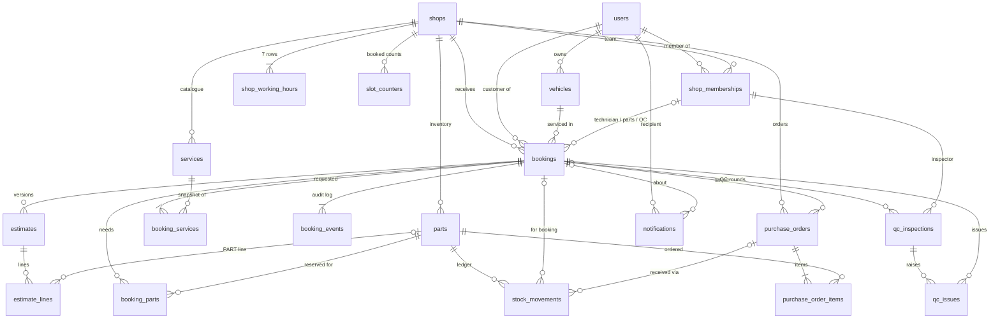

# 02 — Data Model

**Status:** Draft

## Purpose

The complete PostgreSQL schema of the BayFlow modular monolith: every table, column, key, constraint and index; how tenant isolation is enforced inside the database (D20); which rows each operation locks (D30, D37); how the two ledgers stay append-only; and how migrations run. Module specs (`modules/*.md`), the API contract (spec 03), auth (spec 04), seed (spec 11) and tests (spec 12) are built from this file.

Names come from [18-glossary.md](18-glossary.md). [17-decisions.md](17-decisions.md) and [08-booking-state-machine.md](08-booking-state-machine.md) win over anything written here. References: "brief §n" = hackathon brief, "Dn" = decision, "Tnn / On" = rule rows in spec 08, "section n" = a section of this file. Facts about PostgreSQL 16, SQLAlchemy 2.1, asyncpg and Alembic were checked against official docs or source on 2026-10-09 and are linked inline; anything not checked is marked *(unverified)*. The core DDL in this spec was also loaded into PostgreSQL 16.15. Its tenant FKs, partial unique indexes, the main CHECKs and the append-only trigger were exercised (over 90 checks, all passing), and so were the two concurrency patterns of 7.3 and 7.4. The constraints added in the 2026-10-09 consolidation (whole-rupee money checks, `bookings.mileage_km`, notification `recipient_role` / `link`, the bonus tables of 3.21 and the directory index of 3.2) were executed on PostgreSQL 16.15 the same day; see "Change log".

**As built (D84, 2026-10-09).** The whole schema — the 20 core tables and the three bonus tables of 3.21 — is implemented by **one** Alembic baseline, revision `23165172278b` (section 9). Its column types, nullability and defaults equal the column tables below, every non-enum CHECK expression below appears in it verbatim (118 CHECKs in total: 22 enum CHECKs, 19 `_not_blank` CHECKs of 2.4, 77 others), and `alembic check` finds no difference between the models and the migration. `apps/api/tests/db/test_constraints.py` re-proves the main guarantees (tenant FKs, one owner, stock and money CHECKs, enum CHECKs, append-only ledgers, `seq`) on every CI run.

## 1. Database layout

- **One PostgreSQL 16 database** (D12: Railway's managed image, local Docker and CI all use `postgres:16`), **one schema: `public`**, one Alembic history (section 9).
- **No extensions.** `gen_random_uuid()` is built into core PostgreSQL and returns a version 4 UUID ([docs](https://www.postgresql.org/docs/16/functions-uuid.html)); it is used only in hand-written data migrations (section 2). `citext` is not used (see `users`).
- **Each table is owned by exactly one module** (glossary §7). Only the owning module's repositories write it; other modules call its service or react to its events (spec 01). `reporting` reads across tables, read-only.
- **Cross-module foreign keys are intended** (D3 one database, D20 composite FKs). They constrain data and never give another module write access. Extracting a module later would mean replacing its inbound FKs with application checks; that trade-off is accepted.

| Module | Package | Owns | References tables of other modules |
|---|---|---|---|
| identity | `app.modules.identity` | `users` | — |
| shops | `app.modules.shops` | `shops`, `shop_working_hours`, `shop_memberships`, `services` | `users` |
| scheduling | `app.modules.scheduling` | `slot_counters` | `shops` |
| bookings | `app.modules.bookings` | `vehicles`, `bookings`, `booking_services`, `booking_events` | `users`, `shops`, `shop_memberships`, `services` |
| estimates | `app.modules.estimates` | `estimates`, `estimate_lines` | `users`, `bookings`, `parts` |
| inventory | `app.modules.inventory` | `parts`, `stock_movements`, `booking_parts`, `purchase_orders`, `purchase_order_items` | `users`, `shops`, `bookings` |
| qc | `app.modules.qc` | `qc_inspections`, `qc_issues` | `users`, `bookings`, `shop_memberships` |
| notifications | `app.modules.notifications` | `notifications` | `users`, `shops`, `bookings` |
| reporting | `app.modules.reporting` | *(none — read-only queries)* | all, read-only |
| calls *(P2)* | `app.modules.calls` | `call_logs`, `ai_call_summaries`, `tasks` | `users`, `shops`, `bookings` |

## 2. Conventions

| Topic | Rule | Why |
|---|---|---|
| Names | snake_case, plural tables, FKs `<entity>_id`, user FKs `<role>_user_id` (glossary §13); constraint and index names per 2.2 | One spelling everywhere; names are an error-mapping contract |
| Primary keys | `id uuid`, **generated in Python** (`uuid.uuid4()`) and assigned when the row object is created — as built, by the model base's keyword constructor (`app.core.database.Base.__init__` sets `id = uuid4()` when none is given); the column (`app.shared.orm.UUIDPrimaryKeyMixin`) also has the ORM `default=uuid.uuid4` as a fallback; **no DB default**. Exception: `slot_counters` (natural PK, D37) | Services need new ids *before* flushing (event `metadata`, notification links, response bodies), and SQLAlchemy's column `default` only runs at INSERT time ([source](https://github.com/sqlalchemy/sqlalchemy/blob/main/lib/sqlalchemy/sql/schema.py)). One code path for app, seed (D51 runs through services) and tests. v4 per D50 |
| Timestamps | `timestamptz` only; PostgreSQL stores it as UTC ([docs](https://www.postgresql.org/docs/16/datatype-datetime.html)). `time` (no zone) only for shop-local opening hours. Conversions use `zoneinfo` + `shops.timezone` in Python; asyncpg returns offset-aware datetimes ([docs](https://magicstack.github.io/asyncpg/current/usage.html#type-conversion)), so the session `TimeZone` never matters | D38 |
| Action times | Every application-written timestamp comes from the injected clock (D63, `app.shared.clock`: `SystemClock` in production, `SimulatedClock` in the seed and tests). The service reads `clock.now()` **once per action** and assigns that instant to every `*_at`, `created_at` and `updated_at` the action writes, so all columns touched by one action share one instant. An action on an existing booking reads it **right after locking the booking row** (spec 08 step 3; 7.2), so a transaction that waited for that lock gets a later instant than the one it waited for and the timeline order matches the commit order. T01 (no booking yet) reads it at the start; its "slot after now" check uses the same instant. DB defaults (`DEFAULT now()`) remain only as a fallback for hand-written SQL (D63); services never rely on them | Consistent audit trail; back-dated seed data and deterministic tests need one controllable clock (D63) |
| Enums | `varchar(32)` + CHECK listing exactly the Python enum's members, named `ck_<table>_<column>`. Models declare them with `app.shared.orm.enum_type(EnumClass, "<column>")`; migrations render them as `sa.String(length=32)` + exactly one named `sa.CheckConstraint` through the `alembic/env.py` `render_item` hook (section 9, D84) | D29 |
| Money | PKR in **whole rupees** (D41). Type stays `numeric(12,2)` (max 9,999,999,999.00), always holding `.00`, so the JSON contract `"16100.00"` (glossary §9) needs no conversion. Every money column has `CHECK (col >= 0)` (no discounts or refunds in scope) **and** its table's `ck_<table>_whole_rupees`: `col = trunc(col)` (no paisa). Rounding (half-up to whole rupees) happens in the service, never in SQL (2.3) | D41 |
| Quantities | Part quantities `integer` (JSON integers). `estimate_lines.quantity` is `numeric(10,2)` (JSON decimal string with 2 places, e.g. `"1.50"`): integer-valued for `PART` (CHECK), hours for `LABOUR` | Glossary §9 |
| Strings | `varchar(n)` where n = the API's max length (spec 03 must use the same limits). Every required free-text column also gets `ck_<table>_<column>_not_blank`: `btrim(col) <> ''` (generated by `app.shared.orm.not_blank()`; not repeated in section 3 — the as-built list is 2.4) | The DB rejects what the API rejects |
| JSON | `jsonb` with a `jsonb_typeof` CHECK on the top-level shape | Malformed metadata fails loudly |
| Deletion | No hard delete of any referenced row. Deactivate instead: `is_active` (`users`, `shop_memberships`, `services`, `parts`), `is_listed` (`shops`). Bookings, estimates, POs, events and movements are kept forever. Only hard delete: lines of a `DRAFT` estimate replaced by O1 (nothing references them) | History stays explainable (brief §2 "no audit trail") |
| Foreign keys | `ON DELETE RESTRICT` on every FK, default `ON UPDATE NO ACTION` (ids never change), **no CASCADE**. RESTRICT is chosen over the default NO ACTION because NO ACTION may be deferred and RESTRICT may not ([docs](https://www.postgresql.org/docs/16/ddl-constraints.html)) | No code path deletes a referenced row, so an FK error means a bug and must fail on the statement. CASCADE would erase the audit trail brief §7.5 requires |
| Indexes | PostgreSQL does not index referencing columns automatically ([docs](https://www.postgresql.org/docs/16/ddl-constraints.html)). Parents are never deleted, so FK columns are indexed **only where a query needs it**. Every index below names the screen or query it serves | Small, explainable index set |

### 2.1 Standard columns (left out of the column tables below)

| Column | Definition | Exceptions |
|---|---|---|
| `id` | `uuid NOT NULL`, PK `pk_<table>` | `slot_counters` has no `id` |
| `created_at` | `timestamptz NOT NULL DEFAULT now()`. The service always assigns the action's clock instant (D63, section 2 "Action times"); the DB default is only a fallback for hand-written SQL | No exceptions. The ledgers `booking_events` and `stock_movements` use the same rule, and because several rows written by one action share one instant (and random UUIDs keep no insert order), they also carry **`seq bigint GENERATED ALWAYS AS IDENTITY`** (D79): their lists and running balances are ordered by **`(created_at, seq)`**. Invariant checks never depend on the order of rows within one action (DI-1…DI-3 are sums) |
| `updated_at` | `timestamptz NOT NULL DEFAULT now()` (fallback); set from the clock (D63) on every change: the ORM `default` and `onupdate` are the clock's `utcnow` (a Python-side callable, so the new value is on the object after flush without a refetch; checked with SQLAlchemy 2.0.51, as built with 2.1.4 in `app.shared.orm.TimestampMixin`; `created_at` comes from `CreatedAtMixin` the same way). `onupdate` is only the safety net: services stamp every change with `app.shared.orm.touch(row, now)`, the action's single instant, because SQLAlchemy leaves a column set to its current value out of the `UPDATE` and `onupdate` would then read the clock a second time when one action updates a row twice (found by a stepping-clock test, 2026-10-09) | Absent on rows that never change: `booking_services`, `booking_events`, `estimate_lines`, `stock_movements`, `notifications` (only `read_at` changes), `ai_call_summaries` |
| `shop_id` | `uuid NOT NULL` on every shop-owned table | Root tables (`shop_working_hours`, `shop_memberships`, `services`, `slot_counters`, `bookings`, `parts`, `purchase_orders`, `tasks`) list it in their column table with an FK to `shops (id)`. Child tables do not list it; it appears in their composite FKs (section 4), which also prove the shop exists |

### 2.2 Constraint and index naming

```python
# app/core/database.py
NAMING_CONVENTION = {
    "pk": "pk_%(table_name)s",
    "fk": "fk_%(table_name)s_%(column_0_N_name)s_%(referred_table_name)s",
    "uq": "uq_%(table_name)s_%(column_0_N_name)s",
    "ck": "ck_%(table_name)s_%(constraint_name)s",
    "ix": "ix_%(table_name)s_%(column_0_N_name)s",
}

class Base(DeclarativeBase):
    metadata = MetaData(naming_convention=NAMING_CONVENTION)
```

`%(column_0_N_name)s` joins all columns with `_`. Names longer than PostgreSQL's 63-character limit are shortened deterministically with an md5 suffix ([docs](https://docs.sqlalchemy.org/en/21/core/constraints.html#configuring-constraint-naming-conventions)). Partial and expression indexes always get an explicit name (listed below). The API maps integrity errors to error codes by constraint name (section 7.6). SQLAlchemy's asyncpg adapter re-raises driver errors `from` the asyncpg exception and copies its `sqlstate` ([source](https://github.com/sqlalchemy/sqlalchemy/blob/main/lib/sqlalchemy/dialects/postgresql/asyncpg.py)). asyncpg errors carry `constraint_name` ([source](https://github.com/MagicStack/asyncpg/blob/master/asyncpg/exceptions/_base.py)).

### 2.3 ORM mapping rules (SQLAlchemy 2.1 + asyncpg)

| Concern | Rule | Source |
|---|---|---|
| UUID | `Uuid` type (`as_uuid=True` is the default since 2.0); native `uuid` column | [source](https://github.com/sqlalchemy/sqlalchemy/blob/main/lib/sqlalchemy/sql/sqltypes.py) |
| Enums | `Enum(PyEnum, native_enum=False, create_constraint=True, length=32, name="<column>", validate_strings=True, values_callable=…)` — as built, `app.shared.orm.enum_type(PyEnum, "<column>")` — with every `PyEnum` a `StrEnum` from `app.shared.enums` (D74). **`create_constraint` defaults to False since 1.4**, so without it no CHECK is created. The type's `name` becomes `%(constraint_name)s`, which gives `ck_<table>_<column>`. `values_callable` persists the member *values* (by default Enum persists names; ours are equal anyway, glossary §13). In migrations the type is rendered as `String(32)` + one named CHECK by the `render_item` hook (section 9), because Alembic 1.20 with SQLAlchemy 2.1.4 would otherwise emit every such CHECK twice (D84) | [docs](https://docs.sqlalchemy.org/en/21/core/type_basics.html#sqlalchemy.types.Enum) |
| Money | `Numeric(12, 2)` maps to `Decimal`; asyncpg returns `numeric` as `Decimal` | [docs](https://magicstack.github.io/asyncpg/current/usage.html#type-conversion) |
| Server values | Every mapper uses `eager_defaults=True`. The default `"auto"` fetches INSERT defaults with RETURNING, but values the database generates on UPDATE are fetched only with `True`. Otherwise they are expired and lazy-loaded, which is implicit IO and fails under asyncio. Ids and timestamps are Python-side (D50, D63); the one value the database always generates is the ledgers' `seq` identity (D79), which is returned with RETURNING on insert. Otherwise this is a safety net for the remaining server defaults (e.g. a `DEFAULT now()` fallback reached by an ORM write that forgot to set a value) | [docs](https://docs.sqlalchemy.org/en/21/orm/persistence_techniques.html#fetching-server-generated-defaults) |
| Identity | `mapped_column(BigInteger, Identity(always=True), unique=True)` renders `seq BIGINT GENERATED ALWAYS AS IDENTITY` plus `uq_<table>_seq` (checked: SQLAlchemy 2.0.51 DDL output; PostgreSQL 16.15 then rejects an explicit value, *"Column "seq" is an identity column defined as GENERATED ALWAYS"*). Identity columns are implicitly `NOT NULL`. As built (SQLAlchemy 2.1.4): `booking_events.seq` and `stock_movements.seq` are exactly this, the baseline renders `sa.Column("seq", sa.BigInteger(), sa.Identity(always=True), nullable=False)` with `uq_booking_events_seq` / `uq_stock_movements_seq`, and `test_seq_is_generated_by_the_database_only` proves an explicit value is refused | [docs](https://docs.sqlalchemy.org/en/21/core/defaults.html#identity-ddl) |
| Sessions | `async_sessionmaker(expire_on_commit=False)` | [docs](https://docs.sqlalchemy.org/en/21/orm/extensions/asyncio.html) |
| Row locks | `select(...).with_for_update()`. Add `.execution_options(populate_existing=True)` when the object may already be in the session; it overwrites the loaded object with the freshly selected row | [docs](https://docs.sqlalchemy.org/en/21/orm/queryguide/api.html#populate-existing) |
| Savepoints | `async with session.begin_nested():` emits SAVEPOINT | [source](https://github.com/sqlalchemy/sqlalchemy/blob/main/lib/sqlalchemy/ext/asyncio/session.py) |
| Rounding | Whole rupees (D41): `line_total = (quantity * unit_price).quantize(Decimal("1"), rounding=ROUND_HALF_UP)`, stored as `numeric(12,2)` (`.00`). PostgreSQL `round(numeric)` rounds to the nearest integer and breaks ties away from zero ([docs](https://www.postgresql.org/docs/16/functions-math.html)), while Python's default context is `ROUND_HALF_EVEN` (checked on Python 3.12: `Decimal("2498.5")` → `2498` by default, `2499` with HALF_UP; PostgreSQL 16.15 `round(0.50 * 4997.00)` → `2499`). For our non-negative values HALF_UP matches the DB CHECK `ck_estimate_lines_line_total` | — |

### 2.4 `_not_blank` CHECKs (as built, D84)

`app.shared.orm.not_blank("<column>")` adds `CHECK (btrim(<column>) <> '')` named `ck_<table>_<column>_not_blank` to every required free-text column. The baseline (section 9) creates exactly these 19:

| Table | Columns with `ck_<table>_<column>_not_blank` |
|---|---|
| `users` | `full_name` |
| `shops` | `name`, `address`, `city`, `phone` |
| `services` | `name` |
| `vehicles` | `registration_number`, `make`, `model` |
| `booking_services` | `name_snapshot` |
| `estimate_lines` | `description` |
| `parts` | `name` |
| `qc_issues` | `title`, `description` |
| `notifications` | `title`, `body` |
| *(bonus)* `ai_call_summaries` | `intent`, `details` |
| *(bonus)* `tasks` | `title` |

Columns without one, by design: those whose own format CHECK already rejects a blank (`users.email`, `shops.slug`, `parts.sku`, `vehicles.registration_key`, `bookings.reference`, `purchase_orders.po_number`, `notifications.link`), values the API generates or validates itself (`users.password_hash`, `shops.timezone`, `call_logs.room_name`, `ai_call_summaries.language`), and nullable free text. A violation is a 500 like any unmapped constraint (7.6): the API's own validation rejects blank values with 422 first.

## 3. Tables

The standard columns from 2.1 are not repeated. "FK" means `ON DELETE RESTRICT`. Composite tenant FKs are listed per table and summarised in section 4.

### 3.1 `users` — identity

One login account (glossary §1). Customer, staff and owner are all `users`; roles live in `shop_memberships`.

| Column | Type | Null | Default | Notes |
|---|---|---|---|---|
| `email` | `varchar(254)` | no | | The login identifier. Validated and normalised by the project `Email` type (D62, `app.shared.email`): `email_validator.validate_email(value, check_deliverability=False, test_environment=True)`, then the whole address is lower-cased. Demo accounts use the reserved `.test` domain (glossary §14), which Pydantic's `EmailStr` would reject (spec 04) |
| `password_hash` | `varchar(255)` | no | | Argon2id encoded hash (D10); never serialised |
| `full_name` | `varchar(120)` | no | | |
| `phone` | `varchar(20)` | yes | | Optional (D33); format validated by the API; only filled if empty for existing accounts |
| `is_active` | `boolean` | no | `true` | Re-read on every request (D9) |
| `last_login_at` | `timestamptz` | yes | | Set on successful login |

- **Keys:** `uq_users_email (email)`.
- **Checks:** `ck_users_email_lowercase`: `email = lower(email)`; `ck_users_email_shape`: `email LIKE '_%@_%'`.
- **Indexes:** `uq_users_email` serves login (brief §7.1), the wizard account rule (D32) and adding staff by e-mail (D18). `ix_users_phone (phone) WHERE phone IS NOT NULL` serves the P2 AI caller lookup (brief §8.2); like the bonus tables it is created by the baseline revision (D84, section 9).
- **Case-insensitive e-mail.** We chose "unique on `lower(email)`", implemented as a normalised column. The API lower-cases the address on write and on lookup (the `Email` type, D62; email-validator itself lower-cases only the domain), and `ck_users_email_lowercase` makes any other spelling impossible to store. So the plain `uq_users_email` is exactly "unique on `lower(email)`", and a plain `email = :email` lookup is correct and uses the index. **Rejected:** `citext`, because it needs an extension, its own docs recommend nondeterministic collations instead, its case folding follows the database's `LC_CTYPE`, and it is slower than `text` ([docs](https://www.postgresql.org/docs/16/citext.html)). Also rejected: a bare expression index on `lower(email)`. It is correct, but every query must remember to wrap `lower()` or it silently misses the index.

### 3.2 `shops` — shops

| Column | Type | Null | Default | Notes |
|---|---|---|---|---|
| `name` | `varchar(120)` | no | | brief §7.2 |
| `slug` | `varchar(80)` | no | | URL key for public pages, derived from the name (the shops module adds `-2`, `-3` on collision) |
| `address` | `varchar(255)` | no | | brief §7.2 |
| `city` | `varchar(80)` | no | | Landing-page city filter (brief §7.3) |
| `phone` | `varchar(20)` | no | | brief §7.2 |
| `timezone` | `varchar(64)` | no | `'Asia/Karachi'` | IANA name, validated by the API with `zoneinfo` (D38). There is no CHECK: validating a zone name needs a catalog lookup, and CHECKs cannot contain subqueries ([docs](https://www.postgresql.org/docs/16/sql-createtable.html)) |
| `slot_duration_minutes` | `integer` | no | `60` | Step of the slot grid, which is anchored at local midnight in `timezone` (D37) |
| `slot_capacity` | `integer` | no | `1` | Max bookings starting in one slot (glossary §1); free places in a slot are `remaining` (D68) |
| `logo_url` | `varchar(2048)` | yes | | Optional; UI falls back to initials (D55) |
| `rating` | `numeric(2,1)` | yes | | Seeded placeholder; null shows "New" (D56) |
| `is_listed` | `boolean` | no | `true` | The public directory shows a shop only when `is_listed` **and** it has at least one active service (D64); T01 applies the same guard |

- **Keys:** `uq_shops_slug (slug)`.
- **Checks:** `ck_shops_slug_format`: `slug ~ '^[a-z0-9]+(-[a-z0-9]+)*$'`; `ck_shops_slot_duration`: `slot_duration_minutes BETWEEN 15 AND 240 AND slot_duration_minutes % 15 = 0`; `ck_shops_slot_capacity`: `slot_capacity BETWEEN 1 AND 50`; `ck_shops_logo_url_https`: `logo_url IS NULL OR logo_url LIKE 'https://%'`; `ck_shops_rating_range`: `rating IS NULL OR rating BETWEEN 0 AND 5`.
- **Indexes:** `uq_shops_slug` serves the public shop page (public routes use the slug, D68). **`ix_shops_listed_city_name`**: `(city, name) WHERE is_listed` serves the public directory (brief §7.3, D64): listed shops, optional city filter, ordered by name. The "at least one active service" condition is an `EXISTS` on `services` that uses `uq_services_active_name` (leading `shop_id`, predicate `is_active`, 3.5). Checked on PostgreSQL 16.15 with sequential scans disabled: the plan is an index scan on `ix_shops_listed_city_name` plus an index-only scan on `uq_services_active_name`. Name search (`ILIKE`) filters that small result.
- **Grid changes (D37, service rules — a CHECK cannot see other tables).** Changing `slot_duration_minutes` or `timezone` is **blocked with 409 `CONFLICT`** while the shop has future non-cancelled bookings, because existing `slot_counters` rows and `bookings.slot_start` values sit on the old grid. The shops service locks this row `FOR UPDATE` and publishes `ShopGridChanging`; the bookings module vetoes the change when future bookings exist (spec 01). Booking creation (T01) holds the same row `FOR SHARE` while it checks the slot and creates the booking, so a grid change and a new booking can never interleave (7.1, 7.2). When allowed, a duration change must also keep every working-hours time on the new grid (422 `VALIDATION_ERROR`, 3.3). `slot_capacity` and working-hours changes are always allowed; existing bookings are kept.
- The Owner is **not** a column. It is the shop's single `OWNER` membership (3.4), so there is no duplicated owner pointer to drift.

### 3.3 `shop_working_hours` — shops

| Column | Type | Null | Default | Notes |
|---|---|---|---|---|
| `shop_id` | `uuid` | no | | FK → `shops` |
| `weekday` | `smallint` | no | | `0` = Monday … `6` = Sunday (glossary §5) |
| `is_closed` | `boolean` | no | `false` | |
| `opens_at` | `time` | yes | | Shop-local wall-clock time (D38); ignored when closed |
| `closes_at` | `time` | yes | | The last slot must end by this time (D37) |

- **Keys:** `uq_shop_working_hours_shop_id_weekday (shop_id, weekday)`. It serves slot computation (D37) and the hours editor.
- **Checks:** `ck_shop_working_hours_weekday`: `weekday BETWEEN 0 AND 6`; `ck_shop_working_hours_open_times`: `is_closed OR (opens_at IS NOT NULL AND closes_at IS NOT NULL AND closes_at > opens_at)`. Overnight opening hours are not supported.
- **On the grid (D37, service-level validation).** The grid is anchored at local midnight, so `opens_at` and `closes_at` must lie on it: their minutes since midnight are multiples of `shops.slot_duration_minutes` (otherwise 422 `VALIDATION_ERROR`). Working hours only select which grid slots are open, and the last slot ends exactly at `closes_at`. A CHECK cannot enforce this, because the step lives on `shops`. Working-hours edits are always allowed; existing bookings are kept (D37).
- The shops service creates all 7 rows together with the shop. Python's `date.weekday()` uses the same numbering (Monday = 0). In SQL use `EXTRACT(ISODOW FROM d) - 1`, never `DOW`, whose Sunday is 0 ([docs](https://www.postgresql.org/docs/16/functions-datetime.html)).

### 3.4 `shop_memberships` — shops

| Column | Type | Null | Default | Notes |
|---|---|---|---|---|
| `shop_id` | `uuid` | no | | FK → `shops` |
| `user_id` | `uuid` | no | | FK → `users` |
| `role` | `varchar(32)` | no | | `MembershipRole` |
| `is_active` | `boolean` | no | `true` | Deactivation takes effect immediately (D9, D19) |
| `created_by_user_id` | `uuid` | no | | FK → `users`: the Owner who added the member (for the `OWNER` row, the Owner themself) |

- **Keys:** `uq_shop_memberships_shop_id_user_id (shop_id, user_id)`: one role per user per shop (D15). It is also the target of the staff-assignment FKs (4.4).
- **`uq_shop_memberships_one_owner_per_shop`**: `CREATE UNIQUE INDEX … ON shop_memberships (shop_id) WHERE role = 'OWNER'`, a partial unique index ([docs](https://www.postgresql.org/docs/16/indexes-partial.html)) that allows **at most one** Owner. "At least one" holds because the shop and its `OWNER` row are inserted in one transaction, and the service never re-roles that row (D19).
- **Checks:** `ck_shop_memberships_role` (enum); `ck_shop_memberships_owner_active`: `role <> 'OWNER' OR is_active` (D19).

| Index | Definition | Serves |
|---|---|---|
| `uq_shop_memberships_shop_id_user_id` | unique key | The per-request membership dependency (D20); team list (brief §7.4 Owner) |
| `ix_shop_memberships_user_active` | `(user_id) WHERE is_active` | Shop switcher / "my shops" (brief §7.2) |
| `ix_shop_memberships_shop_role_active` | `(shop_id, role) WHERE is_active` | "SAs of the shop" (D26); technician and parts-person pickers (422 `MEMBER_NOT_ELIGIBLE`); `QC_REQUESTED` recipients |

### 3.5 `services` — shops

| Column | Type | Null | Default | Notes |
|---|---|---|---|---|
| `shop_id` | `uuid` | no | | FK → `shops` |
| `name` | `varchar(120)` | no | | |
| `description` | `varchar(1000)` | yes | | |
| `estimated_duration_minutes` | `integer` | no | | Informational (brief §7.2); does not change the slot length |
| `base_price` | `numeric(12,2)` | yes | | Optional (brief §7.2); whole rupees (D41) |
| `is_active` | `boolean` | no | `true` | Inactive = hidden from the wizard and kept for history |

- **Keys:** `uq_services_shop_id_id (shop_id, id)`. It is the composite-FK target (section 4) and serves "active services of shop X" (wizard step 2, landing "services offered", owner catalogue).
- **`uq_services_active_name`**: `UNIQUE INDEX (shop_id, lower(name)) WHERE is_active` → 409 `CONFLICT`. It also serves the directory's "has an active service" `EXISTS` (D64, 3.2).
- **Checks:** `ck_services_duration`: `estimated_duration_minutes BETWEEN 5 AND 10080`; `ck_services_base_price`: `base_price IS NULL OR base_price >= 0`; `ck_services_whole_rupees`: `base_price IS NULL OR base_price = trunc(base_price)` (D41).

### 3.6 `slot_counters` — scheduling

| Column | Type | Null | Default | Notes |
|---|---|---|---|---|
| `shop_id` | `uuid` | no | | FK → `shops` |
| `slot_start` | `timestamptz` | no | | UTC instant of a grid slot start (D37) |
| `booked_count` | `integer` | no | `0` | Non-cancelled bookings that start in this slot |

- **PK:** `pk_slot_counters (shop_id, slot_start)`. This natural key is the only exception to the `id` rule (D37). The PK serves the slot-picker range scan (`shop_id = ? AND slot_start >= ? AND slot_start < ?`, brief §7.3) and the row lock (7.4).
- **Check:** `ck_slot_counters_booked_count_non_negative`: `booked_count >= 0` (D37). Capacity is checked by the service under the row lock, because it lives on `shops` and a CHECK cannot read another table. Lowering `slot_capacity` never invalidates existing bookings.
- Rows are created lazily by a slot's first booking and are never deleted.

### 3.7 `vehicles` — bookings

| Column | Type | Null | Default | Notes |
|---|---|---|---|---|
| `owner_user_id` | `uuid` | no | | FK → `users`: the customer (D35) |
| `registration_number` | `varchar(20)` | no | | As typed and trimmed, e.g. `LEA-1234` |
| `registration_key` | `varchar(20)` | no | | Normalised: upper case, spaces and dashes removed, e.g. `LEA1234` (D35) |
| `make` | `varchar(60)` | no | | |
| `model` | `varchar(60)` | no | | |
| `year` | `smallint` | no | | The API also enforces ≤ current year + 1 |
| `color` | `varchar(30)` | yes | | |
| `mileage_km` | `integer` | yes | | |

- **Keys:** `uq_vehicles_owner_user_id_registration_key` (D35); `uq_vehicles_owner_user_id_id (owner_user_id, id)`. The second is the target of `bookings (customer_user_id, vehicle_id)`, so a booking can only use **its own customer's** vehicle.
- **Checks:** `ck_vehicles_registration_key`: `registration_key = upper(regexp_replace(registration_number, '[[:space:]-]', '', 'g')) AND registration_key ~ '^[A-Z0-9]{2,20}$'`. The DB re-derives the key, so the app and the DB can never disagree. `ck_vehicles_year`: `year BETWEEN 1900 AND 2100` (static bounds; PostgreSQL assumes CHECKs are immutable, so no `now()`, [docs](https://www.postgresql.org/docs/16/ddl-constraints.html)). `ck_vehicles_mileage`: `mileage_km IS NULL OR mileage_km BETWEEN 0 AND 2000000`.
- **Write path (T01):** `INSERT … ON CONFLICT (owner_user_id, registration_key) DO UPDATE … RETURNING id`, an atomic upsert even under concurrency ([docs](https://www.postgresql.org/docs/16/sql-insert.html)). The bookings module decides which fields are overwritten.

### 3.8 `bookings` — bookings

| Column | Type | Null | Default | Notes |
|---|---|---|---|---|
| `shop_id` | `uuid` | no | | FK → `shops` |
| `reference` | `varchar(9)` | no | | `BF-XXXXXX` (glossary §1); unique across shops (phone/AI lookup) |
| `customer_user_id` | `uuid` | no | | FK → `users` |
| `vehicle_id` | `uuid` | no | | FK `(customer_user_id, vehicle_id)` → `vehicles (owner_user_id, id)` |
| `mileage_km` | `integer` | yes | | Mileage given in the wizard, snapshotted at booking time (D65). `vehicles.mileage_km` is overwritten on re-booking (D35), so history lives here |
| `slot_start` | `timestamptz` | no | | |
| `slot_end` | `timestamptz` | no | | `slot_start` + the shop's `slot_duration_minutes` at booking time; later setting changes do not move it |
| `status` | `varchar(32)` | no | `'PENDING'` | `BookingStatus` (17 values) |
| `technician_user_id` | `uuid` | yes | | FK `(shop_id, technician_user_id)` → `shop_memberships (shop_id, user_id)` |
| `parts_person_user_id` | `uuid` | yes | | Same pattern |
| `qc_inspector_user_id` | `uuid` | yes | | Same pattern; the current QC picker (T18) |
| `customer_notes` | `varchar(2000)` | yes | | Wizard free text (brief §5.1) |
| `inspection_notes` | `varchar(4000)` | yes | | Technician (T06) |
| `repair_started_at` | `timestamptz` | yes | | O2; overwritten on each repair round |
| `ready_notified_at` | `timestamptz` | yes | | O3; the last "vehicle ready" message (D27) |
| `completed_at` | `timestamptz` | yes | | T21 |
| `cancelled_at` | `timestamptz` | yes | | T03, T22 |
| `cancelled_by_user_id` | `uuid` | yes | | FK → `users` (customer or staff) |
| `cancel_reason` | `varchar(500)` | yes | | Required from staff (service rule, T03/T22) |
| `version` | `integer` | no | `1` | +1 **whenever a `booking_events` row is written** (every audited transition and operation, including an estimate edit that creates a new version); plain draft saves do not bump it (D30). Compared with `expected_version` → 409 `CONCURRENT_UPDATE` |

Other milestone times (confirmed, inspection started, sent to QC …) are **not** columns. They are `booking_events.created_at` values (spec 08 principle 5). For that reason `inspection_started_at` is not added.

- **Keys:** `uq_bookings_reference (reference)`; `uq_bookings_shop_id_id (shop_id, id)` (composite-FK target).
- **Checks.** The last six mirror spec 08 side effects and D47, so a buggy service cannot persist an impossible booking:

| Check | Expression |
|---|---|
| `ck_bookings_status` | `status IN ('PENDING', 'CONFIRMED', 'ASSIGNED', 'INSPECTING', 'ESTIMATE_REVIEW', 'AWAITING_CUSTOMER', 'ESTIMATE_APPROVED', 'ESTIMATE_REJECTED', 'PARTS_PENDING', 'PARTS_ORDERED', 'PARTS_READY', 'IN_REPAIR', 'QC_PENDING', 'QC_IN_PROGRESS', 'READY_FOR_PICKUP', 'COMPLETED', 'CANCELLED')` |
| `ck_bookings_reference_format` | `reference ~ '^BF-[0-9A-HJKMNP-TV-Z]{6}$'` (Crockford base32) |
| `ck_bookings_slot_order` | `slot_end > slot_start` |
| `ck_bookings_version_positive` | `version >= 1` |
| `ck_bookings_mileage_km` | `mileage_km IS NULL OR mileage_km BETWEEN 0 AND 2000000` (D65; same bounds as `ck_vehicles_mileage`, since both come from one wizard field) |
| `ck_bookings_cancellation_fields` | `((status = 'CANCELLED') = (cancelled_at IS NOT NULL)) AND ((cancelled_at IS NULL) = (cancelled_by_user_id IS NULL)) AND (cancel_reason IS NULL OR cancelled_at IS NOT NULL)` |
| `ck_bookings_completion_fields` | `(status = 'COMPLETED') = (completed_at IS NOT NULL)` |
| `ck_bookings_technician_required` | `technician_user_id IS NOT NULL OR status IN ('PENDING', 'CONFIRMED', 'CANCELLED')` (set by T04) |
| `ck_bookings_parts_person_required` | `parts_person_user_id IS NOT NULL OR status IN ('PENDING', 'CONFIRMED', 'ASSIGNED', 'INSPECTING', 'ESTIMATE_REVIEW', 'AWAITING_CUSTOMER', 'ESTIMATE_APPROVED', 'ESTIMATE_REJECTED', 'CANCELLED')` (set by T12) |
| `ck_bookings_qc_picker` | `(qc_inspector_user_id IS NOT NULL) = (status IN ('QC_IN_PROGRESS', 'READY_FOR_PICKUP', 'COMPLETED'))` (set by T18, cleared by T17/T20, kept by T19) |
| `ck_bookings_qc_picker_not_technician` | `qc_inspector_user_id IS NULL OR qc_inspector_user_id <> technician_user_id` (D47; the service answers 403 `FORBIDDEN` first, T18) |

| Index | Definition | Serves |
|---|---|---|
| `ix_bookings_shop_id_status_slot_start` | `(shop_id, status, slot_start)` | SA/Owner list filtered by status (brief §7.4); Owner "bookings by status"; QC queue (`status IN ('QC_PENDING', 'QC_IN_PROGRESS')`) |
| `ix_bookings_shop_id_slot_start` | `(shop_id, slot_start)` | SA schedule by date; slot-counter reconciliation (DI-4) |
| `ix_bookings_customer_user_id_slot_start` | `(customer_user_id, slot_start)` | Customer dashboard (brief §7.3) |
| `ix_bookings_technician_jobs` | `(shop_id, technician_user_id, status) WHERE technician_user_id IS NOT NULL` | Technician "my assigned jobs" (D21) |
| `ix_bookings_parts_person_jobs` | `(shop_id, parts_person_user_id, status) WHERE parts_person_user_id IS NOT NULL` | Parts Person "jobs awaiting parts" (brief §7.4) |
| `uq_bookings_reference` | unique key | Lookup by reference (support; P2 AI Front Desk) |

### 3.9 `booking_services` — bookings

| Column | Type | Null | Default | Notes |
|---|---|---|---|---|
| `booking_id` | `uuid` | no | | FK `(shop_id, booking_id)` → `bookings (shop_id, id)` |
| `service_id` | `uuid` | no | | FK `(shop_id, service_id)` → `services (shop_id, id)` |
| `name_snapshot` | `varchar(120)` | no | | D34 |
| `base_price_snapshot` | `numeric(12,2)` | yes | | D34 |

- **Keys:** `uq_booking_services_booking_id_service_id`. It serves booking detail and the service chips in lists. **Checks:** `ck_booking_services_price`: `base_price_snapshot IS NULL OR base_price_snapshot >= 0`; `ck_booking_services_whole_rupees`: `base_price_snapshot IS NULL OR base_price_snapshot = trunc(base_price_snapshot)` (D41).
- Immutable after insert. "At least one row per booking" is a T01 service rule.

### 3.10 `booking_events` — bookings (append-only, section 8)

| Column | Type | Null | Default | Notes |
|---|---|---|---|---|
| `seq` | `bigint` | no | `GENERATED ALWAYS AS IDENTITY` | Insert-order tie-breaker (D79); unique; never set by the application |
| `booking_id` | `uuid` | no | | FK `(shop_id, booking_id)` → `bookings (shop_id, id)` |
| `action` | `varchar(32)` | no | | `BookingAction` (27 values, glossary §4, including P1) |
| `from_status` | `varchar(32)` | yes | | `NULL` only for `CREATE` |
| `to_status` | `varchar(32)` | no | | Equals `from_status` for operations |
| `actor_user_id` | `uuid` | yes | | FK → `users`; `NULL` only for `SYSTEM` |
| `actor_role` | `varchar(32)` | no | | `ActorRole` |
| `note` | `varchar(2000)` | yes | | Reason, repair notes, return note |
| `metadata` | `jsonb` | no | `'{}'` | Shapes in spec 08 ("`booking_events.metadata` examples") |
| `created_at` | `timestamptz` | no | `now()` (fallback only) | Standard column, listed because the timeline depends on it: the action's clock instant (D63), read after the booking lock (section 2 "Action times") |

- **Checks:** `ck_booking_events_action`, `ck_booking_events_from_status`, `ck_booking_events_to_status`, `ck_booking_events_actor_role` (enums); `ck_booking_events_create_from`: `(action = 'CREATE') = (from_status IS NULL)`; `ck_booking_events_operation_status`: `action NOT IN ('EDIT_ESTIMATE', 'START_REPAIR', 'NOTIFY_READY', 'REASSIGN_TECHNICIAN', 'REASSIGN_PARTS_PERSON') OR from_status = to_status`; `ck_booking_events_actor`: `actor_user_id IS NOT NULL OR actor_role = 'SYSTEM'`; `ck_booking_events_metadata_object`: `jsonb_typeof(metadata) = 'object'` ([docs](https://www.postgresql.org/docs/16/functions-json.html)).
- **Keys:** `uq_booking_events_seq (seq)`.
- **Index:** `ix_booking_events_booking_id_created_at_seq (booking_id, created_at, seq)`. It serves the live status timeline (brief §7.3) and the audit history (brief §7.5), read with `ORDER BY created_at, seq` (D79). Every action on a booking holds the booking lock while it inserts its event, so per booking the `(created_at, seq)` order is also the commit order.

### 3.11 `estimates` — estimates

| Column | Type | Null | Default | Notes |
|---|---|---|---|---|
| `booking_id` | `uuid` | no | | FK `(shop_id, booking_id)` → `bookings (shop_id, id)` |
| `version` | `integer` | no | | 1, 2, 3 …: the revision count (brief §7.5, D39) |
| `status` | `varchar(32)` | no | `'DRAFT'` | `EstimateStatus` |
| `parts_total` | `numeric(12,2)` | no | `0` | Cached Σ of `PART` line totals (section 6) |
| `labour_total` | `numeric(12,2)` | no | `0` | Cached Σ of `LABOUR` line totals |
| `grand_total` | `numeric(12,2)` | no | `0` | `parts_total + labour_total` |
| `created_by_user_id` | `uuid` | no | | FK → `users`: the actor whose action created this version |
| `submitted_at` | `timestamptz` | yes | | T06 |
| `sent_at` | `timestamptz` | yes | | T07 |
| `sent_by_user_id` | `uuid` | yes | | FK → `users` |
| `decided_at` | `timestamptz` | yes | | T08/T09: the timestamped acceptance (brief §3) |
| `decided_by_user_id` | `uuid` | yes | | FK → `users` (the customer) |
| `customer_note` | `varchar(500)` | yes | | Rejection reason (T09) |

- **Keys:** `uq_estimates_booking_id_version (booking_id, version)`; `uq_estimates_shop_id_id (shop_id, id)`.
- **`uq_estimates_one_open_version_per_booking`**: `UNIQUE INDEX (booking_id) WHERE status IN ('DRAFT', 'SUBMITTED', 'SENT')`. This enforces spec 08: "Only one version per booking can be DRAFT, SUBMITTED or SENT at a time."
- **`uq_estimates_one_approved_per_booking`**: `UNIQUE INDEX (booking_id) WHERE status = 'APPROVED'`. T12 reads "the approved version", and there is never more than one.
- **Checks:** `ck_estimates_status` (enum); `ck_estimates_version_positive`: `version >= 1`; `ck_estimates_totals`: `parts_total >= 0 AND labour_total >= 0 AND grand_total = parts_total + labour_total`; `ck_estimates_whole_rupees`: `parts_total = trunc(parts_total) AND labour_total = trunc(labour_total) AND grand_total = trunc(grand_total)` (D41); `ck_estimates_submitted_fields`: `status <> 'SUBMITTED' OR submitted_at IS NOT NULL`; `ck_estimates_sent_fields`: `((sent_at IS NULL) = (sent_by_user_id IS NULL)) AND (status NOT IN ('SENT', 'APPROVED', 'REJECTED') OR sent_at IS NOT NULL)`; `ck_estimates_decision_fields`: `((status IN ('APPROVED', 'REJECTED')) = (decided_at IS NOT NULL)) AND ((decided_at IS NULL) = (decided_by_user_id IS NULL)) AND (customer_note IS NULL OR decided_at IS NOT NULL)`.
- **Indexes:** `uq_estimates_booking_id_version` serves the version list and "latest version" (`ORDER BY version DESC LIMIT 1`). The two partial unique indexes serve "current open version" and "approved version".
- Immutability of `SENT`/`APPROVED`/`REJECTED`/`SUPERSEDED` versions (D39) is a service rule (409 `ESTIMATE_LOCKED`). See 7.6 for the required statement order when superseding.
- **T07 and the open-version index.** `SEND_ESTIMATE` marks the single open version `SENT`. Older versions were already `SUPERSEDED` when the SA's edit created a new version (O1, spec 08 T07), so a send never needs a second open version and `uq_estimates_one_open_version_per_booking` never blocks it. T22 moves a non-final version (`DRAFT`, `SUBMITTED`, `SENT`) to `SUPERSEDED`; the CHECKs above allow that (a superseded `SENT` version keeps `sent_at`).

### 3.12 `estimate_lines` — estimates

| Column | Type | Null | Default | Notes |
|---|---|---|---|---|
| `estimate_id` | `uuid` | no | | FK `(shop_id, estimate_id)` → `estimates (shop_id, id)` |
| `position` | `smallint` | no | | 1-based display order; 1–50 lines (O1) |
| `line_type` | `varchar(32)` | no | | `EstimateLineType` |
| `part_id` | `uuid` | yes | | Required iff `PART`; FK `(shop_id, part_id)` → `parts (shop_id, id)` |
| `description` | `varchar(255)` | no | | `LABOUR`: free text. `PART`: the service copies `parts.name`, so an approved estimate never changes when the catalogue is edited |
| `quantity` | `numeric(10,2)` | no | | `PART`: integer 1–9999. `LABOUR`: hours 0.01–999.99 (O1) |
| `unit_price` | `numeric(12,2)` | no | | Whole rupees (D41). `PART` defaults to `parts.unit_cost`, editable (D40) |
| `line_total` | `numeric(12,2)` | no | | `quantity × unit_price` rounded half-up to whole rupees (D41, 2.3) |

- **Keys:** `uq_estimate_lines_estimate_id_position`. It serves "lines of an estimate, in order". The same part may appear on several lines; T12 sums them per `part_id`.
- **Checks:** `ck_estimate_lines_line_type` (enum); `ck_estimate_lines_position`: `position BETWEEN 1 AND 50`; `ck_estimate_lines_part_ref`: `(line_type = 'PART') = (part_id IS NOT NULL)`; `ck_estimate_lines_part_quantity`: `line_type <> 'PART' OR (quantity = trunc(quantity) AND quantity BETWEEN 1 AND 9999)`; `ck_estimate_lines_labour_quantity`: `line_type <> 'LABOUR' OR quantity BETWEEN 0.01 AND 999.99`; `ck_estimate_lines_unit_price`: `unit_price >= 0`; `ck_estimate_lines_line_total`: `line_total = round(quantity * unit_price)` (whole rupees; Python rounding rule in 2.3); `ck_estimate_lines_whole_rupees`: `unit_price = trunc(unit_price) AND line_total = trunc(line_total)` (D41).

### 3.13 `parts` — inventory

| Column | Type | Null | Default | Notes |
|---|---|---|---|---|
| `shop_id` | `uuid` | no | | FK → `shops` |
| `sku` | `varchar(40)` | no | | Upper-cased by the API; unique per shop |
| `name` | `varchar(120)` | no | | e.g. "Engine oil 4 L" |
| `unit_cost` | `numeric(12,2)` | no | | Whole rupees (D41). Default unit price on estimate lines (D40) |
| `on_hand` | `integer` | no | `0` | Physical stock. Always `0` on insert (D44); changed only through `stock_movements` |
| `reserved` | `integer` | no | `0` | Held for bookings (D42) |
| `reorder_level` | `integer` | no | `0` | "Low" when available ≤ this (D45) |
| `is_active` | `boolean` | no | `true` | Inactive parts cannot be added to estimates (T06, O1) |

- **Keys:** `uq_parts_shop_id_sku (shop_id, sku)`. It serves the inventory table sorted by SKU (brief §7.4) and SKU lookup; on duplicate → 409 `CONFLICT`. `uq_parts_shop_id_id (shop_id, id)` is the composite-FK target and serves part pickers.
- **Checks (D42):** `ck_parts_on_hand_non_negative`: `on_hand >= 0`; `ck_parts_reserved_non_negative`: `reserved >= 0`; `ck_parts_reserved_lte_on_hand`: `reserved <= on_hand`; `ck_parts_unit_cost`: `unit_cost >= 0`; `ck_parts_whole_rupees`: `unit_cost = trunc(unit_cost)` (D41); `ck_parts_reorder_level`: `reorder_level >= 0`; `ck_parts_sku_format`: `sku ~ '^[A-Z0-9][A-Z0-9._/-]{0,39}$'`.
- **New parts start empty (D44).** A part is always inserted with `on_hand = reserved = 0`, whoever creates it (Parts Person or Owner); the catalogue schemas have no stock fields (spec 04 SEC-17). Opening stock and corrections are separate `ADJUST` movements by the **Parts Person only** (D44), so DI-1 holds from the first row. The adjustment endpoint (`POST /api/v1/shops/{shop_id}/parts/{part_id}/adjustments`) is **P0** (D82): it is the only way to stock a newly created part and to correct drift (D71).
- **Adjustments never undercut reservations.** A negative `ADJUST` may not take `on_hand` below `reserved` (stock already held for bookings) or below 0: the service checks this under the part lock and answers **409 `INSUFFICIENT_STOCK`** with nothing written (D82); `ck_parts_reserved_lte_on_hand` and `ck_parts_on_hand_non_negative` are the database backstops (7.5).

### 3.14 `booking_parts` — inventory

| Column | Type | Null | Default | Notes |
|---|---|---|---|---|
| `booking_id` | `uuid` | no | | FK `(shop_id, booking_id)` → `bookings (shop_id, id)` |
| `part_id` | `uuid` | no | | FK `(shop_id, part_id)` → `parts (shop_id, id)` |
| `required_qty` | `integer` | no | | From the approved version's `PART` lines, summed per part (T12) |
| `reserved_qty` | `integer` | no | `0` | Currently held for this booking |
| `consumed_qty` | `integer` | no | `0` | Allocated to the job (T16) |

- **Keys:** `uq_booking_parts_booking_id_part_id`. It serves "required vs available" for a job (brief §7.4, §7.6) and T13–T16 and T22.
- **Checks:** `ck_booking_parts_quantities`: `required_qty > 0 AND reserved_qty >= 0 AND consumed_qty >= 0 AND reserved_qty + consumed_qty <= required_qty`; `ck_booking_parts_consume_all`: `consumed_qty = 0 OR (consumed_qty = required_qty AND reserved_qty = 0)` (T16 consumes everything at once).

### 3.15 `stock_movements` — inventory (append-only ledger, section 8)

| Column | Type | Null | Default | Notes |
|---|---|---|---|---|
| `seq` | `bigint` | no | `GENERATED ALWAYS AS IDENTITY` | Insert-order tie-breaker (D79); unique; never set by the application |
| `part_id` | `uuid` | no | | FK `(shop_id, part_id)` → `parts (shop_id, id)` |
| `movement_type` | `varchar(32)` | no | | `StockMovementType` |
| `quantity` | `integer` | no | | Always positive; the direction comes from the type |
| `on_hand_delta` | `integer` | no | | Signed effect on `parts.on_hand` |
| `reserved_delta` | `integer` | no | | Signed effect on `parts.reserved` |
| `booking_id` | `uuid` | yes | | FK `(shop_id, booking_id)` → `bookings (shop_id, id)`; required for `RESERVE`/`RELEASE`/`CONSUME` |
| `purchase_order_id` | `uuid` | yes | | FK `(shop_id, purchase_order_id)` → `purchase_orders (shop_id, id)`; required for `RECEIVE`, optional on the `RESERVE` that follows a receipt (D43) |
| `actor_user_id` | `uuid` | no | | FK → `users`: Parts Person (the only role allowed `ADJUST`, D44), or whoever cancelled (T22 may be the customer) |
| `note` | `varchar(500)` | yes | | Required for `ADJUST` (reason) |
| `created_at` | `timestamptz` | no | `now()` (fallback only) | Standard column, listed because the ledger order depends on it: the action's clock instant (D63); history and running balances are read with `ORDER BY created_at, seq` (D79) |

- **Checks:** `ck_stock_movements_movement_type` (enum); `ck_stock_movements_quantity_positive`: `quantity > 0`;
  `ck_stock_movements_deltas`: `(movement_type = 'RECEIVE' AND on_hand_delta = quantity AND reserved_delta = 0) OR (movement_type = 'RESERVE' AND on_hand_delta = 0 AND reserved_delta = quantity) OR (movement_type = 'RELEASE' AND on_hand_delta = 0 AND reserved_delta = -quantity) OR (movement_type = 'CONSUME' AND on_hand_delta = -quantity AND reserved_delta = -quantity) OR (movement_type = 'ADJUST' AND abs(on_hand_delta) = quantity AND reserved_delta = 0)`;
  `ck_stock_movements_links`: `(movement_type IN ('RESERVE', 'RELEASE', 'CONSUME') AND booking_id IS NOT NULL) OR (movement_type = 'RECEIVE' AND booking_id IS NULL AND purchase_order_id IS NOT NULL) OR (movement_type = 'ADJUST' AND booking_id IS NULL AND purchase_order_id IS NULL AND note IS NOT NULL)`.
- **Keys:** `uq_stock_movements_seq (seq)`.
- **Index:** `ix_stock_movements_part_id_created_at_seq (part_id, created_at, seq)`. It serves a part's stock history and running balance (`ORDER BY created_at, seq`, D79) and ledger reconciliation (DI-1). Queries still filter by `shop_id` (D20); `part_id` alone already identifies one shop's part.
- The signed deltas make the ledger summable: `parts.on_hand = Σ on_hand_delta`, `parts.reserved = Σ reserved_delta` (section 6). The invariants are sums, so they never depend on the order of rows within one action (D79). A running balance is exact in `seq` order (inserts for one part are serialised by the part lock); `(created_at, seq)` can differ from it only when two actions on different bookings read the clock in the opposite order to getting the part lock, microseconds apart.

### 3.16 `purchase_orders` — inventory

| Column | Type | Null | Default | Notes |
|---|---|---|---|---|
| `shop_id` | `uuid` | no | | FK → `shops` |
| `po_number` | `varchar(9)` | no | | `PO-XXXXXX` (D43) |
| `status` | `varchar(32)` | no | `'ORDERED'` | `PurchaseOrderStatus` (brief §7.6) |
| `booking_id` | `uuid` | yes | | FK `(shop_id, booking_id)` → `bookings (shop_id, id)`; `NULL` = general restock (D43). Never changed after insert |
| `supplier_name` | `varchar(120)` | yes | | Optional (T13) |
| `created_by_user_id` | `uuid` | no | | FK → `users` (Parts Person, D44) |
| `received_at` | `timestamptz` | yes | | Set when the PO becomes `RECEIVED` |

- **Keys:** `uq_purchase_orders_shop_id_po_number`; `uq_purchase_orders_shop_id_id`.
- **Checks:** `ck_purchase_orders_status` (enum); `ck_purchase_orders_po_number_format`: `po_number ~ '^PO-[0-9A-HJKMNP-TV-Z]{6}$'`; `ck_purchase_orders_received_fields`: `(status = 'RECEIVED') = (received_at IS NOT NULL)`.

| Index | Definition | Serves |
|---|---|---|
| `ix_purchase_orders_shop_id_status_created_at` | `(shop_id, status, created_at)` | PO list, open orders first (brief §7.4 Parts Person) |
| `ix_purchase_orders_booking` | `(shop_id, booking_id) WHERE booking_id IS NOT NULL` | Linked PO on booking detail; T15 |

### 3.17 `purchase_order_items` — inventory

| Column | Type | Null | Default | Notes |
|---|---|---|---|---|
| `purchase_order_id` | `uuid` | no | | FK `(shop_id, purchase_order_id)` → `purchase_orders (shop_id, id)` |
| `part_id` | `uuid` | no | | FK `(shop_id, part_id)` → `parts (shop_id, id)` |
| `ordered_qty` | `integer` | no | | ≥ the shortage when created by T13 |
| `received_qty` | `integer` | no | `0` | Grows with each receipt (T15) |
| `unit_cost` | `numeric(12,2)` | no | | Whole rupees (D41). Defaults to `parts.unit_cost` |

- **Keys:** `uq_purchase_order_items_purchase_order_id_part_id`. It serves PO detail and the receive form.
- **Checks:** `ck_purchase_order_items_quantities`: `ordered_qty > 0 AND received_qty >= 0 AND received_qty <= ordered_qty`; `ck_purchase_order_items_unit_cost`: `unit_cost >= 0`; `ck_purchase_order_items_whole_rupees`: `unit_cost = trunc(unit_cost)` (D41).

### 3.18 `qc_inspections` — qc

| Column | Type | Null | Default | Notes |
|---|---|---|---|---|
| `booking_id` | `uuid` | no | | FK `(shop_id, booking_id)` → `bookings (shop_id, id)` |
| `inspector_user_id` | `uuid` | no | | FK `(shop_id, inspector_user_id)` → `shop_memberships (shop_id, user_id)` |
| `picked_at` | `timestamptz` | no | | T18 |
| `completed_at` | `timestamptz` | yes | | T19/T20 |
| `result` | `varchar(32)` | yes | | `QcResult`; `NULL` while in progress |
| `checklist` | `jsonb` | yes | | D46: `[{"key": "road_test", "label": "Road test", "passed": true}, …]`; items defined in code (`modules/qc.md`) |
| `notes` | `varchar(2000)` | yes | | brief §7.4 "checklist/notes" |

- **Keys:** `uq_qc_inspections_shop_id_id` (target for `qc_issues`).
- **`uq_qc_inspections_one_open_per_booking`**: `UNIQUE INDEX (booking_id) WHERE result IS NULL`. It is the DB backstop for "first QC to pick wins" (FAQ, T18).
- **Checks:** `ck_qc_inspections_result` (enum); `ck_qc_inspections_completion`: `(result IS NULL) = (completed_at IS NULL)`; `ck_qc_inspections_pass_checklist`: `result <> 'PASS' OR checklist IS NOT NULL`; `ck_qc_inspections_checklist_array`: `checklist IS NULL OR jsonb_typeof(checklist) = 'array'`.

| Index | Definition | Serves |
|---|---|---|
| `ix_qc_inspections_booking_id_picked_at` | `(booking_id, picked_at)` | QC rounds on booking detail (one row per round, spec 08 "QC loop") |
| `ix_qc_inspections_shop_id_inspector_user_id_picked_at` | `(shop_id, inspector_user_id, picked_at)` | QC visibility "bookings they inspected before" (D21); QC history |

### 3.19 `qc_issues` — qc

| Column | Type | Null | Default | Notes |
|---|---|---|---|---|
| `booking_id` | `uuid` | no | | FK `(shop_id, booking_id)` → `bookings (shop_id, id)` |
| `qc_inspection_id` | `uuid` | no | | FK `(shop_id, qc_inspection_id)` → `qc_inspections (shop_id, id)`: the failed inspection |
| `title` | `varchar(120)` | no | | T20: 1–120 |
| `description` | `varchar(2000)` | no | | T20: 1–2000 |
| `status` | `varchar(32)` | no | `'OPEN'` | `QcIssueStatus` |
| `created_by_user_id` | `uuid` | no | | FK → `users` (the QC inspector) |
| `resolved_at` | `timestamptz` | yes | | T17 |
| `resolved_by_user_id` | `uuid` | yes | | FK → `users` (the technician) |

- **Checks:** `ck_qc_issues_status` (enum); `ck_qc_issues_resolution_fields`: `((status = 'RESOLVED') = (resolved_at IS NOT NULL)) AND ((resolved_at IS NULL) = (resolved_by_user_id IS NULL))`.
- **Index:** `ix_qc_issues_booking_id_status (booking_id, status)`. It serves the technician's "view QC issues sent back" (brief §7.4) and T17's resolve-all-open update. The service ensures `qc_issues.booking_id` equals its inspection's `booking_id`; there is no CHECK, because the value lives in another table.

### 3.20 `notifications` — notifications

| Column | Type | Null | Default | Notes |
|---|---|---|---|---|
| `recipient_user_id` | `uuid` | no | | FK → `users` |
| `recipient_role` | `varchar(32)` | no | | `ActorRole` (glossary §2.2) under which the recipient is notified, e.g. `CUSTOMER` for the booking's customer, `TECHNICIAN` for the assigned technician (D67). The same type (e.g. `BOOKING_CANCELLED`) reaches customers and staff, so the role decides the target surface. `SYSTEM` is never a recipient (service rule) |
| `shop_id` | `uuid` | yes | | FK → `shops`; set by every current type (all are shop events) |
| `booking_id` | `uuid` | yes | | FK `(shop_id, booking_id)` → `bookings (shop_id, id)` |
| `type` | `varchar(32)` | no | | `NotificationType`: all 17 values of glossary §6, bonus ones included (the CHECK follows the Python enum) |
| `title` | `varchar(160)` | no | | |
| `body` | `varchar(1000)` | no | | |
| `link` | `varchar(500)` | no | | **Server-computed** deep link (D67): a relative path into the right surface for this recipient, e.g. `/bookings/{booking_id}` for a customer, `/pos/shops/{shop_id}/jobs/{booking_id}` for a technician (route table in spec 09 §4.10). Never taken from request input |
| `read_at` | `timestamptz` | yes | | `NULL` = unread |
| `created_at` | `timestamptz` | no | `now()` (fallback only) | The action's clock instant (D63). No `updated_at` |

- **Checks:** `ck_notifications_type` (enum); `ck_notifications_recipient_role` (enum, the 7 `ActorRole` values, D29); `ck_notifications_booking_needs_shop`: `booking_id IS NULL OR shop_id IS NOT NULL` (MATCH SIMPLE would otherwise skip the FK, see 4.3); `ck_notifications_link_relative`: `link LIKE '/%' AND link NOT LIKE '//%' AND strpos(link, '\') = 0` (no external, protocol-relative or backslash URLs — the same rule as the login `next` sanitiser, spec 04 SEC-39).

| Index | Definition | Serves |
|---|---|---|
| `ix_notifications_recipient_user_id_created_at` | `(recipient_user_id, created_at)` | Bell dropdown, newest first (brief §5.4) |
| `ix_notifications_unread` | `(recipient_user_id) WHERE read_at IS NULL` | Unread badge count; "mark all read" |

### 3.21 Bonus tables (P2)

Created by the baseline revision together with the core tables (D84, section 9): they exist from the first deploy and stay empty until the P2 `calls` module is built (D36). **Spec 05 §7 is authoritative for these three tables** (glossary §8): this section mirrors its columns and constraints so the whole schema is in one place, and spec 05 owns their behaviour (call states, AI leg, sweeper, tasks). If the two ever differ, spec 05 wins and this section is corrected. All three are owned by `app.modules.calls`, are shop-owned (glossary §1) and use the composite tenant FKs of section 4 (D20). Enums are `varchar(32)` + CHECK (D29) with the glossary §5 values: `CallDirection`, `CallStatus`, `MissedReason` (`NO_ANSWER`, `DECLINED`, `CALLER_HUNG_UP`), `IdentityMethod`, `CallIntent`, `Sentiment`, `TaskKind`, `TaskStatus`. Standard columns as in 2.1 (`ai_call_summaries` has no `updated_at`); every timestamp comes from the clock (D63). "Convention checks" below are the section 2 rules (enum CHECKs, `jsonb` shape, non-negative durations) applied to spec 05's columns.

**`call_logs`** (calls). One in-app call attempt, "stored against the booking" (brief §8.1). A missed customer → shop call that the AI Front Desk answers **stays `MISSED`**; the AI leg is tracked in the `ai_*` columns, and `AiLegStatus` is derived from them, never stored (D58, spec 05 §3.7).

| Column | Type | Null | Default | Notes |
|---|---|---|---|---|
| `booking_id` | `uuid` | no | | FK `(shop_id, booking_id)` → `bookings (shop_id, id)`; every call starts from a booking page |
| `customer_user_id` | `uuid` | no | | FK → `users`; copied from the booking. The scope of the customer's call routes and of every internal AI query (D58) |
| `direction` | `varchar(32)` | no | | `CallDirection` |
| `status` | `varchar(32)` | no | `'RINGING'` | `CallStatus` |
| `missed_reason` | `varchar(32)` | yes | | `MissedReason`; set exactly when `status = 'MISSED'` |
| `caller_user_id` | `uuid` | no | | FK → `users`: the customer (C2S) or the SA/Owner (S2C) |
| `answered_by_user_id` | `uuid` | yes | | FK → `users`: the human who accepted |
| `ended_by_user_id` | `uuid` | yes | | FK → `users`: who hung up; NULL = the system, a timeout or a disconnect |
| `rung_user_ids` | `uuid[]` | no | `'{}'` | Callees who had an open WebSocket when the call started. PostgreSQL has no FKs on array elements; the ids come from the server's ring list, never from input |
| `declined_user_ids` | `uuid[]` | no | `'{}'` | |
| `room_name` | `varchar(128)` | no | | `call-<id>`, one LiveKit room per call (D57) |
| `started_at` | `timestamptz` | no | `now()` (fallback only) | |
| `ring_deadline` | `timestamptz` | no | | `started_at + AI_RING_TIMEOUT_SECONDS` |
| `answered_at` | `timestamptz` | yes | | |
| `ended_at` | `timestamptz` | yes | | When the ringing stopped (`MISSED`) or the conversation ended (`ENDED`) |
| `duration_seconds` | `integer` | yes | | Only for `ENDED`: `ended_at − answered_at` |
| `ai_dispatched_at` | `timestamptz` | yes | | A1 (spec 05 §3.7) |
| `ai_dispatch_id` | `varchar(64)` | yes | | LiveKit dispatch id, needed to delete the dispatch |
| `ai_call_token_hash` | `char(64)` | yes | | SHA-256 hex of the per-call agent token (D58); the token itself is never stored |
| `ai_answered_at` | `timestamptz` | yes | | A2 |
| `ai_ended_at` | `timestamptz` | yes | | A3, A4 |
| `ai_duration_seconds` | `integer` | yes | | `ai_ended_at − ai_answered_at` |
| `ai_error` | `varchar(200)` | yes | | Diagnostic only, never shown verbatim (e.g. `AGENT_UNAVAILABLE`) |
| `ai_identity_verified_at` | `timestamptz` | yes | | Set by `verify-caller`; while NULL, internal data endpoints answer 403 `IDENTITY_NOT_VERIFIED` |
| `ai_identity_method` | `varchar(32)` | yes | | `IdentityMethod` |
| `ai_identity_attempts` | `smallint` | no | `0` | The caller is locked out at 3 failures |

- **Keys:** `uq_call_logs_room_name`; `uq_call_logs_shop_id_id` (composite-FK target for `ai_call_summaries` and `tasks`).
- **`uq_call_logs_one_active_per_booking`**: `UNIQUE INDEX (booking_id) WHERE status IN ('RINGING', 'CONNECTED') OR (ai_dispatched_at IS NOT NULL AND ai_ended_at IS NULL)`. One active call (human or AI leg) per booking, enforced by the database → 409 `CALL_BUSY` (spec 05 §3.9).
- **Checks (spec 05 §7.4):** `ck_call_logs_missed_fields`: `(status = 'MISSED') = (missed_reason IS NOT NULL)`; `ck_call_logs_connected_fields`: `status <> 'CONNECTED' OR answered_at IS NOT NULL`; `ck_call_logs_ended_fields`: `status NOT IN ('ENDED', 'MISSED') OR ended_at IS NOT NULL`; `ck_call_logs_ai_dispatch`: `ai_dispatched_at IS NULL OR (direction = 'CUSTOMER_TO_SHOP' AND status = 'MISSED')`. **Convention checks:** `ck_call_logs_direction`, `ck_call_logs_status`, `ck_call_logs_missed_reason`, `ck_call_logs_ai_identity_method` (enums; an enum CHECK takes its column's name, which is why the consistency check is `…_missed_fields`); `ck_call_logs_durations`: `(duration_seconds IS NULL OR duration_seconds >= 0) AND (ai_duration_seconds IS NULL OR ai_duration_seconds >= 0)`.

| Index | Definition | Serves (spec 05 §7.4) |
|---|---|---|
| `ix_call_logs_ringing_deadline` | `(ring_deadline) WHERE status = 'RINGING'` | Ring-timeout sweeper (spec 05 §3.5) |
| `ix_call_logs_ai_leg_open` | `(ai_dispatched_at) WHERE ai_dispatched_at IS NOT NULL AND ai_ended_at IS NULL` | AI join-timeout and AI max-duration sweeps |
| `ix_call_logs_connected_answered_at` | `(answered_at) WHERE status = 'CONNECTED'` | Human max-duration sweep |
| `ix_call_logs_shop_id_started_at`, `ix_call_logs_booking_id_started_at`, `ix_call_logs_customer_user_id_started_at`, `ix_call_logs_caller_user_id_started_at` | `(shop_id, started_at DESC)`, `(booking_id, started_at DESC)`, `(customer_user_id, started_at DESC)`, `(caller_user_id, started_at DESC)` | Call lists, the call-start rate limit and the monthly minutes cap (spec 05 §11.3) |

**`ai_call_summaries`** (calls; no `updated_at`). The structured summary of one AI leg (brief §8.2), stored once by the API from the agent's post (spec 05 §6.3).

| Column | Type | Null | Default | Notes |
|---|---|---|---|---|
| `call_log_id` | `uuid` | no | | FK `(shop_id, call_log_id)` → `call_logs (shop_id, id)`; unique: one summary per call |
| `booking_id` | `uuid` | no | | FK `(shop_id, booking_id)` → `bookings (shop_id, id)` |
| `customer_user_id` | `uuid` | no | | FK → `users` |
| `intent` | `varchar(120)` | no | | One line |
| `intent_category` | `varchar(32)` | no | | `CallIntent` |
| `details` | `varchar(4000)` | no | | |
| `sentiment` | `varchar(32)` | no | | `Sentiment` |
| `is_urgent` | `boolean` | no | | |
| `language` | `varchar(8)` | no | | `en`, `ur` or `mixed` |
| `transcript` | `jsonb` | no | `'[]'` | JSON array of entries (spec 05 §6.1); `[]` for fallbacks without a transcript |
| `is_fallback` | `boolean` | no | | True when the LLM did not produce the summary |
| `model` | `varchar(64)` | yes | | NULL for fallbacks |

- **Key:** `uq_ai_call_summaries_call_log_id` (spec 05 §7.4): makes the summary POST idempotent and serves the call detail.
- **Convention checks:** `ck_ai_call_summaries_intent_category`, `ck_ai_call_summaries_sentiment` (enums); `ck_ai_call_summaries_transcript_array`: `jsonb_typeof(transcript) = 'array'`.

**`tasks`** (calls). A to-do for Service Advisors created from an AI call (brief §8.2), e.g. "Call back Ahmed about estimate". Root table, so it lists `shop_id`.

| Column | Type | Null | Default | Notes |
|---|---|---|---|---|
| `shop_id` | `uuid` | no | | FK → `shops` |
| `booking_id` | `uuid` | yes | | FK `(shop_id, booking_id)` → `bookings (shop_id, id)`; always set for call tasks, nullable for future manual tasks |
| `call_log_id` | `uuid` | yes | | FK `(shop_id, call_log_id)` → `call_logs (shop_id, id)` |
| `customer_user_id` | `uuid` | yes | | FK → `users` |
| `kind` | `varchar(32)` | no | | `TaskKind` |
| `title` | `varchar(160)` | no | | |
| `description` | `varchar(2000)` | yes | | |
| `is_urgent` | `boolean` | no | `false` | |
| `status` | `varchar(32)` | no | `'OPEN'` | `TaskStatus` |
| `metadata` | `jsonb` | no | `'{}'` | e.g. `preferred_starts`, `caller_verified`, `safety_concern`, `source_tool` |
| `created_by_user_id` | `uuid` | yes | | FK → `users`; NULL = the AI Front Desk or the system (actor `SYSTEM`, glossary §2.2) |
| `done_at` | `timestamptz` | yes | | |
| `done_by_user_id` | `uuid` | yes | | FK → `users`: an SA or the Owner |
| `done_note` | `varchar(500)` | yes | | |

- **`uq_tasks_one_per_call_and_kind`**: `UNIQUE INDEX (call_log_id, kind) WHERE call_log_id IS NOT NULL` (spec 05 §7.4): no duplicate task per call and kind; a repeated kind updates the existing task (spec 05 §6.4).
- **Checks:** `ck_tasks_done_fields` (spec 05 §7.4): `((status = 'DONE') = (done_at IS NOT NULL)) AND ((done_at IS NULL) = (done_by_user_id IS NULL))`. Convention checks: `ck_tasks_kind`, `ck_tasks_status` (enums); `ck_tasks_metadata_object`: `jsonb_typeof(metadata) = 'object'`.
- **Index:** `ix_tasks_shop_id_status_is_urgent_created_at`: `(shop_id, status, is_urgent DESC, created_at DESC)` serves the SA/Owner tasks panel with mark-as-done (spec 05 §6.5).

The same baseline creates `ix_users_phone` (3.1). Index names follow 2.2; spec 05 does not name them, so the names above are this spec's (partial indexes are always named explicitly).

### 3.22 Platform administration (P1, spec 19)

- `users.is_platform_admin boolean NOT NULL DEFAULT false` (D94), partial index `ix_users_platform_admin` on `id` where true.
- `shops.suspended_at timestamptz`, `shops.suspended_reason varchar(500)`, `shops.suspended_by_user_id uuid` FK `users` `RESTRICT` (D96); `ck_shops_suspension_complete`: all three null or all three set.
- `audit_events` — audit (append-only, section 8; trigger `trg_audit_events_append_only`): columns and indexes in spec 19 §3.1 (D95).

## 4. Tenant integrity at the database level (D20)

### 4.1 The pattern

Every shop-owned parent exposes `UNIQUE (shop_id, id)`, and every child references it with **both** columns:

```sql
ALTER TABLE bookings  ADD CONSTRAINT uq_bookings_shop_id_id UNIQUE (shop_id, id);
ALTER TABLE estimates ADD CONSTRAINT fk_estimates_shop_id_booking_id_bookings
    FOREIGN KEY (shop_id, booking_id) REFERENCES bookings (shop_id, id) ON DELETE RESTRICT;
```

A child row's `shop_id` must therefore equal its parent's. An estimate of Shop A can never point at a booking of Shop B, even if the service layer had a bug. An FK target must be a primary key, a non-deferrable unique constraint or a non-partial unique index ([docs](https://www.postgresql.org/docs/16/sql-createtable.html)). That is why each parent carries the extra `UNIQUE (shop_id, id)`: one small index per parent. This is the third of the three isolation layers (overview narrative 2), after the membership dependency and `shop_id`-scoped repositories. Row-level security is not used; brief §7.1 allows either approach.

### 4.2 Composite FK map

| Child | Columns | → Parent key | Nullable |
|---|---|---|---|
| `booking_services` | `(shop_id, booking_id)` · `(shop_id, service_id)` | `bookings (shop_id, id)` · `services (shop_id, id)` | no · no |
| `booking_events` | `(shop_id, booking_id)` | `bookings (shop_id, id)` | no |
| `bookings` | `(shop_id, technician_user_id)` · `(shop_id, parts_person_user_id)` · `(shop_id, qc_inspector_user_id)` | `shop_memberships (shop_id, user_id)` | yes |
| `bookings` | `(customer_user_id, vehicle_id)` | `vehicles (owner_user_id, id)` (customer ownership, not tenant) | no |
| `estimates` | `(shop_id, booking_id)` | `bookings (shop_id, id)` | no |
| `estimate_lines` | `(shop_id, estimate_id)` · `(shop_id, part_id)` | `estimates (shop_id, id)` · `parts (shop_id, id)` | no · yes (`LABOUR`) |
| `booking_parts` | `(shop_id, booking_id)` · `(shop_id, part_id)` | `bookings` · `parts` | no · no |
| `stock_movements` | `(shop_id, part_id)` · `(shop_id, booking_id)` · `(shop_id, purchase_order_id)` | `parts` · `bookings` · `purchase_orders (shop_id, id)` | no · yes · yes |
| `purchase_orders` | `(shop_id, booking_id)` | `bookings (shop_id, id)` | yes |
| `purchase_order_items` | `(shop_id, purchase_order_id)` · `(shop_id, part_id)` | `purchase_orders` · `parts` | no · no |
| `qc_inspections` | `(shop_id, booking_id)` · `(shop_id, inspector_user_id)` | `bookings` · `shop_memberships (shop_id, user_id)` | no · no |
| `qc_issues` | `(shop_id, booking_id)` · `(shop_id, qc_inspection_id)` | `bookings` · `qc_inspections (shop_id, id)` | no · no |
| `notifications` | `(shop_id, booking_id)` | `bookings (shop_id, id)` | yes |
| P2 `call_logs` | `(shop_id, booking_id)` | `bookings (shop_id, id)` | no |
| P2 `ai_call_summaries` | `(shop_id, call_log_id)` · `(shop_id, booking_id)` | `call_logs (shop_id, id)` · `bookings` | no · no |
| P2 `tasks` | `(shop_id, booking_id)` · `(shop_id, call_log_id)` | `bookings` · `call_logs (shop_id, id)` | yes · yes |

Required parent keys: `uq_services_shop_id_id`, `uq_bookings_shop_id_id`, `uq_estimates_shop_id_id`, `uq_parts_shop_id_id`, `uq_purchase_orders_shop_id_id`, `uq_qc_inspections_shop_id_id`, `uq_call_logs_shop_id_id`, `uq_shop_memberships_shop_id_user_id`, `uq_vehicles_owner_user_id_id`.

### 4.3 Nullable references: MATCH SIMPLE

All composite FKs use PostgreSQL's default `MATCH SIMPLE`: *"if any of [the foreign key columns] are null, the row is not required to have a match"* ([docs](https://www.postgresql.org/docs/16/sql-createtable.html)). That is exactly what nullable references need: a general-restock PO (`booking_id` NULL), a `LABOUR` line (`part_id` NULL), an unassigned technician. `MATCH FULL` would be wrong. It *"will not allow one column of a multicolumn foreign key to be null unless all foreign key columns are null"*, and since `shop_id` is never NULL, every unassigned booking would be rejected. MATCH SIMPLE has one side effect: when `shop_id` itself is nullable (`notifications`), a NULL `shop_id` disables the check. Hence `ck_notifications_booking_needs_shop`.

### 4.4 Staff assignment columns → `shop_memberships`

The four columns that name the responsible staff member are `bookings.technician_user_id`, `bookings.parts_person_user_id`, `bookings.qc_inspector_user_id` and `qc_inspections.inspector_user_id`. They reference `shop_memberships (shop_id, user_id)`, which is feasible because of MATCH SIMPLE (4.3). The FK proves "this user is, or was, a member of this booking's shop". It is the database backstop against the obvious attack: an SA posting another shop's user id in `assign-technician`. The service rejects that first with 422 `MEMBER_NOT_ELIGIBLE`.

It deliberately does **not** prove role or active status. Memberships are never deleted, the Owner may change a member's role (brief §7.2 "edit"), and deactivated members keep their assignments (D19). An FK that included `role` or `is_active` would block those legitimate changes or rewrite history. **The role and active checks stay in the service layer** at assignment time (422 `MEMBER_NOT_ELIGIBLE`, T04/T12, and the QC-role check for T18).

Audit columns that come from the authenticated caller (`created_by_user_id`, `sent_by_user_id`, `decided_by_user_id`, `resolved_by_user_id`, `cancelled_by_user_id`, `actor_user_id`; bonus `answered_by_user_id`, `ended_by_user_id`, `done_by_user_id`) reference `users (id)`. They may name customers (approve, cancel), and they never come from request input.

### 4.5 What the database does not cover

- **Reads.** Scoping every query by `shop_id` is the repositories' job (D20, spec 04).
- **A wrong root `shop_id`.** The API takes `shop_id` only from the path, after the membership dependency, and never from a body (D20). A composite FK cannot detect a whole booking filed under the wrong shop.

## 5. ER diagram

All 20 core tables (P0) and their relationships; bonus tables are omitted. `|o` marks a nullable reference. Columns and keys are in section 3, composite FKs in 4.2.



## 6. Derived values and invariants

**Never stored. Computed on read:**

| Value | Definition | Source |
|---|---|---|
| Available quantity | `parts.on_hand − parts.reserved` | Glossary §1, D42 |
| Low / out of stock | available ≤ `reorder_level` / available = 0 | D45 |
| Outstanding (per booking part) | `required_qty − reserved_qty − consumed_qty` | T13–T16 |
| Shortage | `max(0, outstanding − available)` | Brief §7.6 "required parts compared to stock automatically" |
| Unread count | `SELECT count(*) FROM notifications WHERE recipient_user_id = :me AND read_at IS NULL` (`ix_notifications_unread`) | Brief §5.4 bell |
| Slot availability | Grid anchored at local midnight in `shops.timezone`, stepping by `slot_duration_minutes`; `shop_working_hours` select the open slots; each slot's `remaining` = `slot_capacity − booked_count` (D68), full slots hidden; only slots starting after "now" (the clock, D63) and within 30 days | D37 |
| Public directory | Shops with `is_listed` and at least one active service (`ix_shops_listed_city_name`, 3.2) | D64 |
| Current estimate | Highest `version` of the booking | D39 |
| PO total | `Σ ordered_qty × unit_cost` | — |
| Status timeline | `booking_events` ordered by `(created_at, seq)` | Brief §7.3, §7.5; D63, D79 |
| Stock history / running balance | `stock_movements` of a part ordered by `(created_at, seq)` | D42, D79 |

**Cached. Stored, but always written by the server in the same transaction:** `estimates.parts_total / labour_total / grand_total` are recomputed from the lines on every change and never accepted from a client (D40). `estimate_lines.line_total` has a CHECK. `purchase_orders.status` is derived from the items: all `received_qty = 0` → `ORDERED`, some received → `PARTIALLY_RECEIVED`, all complete → `RECEIVED`. Also cached: `slot_counters.booked_count`, and `parts.on_hand / reserved` (the balances of the ledger).

**Invariants.** Spec 12 asserts these after every scenario test and after the seed. Their IDs use the prefix `DI` (data invariant), so they never collide with spec 12's inventory tests `INV-01` … (glossary §13):

| ID | Invariant |
|---|---|
| DI-1 | Per part: `on_hand = Σ stock_movements.on_hand_delta` and `reserved = Σ reserved_delta` |
| DI-2 | Per part: `reserved = Σ booking_parts.reserved_qty` (every reservation belongs to a booking) |
| DI-3 | Per (booking, part): `reserved_qty = Σ RESERVE − Σ RELEASE − Σ CONSUME` and `consumed_qty = Σ CONSUME` (quantities of that booking's movements) |
| DI-4 | Per (shop, slot): `booked_count = count(bookings with that slot_start and status <> 'CANCELLED')` |
| DI-5 | Per estimate: cached totals = sums of its lines by `line_type` |
| DI-6 | Per PO: `status` matches the item quantities; `received_at` is set iff `RECEIVED` |
| DI-7 | Per booking: at least one `booking_events` row, and the latest event's `to_status` = `bookings.status` |

## 7. Locking and transactions

### 7.1 Model

- **One action = one transaction** (spec 08 principle 4), at PostgreSQL's default **Read Committed** isolation ([docs](https://www.postgresql.org/docs/16/transaction-iso.html)), with explicit row locks. SERIALIZABLE is not used; it would add retry loops everywhere.
- **Global lock order** (D30, extended at the front by D37): **`shops` (one row) → `bookings` (one row) → `purchase_orders` (one row) → `parts` (ascending `id`) → `slot_counters` (one row).** Only two operations lock a `shops` row explicitly, and both take that lock first: booking creation (T01) reads it `FOR SHARE`, and a grid change (`update_shop` changing `slot_duration_minutes` or `timezone`) takes it `FOR UPDATE` (7.2). `FOR SHARE` conflicts with `FOR UPDATE` (and with any `UPDATE` of the row) but not with another `FOR SHARE` ([docs](https://www.postgresql.org/docs/16/explicit-locking.html#LOCKING-ROWS)), so a booking and a grid change of the same shop serialise, while concurrent bookings at that shop never wait for each other on the shop row. PostgreSQL resolves deadlocks by aborting one transaction, and its documented defence is to *"acquire locks on multiple objects in a consistent order"* ([docs](https://www.postgresql.org/docs/16/explicit-locking.html)).
- **Parts are locked with one statement:** `SELECT … FROM parts WHERE shop_id = :shop_id AND id = ANY(:ids) ORDER BY id FOR UPDATE`. ORDER BY is applied before the rows are locked ([docs](https://www.postgresql.org/docs/16/sql-select.html#SQL-FOR-UPDATE-SHARE)), so locks are taken in ascending `id` order. `id` never changes, so that order is stable.

### 7.2 Rows locked per operation

| Operation (spec 08) | Locks, in order | Notes |
|---|---|---|
| `CREATE` (T01) | `shops` row `SELECT … FOR SHARE` (D37) → vehicle row (upsert) → `slot_counters` row | No booking exists yet. The shop share-lock is the first statement of the transaction, taken after the Argon2 account check (D32), so the hash never holds a lock; the slot rules (grid, working hours, horizon) and the capacity are checked against the locked row. A concurrent grid change (`FOR UPDATE`) therefore either waits until this booking commits, and its `ShopGridChanging` veto then sees it, or commits first, and this booking is checked on the new grid (422 `INVALID_SLOT`). User and vehicle races are settled by `uq_users_email` and the upsert |
| Grid change: `update_shop` changing `slot_duration_minutes` or `timezone` (D37) | `shops` row `FOR UPDATE` | Taken before `ShopGridChanging` is published; the bookings handler only reads future non-cancelled bookings (no lock) and vetoes with 409 `CONFLICT`. Capacity and working-hours changes take no explicit lock (D37) |
| T02, T04–T12, T17–T21, O1–O5 | `bookings` row | Estimates, `booking_parts`, QC rows, events and notifications are written under this lock; no other locks |
| `ORDER_PARTS`, `MARK_PARTS_READY`, `ALLOCATE_PARTS` (T13, T14, T16) | `bookings` → its `booking_parts`' `parts` (ascending) | T13's new PO is an insert (no lock) |
| PO receive (+ `RECEIVE_PARTS`, T15) | `bookings` (if the PO is linked: read the immutable `booking_id` first, unlocked; the receipt publishes `PurchaseOrderReceiving` so the bookings module locks it, D43) → `purchase_orders` row → received `parts` (ascending) | The PO lock prevents a double receipt. Received stock is reserved for the linked booking **only while that booking is `PARTS_ORDERED`** (D43); for any other status (e.g. `CANCELLED`) it stays general stock |
| `DECLINE` (T03) | `bookings` → `slot_counters` | Decrement |
| `CANCEL` (T22) | `bookings` → `parts` with reservations for it (ascending) → `slot_counters` | Release, then decrement |
| Stock `ADJUST` (Parts Person only, P0; D44, D82), part catalogue edit | that `parts` row | An `ADJUST` that would take `on_hand` below `reserved` or below 0 → 409 `INSUFFICIENT_STOCK`, nothing written (3.13) |
| General-restock PO creation, marking notifications read | none | Insert / single-row update |

### 7.3 Rules for the locking read

1. **Lock the booking by key only:** `… WHERE id = :id AND shop_id = :shop_id FOR UPDATE` (staff) or `… AND customer_user_id = :me` (customer). **Never put `status` in the WHERE.** Under Read Committed, a transaction that waited for the lock re-evaluates the WHERE on the updated row ([docs](https://www.postgresql.org/docs/16/transaction-iso.html)). It would then get *no row*, which is a misleading 404, instead of the 409 `INVALID_TRANSITION` or `ALREADY_PICKED` that spec 08 requires. This was checked on PostgreSQL 16.15: during a concurrent pick, the key-only lock returned `QC_IN_PROGRESS` and the status-filtered lock returned 0 rows. Status, assignment and `expected_version` are checked in Python after the lock (spec 08 steps 4–8).
2. **Lock on first load.** If the booking may already be in the session from an earlier unlocked read, re-select with `populate_existing` (2.3).

### 7.4 Slot counter pattern (D37)

```sql
-- T01, first lock (D37, 7.2): a concurrent grid change holds this row FOR UPDATE
SELECT slot_duration_minutes, slot_capacity, timezone FROM shops
WHERE id = :shop_id
FOR SHARE;                     -- the slot is validated against these values (422 INVALID_SLOT)

-- T01, after validating the slot and before inserting the booking
-- :now = the action's instant from the injected clock (D63), not the database clock
INSERT INTO slot_counters (shop_id, slot_start, booked_count, created_at, updated_at)
VALUES (:shop_id, :slot_start, 0, :now, :now)
ON CONFLICT (shop_id, slot_start) DO NOTHING;

SELECT booked_count FROM slot_counters
WHERE shop_id = :shop_id AND slot_start = :slot_start
FOR UPDATE;                    -- booked_count >= shops.slot_capacity → 409 SLOT_FULL, roll back

UPDATE slot_counters SET booked_count = booked_count + 1, updated_at = :now
WHERE shop_id = :shop_id AND slot_start = :slot_start;
```

If two transactions create the same new counter, `ON CONFLICT DO NOTHING` may skip the insert *"due to the outcome of another transaction"* ([docs](https://www.postgresql.org/docs/16/transaction-iso.html)), so exactly one row exists. The `SELECT … FOR UPDATE` then serialises the two transactions on that row. The second one waits and *"the updated version of the row … is locked and returned"*, so it sees the first one's increment. This was checked on PostgreSQL 16.15 with a brand-new slot: the second `INSERT` returned only after the first transaction committed, then saw `booked_count = 1`, and the result was one row with `booked_count = 2`. `DECLINE` and `CANCEL` run `UPDATE … SET booked_count = booked_count - 1`; the CHECK stops it going below 0. Test SM-07 proves the "last place" race.

### 7.5 Database backstops

| Race | Primary guard | DB backstop | Error |
|---|---|---|---|
| Two QC inspectors pick | Booking lock + status check | `uq_qc_inspections_one_open_per_booking` | 409 `ALREADY_PICKED` |
| Two writers create estimate versions | Booking lock | `uq_estimates_one_open_version_per_booking`, `uq_estimates_booking_id_version`, `uq_estimates_one_approved_per_booking` | 409 `CONCURRENT_UPDATE` |
| Over-reserving or over-consuming stock, or an `ADJUST` that would take `on_hand` below `reserved` | Part locks + service check | `ck_parts_reserved_lte_on_hand`, `ck_parts_*_non_negative`, `ck_booking_parts_quantities` | 409 `INSUFFICIENT_STOCK` |
| Receiving more than ordered | PO lock + validation | `ck_purchase_order_items_quantities` | 422 `VALIDATION_ERROR` (validation) / 409 `CONFLICT` (backstop) |
| Same new e-mail submitted twice at once | — | `uq_users_email` | 409 `EMAIL_ALREADY_REGISTERED` |
| Duplicate SKU, membership or active service name | — | `uq_parts_shop_id_sku`, `uq_shop_memberships_shop_id_user_id`, `uq_services_active_name` | 409 `CONFLICT` |
| *(bonus)* Two calls started on one booking at once | Busy check in the C1 transaction (spec 05) | `uq_call_logs_one_active_per_booking` | 409 `CALL_BUSY` |

### 7.6 Statement order, retries and error mapping

- **Supersede before insert.** PostgreSQL checks non-deferrable uniqueness *"immediately whenever a row is inserted or modified"*, and only constraints, not standalone indexes, accept `DEFERRABLE` ([docs](https://www.postgresql.org/docs/16/sql-createtable.html)). So when an SA edit creates a new version (O1, D39), the service first `UPDATE`s the old version to `SUPERSEDED`, calls `await session.flush()`, and only then inserts the new `DRAFT`. The same applies when O1 replaces a draft's lines: delete the old lines (a bulk `DELETE`, or a flush) before inserting the new ones, because `uq_estimate_lines_estimate_id_position` is checked per row. Do not rely on the ORM's flush order.
- **Generated codes.** `reference` and `po_number` are random 6-character Crockford codes (32⁶ ≈ 1.07 × 10⁹). Insert them inside `begin_nested()` and retry up to 5 times on `uq_bookings_reference` / `uq_purchase_orders_shop_id_po_number`. An error aborts the whole transaction unless it is rolled back to a savepoint ([docs](https://www.postgresql.org/docs/16/tutorial-transactions.html)).
- **Error mapping (for spec 03).** SQLSTATE `23505` unique, `23514` check and `23503` FK violations ([codes](https://www.postgresql.org/docs/16/errcodes-appendix.html)) map **by constraint name** to the codes in 7.5. `40P01` deadlock, `55P03` lock timeout and `40001` serialization failure map to 409 `CONCURRENT_UPDATE` (none should happen with the lock order). Anything unmapped, including `P0001` from the append-only trigger and the `_not_blank` CHECKs of 2.4, becomes 500 `INTERNAL_ERROR`. As built (D84): the table is `CONSTRAINT_CODES` / `SQLSTATE_CODES` in `app.core.db_errors` (exactly the names of 7.5), applied by one `DBAPIError` handler in `app.core.error_handlers`, which reads `constraint_name` and `sqlstate` from the asyncpg error (API test `test_error_codes_by_constraint_name`).

## 8. Append-only tables

`booking_events` (the audit log, D22 and brief §7.5) and `stock_movements` (the ledger, D42) are never updated or deleted. Corrections are new rows: an `ADJUST` or `RELEASE` movement, or a new event.

**Guarantee: a code rule plus a database trigger.**

1. **Code.** Their repositories expose only `add()` and list or read methods, and their models have no `updated_at`. Test SM-20 checks one event per action.
2. **Trigger.** It is created in the baseline revision with `op.execute`:

```sql
CREATE FUNCTION forbid_mutation() RETURNS trigger LANGUAGE plpgsql AS $$
BEGIN
    RAISE EXCEPTION '% is append-only: % is not allowed', TG_TABLE_NAME, TG_OP;
END;
$$;
CREATE TRIGGER trg_booking_events_append_only BEFORE UPDATE OR DELETE ON booking_events
    FOR EACH ROW EXECUTE FUNCTION forbid_mutation();
CREATE TRIGGER trg_stock_movements_append_only BEFORE UPDATE OR DELETE ON stock_movements
    FOR EACH ROW EXECUTE FUNCTION forbid_mutation();
```

**Why a trigger.** It holds for every client: the app, a psql session or a future module. A judge can see it directly: `UPDATE booking_events …` fails. `RAISE EXCEPTION` aborts the transaction with SQLSTATE `P0001` ([docs](https://www.postgresql.org/docs/16/plpgsql-errors-and-messages.html)), which surfaces as 500, because only a bug can reach it. `TRUNCATE` does not fire `ON DELETE` triggers ([docs](https://www.postgresql.org/docs/16/sql-truncate.html)), so test clean-up still works. **Rejected: privileges** (`REVOKE UPDATE, DELETE`). That needs a second, non-owner database role and separate migration credentials, while we deploy with one `DATABASE_URL` (glossary §12). A superuser *"bypasses all permission checks"* anyway ([docs](https://www.postgresql.org/docs/16/role-attributes.html)). Emergency repair is possible only by a superuser setting `session_replication_role = replica`, which stops ordinary triggers from firing ([docs](https://www.postgresql.org/docs/16/runtime-config-client.html)). That is a manual, documented step and never appears in app code.

The trigger is **not** applied to `estimates` and `estimate_lines`: `DRAFT` rows change legitimately. Their freeze after `DRAFT` (D39) is the service's 409 `ESTIMATE_LOCKED`, covered by tests.

## 9. Migrations

- **Tool:** Alembic, created from the async template with `alembic init -t async <dir>` ([docs](https://alembic.sqlalchemy.org/en/latest/cookbook.html#using-asyncio-with-alembic)). It lives in `apps/api/` (`alembic.ini`, `alembic/env.py`, `alembic/versions/`; spec 01). `env.py` builds its async engine (`NullPool`) from the app's own settings (`DATABASE_URL` converted to `postgresql+asyncpg://`, glossary §12), takes `target_metadata` from `app.models_registry` (every module's models on `Base.metadata`, with the 2.2 naming convention), and configures `compare_type=True`, `compare_server_default=True`, the opt-in `alembic.ext.checkconstraint_byname` autogenerate plugin and the `render_item` hook below (`compare_type` is on by default anyway — [docs](https://alembic.sqlalchemy.org/en/latest/api/runtime.html)).
- **`render_item` hook (D84).** SQLAlchemy 2.1 keeps a non-native enum's CHECK create rule as a `functools.partial`, which Alembic 1.20's renderer no longer recognises as type-bound, so autogenerate would emit every D29 enum CHECK **twice** (once under the naming convention, once under the raw type name) next to an `sa.Enum` that would create it again. The hook renders every non-native `Enum` column type as `sa.String(length=32)` and every type-bound CHECK exactly once, as `sa.CheckConstraint("<col> IN (…)", name=op.f("ck_<table>_<column>"))`, dropping the raw-named copy. The models keep `enum_type()` (`Enum(…, create_constraint=True)`), so the ORM still validates values and `alembic check` stays clean. Re-check the hook whenever Alembic or SQLAlchemy is upgraded (observed with Alembic 1.20.0 + SQLAlchemy 2.1.4).
- **One linear history with a single baseline (as built, D84).** The first and so far only revision is **`23165172278b`** (message "baseline schema", `down_revision = None`), file `alembic/versions/20261009_1017_23165172278b_baseline_schema.py`. It creates **every** table of section 3 — the 20 core tables **and** the three bonus tables of 3.21 with `ix_users_phone` — with all keys, CHECKs (incl. 2.4), composite FKs, partial and expression indexes, the `seq` identity columns and the append-only triggers (section 8). There is **no separate P2 revision**: the bonus tables exist, empty, until the calls module is built (D36). Per-module baselines were rejected for three reasons. The cross-module FKs (D20) force an order anyway. Branches would create several heads, which makes the D13 `alembic upgrade head` ambiguous. And the schema is designed as one whole in this spec. Later revisions are small, one concern each, with the message `<module>: <change>` (e.g. `inventory: add ix_stock_movements_booking_id`).
- **File naming** (`alembic.ini`, tokens per [docs](https://alembic.sqlalchemy.org/en/latest/tutorial.html)): `file_template = %%(year)d%%(month).2d%%(day).2d_%%(hour).2d%%(minute).2d_%%(rev)s_%%(slug)s` with `timezone = UTC`, which gave `20261009_1017_23165172278b_baseline_schema.py`. `ruff check --fix` and `ruff format` run as Alembic post-write hooks, so generated revisions are lint-clean.
- **Autogenerate, always hand-reviewed.** Autogenerate does not detect renames, and CHECK constraints are compared only through the opt-in `alembic.ext.checkconstraint_byname` plugin (Alembic ≥ 1.19), which works by name only: *"Expression changes are never detected"* ([docs](https://alembic.sqlalchemy.org/en/latest/autogenerate.html)). So CHECK changes, triggers, functions and data migrations are written by hand. Inside migrations, constraint names are wrapped in `op.f()`. Otherwise Alembic applies the naming convention a second time ([docs](https://alembic.sqlalchemy.org/en/latest/naming.html)).
- **CI and tests** (spec 12): `alembic check` fails if the models and migrations differ (Alembic ≥ 1.9, [docs](https://alembic.sqlalchemy.org/en/latest/autogenerate.html)). As built, `uv run pytest` runs `tests/db/test_migrations.py` on the `<db>_test` database — `alembic downgrade base` → `alembic upgrade head` → `alembic check`, plus "exactly one head" — and the CI `api` job then runs `alembic upgrade head` and `alembic check` against the empty `bayflow` database of its service container.
- **Railway (D13).** The pre-deploy command is `/bin/sh -c "alembic upgrade head && python -m app.scripts.seed"` (Railway runs Dockerfile commands in exec form, so `&&` needs a shell); the seed script exits immediately unless `SEED_ON_DEPLOY=true`. Pre-deploy runs after the build, in a separate container with the service's environment variables and private network. A failure stops the deploy, without a retry ([docs](https://docs.railway.com/guides/pre-deploy-command)). Alembic runs all pending revisions in **one transaction** by default (`transaction_per_migration=False`). It uses transactional DDL when the dialect supports it, and PostgreSQL does ([docs](https://alembic.sqlalchemy.org/en/latest/api/runtime.html)). So a failed upgrade leaves the schema untouched.
- **Expand, then contract.** The old deployment keeps serving until the new one passes `/health` (D13), so every migration must work with the code that is already running. **Expand** first: new tables, nullable columns, new enum values. **Contract** in a later deploy: drops, tighter NOT NULLs, removed enum values.
- **Downgrades.** Every revision implements `downgrade()` (the baseline's drops the triggers and the `forbid_mutation()` function first, then every index and table), and the migration test exercises it on every CI run. Production never downgrades; we roll forward with a fix revision.
- **Adding an enum value (D29).** (1) Add the member to the Python `StrEnum`. (2) Write a revision by hand:

```python
def upgrade() -> None:
    op.drop_constraint(op.f("ck_bookings_status"), "bookings", type_="check")
    op.create_check_constraint(op.f("ck_bookings_status"), "bookings",
                               "status IN ('PENDING', 'CONFIRMED', …, 'NEW_VALUE')")
# downgrade(): the same two calls with the old list; it fails while rows still use NEW_VALUE (intended)
```

  The CHECK's name and expression are exactly what the `render_item` hook produced in the baseline, so `alembic check` stays clean (it compares CHECKs by name only). Adding a CHECK scans the table but does not rewrite it. `NOT VALID` + `VALIDATE CONSTRAINT` would avoid the scan on big tables ([docs](https://www.postgresql.org/docs/16/sql-altertable.html)); that is unnecessary at our size. Removing or renaming a value is a contract step: migrate the data first, then shrink the CHECK.

## 10. Seed

Seed data is not a migration. Spec 11 defines it (D51: idempotent, run through the service layer, 6 shops, the demo cast of glossary §14), and it runs after `alembic upgrade head` in pre-deploy when `SEED_ON_DEPLOY=true` (D13). Because it goes through the services, every seeded row satisfies the constraints and invariants DI-1 to DI-7 above. The services run with a `SimulatedClock` (D63), so back-dated sample bookings get consistent `created_at` / `*_at` values and still pass the "slot after now" rule. Every run also **reconciles the demo cast** (D60): demo users active, demo memberships active with their canonical role, demo password hash valid for `BayFlow@2026`; it never touches bookings, inventory, POs or shop settings created or changed by judges.

## 11. Proposed glossary additions

✅ **Merged into the glossary on 2026-10-09** (removed from the table below): `users` columns (§8); `shop_memberships.created_by_user_id` (§8); the `booking_events` and `stock_movements` column lists, incl. `seq` (§8, D79); `slot_counters.booked_count` and its composite PK as the documented exception to the "`id uuid` PK" rule (§8, §13); all `notifications` columns, incl. `recipient_role` and `link` (§8, D67); `bookings.mileage_km` (§8, D65); the constraint prefixes `pk_`, `fk_`, `uq_`, `ck_`, `ix_` (§13); "AI call summaries" in the shop-owned record list (§1); the enum-backed columns `shop_working_hours.weekday`, `estimate_lines.line_type`, `stock_movements.movement_type`, `purchase_orders.status`, `qc_inspections.result` / `checklist`, `qc_issues.status` (§5). The bonus-table columns are no longer proposed here: spec 05 §7 is authoritative for them (glossary §8), and the first-draft `callee_user_id` / `ai_handled` were dropped (see "Change log").

Still pending (glossary §8 lists only key columns and defers full definitions to this spec, so these are low priority):

| Name(s) | Kind | Where / why |
|---|---|---|
| `opens_at`, `closes_at`, `is_closed` | Columns | `shop_working_hours` (D37) |
| `created_by_user_id` | Column | `purchase_orders`, `qc_issues` (same meaning as `estimates.created_by_user_id`) |
| `name`, `description`, `estimated_duration_minutes`, `base_price`, `is_active` | Columns | `services` (brief §7.2) |
| `owner_user_id`, `registration_number`, `registration_key`, `make`, `model`, `year`, `color`, `mileage_km` | Columns | `vehicles` (D35) |
| `service_id`, `name_snapshot`, `base_price_snapshot` | Columns | `booking_services` (D34) |
| `estimate_id`, `position`, `part_id`, `description`, `quantity`, `unit_price`, `line_total` | Columns | `estimate_lines` |
| `required_qty`, `reserved_qty`, `consumed_qty` | Columns | `booking_parts` (D42) |
| `quantity`, `on_hand_delta`, `reserved_delta`, `booking_id`, `purchase_order_id`, `actor_user_id`, `note` | Columns | `stock_movements` |
| `po_number`, `booking_id`, `supplier_name`, `received_at` | Columns | `purchase_orders` (D43) |
| `purchase_order_id`, `part_id`, `ordered_qty`, `received_qty`, `unit_cost` | Columns | `purchase_order_items` |
| `inspector_user_id`, `picked_at`, `completed_at`, `notes` | Columns | `qc_inspections` (D46) |
| `qc_inspection_id`, `title`, `description`, `resolved_at`, `resolved_by_user_id` | Columns | `qc_issues` |
| Explicitly named partial indexes: `uq_shop_memberships_one_owner_per_shop`, `uq_services_active_name`, `uq_estimates_one_open_version_per_booking`, `uq_estimates_one_approved_per_booking`, `uq_qc_inspections_one_open_per_booking`, `ix_shops_listed_city_name`, the `ix_*` partials; bonus `uq_call_logs_one_active_per_booking`, `uq_tasks_one_per_call_and_kind`; the `ck_<table>_whole_rupees` checks (D41) and the `ck_<table>_<column>_not_blank` checks (2.4, D84) | Naming | Glossary §13 (DB row) |
| `forbid_mutation()`, `trg_booking_events_append_only`, `trg_stock_movements_append_only` | DB function / triggers | Section 8 |
| ✅ merged (glossary §13) — `DI-1` … `DI-7` | Data-invariant ids (formerly `INV-1` … `INV-7`, renamed because they collided with spec 12's inventory tests `INV-01` …) | Section 6; referenced by spec 12 and the module specs |

✅ **Merged since:** the `INSUFFICIENT_STOCK` wording — glossary §10 now reads "…or a stock adjustment would take `on_hand` below `reserved` or below 0" (3.13, 7.5; D82).

## Dependencies

- **Depends on:** the brief, [00-overview.md](00-overview.md), [18-glossary.md](18-glossary.md), [17-decisions.md](17-decisions.md) (incl. D60, D62–D65, D67, D68 added in the consolidation, and D79, D82, D84 (as-built baseline) and the D37 `FOR SHARE` amendment added later), [08-booking-state-machine.md](08-booking-state-machine.md), and [05-calling-and-ai-front-desk.md](05-calling-and-ai-front-desk.md) §7, which is authoritative for the bonus tables in 3.21.
- **Used by:** [01-architecture.md](01-architecture.md) (models, unit of work, error mapping), [03-api-contracts.md](03-api-contracts.md) (field names, length limits, error codes from 7.5/7.6), [04-auth-and-security.md](04-auth-and-security.md) (isolation layers, section 4), [05-calling-and-ai-front-desk.md](05-calling-and-ai-front-desk.md) (3.21), [07-deployment-and-docs.md](07-deployment-and-docs.md) (section 9), [11-seed-data.md](11-seed-data.md), [12-quality-and-testing.md](12-quality-and-testing.md) (DI-1…7, SM-06/07/20), every `modules/*.md`.

## Open questions

None is open. Items 1–8 were this spec's first-draft questions; items 9–12 record further first-draft gaps that the 2026-10-09 consolidation closed; items 13–15 record gaps closed by later decisions the same day.

1. ✅ **Resolved by D30: lock order.** D30 now reads booking → purchase order → parts (ascending `id`) → slot counter, exactly as 7.1.
2. ✅ **Resolved by D47: `PASS_QC` keeps the picker** (cleared on `FAIL_QC`); spec 08 T19 states it, and `ck_bookings_qc_picker` enforces it.
3. ✅ **Resolved by D37: grid edits.** The grid is anchored at local midnight; changing `slot_duration_minutes` or `timezone` is blocked (409 `CONFLICT`) while future non-cancelled bookings exist; capacity and working-hours changes are always allowed, and working-hours times must lie on the grid (3.2, 3.3).
4. ✅ **Resolved by D30: version rule.** `bookings.version` increments whenever a `booking_events` row is written; plain draft saves do not bump it (3.8).
5. ✅ **Resolved by D65: mileage snapshot.** `bookings.mileage_km` stores the wizard's mileage (3.8).
6. ✅ **Resolved by D44: opening stock.** New parts always start at `on_hand = 0`; opening stock and corrections are `ADJUST` movements by the Parts Person only (3.13).
7. ✅ **Resolved by D64: directory.** Only shops with `is_listed` and at least one active service are listed, with an index for that query (3.2).
8. ✅ **Resolved by spec 05 (and D58, glossary §5 `CallStatus`): AI-answered calls stay `MISSED`.** The AI leg is tracked in the `ai_*` columns and `AiLegStatus` is derived (3.21).
9. ✅ **Resolved by spec 08 T07:** a send marks the single open version `SENT`, because older versions were already superseded by O1, so it never conflicts with `uq_estimates_one_open_version_per_booking` (3.11).
10. ✅ **Resolved by glossary §9: quantity encoding.** Stock quantities are JSON integers; estimate-line `quantity` is a 2-place decimal string, whole for `PART` lines (section 2).
11. ✅ **Resolved by glossary §13 and §1:** the `slot_counters` natural PK is the one documented exception to the `id uuid` rule, and `ai_call_summaries` is listed as shop-owned (section 11).
12. ✅ **Resolved by D63 and D79: time source and ledger order.** Action times come from the injected clock instead of the database (`SELECT now()`, ledger `clock_timestamp()`); because one action's rows share one instant, `booking_events` and `stock_movements` carry an identity `seq` and are ordered by `(created_at, seq)` (section 2, 3.10, 3.15).
13. ✅ **Resolved by D37: grid-change race** (raised by spec 01). A booking whose T01 had validated its slot but not committed was invisible to the grid-change check. T01 now takes `SELECT … FOR SHARE` on the `shops` row as its first lock and validates the slot against it, while the grid change holds the row `FOR UPDATE` (3.2, 7.1, 7.2, 7.4).
14. ✅ **Resolved by D82: stock adjustments are P0.** Opening stock and corrections are Parts Person `ADJUST` movements through a core endpoint; below `reserved` or below 0 → 409 `INSUFFICIENT_STOCK` (3.13, 7.2).
15. ✅ **Resolved by D84: one baseline migration.** The planned separate P2 revision (`calls: add calls tables`, with `ix_users_phone`) is dropped: revision `23165172278b` creates the bonus tables and `ix_users_phone` together with the core schema (3.1, 3.21, section 9). Its Alembic 1.20 + SQLAlchemy 2.1.4 duplicate-CHECK problem is solved by the `render_item` hook (section 9), and the `_not_blank` CHECKs are listed in 2.4.

## Change log

- **2026-10-09 consolidation** (decisions D12, D13, D30, D37, D41, D43, D44, D47, D51, D60, D62–D65, D67, D68, D74, D79; glossary §1, §5, §8, §9, §13; spec 05 §7):
  - Time source (D63): action times come from `app.shared.clock`, read once per action after the booking lock; `DEFAULT now()` is only a fallback; the ledgers' `clock_timestamp()` default and the per-action `SELECT now()` were removed; `updated_at` uses a clock-based ORM `onupdate`; 7.4 binds `:now`.
  - Ledger order (D79, wave 2): `seq bigint GENERATED ALWAYS AS IDENTITY` + `uq_<table>_seq` on `booking_events` and `stock_movements`; indexes `ix_booking_events_booking_id_created_at_seq`, `ix_stock_movements_part_id_created_at_seq` replace the `created_at`-only ones; lists and running balances order by `(created_at, seq)`; invariants are order-independent.
  - Money (D41): whole rupees; `ck_<table>_whole_rupees` on `services`, `booking_services`, `estimates`, `estimate_lines`, `parts`, `purchase_order_items`; line totals rounded half-up to whole rupees (2.3, `ck_estimate_lines_line_total`).
  - `bookings.mileage_km` + `ck_bookings_mileage_km` (D65); `bookings.version` rule (D30).
  - `notifications.recipient_role` (`ActorRole` CHECK) and `link` (`varchar(500) NOT NULL`, server-computed, backslash-safe relative path) (D67).
  - Shops: midnight-anchored grid, grid-change and on-grid rules (D37); `ix_shops_listed_city_name` for the directory (D64).
  - Parts start at 0, opening stock via Parts Person `ADJUST` only (D44); an `ADJUST` below `reserved` → 409 `INSUFFICIENT_STOCK`; PO receipt reserves only while the booking is `PARTS_ORDERED` (D43); lock order confirmed (D30); enum classes in `app.shared.enums` (D74).
  - Bonus tables replaced with spec 05 §7 (removed `callee_user_id` and `ai_handled`; added `customer_user_id`, `answered_by_user_id`, `ended_by_user_id`, ring/decline arrays, `ring_deadline`, the `ai_*` columns, summary and task fields, spec 05's constraints and indexes); composite FK map split per table.
  - PostgreSQL 16 exactly (D12); shell-wrapped pre-deploy command (D13); 6 shops and demo-cast reconciliation in the seed (D51, D60); `Email` type for `users.email` (D62).
  - Open questions resolved; proposed glossary additions trimmed to the pending ones.
  - Verified on 2026-10-09: the new CHECKs, `round()` behaviour, the bonus constraints (incl. the `OR`-predicate partial unique index and `uuid[]` defaults) and the directory plan on PostgreSQL 16.15 (throwaway container); Python `Decimal` rounding on Python 3.12; the Python-side `onupdate` behaviour on SQLAlchemy 2.0.51.
- **2026-10-09 alignment with spec 03** (decisions D37, D79, D82):
  - T01 locks the `shops` row `FOR SHARE` first and validates the slot against it; a grid change locks it `FOR UPDATE` before `ShopGridChanging` (D37): 3.2, 7.1 (the global lock order now starts with `shops`), 7.2 (T01 and grid-change rows), 7.4 (SQL). `FOR SHARE` vs `FOR UPDATE` conflicts checked against the PostgreSQL 16 row-level lock table.
  - Stock adjustments are P0, Parts Person only, below `reserved` or 0 → 409 `INSUFFICIENT_STOCK` (D82): 3.13, 7.2.
  - Ledger order written as `(created_at, seq)` everywhere (D79): section 6.
  - Open questions 13–14 added as resolved; the `INSUFFICIENT_STOCK` wording proposal marked merged.
- **2026-10-09 reconciliation with the as-built backend** (D84; verified against `apps/api` — models, the baseline migration, `alembic history`, the test suite):
  - Section 9: one baseline revision `23165172278b` (`20261009_1017_23165172278b_baseline_schema.py`) incl. the bonus tables and `ix_users_phone`; the separate P2 revision plan removed (3.1, 3.21, open question 15); the `env.py` `render_item` hook (enums as `String(32)` + one named CHECK, the Alembic 1.20 + SQLAlchemy 2.1.4 duplicate-CHECK workaround); `compare_server_default`, the `checkconstraint_byname` plugin, `timezone = UTC` and ruff post-write hooks; CI and the migration round-trip test as built.
  - New 2.4: the 19 `_not_blank` CHECKs from `app.shared.orm.not_blank()`; section 2 and 2.3 name the as-built helpers (`enum_type()`, the mixins, the UUID-assigning `Base` constructor); `seq` identity columns confirmed on SQLAlchemy 2.1.4.
  - 7.5: `uq_estimates_one_approved_per_booking` added to the estimate backstops; 7.6: `40001` and the as-built `app.core.db_errors` mapping.
  - Checked, no change needed: every column type, nullability and default of section 3 and 3.21, every non-enum CHECK expression, every constraint and index name, the triggers of section 8, and the `shops` `FOR SHARE` lock of booking creation (D37; 3.2, 7.1, 7.2, 7.4).
