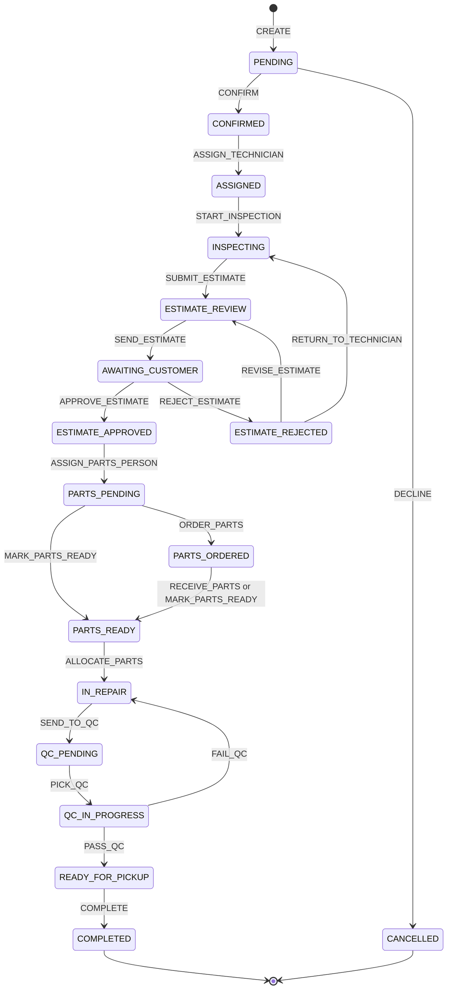

# 08 — Booking State Machine

**Status:** ✅ Locked (foundation spec)
**Code home:** `apps/api/app/modules/bookings/domain/state_machine.py` (pure rules) + `apps/api/app/modules/bookings/service.py` (execution)

## Purpose

Define the one and only set of rules for how a booking moves from `PENDING` to `COMPLETED` (or `CANCELLED`): who may act, from which status, what is checked, what changes in the same database transaction, and who is notified. This is "the heart of the product" (brief §5) and the basis of 35 % (core flow) + 20 % (architecture) of the score.

Names (statuses, actions, roles, error codes, notification types) are defined in [18-glossary.md](18-glossary.md). Interpretations of the brief are recorded in [17-decisions.md](17-decisions.md) (D16, D21–D31, D39–D47).

## Principles

1. **Single source of truth.** One declarative rule table (`RULES`) in the domain layer. Services, `allowed_actions` and tests all read it. Nothing else decides transitions (brief §7.5).
2. **Enforced on the server, in the service layer.** The UI only shows buttons from `allowed_actions`; the server re-checks everything (brief §5, §7.5).
3. **Reject everything not in the table** with 409 `INVALID_TRANSITION` (brief §5 "reject any invalid transition").
4. **One action = one database transaction**: status change + side effects (estimates, stock, slots, QC rows) + audit row + notification rows commit together or not at all.
5. **Every action is audited** in `booking_events`: who, role, when, from, to, action, note, metadata (brief §7.5). Writing a booking event always increments `bookings.version` (D30); plain estimate-draft saves write no event and do not bump the version.
6. **Exactly one responsible role per status** (brief §3 "every status has exactly one responsible role").
7. **Terminal states** `COMPLETED` and `CANCELLED` accept no actions.

## State diagram



Not drawn, for readability: `CANCEL` → `CANCELLED` from each of the 11 cancellable statuses (`PENDING` … `PARTS_READY`).

## Who is the actor?

| Endpoint family | Actor role | Resolved from |
|---|---|---|
| `POST /api/v1/bookings` | `CUSTOMER` | Logged-in user, or the account created/reused by the wizard (D32) |
| `/api/v1/me/bookings/{booking_id}/actions/{slug}` | `CUSTOMER` | Only if `bookings.customer_user_id` = caller; otherwise 404 |
| `/api/v1/shops/{shop_id}/bookings/{booking_id}/actions/{slug}` | The caller's **membership role** in `shop_id` (`OWNER`, `SERVICE_ADVISOR`, `TECHNICIAN`, `PARTS_PERSON`, `QC_INSPECTOR`) | Active `shop_memberships` row; none → 404 |
| `POST /api/v1/shops/{shop_id}/purchase-orders/{po_id}/receive` | `PARTS_PERSON` | Triggers `RECEIVE_PARTS` on the linked booking |

A user who is staff in shop X and also books their own car at shop X uses the customer endpoints for customer actions and the staff endpoints for staff actions; the endpoint family decides the role.

## Assignment guards

| Guard | Passes when |
|---|---|
| `ASSIGNED_TECHNICIAN` | `bookings.technician_user_id` = caller |
| `ASSIGNED_PARTS_PERSON` | `bookings.parts_person_user_id` = caller |
| `QC_PICKER` | `bookings.qc_inspector_user_id` = caller |
| `BOOKING_CUSTOMER` | `bookings.customer_user_id` = caller (enforced by the customer endpoint's scoped query) |

"SA, Owner" in the tables below means the actor roles `SERVICE_ADVISOR` or `OWNER` (D16). The Owner never passes technician, parts or QC guards.

## Transition table (the rules)

All staff endpoints are `POST /api/v1/shops/{shop_id}/bookings/{booking_id}/actions/{slug}`; customer endpoints are `POST /api/v1/me/bookings/{booking_id}/actions/{slug}`. Every row also writes one `booking_events` row and increments `bookings.version`. All timestamps come from the injected clock (D63).

| ID | Action (slug) | From → To | Actor(s) | Guards (in addition to role/assignment/status) | Side effects (same transaction) | Notifications |
|---|---|---|---|---|---|---|
| T01 | `CREATE` (`POST /api/v1/bookings`) | — → `PENDING` | Customer | Shop exists, `is_listed` and has ≥ 1 active service (D64); ≥ 1 active service of this shop selected (422 `VALIDATION_ERROR`); slot valid (422 `INVALID_SLOT`, D37); account rule D32 checked **before** the slot lock (409 `EMAIL_ALREADY_REGISTERED`, nothing created); capacity left (409 `SLOT_FULL`); vehicle fields valid; e-mail validated with the project `Email` type (D62) | Create or reuse user (+ optional phone); upsert vehicle (D35); snapshot `mileage_km` on the booking (D65); lock and increment `slot_counters`; insert booking (`reference` `BF-XXXXXX`, `version` 1); snapshot `booking_services`; set session cookie and return `access_token`, `expires_in`, `account_created` (D32) | `BOOKING_CREATED` → SAs of the shop |
| T02 | `CONFIRM` (`confirm`) | `PENDING` → `CONFIRMED` | SA, Owner | — | — | `BOOKING_CONFIRMED` → customer *(extra)* |
| T03 | `DECLINE` (`decline`) | `PENDING` → `CANCELLED` | SA, Owner | `reason` required (1–500 chars) | Set `cancelled_at`, `cancelled_by_user_id`, `cancel_reason`; decrement slot counter | `BOOKING_CANCELLED` → customer *(extra)* |
| T04 | `ASSIGN_TECHNICIAN` (`assign-technician`) | `CONFIRMED` → `ASSIGNED` | SA, Owner | `technician_user_id` is an active `TECHNICIAN` member of this shop (422 `MEMBER_NOT_ELIGIBLE`) | Set `technician_user_id` | `TECHNICIAN_ASSIGNED` → that technician |
| T05 | `START_INSPECTION` (`start-inspection`) | `ASSIGNED` → `INSPECTING` | Technician | `ASSIGNED_TECHNICIAN` | Ensure a `DRAFT` estimate exists (create v1 if the booking has none) | — |
| T06 | `SUBMIT_ESTIMATE` (`submit-estimate`) | `INSPECTING` → `ESTIMATE_REVIEW` | Technician | `ASSIGNED_TECHNICIAN`; current `DRAFT` has ≥ 1 line (422 `ESTIMATE_EMPTY`); every `PART` line references an active part of this shop | Draft → `SUBMITTED` (`submitted_at`); totals recomputed; optional `inspection_notes` saved on the booking | `ESTIMATE_SUBMITTED` → SAs of the shop |
| T07 | `SEND_ESTIMATE` (`send-estimate`) | `ESTIMATE_REVIEW` → `AWAITING_CUSTOMER` | SA, Owner | Latest version is `SUBMITTED` or `DRAFT` with ≥ 1 line (422 `ESTIMATE_EMPTY`) | The open version → `SENT` (`sent_at`, `sent_by_user_id`). (Older versions were already `SUPERSEDED` when the SA edited, O1, so at most one version is open.) | `ESTIMATE_SENT` → customer (+ optional e-mail, D26) |
| T08 | `APPROVE_ESTIMATE` (`approve-estimate`, customer endpoint) | `AWAITING_CUSTOMER` → `ESTIMATE_APPROVED` | Customer | `BOOKING_CUSTOMER`; body `estimate_id` = the current `SENT` version (409 `STALE_ESTIMATE`) | Estimate → `APPROVED`, `decided_at`, `decided_by_user_id` (timestamped acceptance, brief §3) | `ESTIMATE_APPROVED` → SAs of the shop |
| T09 | `REJECT_ESTIMATE` (`reject-estimate`, customer endpoint) | `AWAITING_CUSTOMER` → `ESTIMATE_REJECTED` | Customer | `BOOKING_CUSTOMER`; same `estimate_id` rule; optional `reason` ≤ 500 chars | Estimate → `REJECTED`, `decided_at`, `decided_by_user_id`, `customer_note` | `ESTIMATE_REJECTED` → SAs of the shop |
| T10 | `REVISE_ESTIMATE` (`revise-estimate`) | `ESTIMATE_REJECTED` → `ESTIMATE_REVIEW` | SA, Owner | — | New `DRAFT` version (`version` + 1, `created_by_user_id` = actor) copying the rejected version's lines | — |
| T11 | `RETURN_TO_TECHNICIAN` (`return-to-technician`) | `ESTIMATE_REJECTED` → `INSPECTING` | SA, Owner | Optional `note` (shown to the technician) | New `DRAFT` version copying the rejected version's lines (the technician edits it) | `ESTIMATE_RETURNED` → technician *(extra)* |
| T12 | `ASSIGN_PARTS_PERSON` (`assign-parts-person`) | `ESTIMATE_APPROVED` → `PARTS_PENDING` | SA, Owner | `parts_person_user_id` is an active `PARTS_PERSON` member (422 `MEMBER_NOT_ELIGIBLE`) | Set `parts_person_user_id`; create `booking_parts` rows from the **approved** version's `PART` lines (quantities summed per `part_id`; `reserved_qty` = `consumed_qty` = 0) | `PARTS_NEEDED` → that parts person |
| T13 | `ORDER_PARTS` (`order-parts`) | `PARTS_PENDING` → `PARTS_ORDERED` | Parts Person | `ASSIGNED_PARTS_PERSON`; at least one part is short after reserving what is available (else 409 `CONFLICT`: "all parts available — use mark-parts-ready"); ordered quantity per short part ≥ its shortage (422) | Reserve `min(available, outstanding)` for every `booking_parts` row (`RESERVE` movements); create a `purchase_orders` row (`ORDERED`, `booking_id`, `PO-XXXXXX`) with items covering the shortages (default items = exact shortages; optional `supplier_name`) | — |
| T14 | `MARK_PARTS_READY` (`mark-parts-ready`) | `PARTS_PENDING` or `PARTS_ORDERED` → `PARTS_READY` | Parts Person | `ASSIGNED_PARTS_PERSON`; for every `booking_parts` row, available ≥ outstanding (409 `INSUFFICIENT_STOCK`) | Reserve all outstanding quantities (`RESERVE` movements). Zero parts (labour-only job, D31) passes trivially | — |
| T15 | `RECEIVE_PARTS` (triggered by `POST /api/v1/shops/{shop_id}/purchase-orders/{po_id}/receive`) | `PARTS_ORDERED` → `PARTS_READY` | Parts Person (any active one in the shop — receiving is a stock operation) | The receipt first publishes `PurchaseOrderReceiving`, so the bookings module locks the linked booking **before** the PO and parts are locked (D30, D43). Received stock is reserved for the linked booking **only while it is `PARTS_ORDERED`** (a cancelled booking gets nothing; the stock stays general). Fires only when, after this receipt, every `booking_parts` row is fully reserved; otherwise the booking stays `PARTS_ORDERED` (partial delivery, brief §5.3) | `RECEIVE` movements (+`on_hand`); `RESERVE` movements for the linked booking; PO items `received_qty`; PO status → `PARTIALLY_RECEIVED` or `RECEIVED` | — |
| T16 | `ALLOCATE_PARTS` (`allocate-parts`) | `PARTS_READY` → `IN_REPAIR` | Parts Person | `ASSIGNED_PARTS_PERSON`; every `booking_parts.reserved_qty` = `required_qty` (409 `INSUFFICIENT_STOCK`) | `CONSUME` movements: `on_hand −= q`, `reserved −= q`; `booking_parts.consumed_qty = required_qty`, `reserved_qty = 0` | `PARTS_READY` → technician |
| T17 | `SEND_TO_QC` (`send-to-qc`) | `IN_REPAIR` → `QC_PENDING` | Technician | `ASSIGNED_TECHNICIAN`; optional `repair_notes` (stored as the event note) | All `OPEN` `qc_issues` of the booking → `RESOLVED` (`resolved_at`, `resolved_by_user_id`); `qc_inspector_user_id` = NULL | `QC_REQUESTED` → every active QC inspector of the shop |
| T18 | `PICK_QC` (`pick-qc`) | `QC_PENDING` → `QC_IN_PROGRESS` | QC Inspector (any active in the shop) | First-wins: if the locked row is already `QC_IN_PROGRESS` → 409 `ALREADY_PICKED`; caller ≠ `technician_user_id` (403 `FORBIDDEN`, D47) | Set `qc_inspector_user_id`; insert `qc_inspections` row (`picked_at`) | — |
| T19 | `PASS_QC` (`pass-qc`) | `QC_IN_PROGRESS` → `READY_FOR_PICKUP` | QC Inspector | `QC_PICKER`; `checklist` provided (keys per D46) and every item passed (422 otherwise — use `fail-qc`) | Inspection `result` = `PASS`, `completed_at`, checklist, notes; `qc_inspector_user_id` is **kept** (records who passed it, D47) | `QC_PASSED` → SAs of the shop *(extra)* |
| T20 | `FAIL_QC` (`fail-qc`) | `QC_IN_PROGRESS` → `IN_REPAIR` | QC Inspector | `QC_PICKER`; `issue_title` (1–120) and `issue_description` (1–2000) required; `checklist` and `notes` optional | Inspection `result` = `FAIL`, `completed_at`, checklist (if given), notes; insert `qc_issues` (`OPEN`); `qc_inspector_user_id` = NULL. Job returns to the **same** technician | `QC_FAILED` → technician |
| T21 | `COMPLETE` (`complete`, staff **or** customer endpoint) | `READY_FOR_PICKUP` → `COMPLETED` | SA, Owner, Customer | Customer endpoint: `BOOKING_CUSTOMER` | Set `completed_at` | — |
| T22 | `CANCEL` (`cancel`, staff **or** customer endpoint) | any of the 11 cancellable statuses → `CANCELLED` | Customer, SA, Owner | Staff must give `reason` (1–500); customer `reason` optional | Release every reservation (`RELEASE` movements, `parts.reserved −= reserved_qty`, `booking_parts.reserved_qty = 0`); decrement slot counter; set `cancelled_at`, `cancelled_by_user_id`, `cancel_reason`; non-final estimate versions (`DRAFT`, `SUBMITTED`, `SENT`) → `SUPERSEDED`; linked POs untouched (D24) | `BOOKING_CANCELLED` *(extra)*: staff cancelled → customer; customer cancelled → SAs + assigned technician + assigned parts person |

## Operations (no status change, still guarded and audited)

| ID | Action (slug) | Allowed in | Actor(s) | Behaviour | Notifications |
|---|---|---|---|---|---|
| O1 | `EDIT_ESTIMATE` (`edit-estimate` in `allowed_actions`; endpoint `PUT /api/v1/shops/{shop_id}/bookings/{booking_id}/estimate`) | `INSPECTING` (assigned Technician); `ESTIMATE_REVIEW` (SA, Owner) | as listed | Replaces the lines of the editable version. In `ESTIMATE_REVIEW`, if the latest version is `SUBMITTED`, a new `DRAFT` version is created (author = SA) and the old one becomes `SUPERSEDED`; if the latest is already the SA's `DRAFT`, it is updated. Any other status → 409 `ESTIMATE_LOCKED`. Lines: 1–50; `PART` (`part_id` active in this shop, whole-number quantity ≥ 1, `unit_price` a whole-rupee amount ≥ 0 defaulting to `parts.unit_cost`); `LABOUR` (`description` required, quantity 0.01–999.99, `unit_price` a whole-rupee amount ≥ 0). Line totals rounded half-up to whole rupees (D41); totals recomputed. While `INSPECTING`, the body may also carry `inspection_notes` (saved on the booking, D40). A booking event (and a `bookings.version` bump) is written only when a **new version** is created; plain draft saves are last-write-wins (D30). | — |
| O2 | `START_REPAIR` (`start-repair`) | `IN_REPAIR` | Technician (`ASSIGNED_TECHNICIAN`) | Sets `repair_started_at` = now (each repair round overwrites it; history keeps every round) | — |
| O3 | `NOTIFY_READY` (`notify-ready`) | `READY_FOR_PICKUP` | SA, Owner | Sets `ready_notified_at` = now; repeatable (D27) | `VEHICLE_READY` → customer (+ e-mail) |
| O4 | `REASSIGN_TECHNICIAN` (`reassign-technician`) *(P1)* | `ASSIGNED`, `INSPECTING`, `IN_REPAIR` | SA, Owner | New `technician_user_id` must be eligible and different; the draft estimate stays | `TECHNICIAN_ASSIGNED` → new technician |
| O5 | `REASSIGN_PARTS_PERSON` (`reassign-parts-person`) *(P1)* | `PARTS_PENDING`, `PARTS_ORDERED`, `PARTS_READY` | SA, Owner | New `parts_person_user_id` must be eligible and different | `PARTS_NEEDED` → new parts person |

## Lifecycles in detail

### Estimate versions (D39)

```
INSPECTING        tech edits v1 (DRAFT) ──submit──► v1 SUBMITTED
ESTIMATE_REVIEW   SA edits → v2 DRAFT (v1 SUPERSEDED) ──send──► v2 SENT      (no edit → v1 SENT)
AWAITING_CUSTOMER customer approves v2 → APPROVED (locked, decided_at/by)
                  customer rejects  v2 → REJECTED (locked)
ESTIMATE_REJECTED revise → v3 DRAFT (SA) → ESTIMATE_REVIEW → send → v3 SENT …
                  return-to-technician → v3 DRAFT (tech) → INSPECTING → submit …
```

The "revision count" shown in the UI is `estimates.version`. Only one version per booking can be `DRAFT`, `SUBMITTED` or `SENT` at a time.

### Parts reservations (D42, D43) — with the worked example's numbers

Start: oil filter `on_hand 10 / reserved 0`, engine oil 4 L `on_hand 8 / reserved 0`, ignition coil `on_hand 0 / reserved 0`. Approved estimate needs 1 of each.

| Step | Action | Oil filter (on_hand/reserved) | Engine oil | Ignition coil | Booking |
|---|---|---|---|---|---|
| Assign parts person | T12 | 10/0 | 8/0 | 0/0 | `PARTS_PENDING`, `booking_parts` required 1/1/1 |
| Order parts | T13: reserve filter + oil; PO for 1 coil | 10/1 | 8/1 | 0/0 | `PARTS_ORDERED` |
| Receive the coil | T15: +1 coil, reserved for this booking | 10/1 | 8/1 | 1/1 | `PARTS_READY` |
| Allocate | T16: consume all three | 9/0 | 7/0 | 0/0 | `IN_REPAIR` |
| *(alternative)* Cancel while `PARTS_ORDERED` | T22: release | 10/0 | 8/0 | 0/0 | `CANCELLED`; the PO stays open, and the coil arrives later as general stock |

### QC loop (D46, D47)

`IN_REPAIR` → `SEND_TO_QC` → `QC_PENDING` → `PICK_QC` (first wins) → `QC_IN_PROGRESS` → `FAIL_QC` (issue created, same technician) → `IN_REPAIR` → `SEND_TO_QC` (issues resolved) → … → `PASS_QC` → `READY_FOR_PICKUP`. No limit on rounds. Each round has its own `qc_inspections` row.

## How an action is executed (service layer)

1. Authenticate (cookie or Bearer) and re-check `users.is_active` (D9).
2. Staff endpoint: the shop dependency loads the caller's active membership for `shop_id` (none → 404).
3. Open a transaction and load the booking **with `SELECT … FOR UPDATE`**, scoped by `shop_id` (staff) or `customer_user_id` (customer). Missing → 404.
4. Visibility (D21) for the caller's role. Not visible → 404 `NOT_FOUND`.
5. Rule lookup; caller's role not in `actors` → 403 `FORBIDDEN`.
6. Assignment guard fails → 403 `NOT_ASSIGNED`.
7. Status not in `from` → 409 `INVALID_TRANSITION` (special case: `PICK_QC` on `QC_IN_PROGRESS` → 409 `ALREADY_PICKED`).
8. `expected_version` present and different from `bookings.version` → 409 `CONCURRENT_UPDATE`.
9. Validate the payload and data guards → 422 / 409.
10. Run side effects through the owning modules' services (estimates, inventory, scheduling, qc) using the same session. Lock order: booking → purchase order → parts (ascending `id`) → slot counter (D30).
11. Update the booking (status if transition; changed columns; `version += 1`; `updated_at`).
12. Insert the `booking_events` row (`action`, `from_status`, `to_status`, `actor_user_id`, `actor_role`, `note`, `metadata`).
13. Publish `BookingActionApplied` on the in-process event bus; the notifications module's handler inserts notification rows **in the same transaction**.
14. Commit.
15. After commit: push `booking.updated` (only to users who can see the booking, glossary §11) and `notification.created` over WebSocket; send optional e-mails in the background (D26).
16. Return the booking detail including the new `allowed_actions`.

`booking_events.metadata` examples: `ASSIGN_TECHNICIAN {technician_user_id}`; `SUBMIT_ESTIMATE`/`SEND_ESTIMATE`/`APPROVE_ESTIMATE`/`REJECT_ESTIMATE {estimate_id, version, grand_total}`; `ORDER_PARTS {purchase_order_id, po_number, reserved: [{part_id, qty}]}`; `RECEIVE_PARTS {purchase_order_id}`; `ALLOCATE_PARTS {consumed: [{part_id, qty}]}`; `PICK_QC`/`PASS_QC {qc_inspection_id}`; `FAIL_QC {qc_inspection_id, qc_issue_id}`; `CANCEL {released: [{part_id, qty}]}`.

## `allowed_actions`

Every booking detail and list item returned to a user includes `allowed_actions: [slug, …]`, computed by a pure function from the rule table:

- include a rule if the booking's status is in `from`, the caller's actor role is in `actors`, and the assignment guard passes;
- `CREATE` and `RECEIVE_PARTS` are never listed (they are not invoked through `/actions/`);
- data guards (stock, checklist) are **not** pre-evaluated; the server checks them on execution and the UI shows the error message. Helper fields such as `parts_summary.all_available` let the UI hint in advance;
- customers only ever see `approve-estimate`, `reject-estimate`, `cancel`, `complete`;
- the Owner sees SA actions only (D16).

## Error mapping

| Situation | HTTP | `code` |
|---|---|---|
| Booking not visible / other shop / not own booking | 404 | `NOT_FOUND` |
| Role cannot perform this action | 403 | `FORBIDDEN` |
| Right role, not the assignee / picker | 403 | `NOT_ASSIGNED` |
| Action not allowed from current status | 409 | `INVALID_TRANSITION` |
| QC job already picked | 409 | `ALREADY_PICKED` |
| Stale `expected_version` | 409 | `CONCURRENT_UPDATE` |
| Approving/rejecting a non-current estimate | 409 | `STALE_ESTIMATE` |
| Editing a locked estimate | 409 | `ESTIMATE_LOCKED` |
| Not enough stock | 409 | `INSUFFICIENT_STOCK` |
| Empty estimate | 422 | `ESTIMATE_EMPTY` |
| Assignee not an eligible active member | 422 | `MEMBER_NOT_ELIGIBLE` |
| Bad payload | 422 | `VALIDATION_ERROR` |

## Worked example trace (brief §6)

| Step | Actor | Calls | Status after | Notable effects | Notifications |
|---|---|---|---|---|---|
| 0 | Fatima (Owner) | register-owner, create shop, add Bilal/Imran/Sara/Usman | — | 1 shop, 5 memberships | — |
| 1–3 | Ahmed | browse → wizard → `POST /api/v1/bookings` (Check engine light + Oil change, Friday 10:00, LEA-1234) | `PENDING` | account created + logged in; slot counter +1 | `BOOKING_CREATED` → Bilal |
| 4 | Bilal | `confirm`, `assign-technician` (Imran) | `CONFIRMED` → `ASSIGNED` | 2 events | `BOOKING_CONFIRMED` → Ahmed; `TECHNICIAN_ASSIGNED` → Imran |
| 5 | Imran | `start-inspection`, PUT estimate (coil 6,500; filter 900; oil 5,200; labour 4,000 = 16,600), `submit-estimate` | `INSPECTING` → `ESTIMATE_REVIEW` | v1 `SUBMITTED` | `ESTIMATE_SUBMITTED` → Bilal |
| 6 | Bilal | PUT estimate (labour 3,500 → 16,100), `send-estimate` | `AWAITING_CUSTOMER` | v2 `SENT`, v1 `SUPERSEDED` | `ESTIMATE_SENT` → Ahmed |
| 7 | Ahmed | `approve-estimate` (v2) | `ESTIMATE_APPROVED` | v2 `APPROVED` with timestamp | `ESTIMATE_APPROVED` → Bilal |
| 8 | Bilal | `assign-parts-person` (Usman) | `PARTS_PENDING` | `booking_parts` × 3 | `PARTS_NEEDED` → Usman |
| 9 | Usman | `order-parts` (1 coil) | `PARTS_ORDERED` | filter + oil reserved; PO created | — |
| 10 | Usman | PO receive (1 coil) → `allocate-parts` | `PARTS_READY` → `IN_REPAIR` | stock +1 then −3 | `PARTS_READY` → Imran |
| 11 | Imran | `start-repair`, `send-to-qc` | `QC_PENDING` | — | `QC_REQUESTED` → Sara and Hina (all QC inspectors) |
| 12 | Sara | `pick-qc`, `fail-qc` ("Oil leak at filter") | `QC_IN_PROGRESS` → `IN_REPAIR` | issue `OPEN` | `QC_FAILED` → Imran |
| 13 | Imran | `send-to-qc` | `QC_PENDING` | issue `RESOLVED` | `QC_REQUESTED` → Sara and Hina |
| 14 | Sara | `pick-qc`, `pass-qc` | `READY_FOR_PICKUP` | inspection `PASS` | `QC_PASSED` → Bilal |
| 15 | Bilal | `notify-ready` | `READY_FOR_PICKUP` | `ready_notified_at` | `VEHICLE_READY` → Ahmed |
| 16 | Ahmed (or Bilal) | `complete` | `COMPLETED` | `completed_at` | — |

## Required tests (expanded in spec 12)

| ID | Test |
|---|---|
| SM-01 | Every (status, action) pair **not** in the rule table is rejected with 409 `INVALID_TRANSITION` (exhaustive, generated from the enums) |
| SM-02 | Each of T02–T22 and O1–O3 succeeds from its allowed status with the right actor |
| SM-03 | Role matrix: each action by every wrong role → 403 `FORBIDDEN` |
| SM-04 | Unassigned technician / parts person / non-picker QC → 403 `NOT_ASSIGNED` (or 404 where not visible) |
| SM-05 | Staff of Shop A acting on a Shop B booking → 404 |
| SM-06 | Two QC inspectors pick concurrently → exactly one 200, one 409 `ALREADY_PICKED` |
| SM-07 | Two customers book the last place in a slot concurrently → exactly one 201, one 409 `SLOT_FULL` |
| SM-08 | Estimate-rejected path: reject → revise → send → approve |
| SM-09 | Reject → return-to-technician → submit → send → approve |
| SM-10 | QC fail loop twice, then pass |
| SM-11 | Cancel in `PARTS_ORDERED` releases reservations and frees the slot |
| SM-12 | Partial PO receipt keeps `PARTS_ORDERED`; full receipt → `PARTS_READY` |
| SM-13 | Labour-only job passes through the parts steps with zero parts |
| SM-14 | Approving a superseded estimate version → 409 `STALE_ESTIMATE` |
| SM-15 | `expected_version` mismatch → 409 `CONCURRENT_UPDATE` |
| SM-16 | Owner cannot perform technician, parts or QC actions (403) but can perform every SA action |
| SM-17 | Customer acting on another customer's booking → 404 |
| SM-18 | The worked example end to end (table above) |
| SM-19 | `allowed_actions` is correct for every role in every status |
| SM-20 | Every action writes exactly one `booking_events` row with correct from/to/actor |

## Implementation sketch

```python
# app/modules/bookings/domain/state_machine.py  (pure: no FastAPI, no SQL)
from dataclasses import dataclass
from enum import StrEnum

class Guard(StrEnum):
    ASSIGNED_TECHNICIAN = "ASSIGNED_TECHNICIAN"
    ASSIGNED_PARTS_PERSON = "ASSIGNED_PARTS_PERSON"
    QC_PICKER = "QC_PICKER"
    BOOKING_CUSTOMER = "BOOKING_CUSTOMER"

@dataclass(frozen=True)
class Rule:
    action: BookingAction
    slug: str
    from_statuses: frozenset[BookingStatus]
    to_status: BookingStatus | None          # None = operation (no status change)
    actors: frozenset[ActorRole]
    guard: Guard | None = None

SA_OR_OWNER = frozenset({ActorRole.SERVICE_ADVISOR, ActorRole.OWNER})

RULES: dict[BookingAction, Rule] = {
    BookingAction.CONFIRM: Rule(BookingAction.CONFIRM, "confirm",
        frozenset({BookingStatus.PENDING}), BookingStatus.CONFIRMED, SA_OR_OWNER),
    BookingAction.START_INSPECTION: Rule(BookingAction.START_INSPECTION, "start-inspection",
        frozenset({BookingStatus.ASSIGNED}), BookingStatus.INSPECTING,
        frozenset({ActorRole.TECHNICIAN}), Guard.ASSIGNED_TECHNICIAN),
    # … one entry per row of the transition and operation tables above
}

def check(rule: Rule, status: BookingStatus, actor: ActorRole, guard_ok: bool) -> None: ...
def allowed_actions(status: BookingStatus, actor: ActorRole, guards: set[Guard]) -> list[str]: ...
```

## Dependencies

- [18-glossary.md](18-glossary.md), [17-decisions.md](17-decisions.md)
- Used by: [02-data-model.md](02-data-model.md), [03-api-contracts.md](03-api-contracts.md), [04-auth-and-security.md](04-auth-and-security.md), [06-workflows.md](06-workflows.md), [12-quality-and-testing.md](12-quality-and-testing.md), `modules/bookings.md`, `modules/estimates.md`, `modules/inventory.md`, `modules/qc.md`, `modules/notifications.md`

## Open questions

None. Any change must first be recorded in spec 17.
