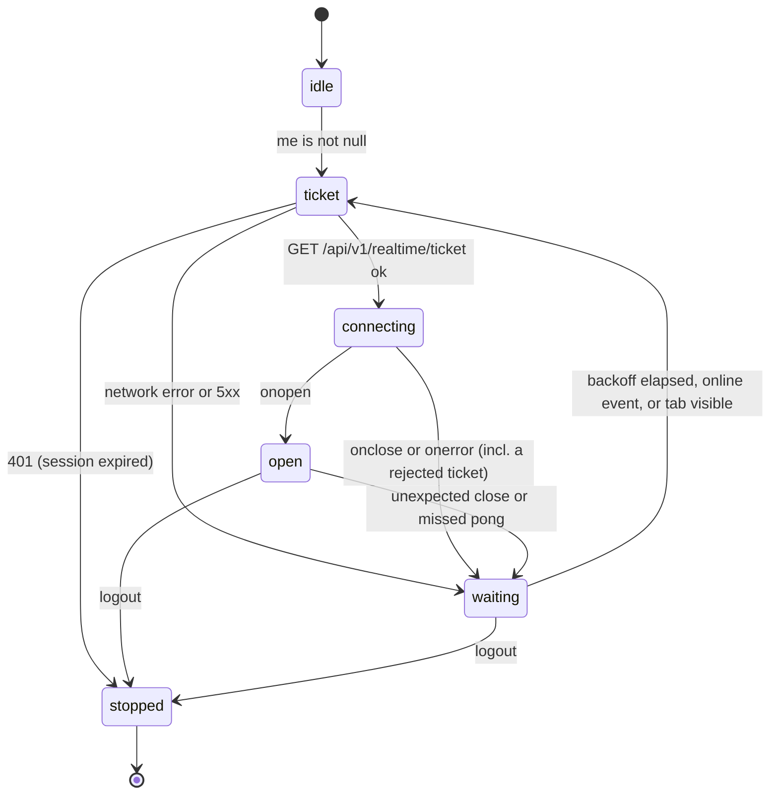

# 09 — Frontend Architecture, Design System & UX

**Status:** Draft

## Purpose

Defines how `apps/web` is built and how it looks and behaves: web architecture (routing, rendering, data, auth, errors, forms, formatting, realtime), the design system (brand tokens, typography, status colors, components) and the UX and accessibility rules that every screen in [10-screens.md](10-screens.md) must follow.

Why it matters: Product & UX is 15 % of the score (brief §10: "Clear landing page and booking wizard; role dashboards that show only relevant work"), and the 35 % core-flow score is earned only if a judge can drive the whole lifecycle through this UI on the live URL (§7.8).

Rules of precedence: names come from [18-glossary.md](18-glossary.md); [17-decisions.md](17-decisions.md) wins every conflict (especially D1, D7, D8, D10, D11, D14, D16, D21, D27, D32–D41, D44, D48, D50, D52, D55, D56, D61, D62, D66–D68, D70, D73, D76, D78, D80–D83, D88, D93, D101); paths, response shapes and request-field limits come from [03-api-contracts.md](03-api-contracts.md), the authoritative endpoint catalogue; booking buttons come from `allowed_actions` as defined in [08-booking-state-machine.md](08-booking-state-machine.md). Framework facts were checked against official docs and package sources on 2026-10-09 (see §8 Sources). The design system (§3, §4.1, §4.14, §5) was rewritten on 2026-10-10 for D101 and checked against `apps/web` (`DESIGN.md`, `globals.css`, `layout.tsx`, `components/ui`, `components/layout`) that day. Anything not checked is marked **(unverified)**.

---

## 1. UX goals

| # | Goal (brief) | How the web app delivers it | Demo check |
|---|---|---|---|
| G1 | Clear landing page (§7.3, §10) | A light hero (white, grid paper fading out, a soft brand-blue glow; §3.1, §3.5) with search and a city filter above the fold. Below it, a shop grid (name, city, rating or "New", services offered). One primary (blue) action per card (R7). Built (2026-10-10): `/` is the previous marketing landing, which the owner chose to keep (spec 16 A25). It lists no shops and, a known gap, nothing on it or in its header or footer links to the directory on `/book` (search, city filter, shop grid), which is reached from the shop pages, the login page, My bookings and the README; so the check below currently fails from `/` (spec 10 P-01). | A judge finds Lahore Auto Care and starts a booking in ≤ 2 clicks. |
| G2 | Guided booking wizard (§5.1, §7.3) | Five steps plus a success screen. One decision per step, a visible progress indicator, input kept when going back, and only available slots shown. | The worked-example booking (§6 steps 1–3) takes under 2 minutes on a phone. |
| G3 | Dashboards show only relevant work (§3, §4, §10) | Each membership role has its own home screen. Lists show only what the API makes visible (D21). Work that needs action is listed first. | Every seeded role logs in and lands on its own queue. |
| G4 | No role can do another role's action (§7.8) | Booking buttons come only from `allowed_actions` (D48). Other buttons come from API-provided membership `capabilities` (D66, §2.8). The Owner's role views are read-only (D16). | Imran (Technician) never sees "Send to customer". |
| G5 | Less customer anxiety (§3) | A live status timeline with customer labels, a pending-action banner, an itemised estimate with its version number, and a ready-for-pick-up banner. | Ahmed sees "Estimate awaiting your approval" without refreshing the page. |
| G6 | Visible accountability (§2, §7.5) | The staff timeline shows who acted, when, from → to, and any note. Estimate versions and decision timestamps are shown, plus the QC issue history. | Bilal can show v1 next to v2 of the estimate. |
| G7 | Clarity across shops (§7.2) | The POS bar always shows the current shop (on the shop-switcher pill) and the role (the role pill). The switcher is one click away. | Fatima switches between her two shops in one click. |
| G8 | Works on mobile and is accessible (§7.3) | The customer portal is designed mobile-first. The POS works on tablets. Everything meets WCAG 2.2 AA. | The wizard and estimate approval work at 360 px width. |

---

## 2. Web architecture

### 2.1 Stack

Versions were read from the npm registry on 2026-10-09. Exact versions are pinned in `pnpm-lock.yaml`.

| Concern | Choice | Current line | Notes |
|---|---|---|---|
| Framework | Next.js App Router, TypeScript strict | `next` 16.4.x | D1, D11. Turbopack is the default for dev and build. Needs Node ≥ 20.9; we use Node 24 LTS. |
| Language | TypeScript | `typescript` **5.9.3** (pinned) | D11: npm `latest` is 7.x, but `openapi-typescript` 7.13 needs `typescript ^5.x` and `typescript-eslint` 8.71 needs `<6.1.0`. |
| Lint | ESLint flat config with `eslint-config-next` | `eslint` **9.39.x** (pinned), `eslint-config-next` 16.4.x | D11: the plugins pulled in by `eslint-config-next` declare peer `eslint` up to `^9`. Next 16 removed `next lint`, so the lint script is `eslint . --max-warnings 0` (D53, D80). |
| UI runtime | React | `react` 19.x | Required by Next 16 (D11). |
| Styling | Tailwind CSS, configured in CSS | `tailwindcss` 4.3.x, `@tailwindcss/turbopack` (dev) | `@theme` tokens (§3.5). Compiled by the `@tailwindcss/turbopack` loader registered in `next.config.ts` (the create-next-app 16.4 default); there is no PostCSS config. |
| Components | shadcn/ui CLI on the **Radix** base | `shadcn` 4.21.x, `radix-ui` 1.x | D1. Initialised with `shadcn init -t next -b radix -p vega` (§3.12). |
| Icons | lucide-react | `lucide-react` 1.x | Icon names are checked against 1.54.0 (§3.9). |
| Toasts | sonner (via shadcn) | `sonner` 2.x | shadcn's Radix `toast` is deprecated in favour of `sonner`. |
| Server state | TanStack Query | `@tanstack/react-query` 5.x | Devtools in development only. |
| Forms | React Hook Form + Zod | `react-hook-form` 7.x, `zod` 4.x, `@hookform/resolvers` 5.x | Laid out with shadcn `Field` components (§2.10). |
| API types and client | openapi-typescript + openapi-fetch | `openapi-typescript` 7.13.x (dev), `openapi-fetch` 0.17.x | D50, D76 (§2.6). |
| Date picker | react-day-picker (installed by shadcn `calendar`) | as installed | Used for the wizard date step and date filters. |
| Bonus (P2) | LiveKit browser SDK | `livekit-client` 2.x, `@livekit/components-react` 2.x | D57. Loaded lazily, only when `NEXT_PUBLIC_CALL_PROVIDER_URL` is set. |

**Not used, on purpose:**
- Server Actions or Route Handlers for data. All data goes through the FastAPI backend (§2.4).
- `next/image` for shop logos. Logos are arbitrary URLs (D55), so they render with Avatar and ``.
- `cacheComponents`, `reactCompiler`.
- A global client-state library. TanStack Query, the URL and React state are enough.

### 2.2 `apps/web` folder structure

The web foundation exists (D72). The tree shows the implemented files; entries marked *(planned)* arrive with the feature work, and every route below already has a page (most render a `ScreenPlaceholder` until its screen is built).

```
apps/web/
├─ package.json                # standalone pnpm project, "packageManager": "pnpm@10.34.6", engines node 24.x (D5); scripts:
│                              #   dev / start (port 3000), build, lint (`eslint . --max-warnings 0`),
│                              #   typecheck (`next typegen && tsc --noEmit`) (D80), test (`vitest run`), format, format:check, api:types (D76)
├─ next.config.ts              # /api/:path* rewrite to API_BASE_URL (§2.5); security headers (spec 04); Tailwind through the
│                              # `@tailwindcss/turbopack` loader (§3.5); standalone output only for the Docker image
├─ components.json             # shadcn/ui: style radix-vega (`init -t next -b radix -p vega`, §3.12), rsc, Lucide icons,
│                              # aliases @/components, @/lib, @/hooks
├─ eslint.config.mjs           # ESLint 9 flat config (Next 16 removed `next lint`, D11, D53, D80); bans raw fetch outside src/lib/api (D50)
├─ prettier.config.mjs         # Prettier + prettier-plugin-tailwindcss
├─ vitest.config.mts           # unit tests: Vitest + React Testing Library + jsdom (spec 12); tests sit next to their module (*.test.ts[x])
├─ vitest.setup.ts
├─ Dockerfile                  # image for `docker compose` only; Vercel builds the app itself (spec 07)
├─ AGENTS.md                   # Next.js agent rules, (re)written by `next dev`
├─ DESIGN.md                   # the design system's working reference: tokens, primitives, shared layout parts,
│                              #   page recipes and do/don't rules (§3, D101)
├─ public/                     # logo.svg
└─ src/
   ├─ proxy.ts                 # optimistic auth gate (Next 16 file convention, §2.8); matcher /pos, /bookings, /book/confirmed
   ├─ app/
   │  ├─ layout.tsx            # <html lang="en">, Fira Sans + Edu NSW ACT Foundation + JetBrains Mono (next/font, §3.6),
   │  │                        #   SkipLink, <Providers>
   │  ├─ providers.tsx         # 'use client': QueryClientProvider, TooltipProvider, <Toaster/>, Query devtools (dev only);
   │  │                        #   RealtimeProvider joins it (planned); the P2 CallProvider goes in the authenticated layouts
   │  ├─ globals.css           # Tailwind 4 + design tokens (§3.5)
   │  ├─ icon.svg              # favicon (app icon file convention)
   │  ├─ not-found.tsx         # 404 (10-screens X-02)
   │  ├─ global-error.tsx      # last-resort error page (renders its own <html>/<body>)
   │  ├─ (public)/             # layout: PublicHeader + PublicFooter; error.tsx
   │  │  ├─ page.tsx                          → /
   │  │  ├─ shops/[slug]/page.tsx             → /shops/:slug
   │  │  ├─ book/page.tsx                     → /book (wizard step 1: choose a shop)
   │  │  └─ book/[slug]/page.tsx              → /book/:slug?step=&service= (steps 2–5, D68)
   │  ├─ (auth)/               # layout: light brand panel + centred card; error.tsx
   │  │  ├─ login/page.tsx                    → /login?next=&reason=
   │  │  └─ register/page.tsx                 → /register
   │  ├─ (customer)/           # layout: PublicHeader + PublicFooter + RequireSession (planned); error.tsx
   │  │  ├─ bookings/page.tsx                 → /bookings
   │  │  ├─ bookings/[bookingId]/page.tsx     → /bookings/:bookingId
   │  │  └─ book/confirmed/[bookingId]/page.tsx → /book/confirmed/:bookingId
   │  └─ (pos)/
   │     └─ pos/
   │        ├─ layout.tsx                     # PosHeader + RequireSession (planned)
   │        ├─ page.tsx                       → /pos (hub redirect)
   │        ├─ error.tsx
   │        ├─ summary/page.tsx               → /pos/summary (P1, planned)
   │        └─ shops/
   │           ├─ new/page.tsx                → /pos/shops/new
   │           └─ [shopId]/
   │              ├─ layout.tsx               # ShopScope (planned) + PosSidebar
   │              ├─ page.tsx                 → role-home redirect
   │              ├─ overview/  bookings/  bookings/[bookingId]/  jobs/  jobs/[bookingId]/
   │              ├─ parts/  parts/[bookingId]/  inventory/  purchase-orders/  purchase-orders/[poId]/
   │              └─ qc/  qc/[bookingId]/  team/  services/  settings/  calls/ (P2, planned)
   ├─ components/
   │  ├─ ui/                   # shadcn-generated primitives (owned code; edited only for tokens/a11y, §3.12)
   │  ├─ layout/               # shells (§4.1): logo, public-header, public-footer, session-actions, pos-header (shop
   │  │                        #   switcher, role pill), pos-sidebar, section-gate, account-menu, skip-link; shared page
   │  │                        #   parts (§4.14): page-header, stat-card, data-table-card, detail-layout, timeline,
   │  │                        #   empty-state, form-section; planned: realtime-indicator
   │  ├─ status-badge.tsx      # StatusBadge (§3.3, §4.2)
   │  ├─ feedback/             # route-error (body of every error.tsx), screen-placeholder (route skeletons);
   │  │                        #   planned: empty-state, error-state, forbidden-state, not-found-state,
   │  │                        #   offline-banner, read-only-banner, unsaved-changes-guard
   │  ├─ booking/              # planned: booking-reference, status-timeline, action-bar, action-dialogs/*,
   │  │                        #   estimate-view, estimate-editor, action-needed-callout
   │  ├─ notifications/        # planned: notification-bell, notification-panel, notification-item
   │  ├─ data/                 # planned: data-table, filter-bar, money, date-time, relative-time, stock-badge
   │  └─ calls/                # P2, planned: call-provider, incoming-call-dialog, in-call-bar, call-button, call-log
   ├─ features/                # one folder per domain: api.ts (queryOptions + hooks), schemas.ts (zod), components/
   │  ├─ auth/components/demo-credentials-panel.tsx   # §4.12
   │  └─ planned: public-shops/ booking-wizard/ customer-bookings/ staff-bookings/ estimates/ inventory/
   │     purchase-orders/ qc/ team/ services/ shop-settings/ overview/ notifications/ calls/ (P2)
   ├─ hooks/                   # use-mobile.ts (shadcn sidebar; also picks the toast position)
   ├─ lib/
   │  ├─ api/                  # openapi.json + schema.d.ts (GENERATED, D76), client.ts, errors.ts, query-client.ts, server.ts;
   │  │                        #   planned: query-keys.ts
   │  ├─ auth/                 # session.ts (session-expired signal); planned: useMe, resolveHome, capabilities.ts
   │  ├─ format.ts             # formatPKR, formatDate, formatTime, formatDateTime (alias formatSlot), shopDateKey, formatRelative (§2.11)
   │  ├─ status.ts             # BOOKING_STATUSES, BOOKING_STATUS_META, phases and labels, CANCELLABLE_STATUSES (§3.3)
   │  ├─ realtime/             # planned: realtime-client.ts, realtime-provider.tsx, handlers.ts
   │  ├─ config/               # planned: booking-actions.ts, role-nav.ts, notification-types.ts
   │  └─ utils.ts              # cn()
   └─ content/
      └─ demo-accounts.ts      # static text for the login page panel (D52) — data, never logic
```

**File naming** follows glossary §13: files are `kebab-case.tsx`, components `PascalCase`, hooks `useXxx`.

**Environment files.** Env vars are documented in the root `.env.example` (D5). Next.js loads `.env*` from the app root (`apps/web/`), never from `src/`.

### 2.3 Route groups

Route groups are folders named `(name)`. They do not appear in the URL, and two groups must never resolve to the same path. There is **one** root layout (`app/layout.tsx`), so moving between groups is a soft navigation with no full reload.

| Group | URLs | Layout responsibilities | Protection |
|---|---|---|---|
| `(public)` | `/`, `/shops/:slug`, `/book`, `/book/:slug` (shop slug in the path, D68) | PublicHeader, footer; marketing widths (`max-w-7xl` for the landing, `max-w-6xl` for shop pages and the wizard, §3.7) | None. The header shows the logged-in state when `me` exists. |
| `(auth)` | `/login`, `/register` | Brand panel + form column (§4.1) | None. If already logged in, the page redirects with `resolveHome` (§2.8). |
| `(customer)` | `/bookings`, `/bookings/:bookingId`, `/book/confirmed/:bookingId` | PublicHeader + a `max-w-5xl` content column on the canvas | `proxy.ts` cookie gate + client `RequireSession` |
| `(pos)` | `/pos/**` | PosHeader. Under `/pos/shops/:shopId/**`: ShopScope, PosSidebar, page header | `proxy.ts` cookie gate + `RequireSession` + ShopScope membership check |

The full route table with roles is in [10-screens.md §1](10-screens.md).

### 2.4 Server and Client Component policy

1. **Server Components by default** for layouts and public pages. Each `page.tsx` is a thin Server Component. It `await`s `params` and `searchParams` (both are Promises; Next 16 removed synchronous access) and passes plain values into one client "screen" component. Pages and layouts are typed with the global `PageProps<'/route'>` and `LayoutProps<'/route'>` helpers produced by `next typegen` (which is why the `typecheck` script runs it first, D80).
2. **Public data** (shop directory, shop detail) is fetched in Server Components through `lib/api/server.ts` with `cache: 'no-store'`. This keeps listings and settings fresh, and gives good first paint and SEO. These routes read `searchParams` or `params`, so they render dynamically anyway.
3. **Everything behind login renders on the client with TanStack Query.** Those screens need the same-origin cookie, WebSocket invalidation, polling and mutations. Authenticated data is never fetched in Server Components, so there is no cookie forwarding and no per-user server caching.
4. **Mutations go browser → `/api/*` rewrite → FastAPI only.** There are no Server Actions and no Route Handlers. Anything under `app/api/**` would shadow the rewrite, because filesystem routes are matched before `afterFiles` rewrites (§2.5).
5. Put `'use client'` as low in the tree as practical. Each page has one client screen component (for example `features/staff-bookings/components/bookings-screen.tsx`).
6. Any client component that calls `useSearchParams()` renders inside `<Suspense>`. Otherwise a production build of a prerendered route fails with "Missing Suspense boundary with useSearchParams".
7. **Format dates and money where the data is fetched:** on the server for public pages, on the client for everything else. Never format inside a server-rendered client component that already has data. ICU builds differ between Node and browsers (for example, `formatRange` emits U+202F and U+2009 spaces), and that would cause hydration mismatches. `<RelativeTime>` renders only after mount.
8. Leave `cacheComponents` and `reactCompiler` off. They are not needed and would add new failure modes during the hackathon.

### 2.5 Request path: rewrite, proxy and WebSocket

```
Browser ──same-origin HTTPS──▶ Vercel / Next.js ──rewrite /api/:path*──▶ Railway FastAPI (/api/v1/…)
   │                              proxy.ts: cookie gate on /pos, /bookings, /book/confirmed (not /api)
   └────────── WSS  wss://<api-host>/api/v1/ws?ticket=…  (direct to the API, D7) ──────▶ Railway FastAPI
```

```ts
// apps/web/next.config.ts (abridged; a Vercel build without API_BASE_URL or NEXT_PUBLIC_WS_URL throws, spec 07)
import type { NextConfig } from 'next'

const apiBaseUrl = (process.env.API_BASE_URL || 'http://localhost:4000').replace(/\/+$/, '') // glossary §12

const nextConfig: NextConfig = {
  poweredByHeader: false,
  // Tailwind CSS 4 through its Turbopack loader (create-next-app 16.4 default; no PostCSS config, §3.5).
  turbopack: { rules: { '*.css': { loaders: ['@tailwindcss/turbopack'], as: '*.css' } } },
  async headers() {
    return [{ source: '/(.*)', headers: securityHeaders }] // spec 04 Tier 1 security headers
  },
  async rewrites() {
    // Array form = "afterFiles": checked after app routes and public files, before dynamic routes.
    // Therefore nothing may live under app/api/**.
    return [{ source: '/api/:path*', destination: `${apiBaseUrl}/api/:path*` }]
  },
}

export default nextConfig
```

**Rules:**
- Rewrites are evaluated when the config loads, at build time on Vercel. `API_BASE_URL` must therefore be present in the Vercel **build** environment, and changing it needs a redeploy (D7, glossary §12).
- **No HTTP caching of `/api/*` (D61).** For projects created on or after 2026-04-06, Vercel caches responses from external rewrites whenever the upstream sends cache headers. The API therefore sends `Cache-Control: no-store` on **every** `/api/*` response (glossary §9), including every response that carries `Set-Cookie`; spec 07's day-1 verification checklist checks the header through the web origin. The web app never relies on HTTP caching of `/api/*`: **TanStack Query owns client-side caching** (§2.7), and server-side public fetches use `cache: 'no-store'` (§2.4).
- **D7 day-1 check:** confirm that `Set-Cookie` from `POST /api/v1/auth/login` survives the rewrite. If it does not, use the fallback in §2.8.
- The WebSocket never goes through Vercel. The browser connects to `NEXT_PUBLIC_WS_URL` with a ticket (§2.12).

### 2.6 API client (one central client, D50)

**Generated types (D76).**
- The API exports its schema to `apps/web/src/lib/api/openapi.json` (`python -m app.scripts.export_openapi`).
- The web script `api:types` (`openapi-typescript src/lib/api/openapi.json -o src/lib/api/schema.d.ts`) generates `apps/web/src/lib/api/schema.d.ts` from it. `make gen-api` runs both steps.
- Both files are committed and never edited by hand. CI runs the generation and fails if either file differs (D50, D76).
- `tsconfig` sets `strict` and `noUncheckedIndexedAccess`, as openapi-fetch recommends.

**`lib/api/client.ts`** is the only module that creates clients:

```ts
import createClient, { type ClientOptions, type Middleware } from 'openapi-fetch'
import type { paths } from './schema'
import { ApiError, NetworkError } from './errors'
import { emitSessionExpired } from '@/lib/auth/session'

// 401 on these paths is an expected answer, not an expired session.
const AUTH_PROBES = new Set(['/api/v1/auth/login', '/api/v1/auth/register-owner', '/api/v1/me'])

const sessionMiddleware: Middleware = {
  onResponse({ response, schemaPath }) {
    if (response.status === 401 && !AUTH_PROBES.has(schemaPath)) emitSessionExpired()
  },
}

export function createApiClient(baseUrl: string, options: Omit<ClientOptions, 'baseUrl'> = {}) {
  return createClient<paths>({ ...options, baseUrl })
}

/** Browser client: baseUrl "" → relative /api/v1/… on the web origin (rewritten to Railway, D7). */
export const api = createApiClient('', { credentials: 'include' })
api.use(sessionMiddleware)

/** openapi-fetch resolves to { data } | { error, response }; TanStack Query needs thrown errors. */
export async function unwrap<T>(
  call: Promise<{ data?: T; error?: unknown; response: Response }>,
): Promise<T> {
  let res: Awaited<typeof call>
  try {
    res = await call
  } catch (cause) {
    throw new NetworkError(cause)
  }
  if (!res.response.ok) throw ApiError.fromResponse(res.response, res.error)
  return res.data as T
}
```

**Why this works (verified in openapi-fetch 0.17.0 source):**
- `baseUrl` defaults to `""`, and the request URL is built as `${baseUrl}${path}`. Relative URLs work in browsers.
- Same-origin `fetch` sends the `bf_session` cookie by default (`credentials: 'same-origin'`); the browser client passes `credentials: 'include'` explicitly, which behaves the same for these same-origin requests.
- A non-2xx body is JSON-parsed into `error`.
- `onResponse` receives `schemaPath`.

**`lib/api/server.ts`** starts with `import 'server-only'` and exports `serverApi = createApiClient(apiBaseUrl, { cache: 'no-store' })`, where `apiBaseUrl` is `API_BASE_URL` (default `http://localhost:4000`, trailing slashes stripped). Node cannot fetch relative URLs. It is used **only** for `/api/v1/public/*` calls, and every call is uncached (D61).

**Feature hooks.**
- Every endpoint is wrapped once, in `features/<domain>/api.ts`, as a `queryOptions()` factory plus a `useXxx` hook, or a `useXxxMutation` hook.
- Components never call `api.GET` directly.
- Request and response types always come from `paths` and `components['schemas']`. Glossary §13 forbids hand-written API types.

### 2.7 Server state with TanStack Query v5

**QueryClient** (`lib/api/query-client.ts`):
- `getQueryClient()` returns a browser singleton and a new client per server request, using `environmentManager.isServer()` from `@tanstack/react-query` 5.104, as in TanStack's Next.js App Router guide.
- It is provided by `app/providers.tsx` (`'use client'`), which also mounts `TooltipProvider`, `<Toaster/>` (§4.9) and the Query devtools (development builds only). `RealtimeProvider` (§2.12) is mounted there too once it exists — it is P1 (D88), so the P0 app runs on polling alone. The P2 `CallProvider` is mounted in the shared authenticated layouts of the customer area and the POS (spec 05 §9.1, §4.13).

| Option | Value | Why |
|---|---|---|
| `staleTime` | `10_000` ms | Avoids refetch storms when panels mount. Freshness comes from polling and the WebSocket. This is the only client cache: every `/api/*` response is `Cache-Control: no-store` (D61, §2.5). |
| `gcTime` | default (5 min) | — |
| `retry` | up to 2 retries, only for `NetworkError` or `ApiError.status >= 500` | A 4xx is a real answer. Retrying a 404 or 403 only delays the error UI. |
| `refetchOnWindowFocus` | `true` (default) | Catches up after a tab was hidden. |
| `placeholderData` | `keepPreviousData` on paginated and filtered lists | No flicker when filters change. |
| mutations `retry` | `false` | Booking actions are not idempotent (D30). |

**Query keys.**
- Keys are built only by `lib/api/query-keys.ts`.
- A key mirrors the API path, so prefix invalidation follows the resource hierarchy. Filter objects go last.
- Dates, functions and class instances never go in keys.
- `qk.me` (`['me']`) is also the prefix of every `/me/*` key. When only the user object should refresh, pass `exact: true`.

```ts
export const qk = {
  me: ['me'] as const,
  myBookings: (f: MyBookingFilters = {}) => ['me', 'bookings', 'list', f] as const,
  myBooking: (id: string) => ['me', 'bookings', 'detail', id] as const,          // + 'events' | 'estimates' | 'calls'
  myVehicles: ['me', 'vehicles'] as const,
  notifications: (p: Page = {}) => ['me', 'notifications', 'list', p] as const,
  unreadCount: ['me', 'notifications', 'unread-count'] as const,
  ownerSummary: ['me', 'owner-summary'] as const,                                // P1
  publicShops: (f: ShopFilters) => ['public', 'shops', 'list', f] as const,
  publicCities: ['public', 'cities'] as const,
  publicShop: (slug: string) => ['public', 'shops', 'detail', slug] as const,
  availability: (slug: string, date: string) => ['public', 'shops', 'detail', slug, 'availability', date] as const,
  shop: (shopId: string) => ['shops', shopId] as const,                          // invalidation root for a tenant
  shopDetail: (shopId: string) => ['shops', shopId, 'detail'] as const,          // E-22 ShopRead: city, timezone, logo (not in /me)
  overview: (shopId: string) => ['shops', shopId, 'overview'] as const,
  bookings: (shopId: string, f: StaffBookingFilters) => ['shops', shopId, 'bookings', 'list', f] as const,
  statusCounts: (shopId: string) => ['shops', shopId, 'bookings', 'status-counts'] as const,
  booking: (shopId: string, id: string) => ['shops', shopId, 'bookings', 'detail', id] as const,
  // children of booking(): [..., 'events'] [..., 'estimates'] [..., 'parts'] [..., 'qc-inspections'] [..., 'calls']
  members: (shopId: string, f = {}) => ['shops', shopId, 'members', f] as const,
  services: (shopId: string, f = {}) => ['shops', shopId, 'services', f] as const,
  parts: (shopId: string, f = {}) => ['shops', shopId, 'parts', 'list', f] as const,
  partMovements: (shopId: string, partId: string) => ['shops', shopId, 'parts', 'detail', partId, 'movements'] as const,
  purchaseOrders: (shopId: string, f = {}) => ['shops', shopId, 'purchase-orders', 'list', f] as const,
  purchaseOrder: (shopId: string, poId: string) => ['shops', shopId, 'purchase-orders', 'detail', poId] as const,
  qcChecklist: (shopId: string) => ['shops', shopId, 'qc', 'checklist'] as const,
  tasks: (shopId: string, f = {}) => ['shops', shopId, 'tasks', f] as const,                     // P2
  shopCalls: (shopId: string, f = {}) => ['shops', shopId, 'calls', 'list', f] as const,         // P2 (spec 05)
  shopCall: (shopId: string, callId: string) => ['shops', shopId, 'calls', 'detail', callId] as const, // P2
}
```

**Live queries and the always-on 15 s polling (D14).**
- Queries marked *live* use `refetchInterval: 15_000`, while the tab is visible (`refetchIntervalInBackground` defaults to `false`; `refetchOnWindowFocus` catches up when the tab returns, and WebSocket invalidations still refetch mounted queries in a hidden tab).
- Live queries: staff booking lists, status counts, staff booking detail, customer booking list and detail, technician/parts/QC queues, owner overview, the parts list and purchase orders (PP-03, PP-04, open estimate editors), the booking-parts panel on the parts job page (PP-02, see below), and the unread notification count.
- Polling runs **whatever the socket state**, as D14 requires: the web app always polls the unread count and the current view every 15 s as a safety net, in addition to WebSocket updates. The socket makes updates instant; polling guarantees convergence if the socket silently drops.
- Panel queries (events, estimates, booking parts, QC inspections) are **not** polled. The booking-detail hook watches `version`, and whenever `version` changes it invalidates that booking's child keys.
- **Exception (D83):** a booking's parts state can change without a booking event, so without a `version` bump — e.g. a partial PO receipt reserves stock for it. The API still pushes `booking.updated` for it, and an equal-version push refetches the booking detail with its children, the booking lists and the parts views at once (map below). As the safety net when the socket is down, the booking-parts panel on PP-02, where it is the main content, is a live query too.

**Invalidation map.**

| Trigger | Cache update |
|---|---|
| Staff booking action succeeds | `setQueryData(qk.booking(shopId, id), response)` (the response is the booking detail with fresh `allowed_actions`), then `invalidateQueries({ queryKey: qk.shop(shopId) })`. Only active queries refetch (the `refetchType` default is `'active'`, verified in query-core 5.104). |
| Customer booking action succeeds | `setQueryData(qk.myBooking(id), response)`, then `invalidateQueries({ queryKey: ['me', 'bookings'] })` |
| `PUT …/estimate` succeeds | `invalidateQueries({ queryKey: qk.booking(shopId, id) })` (detail, estimates, events) |
| PO receive, part create/edit/adjust, PO create | `invalidateQueries({ queryKey: qk.shop(shopId) })` (stock, POs, queues, overview) |
| Member, service or shop-settings change | Invalidate that resource key + `qk.overview`. Membership or shop-name changes also invalidate `qk.me` (`exact: true`). Shop settings also invalidate `['public']`. |
| Shop created | `invalidateQueries({ queryKey: qk.me, exact: true })` (new `OWNER` membership) |
| WS `booking.updated` `{booking_id, shop_id, status, version}` | Compare `data.version` with the cached detail's `version`. **Newer, or nothing cached → refetch:** if the user has a membership in `shop_id`, invalidate `qk.shop(shop_id)`, and always invalidate `['me', 'bookings']`. **Equal → refetch the booking, the lists and the parts views:** the status is unchanged, but this is either the echo of our own mutation or a parts-state change that wrote no booking event (D83, e.g. a partial PO receipt reserving stock for it), which changes `parts_summary` and the booking parts without a `version` bump. Invalidate the booking's detail `qk.booking(shop_id, booking_id)` (a prefix, so its children — booking parts, estimates with live stock — refetch too), the shop's booking lists `['shops', shop_id, 'bookings', 'list']` (SA board and role queues, which show `parts_summary`), and the parts views `qk.parts(shop_id)` and `qk.purchaseOrders(shop_id)`; a customer invalidates `['me', 'bookings']`. So `parts_summary` refreshes at once instead of at the next 15 s poll; the extra refetch on our own echo is harmless. **Older → ignore.** Only queries on screen refetch, so this stays cheap. |
| WS `notification.created` | Prepend to the cached first page of `qk.notifications()`, `setQueryData(qk.unreadCount, n => n + 1)`, announce through the `aria-live` region, and toast per policy (§4.10) |
| WS reconnected after a drop | Invalidate `['me']` and `['shops']` (catch up on missed pushes) |
| WS `task.created`, `call.incoming`, `call.updated` (P2) | `qk.tasks(shopId)`; the call store (§4.13) |

**Mutation rules.**
- **No optimistic updates** for status, estimates or stock. Show a pending spinner, then the server-confirmed result (UX rule R2).
- The only optimistic update allowed is a notification's read flag.
- Every booking action sends `expected_version` from the cached detail (D30).

### 2.8 Auth and session (D7, D8, D9, D32, D66, D70)

**Principle.** The frontend never stores, reads or decodes tokens.
- The httpOnly `bf_session` cookie is set by the API. Because the response arrives through the same-origin rewrite, the cookie lands on the web origin.
- The `access_token` in the login, owner-registration and booking response bodies (D8, D32) is ignored, except in the fallback mode below.
- **Routing never uses a login or registration body.** Those bodies carry no memberships (D81); the web app always calls `GET /api/v1/me` after them and routes from its answer.

| Flow | Behaviour |
|---|---|
| Who am I | `useMe()` = `GET /api/v1/me` under key `qk.me`, `staleTime` 5 min. A **401 resolves to `null`** (anonymous), not to an error. The response is flat (`MeRead`, spec 03 §3.2): `{id, email, full_name, phone, memberships}`. Each membership item is `{membership_id, shop_id, shop_name, shop_slug, role, capabilities}`, with server-computed `capabilities` (D66). **Only active memberships are returned** (sorted by shop name), so there is no `is_active` flag and a pure customer gets `memberships: []`. The shop's city, timezone and logo are not in `/me`; `ShopScope` loads them (below). |
| Log in | `POST /api/v1/auth/login` → 200 `{access_token, token_type, expires_in, user}` and the cookie (D81; `user` is the account itself, **without memberships**) → `await queryClient.fetchQuery({ ...meQuery, staleTime: 0 })` (`GET /api/v1/me`: memberships and capabilities) → `router.replace(resolveHome(me, next))`. `staleTime: 0` matters: `fetchQuery` returns fresh cached data, and the cache still holds the anonymous `null`. A 401 `INVALID_CREDENTIALS` shows inline. A 429 `RATE_LIMITED` shows a wait message. |
| Register owner (D17) | `POST /api/v1/auth/register-owner` with `{full_name, email, password, phone?}`. Like login, it sets the cookie and returns `{access_token, token_type, expires_in, user}` (D81). Then `fetchQuery({ ...meQuery, staleTime: 0 })` (the new owner has `memberships: []` until a shop exists) and go to `/pos/shops/new`. |
| Wizard booking (D32) | `POST /api/v1/bookings` sets the cookie **and** returns `{access_token, token_type, expires_in, account_created, booking}`: the booking (`CustomerBookingDetail`) is nested under `booking` (D32, spec 03 §4.6). The cookie is the normal path; the token matters only in the Bearer fallback below. The UI refetches `qk.me` and goes to `/book/confirmed/{booking.id}` (with `?new_account=1` when `account_created` is true). |
| Log out | `POST /api/v1/auth/logout` → `queryClient.clear()` → realtime `stop()` → `router.replace('/')` |
| Route protection | **Optimistic only**, as Next's auth guide recommends for Proxy. `src/proxy.ts` checks that the cookie *exists* and does no JWT verification (the web app has no `JWT_SECRET`). The API re-checks every request (D9), and the client `RequireSession` redirects when `me === null`. |
| Session expired | The first 401 from any non-probe call emits `session:expired`, once (`emitSessionExpired()` in `lib/auth/session.ts`; `resetSessionExpired()` re-arms it after the next successful login). The handler clears the query cache, stops realtime, calls `POST /api/v1/auth/logout` best-effort (this clears the stale cookie so `proxy.ts` stops letting the user through), then `router.replace('/login?reason=expired&next=<current path>')`. A 401 from `GET /api/v1/realtime/ticket` is the same signal (D70, §2.12). A deactivated user account also gets 401 `UNAUTHENTICATED` (glossary §10) and goes through the same flow. A deactivated *membership* is different: see ShopScope below. |

```ts
// apps/web/src/proxy.ts — Next 16 renamed middleware → proxy; Node.js runtime; not configurable
import { NextResponse, type NextRequest } from 'next/server'

export function proxy(request: NextRequest) {
  if (request.cookies.has('bf_session')) return NextResponse.next() // optimistic: presence only
  const login = new URL('/login', request.url)
  login.searchParams.set('next', `${request.nextUrl.pathname}${request.nextUrl.search}`)
  return NextResponse.redirect(login)
}

export const config = { matcher: ['/pos/:path*', '/bookings/:path*', '/book/confirmed/:path*'] }
```

**Testing the proxy.** `src/proxy.test.ts` calls `proxy()` directly with a `NextRequest` (redirect to `/login` with `next`, pass-through when the cookie exists) and asserts `config.matcher` literally. Next's experimental matcher helper is not used: the Next 16.4.0 package exports `unstable_doesMiddlewareMatch`, while the docs name `unstable_doesProxyMatch`, so neither name is safe to depend on.

**Role-based redirect after login: `resolveHome(me, next)`.**
1. If `next` is a safe internal path, go there. Safe means it starts with `/`, does not start with `//`, and is not `/login` or `/register`.
2. Otherwise, if `me.memberships` is not empty (every returned membership is active), go to `/pos`.
3. Otherwise go to `/bookings`. A customer with no bookings sees the empty state with "Find a shop".

**`/pos` hub.**
- With 0 memberships → `/pos/shops/new` (onboarding).
- With 1 membership → `/pos/shops/:id`.
- With more than 1 → `localStorage['bf:lastShopId']` if it is still a valid membership. Otherwise the first `OWNER` membership. Otherwise the first membership, by shop name.

**`/pos/shops/:shopId`** redirects to the role home:

| Role | Home |
|---|---|
| `OWNER` | `/overview` |
| `SERVICE_ADVISOR` | `/bookings` |
| `TECHNICIAN` | `/jobs` |
| `PARTS_PERSON` | `/parts` |
| `QC_INSPECTOR` | `/qc` |

**ShopScope.** `[shopId]/layout.tsx` finds the membership whose `shop_id` equals `shopId` in `me.memberships`.
- If there is none, it renders `NotFoundState`. This matches the API's 404 for other tenants (D20, D21), so existence is never leaked.
- If found, it provides the membership (`membership_id`, `shop_id`, `shop_name`, `shop_slug`, `role`, `capabilities`) through context and stores `bf:lastShopId`.
- It also loads the shop with `GET /api/v1/shops/{shop_id}` (E-22, `ShopRead`, readable by every member) under `qk.shopDetail(shopId)`, because `/me` does not carry the city, timezone or logo (spec 03 Open question 3). Every POS time is formatted in that `timezone` (D38); until it loads, `DEFAULT_SHOP_TZ` is used.
- **Membership lost mid-session.** When the Owner deactivates a membership (D19), the API answers 404 on that shop's routes; it is not a 401 (D9, D20). Any 404 from a shop-scoped list query therefore refetches `qk.me` (`exact: true`). If the membership is gone, `ShopScope` shows "You no longer have access to {shop}" with a link to `/pos`.

**Navigation scope is not permission.** The sidebar and section guards use the membership role only to decide which screens to *offer* (matrix in [10-screens.md §4](10-screens.md)). A role landing on another role's section sees `ForbiddenState`.
- Every permission is enforced by the API.
- Every **booking** button comes from `allowed_actions` (D48).
- Every **non-booking** button (add member, edit part, receive PO, …) comes from the membership's server-computed `capabilities` returned by `GET /api/v1/me` (D66, glossary §2.4).
- The web app never maps roles to capabilities itself: `lib/auth/capabilities.ts` only holds typed helpers such as `can(membership, 'parts.manage')`.

| Capability (glossary §2.4) | Granted to (D16, D44) | Shows |
|---|---|---|
| `shop.manage` | `OWNER` | Shop settings, working hours, listing toggle |
| `team.manage` | `OWNER` | Add, edit, deactivate and reactivate members |
| `services.manage` | `OWNER` | Service catalogue create and edit |
| `parts.manage` | `OWNER`, `PARTS_PERSON` | Part create and edit (catalogue; no stock quantities) |
| `stock.manage` | `PARTS_PERSON` | New PO, receive PO, stock adjustment incl. opening stock (**P0**, D44, D82) |
| `tasks.manage` | `OWNER`, `SERVICE_ADVISOR` | P2: AI calls and tasks panel, mark task done. The API includes it **only when the bonus calls module is enabled** (glossary §2.4), so a P0-only deployment never shows task UI. |

**D7 fallback (used only if the day-1 `Set-Cookie` check fails).**
- One constant, `AUTH_TRANSPORT = 'bearer'`, in `lib/api/client.ts`, switches the client to keep the `access_token` from the login, owner-registration or booking response **in a module variable only**. It is never stored in browser storage.
- A middleware adds `Authorization: Bearer …`.
- `proxy.ts` becomes a no-op, because there is no cookie, so `RequireSession` guards alone.
- A page reload means logging in again.
- `POST /api/v1/bookings` returns `access_token` and `expires_in` too (D32), so customers created by the wizard are covered.

### 2.9 Error handling (D49)

**Model.** Every API error is RFC 9457 `application/problem+json` with a `code` (glossary §10). `ApiError.fromResponse` builds:

```ts
class ApiError extends Error {
  status: number                       // HTTP status
  code: ErrorCode                      // glossary §10; non-problem bodies (e.g. a proxy 502 page) → 'INTERNAL_ERROR'
  title?: string; detail?: string      // server text; `detail` is shown when it is user-safe (CONFLICT)
  fieldErrors: Record<string, { message: string; code: string }> // from errors[]: "vehicle.registration_number" → { message, code }
}
class NetworkError extends Error {}    // fetch rejected: offline, DNS, CORS — no HTTP status
```

**Field errors (spec 03 §2.3).**
- A 422 body carries `errors: [{ field, message, code }]` — always exactly this shape (`FieldError`).
- `field` is a dot path into the request body (`customer.email`, `lines.2.unit_price`, `working_hours.3.opens_at`). Query and path parameters keep a location prefix (`query.limit`, `path.booking_id`), and `""` means the body as a whole (missing or not JSON). Body paths become field errors; prefixed or empty paths go to the form-level `Alert`.
- `message` is a human sentence and is shown as is. `code` is machine-readable: Pydantic's error type (`missing`, `string_too_long`, `extra_forbidden`, …) or a service code (`invalid_reference`, `not_whole_rupees`, `not_on_grid`, `invalid_range`, `hours_not_on_grid`, `duplicate`, `not_allowed`, `missing_shortage`, `below_shortage`, `not_short`, `exceeds_outstanding`, `nothing_to_receive`, `checklist_incomplete`, `checklist_item_failed`, `unchanged`). A screen may use `code` to choose friendlier copy ([10-screens.md](10-screens.md)).
- 422 codes other than `VALIDATION_ERROR` carry the one field they concern: `INVALID_SLOT` → `slot_start`, `ESTIMATE_EMPTY` → `lines`, `MEMBER_NOT_ELIGIBLE` → `technician_user_id` or `parts_person_user_id`.
- The `slot_start` error of `INVALID_SLOT` carries one reason `code` (glossary §10, spec 03 §2.3): `off_grid`, `in_past`, `beyond_horizon`, `closed_day` or `outside_hours`. The wizard's recovery is the same for all five (back to the time step, refetch availability, [10-screens.md](10-screens.md) P-03); `in_past` may say "That time has already started." An unknown QC checklist key fails the enum (`code` `enum` at `checklist.N.key`); a missing or repeated one is `checklist_incomplete`.
- **Form field names equal API body field names** (snake_case, nested exactly like the request body, array items by index), so `form.setError(field, { type: code, message })` needs no mapping.
- After a 422, focus the first invalid field. Multi-step forms also jump to the step that owns it (wizard, [10-screens.md P-03](10-screens.md)).

**Where errors appear.**

| Kind | Surface |
|---|---|
| 422 with `fieldErrors` | Under each field (`FieldError`, `aria-invalid`), plus a form-level `Alert` when more than one field fails |
| Action errors (403, 409, 422 without fields) | Inside the open dialog as an `Alert`, otherwise a toast. Then run the recovery in the table below. |
| Query errors | `ErrorState` inside the failing panel, with "Try again". A resource 404 shows `NotFoundState`. A 403 shows `ForbiddenState`. |
| 401 | The session-expired flow (§2.8) |
| 5xx or `NetworkError` | Toast "Something went wrong — try again" plus an inline retry. Queries auto-retry twice. `OfflineBanner` appears when `navigator.onLine` is false. |

Every error alert shows a small muted line, "Code: SLOT_FULL", to help support and judges. Raw codes never appear without a human message.

**`code` → default message and recovery.** A screen may override the message with context (see [10-screens.md](10-screens.md)).

| `code` | Default message | Recovery |
|---|---|---|
| `VALIDATION_ERROR` | "Please check the highlighted fields." | Map field errors |
| `INVALID_SLOT` | "That time is no longer available. Please choose another slot." | Wizard: go back to the time step and refetch availability |
| `ESTIMATE_EMPTY` | "Add at least one part or labour line first." | Focus the estimate editor |
| `MEMBER_NOT_ELIGIBLE` | "That person can't be assigned — they may be inactive or have another role." | Refetch members, reopen the picker |
| `UNAUTHENTICATED` | "Your session has expired. Please log in again." | Session-expired flow |
| `INVALID_CREDENTIALS` | "Incorrect e-mail or password." | Keep the e-mail, clear the password |
| `FORBIDDEN` | "Your role can't do that in this shop." | Refetch the booking (buttons resync) |
| `NOT_ASSIGNED` | "This job is assigned to someone else." | Refetch the booking |
| `NOT_FOUND` | "We couldn't find that. It may have been removed, or you may not have access." | `NotFoundState` with a link to the user's home |
| `EMAIL_ALREADY_REGISTERED` | "An account with this e-mail already exists." | Wizard: inline log-in prompt. Register page: "Log in instead". |
| `INVALID_TRANSITION` | "This booking has moved on — we've refreshed it." | Refetch the detail and close the dialog |
| `CONCURRENT_UPDATE` | "Someone else just updated this booking. We've loaded the latest version — please check and try again." On a PO receipt (`expected_received_qty` no longer matches, spec 03 §5.3): "This purchase order was just received by someone else — we've loaded the latest quantities." | Refetch the detail (or the PO) and keep the dialog's input |
| `SLOT_FULL` | "That time was just booked by someone else. Please pick another slot." | Wizard: go back to the time step, refetch, clear the selection |
| `ALREADY_PICKED` | "Another inspector picked this job first." | Refetch the queue; the row shows who picked it |
| `STALE_ESTIMATE` | "The shop updated this estimate. Please review the latest version." | Refetch the detail and highlight the new version |
| `ESTIMATE_LOCKED` | "This estimate can't be edited any more." | Switch the editor to read-only and refetch |
| `INSUFFICIENT_STOCK` | "Not enough stock is available. Check the parts list or order the missing parts." On a stock adjustment (D82): "That adjustment would leave less stock on hand than is reserved for jobs, or below zero." | Refetch booking parts; on a stock adjustment, refetch the part and keep the dialog open |
| `CONFLICT` | Server `detail`, e.g. "SKU already exists" or "Slot duration can't change while the shop has upcoming bookings" (D37); otherwise "That conflicts with an existing record." | Field error when the field is known |
| `RATE_LIMITED` | "Too many attempts. Please wait a moment and try again." | Disable submit until `Retry-After` passes, if that header is sent |
| `INTERNAL_ERROR` | "Something went wrong on our side. Please try again." | Retry |

### 2.10 Forms (React Hook Form + Zod)

**Conventions.**
- One Zod schema per form, in `features/<domain>/schemas.ts`. `useForm({ resolver: zodResolver(schema), defaultValues, mode: 'onTouched' })`.
- Controls are laid out with shadcn `Field`, `FieldLabel`, `FieldDescription` and `FieldError` through RHF `Controller`, setting `aria-invalid` and `data-invalid` (shadcn's current RHF guidance).
- Schemas are typed against the generated request bodies (`z.ZodType<components['schemas']['BookingCreate']>`), so a contract change breaks the build instead of breaking the UI.
- The client validates for fast feedback. **The server is the authority** (D49).
- The submit button shows a `Spinner` and is disabled while pending. Pressing Enter submits single-step forms only.
- Dirty forms (estimate editor, shop settings, part editor) are protected by `UnsavedChangesGuard`. It covers in-app navigation and `beforeunload`.
- **Limits are spec 03's, exactly.** Every rule below uses the same minimum, maximum and pattern as the request schema named in the Source column (spec 03 §1.5, §3, §4, §5), so the UI never accepts a value the API refuses for its shape and never refuses one the API accepts. Text is trimmed before it is checked (`z.string().trim()`), passwords never; required text may not be blank. Ranges below are inclusive.

| Field | Client rule (= spec 03) | Source (spec 03 schema) |
|---|---|---|
| E-mail | Trimmed, ≤ 254 characters, one `@` with text on both sides (`/^[^\s@]+@[^\s@]+$/`), `autocomplete="email"`. **Reserved TLDs such as `.test` must pass** (every demo account is `@bayflow.test`); the server's project `Email` type is the authority. Zod's `z.email()` is not used: zod 4.6.5 accepts `fatima.owner@bayflow.test` but rejects `x@test`, which the server allows (verified). | `Email` (§1.5), D62 |
| Password | **12–128 characters** wherever a password is set: wizard (anonymous), owner registration, add team member. Zod: `z.string().min(12, 'Use at least 12 characters.').max(128, 'Use at most 128 characters.')`; helper text "At least 12 characters". The login form only checks 1–128 characters (the policy applies to new passwords, not to logins). Paste and password managers are allowed. | `CustomerWrite`, `OwnerRegistrationCreate`, `MemberCreate`; `SessionCreate`; D10, WCAG 3.3.8 |
| Full name | Required, 1–120 characters (wizard, owner registration, add team member) | `CustomerWrite`, `OwnerRegistrationCreate`, `MemberCreate` |
| Phone | Optional (required on a shop). 7–20 characters of digits, spaces and hyphens with an optional leading `+`. Hint "03XX-XXXXXXX or +92…"; the server stores it without spaces and hyphens. | `Phone` (§1.5), D33 |
| Vehicle registration | Required, 2–20 characters, shown in upper case. With spaces and hyphens removed and upper-cased, it must match `^[A-Z0-9]{2,20}$` (the registration key, D35). | `VehicleWrite` |
| Make / model | Required, 1–60 characters each | `VehicleWrite` |
| Year | Integer, 1900 to (current year + 1) | `VehicleWrite` |
| Color / mileage | Optional. `color` ≤ 30 characters. `mileage_km` is an integer 0–2,000,000. | `VehicleWrite` |
| Services | 1–10 selected, each once | `BookingCreate.service_ids`, D34 |
| Customer notes | Optional, ≤ 2,000 characters | `BookingCreate.customer_notes` |
| Money inputs (unit price, unit cost, base price, flat fee) | **Whole rupees**, 0–9,999,999,999 (§2.11); anything else is `not_whole_rupees` on the server | `Money` (§1.5), D41 |
| Decline / staff cancel reason | Required, 1–500 | `DeclineRequest`, `CancelRequest` |
| Customer reject / cancel reason; return-to-technician note | Optional, ≤ 500 | `RejectEstimateRequest`, `CustomerCancelRequest`, `ReturnToTechnicianRequest` |
| Inspection notes | Optional, ≤ 4,000 (saved with the draft while `INSPECTING`, sent again on submit) | `EstimateUpdate`, `SubmitEstimateRequest`, D40 |
| Repair notes (send to QC) | Optional, ≤ 2,000 | `SendToQcRequest` |
| Estimate lines | 1–50 lines. `PART`: an active part of the shop, whole-number quantity 1–9,999, `unit_price` optional (defaults to the part's `unit_cost`), no description. `LABOUR`: description 1–255, quantity 0.01–999.99 with at most two decimals (hours, or 1 for a flat fee), `unit_price` required. Prices are money inputs. | `EstimateUpdate`, `EstimateLineWrite`, D40, D41 |
| QC checklist | Exactly the five D46 items, each once; Pass needs every item passed. Optional note per item ≤ 500; inspection notes ≤ 2,000. | `PassQcRequest`, `QcChecklistItemWrite` |
| QC issue title / description | 1–120 / 1–2,000 | `FailQcRequest` |
| Order missing parts | Optional supplier 1–120. One row per short part (all of them, only them), integer quantity from the shortage up to 10,000. | `OrderPartsRequest` |
| New purchase order | Optional supplier 1–120. 1–50 items, each part once, integer quantity 1–10,000, optional unit cost (money input; defaults to the part's cost). | `PurchaseOrderCreate` |
| PO receive quantity | Integer from 0 to the item's outstanding quantity (≤ 10,000); at least 1 in total. Each row also sends `expected_received_qty` = the `received_qty` it rendered. | `PurchaseOrderReceive`, D43 |
| Shop name / address / city | Required, 1–120 / 1–255 / 1–80 characters | `ShopCreate`, `ShopUpdate` |
| Slot duration / capacity | Integer 15–240 minutes, a multiple of 15 (a select offering every multiple of 15, default 60) / integer 1–50 (default 2) | `ShopCreate`, `ShopUpdate`, D37 |
| Working hours | Exactly 7 rows, weekdays 0–6 each once (`is_closed` for closed days). On an open day both times are required, lie on the shop's slot grid (minutes since local midnight divisible by the slot duration; `not_on_grid`) and close is later than open (`invalid_range`). The time selects offer grid times only. | `WorkingHoursWrite`, D37 |
| Logo URL | Optional `https://` URL, ≤ 2,048 characters | `ShopCreate`, `ShopUpdate`, D55 |
| Service | Name 1–120 (unique among the shop's active services, case-insensitive: 409 `CONFLICT`). Description optional, ≤ 1,000. Estimated duration 5–10,080 minutes. Base price optional (blank = "Price after inspection"). | `ServiceCreate`, `ServiceUpdate` |
| Part (SKU / name / reorder level / unit cost) | SKU 1–40 characters, upper case, pattern `^[A-Z0-9][A-Z0-9._/-]{0,39}$`, unique per shop (409 `CONFLICT`). Name 1–120. Reorder level integer 0–100,000 (default 0). Unit cost is a money input. The part form has **no on-hand field**: new parts start at 0 (D44). | `PartCreate`, `PartUpdate`, D44, D45 |
| Stock adjustment (**P0**, D82) | Signed integer `quantity_delta` ≠ 0, from −100,000 to 100,000; reason required, 1–500. Used for opening stock and corrections. | `StockAdjustmentCreate`, D42, D44 |
| Search boxes (`q`) | ≤ 100 characters | §1.6 |
| Task "done" note (P2) | Optional, ≤ 500 | `…/tasks/{task_id}/mark-done` (spec 05 §6.5) |

### 2.11 Formatting: money, time and references

```ts
// src/lib/format.ts (implemented) — money: the formatter exactly as D41 specifies
const PKR = new Intl.NumberFormat('en-PK', { style: 'currency', currency: 'PKR' })
export function formatPKR(amount: string | number): string // PKR.format(...); an empty or non-finite amount throws
// "16100.00" → "Rs 16,100" (non-breaking space after "Rs")

// time: UI renders in the shop's timezone (D38); default Asia/Karachi; one cached Intl formatter per kind and timezone
export const DEFAULT_SHOP_TZ = 'Asia/Karachi'
// formatDate(iso, tz)      → "Fri, 16 Oct 2026"   { weekday:'short', day:'numeric', month:'short', year:'numeric' }
// formatTime(iso, tz)      → "10:00 am"           { hour:'numeric', minute:'2-digit' }
// formatDateTime(iso, tz)  → "Fri, 16 Oct 2026 · 10:00 am"   (formatSlot is an alias)
// shopDateKey(d, tz)       → "2026-10-16"          en-CA date parts; used for ?date= on availability
// formatRelative(iso, now) → "5 minutes ago"      Intl.RelativeTimeFormat('en', { numeric: 'auto' }); client-only, `now` injectable for tests
```

**Verified outputs** (Node 24.13 / ICU 78.2, 2026-10-09):
- D41's formatter gives "Rs 16,100".
- CLDR assigns PKR **0 fraction digits** in every locale tried (`en-PK`, `en`, `ur-PK`, `en-US`). The display rounds half-expand, so `16100.50` → "Rs 16,101" (this cannot happen with D41 data, which always ends in `.00`).

**Consequences (D41 — PKR in whole rupees):**
- Money **inputs accept whole rupees only**: unit prices, unit costs, base prices and flat fees. They use `inputMode="numeric"` with an integer rule, never a decimal step.
- The server rounds every line total (quantity × unit price) half-up to whole rupees, so every amount the API returns ends in `.00` and the 0-decimal display always equals the stored value. Labour hours may be fractional (`"1.50"`), but the line total is still whole rupees.

**Time rules:**
- Timestamps arrive as UTC ISO strings (glossary §9).
- They are always shown in the **booking's or shop's** timezone, never the viewer's.
- Booking and slot screens add the note "Times are shop local time (Asia/Karachi)" once per page.
- Use separate start and end values joined with " – " instead of `formatRange` (its ICU-specific spaces cause hydration mismatches).

**References:**
- `BF-XXXXXX` and `PO-XXXXXX` always render in the mono font, with a copy button where space allows (`BookingReference`, §4.3).
- SKUs render in mono.

### 2.12 Realtime client (glossary §11, D14, D70)

**Priority P1 (D88).** The socket only makes updates faster; the 15 s polling of §2.7 is the P0 path, so every screen must be correct without this client. It ships with the API's P1 WebSocket hub and before any P2 calling work, which depends on it.



**`lib/realtime/realtime-client.ts`**: one socket per tab, owned by `RealtimeProvider`, which is mounted at the root and connects only when `me` is non-null.

| Concern | Rule |
|---|---|
| Ticket | `GET /api/v1/realtime/ticket` through the rewrite (cookie auth) → `{ticket, expires_in}`: a JWT with `typ` = `ws`, valid **60 s** and used **only for the handshake** (D70). Fetch a new ticket for **every** connect attempt (the first connect and every reconnect); never cache or reuse one. An open socket stays open after its ticket expires. A **401** from this endpoint means the session has expired: the state goes to `stopped` and the client's 401 middleware runs the session-expired flow (§2.8). |
| Rejected handshake | The server closes with **1008** (policy violation) before accepting when the ticket is invalid or expired, the `Origin` is not allowed or the user is deactivated (D70, spec 04). Browsers cannot read that code for a rejected handshake: the `close` event reports **1006** (verified with uvicorn 0.54 + Starlette 1.7 against Node 24's WHATWG `WebSocket`; a 1008 sent *after* accept does arrive as 1008). The client therefore never branches on close codes: every close goes to `waiting`, and the next attempt fetches a new ticket. |
| URL | `${NEXT_PUBLIC_WS_URL}?ticket=${encodeURIComponent(ticket)}`. `NEXT_PUBLIC_WS_URL` is the **full** socket URL, as spec 07 defines it: `wss://<api>.up.railway.app/api/v1/ws`, or `ws://localhost:4000/api/v1/ws` locally. It is inlined at build time. |
| Heartbeat | Send `{ "type": "ping" }` every 25 s. If no message (normally `pong`) arrives within 10 s, call `close(4000)` and reconnect. |
| Backoff | `delay = min(30 s, 1 s × 2^attempt) × random(0.8–1.2)`. The attempt count resets on `open`. An `online` event or the tab becoming visible reconnects immediately. |
| Catch-up | After a successful reconnect (not the first connect), invalidate `['me']` and `['shops']` (§2.7). |
| Dispatch | Parse `{ type, data }`. `booking.updated` and `notification.created` go to the cache handlers (§2.7). P2: `call.incoming`, `call.updated` and `task.created` go to the call store and tasks. Unknown types are ignored. |
| Status | Exposes one of `idle`, `connecting`, `open`, `waiting` or `stopped` to `RealtimeIndicator` (§4.1). |

### 2.13 Web environment variables (glossary §12)

| Variable | Visibility | Used for | Note |
|---|---|---|---|
| `API_BASE_URL` | Server only | Rewrite destination (§2.5) and `serverApi` | Read at build time for rewrites. Set it in the Vercel build env. |
| `NEXT_PUBLIC_WS_URL` | Browser | Full WebSocket URL, including `/api/v1/ws` (spec 07) | `NEXT_PUBLIC_*` values are inlined at `next build`. A change requires a redeploy. |
| `NEXT_PUBLIC_CALL_PROVIDER_URL` | Browser | P2 LiveKit URL | Blank hides every call UI. |

**Local development (D73).** The web app runs on port **3000** and the API on **4000** (`API_BASE_URL=http://localhost:4000`, `NEXT_PUBLIC_WS_URL=ws://localhost:4000/api/v1/ws`). The root `start.sh` / `stop.sh` (`start.bat` / `stop.bat` on Windows) start and stop both apps together, with the database container.

---

## 3. Design system

One visual language for every screen — the landing page's — on three layers (D101): **tokens** in `src/app/globals.css` (the only file that writes a colour), **primitives** in `src/components/ui` (shadcn/Radix, restyled, APIs unchanged) and the **shells and shared page parts** in `src/components/layout` (§4.1, §4.14). `apps/web/DESIGN.md` is the working reference with copy-paste recipes; this section records the rules and the values. The tokens, primitives and shells are built and apply to every screen; page compositions follow DESIGN.md's recipes as each screen is rebuilt.

### 3.1 Brand direction

**Source (D101).** On 2026-10-10 the owner asked for every screen to look like the public landing page, using "the exact same font, color palettes" as GarageBox (https://www.garagebox.io/en). BayFlow therefore uses GarageBox's fonts, palette, radii and shadows as **values only** — never GarageBox's name, logo, photos, illustrations, copy or code. Where a GarageBox value fails WCAG 2.2 AA, BayFlow uses a corrected value (§3.2, "AA corrections").

The brief's own colours (navy `#14213D` and orange `#E8590C`, extracted from the PDF's content streams) no longer drive the palette. Navy survives only in the 40 % scrim behind dialogs and sheets (the auth brand panel became light on 2026-10-10); the orange family survives as the "attention" ink `#BD490A` with its tints (§3.4), and as decoration (landing illustrations).

**Personality:** light, airy and friendly. White cards on a pale-blue canvas, hairline borders and soft warm shadows; pill buttons and chips; one sans family with heavy headings; colour only where it has a job.

| Colour role | Rule |
|---|---|
| **Brand blue = the action** | `#002CF1`: the one primary button per view (R7) — in the customer portal, the POS and the admin console alike — plus checked controls, the selected day, links, the focus ring and the unread dot. Never a booking-status colour. |
| **Green = success** | `#047857` for success fills (white label 5.48 : 1) and green text. GarageBox's `#10B981` is decoration only (progress, dots, illustrations), never under text. |
| **Orange = attention** | The `cta` ink `#BD490A` on the `attention` tint: "Action needed" chips and banners, and the unread-count badge. Never a button, and never a second call to action next to the blue primary. |
| **Phase hues = booking status** | Reserved for status chips, their icon tiles and timeline nodes, and status charts (§3.3). |
| **Stone = everything else** | Warm stone neutrals for text, borders and quiet surfaces; no other grey family. |
| **Never colour alone** | Every status or stock state also has a text label and an icon (WCAG 1.4.1). |

### 3.2 Colour tokens (light theme)

shadcn's variable names (shadcn theming docs) plus BayFlow extensions *(ext)*. Every value lives in `globals.css` `:root`; screens use the generated utilities, never a hex value. Contrast ratios are in §5.1, dark values in §3.11.

| CSS variable | Hex | Utility | Used for |
|---|---|---|---|
| `--background` | `#FFFFFF` | `bg-background` | The page of the marketing screens (landing, booking flow, auth) |
| `--foreground` | `#1C1917` | `text-foreground` | Titles, values, body text |
| `--card`, `--popover` | `#FFFFFF` | `bg-card`, `bg-popover` | Cards, tables, dialogs, sheets; menus and popovers at 95 % with a blur |
| `--card-foreground`, `--popover-foreground` | `#1C1917` | | |
| `--primary` | `#002CF1` | `bg-primary` | The primary button, checked controls, the selected day, progress fill (same value as `--brand-blue`) |
| `--primary-foreground` | `#FFFFFF` | `text-primary-foreground` | Text on primary (7.98 : 1) |
| `--primary-hover` *(ext)* | `#1D4ED8` | `hover:bg-primary-hover` | Primary hover (the button does it, with the blue glow) |
| `--secondary` | `#F4F4F3` | `bg-secondary` | Secondary buttons, neutral chips and icon tiles, the segmented-tabs track |
| `--secondary-foreground` | `#1C1917` | | |
| `--muted` | `#FAFAF9` | `bg-muted` | Card and table footer bars, quiet panels, disabled fields |
| `--muted-foreground` | `#44403C` | `text-muted-foreground` | Descriptions, secondary lines, labels in lists, inactive nav items |
| `--accent` | `#EAEEF3` | `bg-accent` | Menu-item focus and hover (shadcn's name; **not** a brand accent) |
| `--accent-foreground` | `#1C1917` | | |
| `--destructive` | `#DA2626` | `text-destructive`, `border-destructive` | Field errors and invalid borders (AA-corrected, below) |
| `--destructive-foreground` *(ext)* | `#FFFFFF` | | Text on danger fills |
| `--destructive-strong` *(ext)* | `#DC2626` | `bg-destructive-strong` | The solid danger button (white label 4.83 : 1) |
| `--border` | `#D9D9D9` | `border-border` (every element's default) | Card edges and dividers (decorative) |
| `--input` | `#8B857F` | `border-input` | Control edges: inputs, selects, checkboxes, radios, the switch track (≥ 3 : 1, AA-corrected) |
| `--ring` | `#002CF1` | `outline-ring` (every element's default outline colour) | The focus outline, 2 px at full opacity (§5.2) |
| `--canvas` *(ext)* | `#F2F7FE` | `bg-canvas` | Behind the cards on every app screen; the shells set it |
| `--layer` *(ext)* | `#EDF2FA` | `bg-layer` | "Paper": a tinted well inside a card (totals, notes); the table header band at 60 %. Never a card |
| `--layer-hover` *(ext)* | `#EAEEF3` | `bg-layer-hover` | Hover surface (same value as `--accent` and `--nav-hover`) |
| `--layer-accent` *(ext)* | `#E7E5E4` | `bg-layer-accent` | Skeletons |
| `--layer-selected` *(ext)* | `#E9E8E7` | `bg-layer-selected` | Secondary-button hover |
| `--field` / `--field-hover` *(ext)* | `#F4F4F3` / `#E9E8E7` | `bg-field` | Left over from the Carbon period; fields are white (`bg-card`) now |
| `--border-faint` *(ext)* | `#ECECEC` | `border-border-faint` | Table-row dividers, dividers inside cards (`--border-subtle` has the same value) |
| `--border-medium` *(ext)* | `#D6D3D1` | `border-border-medium` | Outline buttons, filter pills, the shop-switcher pill, the dashed empty-state border |
| `--border-strong` *(ext)* | `#8B857F` | `border-border-strong` | Same value as `--input`; outline-button hover |
| `--text-helper` *(ext)* | `#736C67` | `text-helper` | Captions, timestamps, hints, placeholders, table headers, sidebar group labels (AA-corrected) |
| `--subtle-foreground` *(ext)* | `#A8A29E` | `text-subtle-foreground` | Decoration only: quiet icons, separators. **Never text** (2.52 : 1) |
| `--overlay` *(ext)* | `rgb(20 33 61 / 0.4)` | `bg-overlay` | The scrim behind dialogs and sheets (navy at 40 %, blurred) |
| `--brand-blue` / `--brand-blue-hover` *(ext)* | `#002CF1` / `#1D4ED8` | `bg-brand-blue` | Blue fills outside buttons: avatar initials, the switcher's store icon, the unread dot |
| `--brand-blue-foreground` *(ext)* | `#FFFFFF` | | |
| `--brand-blue-ink` *(ext)* | `#002CF1` | `text-brand-blue-ink` | Links, IDs that link, eyebrows, selected labels, the active nav icon |
| `--brand-blue-subtle` *(ext)* | `#E4EBF9` | `bg-brand-blue-subtle` | Icon tiles, selected pills, the role pill, `brand` chips; row hover at 40 % |
| `--brand-green` / `--brand-green-hover` *(ext)* | `#047857` / `#065F46` | `bg-brand-green` | Success fills and green text, the public header's "Sign In" pill (AA-corrected) |
| `--brand-green-foreground` *(ext)* | `#FFFFFF` | `text-brand-green-foreground` | Text on green fills (5.48 : 1) |
| `--brand-green-accent` *(ext)* | `#10B981` | `bg-brand-green-accent` | Decoration only: progress, dots, illustration accents. Never under text |
| `--cta` / `--cta-hover` *(ext)* | `#BD490A` / `#A53F08` | `text-cta`, `bg-cta` | The attention ink ("Action needed" labels) and the unread-count badge |
| `--cta-foreground` *(ext)* | `#FFFFFF` | | Text on `cta` (5.10 : 1) |
| `--attention` / `--attention-border` *(ext)* | `#FFF4E6` / `#FFC078` | `bg-attention`, `border-attention-border` | "Action needed" chips and banners (text in `cta`) |
| `--success-subtle` / `--success-ink` *(ext)* | `#D9F4EB` / `#047857` | | Success notices and chips, "In stock" |
| `--warning-subtle` / `--warning-ink` *(ext)* | `#FCF3D7` / `#854D0E` | | Warnings, "Low stock", pending; the offline banner |
| `--danger-subtle` / `--danger-ink` *(ext)* | `#FCE1E1` / `#B91C1C` | | Error notices, rejected, suspended, "Out of stock" |
| `--info-subtle` / `--info-ink` *(ext)* | `#D6DDFD` / `#1D4ED8` | | Read-only notices and tips |
| `--brand-navy` *(ext)* | `#14213D` | `bg-brand-navy` | Kept so older code compiles; no screen uses it since the auth brand panel became light (2026-10-10) |
| `--brand-orange` / `--brand-orange-on-dark` *(ext)* | `#E8590C` / `#FD7E14` | | Decoration only (landing illustrations and accents); `-on-dark` is unused since the auth panel became light. Never small text on white (3.58 : 1) |
| `--nav` / `--nav-foreground` *(ext)* | `#FFFFFF` / `#1C1917` | | The app bar (light since D101) |
| `--nav-muted` / `--nav-hover` *(ext)* | `#44403C` / `#EAEEF3` | `hover:bg-nav-hover` | Secondary text on the bar; nav and sidebar hover |
| `--role-chip` *(ext)* | `#E4EBF9` | | The role pill's fill (same value as `--brand-blue-subtle`, which the pill uses) |
| `--sidebar` / `--sidebar-foreground` | `#FFFFFF` / `#1C1917` | | POS and admin sidebar |
| `--sidebar-accent` / `--sidebar-accent-foreground` | `#BFDBFE` / `#1C1917` | | The current sidebar item (12.31 : 1). Sidebar only |
| `--sidebar-primary` / `--sidebar-primary-foreground` | `#002CF1` / `#FFFFFF` | | |
| `--sidebar-border` / `--sidebar-ring` | `#ECECEC` / `#002CF1` | | |
| `--chart-1` … `--chart-5` | `#1D4ED8`, `#6D28D9`, `#A16207`, `#0E7490`, `#A21CAF` | | Phase inks for charts (intake, inspection, estimate, parts, repair & QC), each ≥ 3 : 1 on white |

**AA corrections against GarageBox's raw values** (WCAG 2.x ratios, computed):

| Token | GarageBox | BayFlow | Why |
|---|---|---|---|
| `--text-helper` | `#78716C` | `#736C67` | Theirs is 4.46 on the canvas and 4.27 on paper; ours is 4.79 and 4.59 (5.16 on white) |
| `--input` (control edges) | `#D9D9D9` | `#8B857F` | Theirs is 1.41 : 1 against white; ours is 3.65 (3.39 on the canvas), meeting WCAG 1.4.11 |
| `--destructive` (error text) | `#DC2626` | `#DA2626` | Theirs is 4.49 on the canvas; ours is 4.55 (4.90 on white). Solid danger fills keep `#DC2626` (white label 4.83) |
| `--brand-green` (fills, green text) | `#10B981` | `#047857` | White on theirs is 2.54; on ours 5.48. `#10B981` stays as `--brand-green-accent`, decoration only |

### 3.3 Booking status colors — all 17 `BookingStatus` values

- **Hue = phase**, so a list can be scanned by phase. The icon and label tell statuses within a phase apart.
- Customer labels, staff labels and phases are **exactly** those in glossary §3 (phases are the `StatusPhase` values, glossary §5).
- Every chip is soft (GarageBox's style): the phase hue at about 16 % on white as the fill, a 1 px border (the hue at about 32 %), and the dark ink for text and icon. A 24 px pill with a 12 px medium label (`sm`) or 28 px with 14 px (`md`).
- The same hue and icon for every role: staff and customers see different *words*, never different colours.
- Brand blue is never a status colour: intake uses its own blue-violet tint (`#D6DDFD` / `#1D4ED8`), not the button blue.
- The phase tokens (`bg-status-<phase>-bg`, `text-status-<phase>-fg`, `border-status-<phase>-border`) may also tint an icon tile or a timeline node of that phase (the notification panel does), and `--chart-1` … `--chart-5` are the phase inks for charts (§3.2).

| Phase (`StatusPhase`, hue) | Badge variant | Background | Text and icon | Border | Text contrast |
|---|---|---|---|---|---|
| `INTAKE` Intake (blue-violet) | `intake` | `#D6DDFD` | `#1D4ED8` | `#ADBBFA` | 4.98 : 1 |
| `INSPECTION` Inspection (violet) | `inspection` | `#ECE5FE` | `#6D28D9` | `#DACBFC` | 5.82 : 1 |
| `ESTIMATE` Estimate (yellow) | `estimate` | `#FCF3D7` | `#854D0E` | `#F8E7B0` | 6.18 : 1 |
| `ESTIMATE` — `ESTIMATE_REJECTED` only (red override) | `estimate-rejected` | `#FCE1E1` | `#B91C1C` | `#FAC3C3` | 5.24 : 1 |
| `PARTS` Parts (cyan) | `parts` | `#D7F3F8` | `#0E7490` | `#AFE8F1` | 4.61 : 1 |
| `REPAIR_QC` Repair & QC (fuchsia) | `repair-qc` | `#F9E1FC` | `#A21CAF` | `#F3C4FA` | 5.18 : 1 |
| `HANDOVER` Hand-over (green) | `handover` | `#D9F4EB` | `#047857` | `#B3E9D7` | 4.72 : 1 |
| `CLOSED` Closed (stone) | `closed` | `#E9E8E7` | `#44403C` | `#D6D3D1` | 8.39 : 1 |

| # | `BookingStatus` | Phase | Staff label (glossary §3) | Customer label (glossary §3) | Icon (lucide-react) |
|---|---|---|---|---|---|
| 1 | `PENDING` | Intake | Pending | Booking received | `Inbox` |
| 2 | `CONFIRMED` | Intake | Confirmed | Booking confirmed | `CalendarCheck` |
| 3 | `ASSIGNED` | Inspection | Assigned | Technician assigned | `UserCheck` |
| 4 | `INSPECTING` | Inspection | Inspecting | Inspection in progress | `ScanSearch` |
| 5 | `ESTIMATE_REVIEW` | Estimate | Estimate review | Preparing your estimate | `ClipboardList` |
| 6 | `AWAITING_CUSTOMER` | Estimate | Awaiting customer | Estimate awaiting your approval | `Hourglass` |
| 7 | `ESTIMATE_APPROVED` | Estimate | Estimate approved | Estimate approved | `FileCheck` |
| — | `ESTIMATE_REJECTED` | Estimate (red) | Estimate rejected | Estimate declined — the shop will follow up | `FileX` |
| 8 | `PARTS_PENDING` | Parts | Parts pending | Checking parts | `PackageSearch` |
| 9 | `PARTS_ORDERED` | Parts | Parts ordered | Parts ordered | `Truck` |
| 10 | `PARTS_READY` | Parts | Parts ready | Parts ready | `PackageCheck` |
| 11 | `IN_REPAIR` | Repair & QC | In repair | Repair in progress | `Wrench` |
| 12 | `QC_PENDING` | Repair & QC | QC pending | Waiting for quality check | `ListChecks` |
| 13 | `QC_IN_PROGRESS` | Repair & QC | QC in progress | Quality check in progress | `ClipboardCheck` |
| 14 | `READY_FOR_PICKUP` | Hand-over | Ready for pick-up | Ready for pick-up | `CarFront` |
| 15 | `COMPLETED` | Hand-over | Completed | Completed | `CircleCheckBig` |
| — | `CANCELLED` | Closed | Cancelled | Cancelled | `Ban` |

**Implementation (built).**
- `src/lib/status.ts` exports `BOOKING_STATUSES` (glossary §3 order), `BOOKING_STATUS_META` (`satisfies Record<BookingStatus, BookingStatusMeta>`: staff label, customer label, phase, terminal), `STATUS_PHASES`, `STATUS_PHASE_LABELS`, `CANCELLABLE_STATUSES` and the helpers `statusLabel`, `statusPhase`, `statusesInPhase`. TypeScript fails the build if a status is missing. Until the exported OpenAPI document contains `BookingStatus`, the union is declared in that file; a TODO there asserts it equals `components['schemas']['BookingStatus']` once it does (D50, D76).
- `StatusBadge` (`src/components/status-badge.tsx`) takes `status`, `audience: 'staff' | 'customer'` and `size` (`sm`, the default, 24 px in lists and tables; `md`, 28 px beside a page title). It maps each status to its icon (table above) and its phase to a badge variant (`ESTIMATE_REJECTED` gets the red override), renders `data-status="<VALUE>"` for Playwright, and an `sr-only` prefix "Status:". Screens always render a booking status with it, never with a hand-made chip.

### 3.4 Other badge vocabularies

Other states use the soft `Badge` variants, which follow the status chips' recipe (fill, 1 px border, dark ink): `success` (green: the hand-over hue), `warning` (yellow: the estimate hue), `info` (blue: the intake hue), `neutral` (stone: the closed hue), `destructive` (red: the rejected hue), `brand` (brand-blue tint and ink) and `attention`. `secondary` is a plain stone chip.

| Vocabulary | Values → `Badge` variant |
|---|---|
| Stock (D45): the API's `stock_state` on `PartRead` and `PartStockRef` (spec 03 §3.5; never recomputed by the UI) | `OUT` → **Out** (`destructive`): `available = on_hand − reserved` is 0. `LOW` → **Low** (`warning`): `0 < available ≤ reorder_level`. `OK` → **In stock** (`success`). "Out" wins over "Low". |
| `EstimateStatus` | `DRAFT` Draft (`neutral`) · `SUBMITTED` Submitted (`info`) · `SENT` Sent to customer (`warning`) · `APPROVED` Approved (`success`) · `REJECTED` Rejected (`destructive`) · `SUPERSEDED` Superseded (`neutral`) |
| `PurchaseOrderStatus` | `ORDERED` Ordered (`info`) · `PARTIALLY_RECEIVED` Partially received (`warning`) · `RECEIVED` Received (`success`) |
| `QcIssueStatus` / `QcResult` | `OPEN` (`destructive`) · `RESOLVED` (`success`) / `PASS` (`success`) · `FAIL` (`destructive`) |
| Membership | Active (`success`) · Inactive (`neutral`). Role names are `brand` chips (blue ink on the blue tint, 6.67 : 1) with the glossary §2.1 display name. |
| Shop (platform admin, D96) | Suspended (`destructive`) · Unlisted (`neutral`) |
| Estimate line type | Labour (`neutral`) · Part (`info`) |
| Counts | `secondary` with `tabular-nums` |
| Action needed | `attention`: the `attention` fill, `cta` ink (4.69 : 1), `attention-border`, plus a `CircleAlert` icon. Only in the viewer's own queue. |
| P2: `CallStatus` / `TaskStatus` / `Sentiment` | `RINGING` `info` (pulse; static under reduced motion) · `CONNECTED` `success` · `ENDED` `neutral` · `MISSED` `destructive` / `OPEN` `warning` · `DONE` `success` / `POSITIVE` `success` · `NEUTRAL` `neutral` · `NEGATIVE` `destructive` |

### 3.5 Tailwind CSS 4 setup (`src/app/globals.css`)

Configuration lives in CSS. There is no `tailwind.config.ts` and no PostCSS config: `next.config.ts` registers the `@tailwindcss/turbopack` loader for `*.css` (`turbopack.rules`, the create-next-app 16.4 default), so Turbopack compiles Tailwind in dev and build. Theme variables defined with `@theme` generate utilities and are emitted as CSS variables on `:root`. `@theme inline` is used for values that reference other variables (verified in the Tailwind docs).

```css
@import 'tailwindcss';
@import 'tw-animate-css';          /* shadcn: replaces tailwindcss-animate */
@import 'shadcn/tailwind.css';     /* shipped by the shadcn package (keyframes + data-* variants); added by init */

/* Class-based dark variant: next-themes adds .dark to <html> (§3.11, D93), so `dark:` follows the
   chosen theme, not only the OS. Tailwind's default dark variant is prefers-color-scheme. */
@custom-variant dark (&:where(.dark, .dark *));

:root {
  color-scheme: light;
  --radius: 0.75rem;                       /* the base (rounded-lg, 12px); the scale is explicit below */
  --canvas: #f2f7fe;  --layer: #edf2fa;  --text-helper: #736c67;  --border-strong: #8b857f;
  --background: #ffffff;  --foreground: #1c1917;
  --primary: #002cf1;  --primary-foreground: #ffffff;  --primary-hover: #1d4ed8;
  --secondary: #f4f4f3;  --muted: #fafaf9;  --muted-foreground: #44403c;  --accent: #eaeef3;
  --destructive: #da2626;  --destructive-strong: #dc2626;
  --border: #d9d9d9;  --input: #8b857f;  --ring: #002cf1;
  --shadow-card: 0 1px 2px 0 rgb(120 113 108 / 0.16);   /* …dropdown, dialog and primary glow (§3.8) */
  /* …brand, attention, success/warning/danger/info, nav, sidebar, chart and
     status-<phase>-{bg,fg,border} exactly as §3.2–§3.3 */
}
.dark { color-scheme: dark; /* …a dark value for every token above (§3.11) */ }

@theme inline {
  --font-sans: var(--font-fira-sans), ui-sans-serif, system-ui, sans-serif;
  --font-heading: var(--font-fira-sans), ui-sans-serif, system-ui, sans-serif;
  --font-mono: var(--font-jetbrains-mono), ui-monospace, monospace;
  --font-handwriting: var(--font-edu-nsw-act), cursive;
  --color-primary: var(--primary);
  --color-helper: var(--text-helper);
  /* …one --color-* line per token (shadcn pattern: define under :root, expose with @theme inline) */
  --shadow-dropdown: var(--shadow-dropdown);
  --shadow-dialog: var(--shadow-dialog);
  --shadow-glow: var(--shadow-primary);
}

@theme static {
  --radius-sm: 0.375rem;  --radius-md: 0.5rem;  --radius-lg: 0.75rem;  --radius-xl: 1rem;
  --radius-2xl: 1.25rem;  --radius-3xl: 1.5rem;  --radius-4xl: 2rem;
  --shadow-xs: 0 1px 2px 0 rgb(120 113 108 / 0.16);   /* …2xs to 2xl in warm stone (§3.8) */
}

@layer base {
  * { @apply border-border outline-ring; }   /* full-opacity brand-blue outline colour (§5.2) */
  html { scroll-padding-top: 5rem; }          /* focused content clears the sticky bars (§5.2) */
  body { @apply bg-background font-sans text-foreground antialiased; }
  h1, h2 { font-weight: 800; }  h3, h4, h5 { font-weight: 700; }  h6 { font-weight: 600; }
}
```

**Values are hex, not shadcn's default OKLCH,** and `globals.css` is the only file that writes one. Tailwind 4 accepts any CSS colour. The default breakpoints are kept: `sm` 40rem (640), `md` 48rem (768), `lg` 64rem (1024), `xl` 80rem (1280), `2xl` 96rem (1536).

**Also in `globals.css`:** `.marketing` (the landing, its header and footer, the booking flow) pins `--radius` to 12 px; `bg-hero` (a hero band: white, grid paper fading out, a soft brand-blue glow), `bg-grid-pattern` and `.reviews-marquee` (the landing's testimonials loop) serve the hero and landing; `.font-handwriting` sets the accent font upright at 700 (§3.6); the Carbon-era type utilities (`type-label-01` … `type-heading-05`) and the `carbon-focus` helper still compile, restyled to the current type and focus, but new markup does not use them.

**Theme guard.** `src/app/theme-tokens.test.ts` fails any screen file (`.tsx` outside `components/ui`) that uses a hex colour class, `bg-white` or a grey palette step (`gray`, `slate`, `neutral`, `zinc`, `stone`). Raw hues (`bg-blue-50`, `text-emerald-600`, …) are banned by DESIGN.md §7 but not by the test.

### 3.6 Typography

**Fonts (D101):**
- **Fira Sans** for all text: body, labels and headings (`font-sans`; `font-heading` is the same family, kept so older code compiles). The family has no variable axis, so the weights in use are loaded one by one: 400 (body), 500 and 600 (labels, card titles), 700 (sub-headings), 800 (page and hero titles), 900 (the large logo wordmark).
- **Edu NSW ACT Foundation** for the handwritten accent word only (`font-handwriting`, through `<Handwritten>` from `components/booking/booking-hero.tsx`): at most one word per page, in a hero or greeting, never in data views (tables, forms, detail pages). `.font-handwriting` sets it upright at 700 (its variable `wght` axis runs 400–700); the family has no italic, so `font-synthesis-style: none` stops a stray `italic` class from faking a slant.
- **JetBrains Mono** for booking references, plates, VINs, SKUs, PO numbers and codes (`font-mono`).

All three are SIL Open Font License fonts and load through `next/font/google`, which self-hosts them at build time, so the browser makes no request to Google: `Fira_Sans({ subsets: ['latin'], weight: ['400', '500', '600', '700', '800', '900'], variable: '--font-fira-sans', display: 'swap' })`, `Edu_NSW_ACT_Foundation({ subsets: ['latin'], variable: '--font-edu-nsw-act', display: 'swap' })` and `JetBrains_Mono({ subsets: ['latin'], variable: '--font-jetbrains-mono', display: 'swap' })`. The variables are set on `<html>` and mapped in `@theme inline` (§3.5).

Headings get Fira Sans automatically, at 800 (`h1`, `h2`), 700 (`h3`–`h5`) and 600 (`h6`); a weight class on the element wins. The portal and the POS share one scale. No letter-spacing on body text.

| Role | Classes | Size | Weight |
|---|---|---|---|
| Hero or greeting title (one per page at most) | `text-3xl sm:text-4xl lg:text-5xl font-extrabold tracking-tight` | 30 → 36 → 48 px | 800. The landing's own hero goes up to 68 px. |
| Page title (h1, `PageHeader`) | `text-3xl sm:text-4xl leading-tight font-extrabold tracking-tight` | 30 → 36 px | 800 |
| Section title (h2) | `text-xl font-bold` (big sections) or `text-lg font-semibold` (card titles; `CardTitle` does this) | 20 / 18 px | 700 / 600 |
| Sub-section (h3) | `text-base font-semibold` | 16 px | 600 |
| Dialog and sheet title | `text-xl font-bold` (built into the primitives) | 20 px | 700 |
| Body for reading (descriptions, notes) | `text-base text-muted-foreground` | 16 px | 400 |
| Body for UI (tables, lists), buttons | `text-sm` | 14 px | 400 (body), 500 (buttons) |
| Label | `text-sm font-medium` (`Label`, `FieldLabel` do this) | 14 px | 500 |
| Small or meta text — the minimum | `text-xs text-helper` | 12 px | 400–500 |
| Eyebrow | `text-sm font-semibold text-brand-blue-ink` | 14 px | 600 |
| KPI value | `text-3xl font-extrabold tracking-tight tabular-nums` | 30 px | 800 |
| References, plates, SKU, PO | `font-mono` (a linked one also `font-semibold text-brand-blue-ink`) | inherit | 400–600 |
| Money and quantities | `formatPKR(…)` + `tabular-nums`, right-aligned in tables | inherit | 500. Grand total `text-lg font-bold` in the totals well. |
| Inputs | `text-base sm:text-sm` (built into the field primitives) | 16 px below 640 px, then 14 px | 400. 16 px stops iOS from zooming on focus. |

**Typography rules:**
- One `h1` per page, sentence case.
- Headings never skip levels.
- Line length is capped at about 70 characters for prose (`max-w-prose`).
- Truncated text gets a `Tooltip` showing the full value and keeps it in `title`.
- Never `text-[10px]` or `text-[11px]`, never uppercase labels with wide tracking (`uppercase tracking-wider`, `tracking-[0.32px]`), and never `font-bold` on 12 px text to make it "visible": use 12 px `text-helper` or larger.

### 3.7 Spacing and layout

| Token | Value | Use |
|---|---|---|
| Base unit | 4 px (Tailwind `--spacing: 0.25rem`) | All spacing uses multiples of it. |
| Page gutter | 16 px (`px-4`) → 24 px (`sm:px-6`) → 32 px (`lg:px-8`) | Set by the shells (§4.1): pages render content only — no outer padding, no background, no `<main>` (except the three POS pages outside a shop, §4.1) |
| Page padding (vertical) | 24 → 32 px (`py-6 lg:py-8`) in the POS and the admin console; 32 → 40 px (`py-8 lg:py-10`) in the customer area | Set by the shells |
| Section gap | 24 px (`space-y-6`); 32 px (`space-y-8`) on big pages and between `FormSection`s | |
| Grid gap | 16 px (`gap-4`) for grids of cards; 24 → 32 px (`gap-6 xl:gap-8`) for two-column layouts | |
| Card padding | 24 px (20 px below `sm`; 16 px for `Card size="sm"`); rows inside cards `px-5 py-3.5` | `Card` sets it: never `p-4`/`p-5` on `CardHeader` or `CardContent` |
| Form spacing | 8 px between label and control (`Field`); 20 px between fields (`FieldGroup`); 24 px between groups (`FieldSet`) | shadcn `Field` components (§2.10) |
| Control height | Buttons 42 px (`default`), 36 px (`sm`), 48 px (`lg`), 28 px (`xs`); icon buttons 40 px (`icon`), 32, 24 and 48 px (`icon-sm`, `icon-xs`, `icon-lg`). Fields 42 px (selects also 36 px with `size="sm"`); segmented tabs 42 px; filter pills 36 px (32 px `sm`) | Technician and QC screens use `lg` (48 px) job actions and 48 px (`h-12`) inspection toggles. Every target is ≥ 24 × 24 px (WCAG 2.5.8, §5.5). |
| Content width | POS and admin `max-w-7xl` (1280 px), set by the shells; the three POS pages outside a shop set it on their own `<main>`. Customer area `max-w-5xl` (1024 px). Landing and public header `max-w-7xl`; shop pages and the booking wizard `max-w-6xl` (1152 px). Create pages such as `/pos/shops/new`: one centred `max-w-2xl` column. Auth form column 460 px. | |
| App bar | 64 px (`h-16`), sticky; the public header is 80 px (`h-20`) | §4.1 |
| Sidebar | 256 px (`w-64`), collapsing to a 64 px icon rail; a 288 px sheet below `md` | shadcn `Sidebar` (§4.1) |
| Detail pages | Main column plus a 360 px aside from `lg`, the aside sticky 96 px from the top; on phones the aside comes first | `DetailLayout` (§4.14) |
| Z-order | Sidebar 10. Sticky action bar 20. App bar 40. Public header and Radix portals (dialogs, sheets, menus, popovers, tooltips) 50. Offline banner 70. Toasts above everything (sonner's own stacking). P2 incoming-call panel 50: non-modal, so the page under it stays usable (D78). | |

### 3.8 Radius and elevation

**Radius.** An explicit scale (`@theme static`, §3.5) replaces shadcn's multipliers; `--radius` (0.75 rem, 12 px) is only the base that shadcn internals read. Nothing is square except the inside of a table.

| Utility | Size | Used on |
|---|---|---|
| `rounded-sm` | 6 px | Tiny marks (`kbd`, swatches) |
| `rounded-md` | 8 px | Menu and select items, tooltips, plate and SKU tags |
| `rounded-lg` | 12 px | Inputs, selects, textareas; menus and select lists; skeleton lines |
| `rounded-xl` | 16 px | Alerts, popovers, sidebar items, icon tiles (36–40 px) |
| `rounded-2xl` | 20 px | Cards, table cards, KPI cards, list rows that are cards, toasts |
| `rounded-3xl` | 24 px | Dialogs, the open edge of sheets, hero bands, empty states |
| `rounded-4xl` | 32 px | In the scale; not used by the primitives |
| `rounded-full` | pill | Buttons, chips and badges, toggles and filter pills, segmented tabs, the search field, avatars. Never on boxes that hold paragraphs. |

**Elevation.** GarageBox's warm stone shadows (`#78716C` at 16 %). Cards are flat apart from the hairline `shadow-xs`; only floating surfaces cast real shadows, and big shadows never stack on cards.

| Utility | Value | Used for |
|---|---|---|
| `shadow-xs` | `0 1px 2px 0 rgb(120 113 108 / 0.16)` | Cards, fields, outline buttons (the "card" shadow) |
| `shadow-sm` | `0 1px 3px 0` + `0 1px 2px -1px`, both stone at 16 % | Raised pills, the active segmented tab, the switch thumb |
| `shadow-md` / `shadow-lg` | `0 8px 16px 0` / `0 12px 24px -4px`, stone at 16 % | The hover lift of a clickable card (`shadow-xs` → `hover:shadow-md`) |
| `shadow-dropdown` (`shadow-float` is its older name) | `0 0 2px 0 rgb(120 113 108 / 0.24), -20px 20px 40px -4px rgb(120 113 108 / 0.24)` | Menus, popovers, select lists (built in) |
| `shadow-dialog` | `-40px 40px 80px -8px rgb(0 0 0 / 0.24)` | Dialogs and sheets (built in) |
| `shadow-glow` | `0 8px 16px 0 rgb(0 44 241 / 0.24)` | The primary button's hover (built in) |

The ramp also has `shadow-2xs` (`0 1px 0 0`, stone at 12 %), `shadow-xl` (`0 20px 40px -4px`) and `shadow-2xl` (`0 24px 48px 0`), both stone at 16 %.

### 3.9 Iconography

- **Library.** lucide-react 1.x only. Every name used in this spec and in spec 10 was checked against the published `lucide-react@1.54.0` typings. The pre-1.0 aliases `CheckCircle2` and `AlertTriangle` **no longer exist**; use `CircleCheckBig` and `TriangleAlert`.
- **Sizes.** 16 px (`size-4`) inline, in buttons (they size icon children themselves), menus and chips (14 px in 24 px chips). 18 px in sidebar items and KPI tiles. 20 px (`size-5`) for the bar's bell. 24 px in the 48 px empty-state tile. Stroke width is 2 (the default).
- **Colour.** Icons take the text colour of their context; tinted icon tiles use a tint and its ink (`bg-brand-blue-subtle text-brand-blue-ink`, the semantic subtle/ink pairs, or a phase's tokens). Menu icons are muted automatically.
- **Accessibility.** Decorative icons get `aria-hidden`. Icon-only buttons need an `aria-label` and a `Tooltip`.
- **Fixed meanings:**

| Meaning | Icon |
|---|---|
| Bookings | `CalendarCheck` |
| Jobs | `Wrench` |
| Parts queue | `PackageSearch` |
| Inventory | `Boxes` |
| Purchase orders | `Truck` |
| QC | `ClipboardCheck` |
| Team | `Users` |
| Services | `Tags` |
| Settings | `Settings` |
| Overview | `LayoutDashboard` |
| Notifications | `Bell` |
| Shop | `Store` |
| Vehicle | `Car` |
| Money | `Receipt` |
| Calls (P2) | `PhoneCall` |
| AI (P2) | `Sparkles` |
| Tasks (P2) | `ListTodo` |

### 3.10 Motion

| Motion | Rule |
|---|---|
| Hover / press | 150 ms ease-out colour transitions (`transition-colors duration-150`); a pressed button scales to 98 %; a clickable card lifts from `shadow-xs` to `shadow-md` |
| Overlays | Using the shadcn `tw-animate-css` classes: the scrim fades in over 200 ms; dialogs fade and zoom from 95 % in 150 ms; sheets slide in over 200 ms; menus and popovers fade, zoom and slide in over 100 ms |
| Live status change | On realtime changes, the new timeline entry and the badge get a 1.5 s `attention` background fade, so the change is visible without moving the layout. |
| Reduced motion | `prefers-reduced-motion` disables transforms, the fade, the ringing pulse and the landing's testimonials marquee (`motion-reduce:` variants and a media query). |
| Never | Nothing bounces. Nothing loops except the landing's testimonials marquee (it pauses on hover). No parallax and no auto-playing media. |

The easing curves (`ease-productive`, `ease-entrance`, `ease-exit`) and durations 70–240 ms (`--duration-fast-01` … `--duration-moderate-02`) from the Carbon period stay available in `globals.css`.

### 3.11 Dark mode decision

**Light and dark themes (D93, amends the earlier light-only decision); the app is forced to light for now.** The owner asked for no theme switcher yet (2026-10-10), so `ThemeProvider` has `forcedTheme="light"` and `ThemeToggle` is not rendered; enabling dark mode later is removing `forcedTheme` and placing the toggle. D101 replaced the dark values too, so they stay coherent with the light ones while forced off.
- **How:** `next-themes` with the class strategy (`attribute="class"`, `forcedTheme="light"`, `enableSystem={false}`, `disableTransitionOnChange`) puts the theme class on `<html>` before hydration, so `<html>` carries `suppressHydrationWarning`. `ThemeToggle` (`components/theme/theme-toggle.tsx`, a `DropdownMenu` with Light / Dark / System) exists but is not placed anywhere. Its sun/moon icon swaps through `dark:` classes, so the trigger renders identically on server and client.
- **Tokens:** every colour token has a light value in `:root` (§3.2) and a dark value in `.dark` — a stone-black version of the same palette: canvas `#0C0A09` (darker than the cards, `#1C1917`), foreground `#F5F5F4`, brand-blue fill `#2A5CFF` (white label 5.16 : 1) with the ink `#93C5FD`, green `#34D399` and orange `#FD7E14` fills with a dark label, status hues as light inks on tinted dark fills. Every text pair stays AA. `color-scheme: dark` makes native controls and scrollbars follow.
- **Screens use tokens only** (the theme guard, §3.5). Chromatic palette classes, where a marketing screen still has them, need an explicit `dark:` counterpart. The only surface that is dark in both themes is the auth brand panel, which puts `.dark` on itself to use the dark tokens; the app bar is light since D101.
- **Danger fills** use `--destructive-strong` (`#DC2626` in both themes, white label 4.83 : 1); `--destructive` lightens to `#F87171` in dark for text.
- **Toasts** follow the theme (`sonner.tsx` passes `forcedTheme ?? resolvedTheme` from `useTheme()`).

### 3.12 shadcn/ui setup and component inventory

**Init (done):** `pnpm dlx shadcn@4.21.4 init -t next -b radix -p vega` → `components.json` style `radix-vega`, base color neutral, Lucide icons, aliases `@/components`, `@/lib`, `@/hooks`.
- shadcn 4.21.4 sets up Tailwind 4 projects through **presets** and no longer offers the `new-york` style there (its style prompt only appears for Tailwind 3 projects; checked in the package source). The **Vega** preset is "Lucide / Inter": we keep its Lucide icons (§3.9) and replace its font (Fira Sans, §3.6) and its neutral palette (our tokens, §3.2–§3.5).
- shadcn switched its **default base to Base UI in July 2026**. Radix stays fully supported, and the CLI's `-b, --base <base>` option accepts `base`, `radix` or `aria`.
- We pin **Radix** because the team's existing Next.js app (drive-247 portal) uses Radix-based shadcn. Its `asChild` composition is what most examples and AI tools generate; Base UI renames it to `render`. shadcn's generated `combobox` is built on Base UI's `Combobox` even on the Radix base, so it was **removed** (with `@base-ui/react`) to keep the UI Radix-only (D1); searchable pickers use the classic Radix pattern instead — `Popover` + `Command` (cmdk).
- shadcn's Radix `toast` is deprecated, so we use `sonner`.
- Recorded as decision D1.

**Edits after `shadcn add` (owned code; all applied, component APIs unchanged):**
1. Focus: full-opacity `outline-ring` instead of shadcn's `ring-ring/50` / `outline-ring/50`, always written with `focus-visible:outline-solid` (§5.2).
2. The D101 look: pill buttons (`default` 42 px, `sm` 36, `lg` 48, `xs` 28; icon 40 / 32 / 24 / 48) with a blue glow on the primary's hover, and a `destructive-outline` variant for destructive actions on the page (white, stone border, danger-ink label 6.47 : 1, pink fill on hover; R7); 42 px white fields with a 12 px radius, a ≥ 3 : 1 edge and a blue focus border and halo; 20 px cards; a 48 px-row table with a tinted header band and no zebra; pill tabs (segmented) and underline tabs (`variant="line"`); 24 px dialogs and sheet edges over a blurred navy scrim; translucent, blurred menus and popovers; soft-fill alerts and badges; circular calendar days.
3. Badge variants per phase (§3.3) plus the `estimate-rejected` override, and the semantic `success`, `warning`, `info`, `neutral`, `brand` and `attention` variants (§3.4).
4. The `cta` button variant (`bg-cta text-cta-foreground hover:bg-cta-hover`) still exists so older code compiles; screens don't use it (R7).

| Component | Used for |
|---|---|
| `button`, `badge`, `card`, `separator`, `skeleton`, `spinner` | Everywhere |
| `input`, `textarea`, `label`, `field`, `input-group` | Forms (`Field` layout §2.10); search inputs with icons; money inputs with an "Rs" prefix |
| `select`, `native-select` | Role, slot duration, technician pickers; `native-select` for the city filter and year on mobile |
| `checkbox`, `radio-group`, `switch`, `toggle-group` | Service multi-select; slot chips (radio group); QC Pass/Fail per item; day open/closed and active toggles; status filter chips |
| `calendar` + `popover` (date-picker pattern) | Wizard date step, date filters |
| `popover` + `command` (searchable picker pattern) | Part search in the estimate editor, member pickers, shop switcher search |
| `dialog`, `alert-dialog`, `sheet` | Action dialogs; destructive confirmations; mobile nav, part editor, notifications on mobile |
| `dropdown-menu`, `popover`, `tooltip` | User menu, row menus, shop switcher; notification panel (desktop); icon buttons |
| `tabs`, `accordion`, `collapsible` | Booking detail sections below `lg`; Active/Past tabs; timeline details; wizard review |
| `table`, `pagination`, `progress` | `DataTable`; "2 of 3 parts ready" |
| `alert`, `empty` | Inline errors and banners; empty states (`Empty`, `EmptyHeader`, `EmptyMedia`, `EmptyTitle`, `EmptyDescription`, `EmptyContent`) |
| `avatar` | Shop logo with initials fallback (D55), user initials |
| `scroll-area`, `sidebar`, `breadcrumb` | Notification list; POS sidebar (collapsible, mobile sheet built in); POS detail pages |
| `sonner` | Toasts (`<Toaster/>` in `app/providers.tsx`, mounted by the root layout) |

---

## 4. Shared UX components and their behaviour

### 4.1 App shells

Every shell is light (D101): white bars and sidebars, app content on the `#F2F7FE` canvas, and no navy surfaces (the auth brand panel is light too). Pages render content only (§3.7).

| Component | Behaviour |
|---|---|
| `PublicHeader` | The landing page's header, on every public and customer page: white at 95 % with a blur, 80 px, sticky (`z-50`), content `max-w-7xl`. Left: the logo (→ `/`). Centre (≥ `lg`): the marketing menus (Features, Solutions, Company, Resources). Right, signed out: a green "Sign In" pill (`brand-green`, white label 5.48 : 1) → `/login`; signed in: `NotificationBell` and `AccountMenu` ("My bookings" is in the menu). Below `lg` the menus fold into a drawer behind a menu button, which ends with a blue "Book a Demo / Get Started" pill → `/register`. Required but not built: a link to the shop directory (G1). Nothing on `/`, in this header or in the footer links to `/book` — a known gap, since the owner chose to keep the previous landing, header and footer (2026-10-10, spec 16 A25). |
| Customer shell | `(customer)/layout.tsx`: `PublicHeader`, then a `<main>` on the canvas with a `max-w-5xl` column (gutters as §3.7, `py-8 lg:py-10`), then `PublicFooter`. |
| Auth shell | `(auth)/layout.tsx`: from `lg`, a light brand panel (`AuthShowcase`: a rounded `rounded-3xl` canvas panel with grid paper fading out and a soft blue glow) that changes per page — login: the logo, "Every hand-off, on the *record*." (the handwritten word) and a sample booking's hand-offs; register: "Welcome to *BayFlow*" and four product facts — beside the white form column (576 px at most, 480 px for the login form) with "Back to website"; below `lg` the logo heads the form over a faint grid-paper wash. |
| `PosHeader` | The POS app bar: white at 90 % over the canvas with a blur, 64 px, sticky (`z-40`), a faint bottom border. Left: the sidebar toggle (a 40 px ghost icon button, on shop pages only), the logo (→ `/pos`; the mark alone below `sm`, plus a "POS" tag from `lg`), a divider (≥ `sm`) and the `ShopSwitcher` pill. Right: the `RoleChip` pill, `NotificationBell` and `AccountMenu`; `RealtimeIndicator` joins them with the P1 realtime client (D88). The platform admin console (spec 19 §5) uses the same bar with a dark "Platform admin" pill (white on `foreground`, 17.49 : 1), its own sidebar and access gate. |
| `PosSidebar` | shadcn `Sidebar`, white, 256 px, below the bar (`top-16`) with a faint right border; its state lives in the POS layout's `SidebarProvider`, so it survives navigation. Shows the role's nav items ([10-screens.md §4](10-screens.md)) in labelled groups: the Owner gets "Manage" and "Role views (read-only)", every other role "Your work"; group labels are 12 px `text-helper`, sentence case. Items are 40 px, `rounded-xl`, an 18 px icon and a 14 px medium label in `muted-foreground`; hover `#EAEEF3`. The current item has the `#BFDBFE` fill, a semibold dark label (12.31 : 1), a brand-blue icon and `aria-current="page"`. It collapses to a 64 px icon rail (labels become tooltips) from the bar's toggle, ⌘B / Ctrl+B or the rail, and becomes a 288 px `Sheet` below `md` (768 px), with the logo and the shop name on top. |
| `ShopSwitcher` | In the bar: a 36 px white pill (`border-medium`, `shadow-xs`) with a brand-blue store icon (≥ `sm`), the current shop's name (truncated) and a chevron. Its `DropdownMenu` (288 px) lists "All shops summary" first (P1, owners of ≥ 2 shops), then "Switch shop": each membership's shop (`shop_name` and the role, from `GET /api/v1/me`; membership items carry no city, spec 03 Open question 3) with a check on the current one, and "Create new shop" last (any signed-in user may create a shop, D17). A `Command` search appears once there are 5+ shops. Switching shops keeps the current section when the user's role in the target shop allows it, otherwise it opens that role's home. |
| `RoleChip` (the role pill) | The current membership's role (glossary §2.1 display name) on the right of the bar: a 36 px pill with the `brand-blue-subtle` fill, `brand-blue-ink` text (6.67 : 1), a faint blue border and a `ShieldCheck` icon. Below `sm` only the icon shows; the name stays in `sr-only` text ("Your role: Technician"). It is a chip, never a switch: the person's role comes from their membership of this shop, and there is no role or account switcher anywhere (D52 forbids any "log in as"; demo accounts are on the login page). |
| `NotificationBell` | A 40 px ghost icon button with a 20 px `Bell`; `aria-label="Notifications, {n} unread"` ("Notifications" at 0). The unread count sits on its corner in a 20 px orange badge (`bg-cta`, white 12 px semibold label, 5.10 : 1, a 2 px white ring), showing 1–9 or "9+". Opens `NotificationPanel` (§4.10). The count is a live query (§2.7). |
| `AccountMenu` (the user menu) | The signed-in user's 36 px avatar (initials on brand blue) opens a 256 px menu: name, e-mail and role (in brand-blue ink), then "My bookings" (`/bookings`; not in the admin console), "Workshop POS" (public header and admin console, for users with memberships), "Platform admin" (public header, for platform admins, D94), "Website" (POS and admin console) and "Sign out" (the log-out flow, §2.8). Shared by the public header, the POS bar and the admin console. The realtime status appears here below `lg` once `RealtimeIndicator` ships. |
| `RealtimeIndicator` | P1 with the realtime client (D88; not rendered before it ships). Dot plus text, polite. `open` → "Live" (green). `connecting` or `waiting` → "Reconnecting…" (amber), with the tooltip "Live updates are reconnecting — this page still refreshes every 15 s." `stopped` happens only after logout or session expiry, so it is not shown. The 15 s polling runs in every state (D14), so the indicator is informational and never blocks the UI. |
| `SkipLink` | The first focusable element in every layout: "Skip to main content", targeting `#main`. Every shell renders `<main id="main" tabIndex={-1}>` (the shop and admin shells through `SidebarInset`); the POS hub (`/pos`), new shop (`/pos/shops/new`) and all-shops summary (`/pos/summary`) have no sidebar and render their own (DESIGN.md §3 gives the markup). |

### 4.2 `StatusBadge`

Props: `status`, `audience`, and `size` (`sm`, 24 px with a 12 px label, in lists and tables; `md`, 28 px with a 14 px label, beside a page title). It renders the icon, the label and the phase colours from §3.3, plus `data-status`. When the status changes live, it runs the §3.10 fade.

### 4.3 `BookingReference`

Mono `BF-XXXXXX` with a copy button (`aria-label="Copy booking reference BF-7K2M9Q"`). Copying shows the toast "Reference copied". It appears in every booking header, list row and card, toast, dialog title, notification and page `<title>` (UX rule R3).

### 4.4 `StatusTimeline` (built from `booking_events`)

**Audiences.**

| | Customer | Staff |
|---|---|---|
| Data | `GET /api/v1/me/bookings/{id}/events` → `{items}`, the customer-safe projection of spec 03 §3.3 (`CustomerBookingEventRead`) | `GET /api/v1/shops/{shop_id}/bookings/{id}/events` → `{items}` (`BookingEventRead`), ordered by `(created_at, seq)` |
| Entry label | The glossary §3 customer label of `to_status` | Staff label |
| Actor | No staff names; the customer's own actions (`by_customer`) read "by you". `note` is filled only for the customer-facing reasons of `DECLINE`, `CANCEL` and `REJECT_ESTIMATE`, shown under the entry. | Actor name and role chip |
| Extra lines | Operations shown as sub-lines: `START_REPAIR` "Repair started", `NOTIFY_READY` "Pick-up notice sent" | The note, plus a metadata summary such as "Estimate v2 sent · Rs 16,100", "PO-4H8K2M created", "QC failed: Oil leak at filter", "Imran → Sara (reassigned)" |
| Hidden | `EDIT_ESTIMATE`, `REASSIGN_*` and internal notes | — |

**Shape.** A vertical `<ol>` that is newest-last for customers, so it reads like a journey. Each item has an icon, a label, `<time dateTime>` in shop time, and an actor line where the audience allows one.
- **Customers** also see the happy-path steps still ahead (greyed, labelled "Next") from the current status: Intake → Inspection → Estimate → Parts → Repair & QC → Pick-up. The current step has `aria-current="step"`.
- **QC failure loop for customers** (`FAIL_QC` → `IN_REPAIR`): shown honestly as "Quality check found something to fix — back in repair". Issue details are not shown.
- **Staff** see newest-first with full detail and a "Show all" collapse after 8 items.
- **Live:** new entries arrive through invalidation (§2.7), get the §3.10 highlight, and are announced in the page's `aria-live="polite"` region ("Status updated: Ready for pick-up").

### 4.5 Estimate view and editor (Shop-Ware DVX-inspired)

**What we borrow from Shop-Ware's Digital Vehicle Experience** (the customer-facing estimate pattern):
- a summary card first: total, number of parts and labour lines, version and date;
- clearly itemised sections;
- one large approve action next to a quieter decline;
- a visible timestamped decision ("Approved by you on 16 Oct 2026, 2:31 pm");
- a "Questions? Call the shop" link.

**Difference:** the decision applies to the **whole version**. There is no per-line approval, because of D39 versioning.

**`EstimateView`** (read-only; customer and staff).
- Header: "Estimate v2", `EstimateStatus` badge, "Sent 16 Oct, 2:15 pm".
- **Parts** table: name, quantity, unit price, line total. Staff also see SKU.
- **Labour** table: description, hours, rate, line total.
- Footer: a paper well (`rounded-xl bg-layer p-4`, DESIGN.md §6.5) with the parts subtotal, the labour subtotal and the **Grand total** (`text-lg font-bold tabular-nums`), all formatted with `formatPKR`.
- Staff get a **version selector** listing every version with its status and author ("v1 Submitted by Imran · v2 Sent by Bilal"). P1: a "Changed since v1" marker on edited lines (for example labour Rs 4,000 → Rs 3,500, worked example step 6).
- Customers only ever see `SENT`, `APPROVED` and `REJECTED` versions. They never see `DRAFT`, `SUBMITTED` or `SUPERSEDED` (D39; spec 04 §C data-exposure rule).

**`EstimateDecisionBar`** (customer, when `allowed_actions` contains `approve-estimate` or `reject-estimate`):
- "Approve estimate (Rs 16,100)" as the view's primary (blue) button (R7); it opens a confirm dialog repeating the version and total.
- "Decline estimate" (`reject-estimate`) as an `outline` button; it opens a dialog with an optional reason (≤ 500 characters), the copy "The shop will contact you to revise it." and a `destructive` confirm button.
- On phones both sit in a `StickyActionBar` at the bottom of the screen (§4.14), Decline first and Approve last.
- Both send `estimate_id` (the current `SENT` version) and `expected_version`.

**`EstimateEditor`** (staff; shown when `allowed_actions` contains `edit-estimate`). Editable in `INSPECTING` by the assigned Technician, and in `ESTIMATE_REVIEW` by the SA or Owner (08 O1).

*Lines table:* type (Part / Labour) · item · quantity · unit price (Rs, whole rupees) · line total · **stock** (parts only) · remove.
- "+ Part" opens a searchable picker (`Popover` + `Command`) searching `GET /api/v1/shops/{shop_id}/parts?q=` (active parts only by default; E-43 in spec 10). Each option shows SKU · name · Rs unit cost · stock badge "9 available". Picking one sets `unit_price` to the part's `unit_cost`, which stays editable (D40).
- "+ Labour" adds a free-text description × hours × rate.

*Live stock availability per part line (D40, brief §2 "parts availability is unknown at estimate time").*
- It compares `available` with the **total quantity of that part across all lines**:
  - **In stock** (green): "9 available".
  - **Short** (yellow): "Only 2 available — short by 1".
  - **Out of stock** (red): "Out of stock — will be ordered".
- Helper text: "Availability is live; parts are reserved later, at the parts step."
- Availability comes from the part objects (`on_hand`, `reserved`, `available`) and refreshes on focus and every 15 s while the editor is open.

*Totals.* A client preview that applies the server's rule (D41): each line total = quantity × unit price, rounded half-up to whole rupees, computed in integers (quantity in hundredths × whole-rupee price, then `(n + 50) div 100`), labelled "Preview — totals are recalculated when you save". After saving, the editor shows the server's `parts_total`, `labour_total` and `grand_total`.

*Saving.* "Save draft" calls `PUT /api/v1/shops/{shop_id}/bookings/{booking_id}/estimate`.
- While `INSPECTING`, the same request also saves the technician's `inspection_notes` (D40).
- In `ESTIMATE_REVIEW`, the first SA save creates a new version (D39) and bumps `bookings.version`; later saves of that draft do not (D30). The editor header then reads "Draft v2 by Bilal — based on v1 by Imran".
- `UnsavedChangesGuard` is active while the editor is dirty.
- Line errors map to `lines.<i>.<field>`.
- A 409 `ESTIMATE_LOCKED` switches the editor to read-only.

*Submitting or sending.* "Submit estimate" (Technician) and "Send to customer" (SA) **save first if the editor is dirty**, then call the action with `expected_version` = the save response's `booking_version` (`EstimateEditRead` also says `created_new_version`, spec 03 §5.3), so no refetch is needed in between. An empty estimate is blocked client-side with the `ESTIMATE_EMPTY` message.

### 4.6 `ActionBar` and action dialogs (D48)

**Input.**
- The booking's `allowed_actions`, `version` and `reference`.
- An `audience`: `staff` or `customer`.
- A screen `variant`: `sa` | `technician` | `parts` | `qc` | `customer`.
- An optional `readOnly` flag. When it is set, nothing renders — used by the Owner's role views (D16).

**Rendering rules.**
1. Render **only** slugs present in `allowed_actions` that also have a registry entry (`lib/config/booking-actions.ts`, `satisfies Record<ActionSlug, ActionMeta>`). Unknown slugs are ignored and logged in development (forward-compatible).
2. Some slugs render elsewhere on the page: `edit-estimate` (estimate panel header), `pass-qc` and `fail-qc` (QC inspection form footer), `approve-estimate` and `reject-estimate` (`EstimateDecisionBar`). Everything else renders in the bar.
3. Order follows the table below. The **first forward action** is the view's one primary button (brand blue, R7), in the POS and the customer portal alike. Other actions are `outline`. `reassign-*` goes into a "More" menu. Destructive actions (`decline`, `cancel`, and `fail-qc` where it shows in a bar) come last, after a separator, as `destructive-outline` buttons (white pill, stone border, danger-ink label; DESIGN.md §6.15); their `AlertDialog` carries the solid `destructive` confirm button (DESIGN.md §6.10). On phones the bar is a `StickyActionBar` (§4.14).
4. While any action is pending, the clicked button shows a `Spinner` and **every** action button is disabled. On success: a toast, then focus returns to the bar. When an action takes the booking out of the user's queue (for example a technician sending it to QC), the page stays, now read-only, and a "Back to my jobs" link appears.
5. **Data guards** (stock, checklist, empty estimate) are not pre-evaluated by the API (08). The UI uses hints such as `parts_summary.all_available` to choose emphasis, and validates on click with an explanation. It never disables a button without saying why.

| Slug | Label (staff / customer) | Dialog and inputs (body adds `expected_version`) | Success toast |
|---|---|---|---|
| `confirm` | Confirm booking | none | "BF-… confirmed" |
| `assign-technician` | Assign technician | Dialog: select of active `TECHNICIAN` members (from the members list), required → `technician_user_id` | "Imran assigned to BF-…" |
| `start-inspection` | Start inspection | none | "Inspection started" |
| `edit-estimate` | Edit estimate | Opens `EstimateEditor` | "Estimate saved (v2)" |
| `submit-estimate` | Submit estimate | Dialog: summary (version, total) + optional inspection notes (≤ 4,000) → `inspection_notes` | "Estimate v1 sent to the service advisor" |
| `send-estimate` | Send to customer | Confirm dialog: "Send estimate v2 (Rs 16,100) to Ahmed?" | "Estimate v2 sent to Ahmed" |
| `revise-estimate` | Revise estimate | Confirm dialog: "A new draft (v3) will be created from the declined version." Then opens the editor. | "Draft v3 created" |
| `return-to-technician` | Return to technician | Dialog: optional note (≤ 500) → `note` | "Returned to Imran" |
| `approve-estimate` | — / Approve estimate | Confirm (§4.5) → `estimate_id` | "Estimate approved — thank you!" |
| `reject-estimate` | — / Decline estimate | Dialog: optional reason → `estimate_id`, `reason` | "Estimate declined — the shop will follow up" |
| `assign-parts-person` | Assign parts person | Dialog: select of active `PARTS_PERSON` members → `parts_person_user_id` | "Usman assigned to BF-…" |
| `order-parts` | Order missing parts | Dialog: one row per short part, each quantity from the shortage up to 10,000; optional supplier (1–120) → `items[{part_id, quantity}]`, `supplier_name` | "PO-… created" |
| `mark-parts-ready` | Mark parts ready | Confirm: "Reserve all required parts for BF-…?" | "Parts reserved — ready to allocate" |
| `allocate-parts` | Allocate parts | Confirm dialog listing part × quantity: "Stock will be deducted and the job released to repair." | "Parts allocated — BF-… is in repair" |
| `start-repair` | Start repair | none | "Repair started" |
| `send-to-qc` | Send to QC | Dialog: optional repair notes (≤ 2,000) → `repair_notes` | "Sent to QC" |
| `pick-qc` | Pick this job | none. Navigates to the inspection screen. | "You're inspecting BF-…" |
| `pass-qc` | Pass QC | QC form: every checklist item Pass (optional note per item ≤ 500) + optional notes (≤ 2,000) → `checklist`, `notes` | "QC passed — ready for pick-up" |
| `fail-qc` | Fail QC | `AlertDialog`: issue title (1–120), description (1–2,000), prefilled from failed items → `issue_title`, `issue_description` (+ `checklist`, `notes`) | "Returned to Imran with an issue" |
| `notify-ready` | Notify customer | none. Shows "Last notified 10:42 am" from `ready_notified_at`, because the action is repeatable (D27). | "Pick-up notice sent to Ahmed" |
| `complete` | Complete booking / I've collected my vehicle | Confirm dialog | "BF-… completed" |
| `reassign-technician` (P1) | Reassign technician | Dialog: select, excluding the current technician | "Reassigned to …" |
| `reassign-parts-person` (P1) | Reassign parts person | Dialog: select, excluding the current parts person | "Reassigned to …" |
| `decline` | Decline booking | `AlertDialog`: **required** reason (1–500) → `reason` | "BF-… declined" |
| `cancel` | Cancel booking | `AlertDialog`: reason **required** for staff (1–500), optional for the customer (≤ 500). The copy names consequences: "Reserved parts return to stock and the slot is freed." | "BF-… cancelled" |

**Dialog rules.**
- Titles always include the reference: "Decline booking BF-7K2M9Q?".
- Destructive dialogs use `AlertDialog`, with initial focus on **Cancel** and not on the destructive button.
- Required reasons show a live character counter.
- Server errors render inside the dialog (§2.9), and the user's input is kept.

### 4.7 `DataTable` and `FilterBar`

- **Semantics.** A real `<table>` with an `sr-only` `<caption>`. The row's primary link sits in the reference cell; a stretched pseudo-element makes the whole row clickable without nesting interactive elements. Row menus stop propagation.
- **Look (D101, built into `Table` and `DataTableCard`, §4.14).** The table sits flush in a white 20 px card with an optional title row, a toolbar (`TableSearch`, a 36 px pill search field with a clear button; filter pills from `ToggleGroup variant="outline" size="sm"`; a result count) and an optional pager footer. `Table` gives a header band (`bg-layer` at 60 %) with 14 px `text-helper` labels in sentence case, 48 px rows, faint dividers, a blue hover tint (`brand-blue-subtle` at 40 %) and no zebra. Money is right-aligned with `tabular-nums`, IDs and plates are `font-mono`, and there is one action column, at the end. The `Table` container scrolls horizontally, so a wide table never widens the page.
- **Props:**
  - `columns`: header, cell, align, `hideBelow` breakpoint;
  - `rows`, `getRowHref`, `isLoading`, `error`, `empty` (an `EmptyState` config);
  - `pagination`: `limit` 20, `offset`, `total`, rendered as "Showing 21–40 of 57" with Previous/Next;
  - `renderMobileCard`: below `md`, the table renders as a card list.
- **Filters live in the URL** (`?status=PENDING&status=CONFIRMED&q=lea&date=today&page=2`), so they are shareable and work with the back button. `FilterBar` holds:
  - a search input, debounced 300 ms, with `aria-label`;
  - status chips (`toggle-group`, multi-select) showing **counts**, grouped by phase, with quick presets such as "Needs my action";
  - a date preset (`Today`, `Next 7 days`, `All`);
  - "Clear filters".
- **States:**
  - **Loading:** five skeleton rows.
  - **Refetching:** keep the rows (`keepPreviousData`) and show a thin progress line.
  - **Empty:** an `EmptyState` with copy specific to the filters ("No bookings match 'LEA' — Clear filters").
  - **Error:** an `ErrorState` with Retry.

### 4.8 Empty, loading and error states

| State | Pattern |
|---|---|
| Loading | Skeletons shaped like the final content: header, cards, rows (`Skeleton`: pulsing stone `#E7E5E4`, `rounded-lg`; `rounded-2xl` for card shapes, `rounded-full` for pills). No full-page spinners after the first paint. Buttons show a `Spinner` while their own mutation runs. |
| Empty | `EmptyState` (§4.14, on shadcn `Empty`): a 48 px icon tile (brand tint; `success` for "all done", `neutral`), a title saying what is missing, one sentence on why it matters, and at most **one** next action. A dashed 24 px-radius card on the canvas, or `inline` inside another card. Example — Technician: "No jobs assigned yet — new assignments appear here instantly." |
| Error | `ErrorState`: `CircleAlert`, a human message (§2.9), the code line, and "Try again". |
| Not found | Copy: "We couldn't find that." The page never says whether the item exists elsewhere (D20). |
| Forbidden | Copy: "This area is for {roles}." Plus a link to the user's home. |
| Offline | `OfflineBanner` (sticky at the top, `warning-subtle` with `warning-ink` text, `role="status"`): "You're offline — changes can't be saved." Mutations are blocked while offline. |

### 4.9 Toasts (sonner)

- **Position:** bottom-right on desktop; top-centre below `md`, so sticky action bars are never covered.
- **Duration:** success 4 s; realtime notification 6 s with a "View" action; errors stay until dismissed.
- **Limits:** at most 3 visible.
- **Look:** white popover cards with the hairline border and a 20 px radius (`--radius-2xl`); they follow the theme (§3.11).
- **Copy:** success toasts are short and include the reference.
- **Live region:** sonner announces toasts through its own live region **(unverified: check `aria-live` in the rendered DOM on day 1)**.

### 4.10 Notification panel

- **Container:** a `Popover` 380 px wide on ≥ md, a right-side `Sheet` below md.
- **Header:** "Notifications" and "Mark all as read" (`POST /api/v1/me/notifications/read-all`).
- **Items:**
  - the type icon in a round tile tinted with its booking phase (§3.3), the title (semibold while unread), the body clamped to 2 lines;
  - a meta line in `text-helper`: reference · shop name (when the user belongs to more than one shop) · relative time;
  - while unread, a brand-blue dot with `sr-only` "Unread" and a light blue row tint (`brand-blue-subtle` at 50 %).
- **List:** "Load more" pages 20 at a time. Empty: "You're all caught up". Errors: `ErrorState` with Retry.
- **Click:** marks the item read (optimistic) and navigates to the notification's `link`.

**Deep link (D67).**
- Every notification carries a **server-computed `link`** (a relative web path into the right surface for that recipient) and its `recipient_role` (glossary §6, §8). The panel and the toast's "View" action call `router.push(link)`. The client never derives the route from `type`, `recipient_role` or `shop_id`: the same type (for example `BOOKING_CANCELLED`) reaches customers and staff, so only the server knows the right page.
- Defence in depth: a `link` is followed only when it is a safe internal path (starts with `/`, not `//`; the rule used for `next` in §2.8 and by spec 02's `ck_notifications_link_relative`). A null or unsafe `link` leaves the item non-navigable; clicking still marks it read.
- `recipient_role` is display-only: when the user holds more than one role, the item shows it as a small chip ("as Technician", "as Customer").
- **Expected `link` targets.** The notifications module computes them; they are listed here so the server and the web routes agree:

| `recipient_role` | `link` |
|---|---|
| `CUSTOMER` | `/bookings/{booking_id}` |
| `SERVICE_ADVISOR`, `OWNER` | `/pos/shops/{shop_id}/bookings/{booking_id}` |
| `TECHNICIAN` | `/pos/shops/{shop_id}/jobs/{booking_id}` |
| `PARTS_PERSON` | `/pos/shops/{shop_id}/parts/{booking_id}` |
| `QC_INSPECTOR` | `/pos/shops/{shop_id}/qc/{booking_id}` |

- **Exception:** `AI_TASK_CREATED` (P2) links to `/pos/shops/{shop_id}/calls`.

**Realtime.**
- A `notification.created` message updates the list and the badge, and announces "New notification: {title}" in an `aria-live="polite"` region that is mounted once in the root providers.
- Every new notification also shows a toast with a "View" action (→ `link`), unless the current path already equals its `link` (the page refreshes instead). Every glossary §6 type is a hand-off or a state change the recipient should notice, including `BOOKING_CANCELLED`, which tells staff to stop work.

### 4.11 Banners and callouts

| Component | Behaviour |
|---|---|
| `ActionNeededCallout` | A 16 px-radius box on the `attention` tint with a 1 px `attention-border` (no coloured side bar), `CircleAlert`, the label in semibold `cta` ink and the one-line message in `foreground`, and one action (R7 decides whether it is the view's primary). Its text comes from `allowed_actions`, never from status alone. Examples: `approve-estimate` → "Estimate awaiting your approval — Rs 16,100" + "Review estimate"; `complete` → "Your vehicle is ready — confirm when you've collected it". |
| `ReadyForPickupBanner` | `Alert variant="success"` (the success tint, title and icon in `success-ink`, body in `foreground`) with `CarFront`. Shows the shop name, address, phone and today's opening hours. Shown while the status is `READY_FOR_PICKUP` (D27); it adds "Pick-up notice sent at …" once `ready_notified_at` is set. |
| `ReadOnlyBanner` | `Alert variant="info"`: "Read-only view — technician actions are done by technicians. To act on this booking, open it in Bookings." Includes a link. Used on the Owner's role views (D16). |
| `OfflineBanner` | §4.8 |

### 4.12 `DemoCredentialsPanel` (login page, D52)

- A plain-text `Card` titled "Demo accounts".
- Rows for the glossary §14 cast — role, name, e-mail — plus the platform admin Areeba Hashmi (`admin@bayflow.test`, spec 19 §8).
- One line for the shared password `BayFlow@2026`.
- A note: "Ahmed isn't seeded — create him through the booking wizard with a fresh e-mail such as `ahmed.<your-initials>@bayflow.test`." (glossary §14.1, spec 11 judge notes; `.test` addresses are accepted, D62, and never e-mailed, D26.)
- A tip (D71): "Friday 10:00 full or parts used up by earlier testers? Pick another slot; Usman (Parts) can adjust stock."
- The component is `src/components/auth/demo-accounts-panel.tsx`; the content lives in `src/content/demo-accounts.ts`, which is **data only**. Picking an account fills the e-mail and the shared password, and the user still presses Log in (D52, amended 2026-10-10): no auto-login, no "log in as" button, no bypass.
- The text is selectable and readable by screen readers.

### 4.13 Bonus components (P2, spec 05)

These load only when `NEXT_PUBLIC_CALL_PROVIDER_URL` is set. **Spec 05 §9 is authoritative for their behaviour (D78)**; this table summarises it. P2 also relaxes the `Permissions-Policy` header in `next.config.ts` from `microphone=()` to `microphone=(self)`; otherwise the browser blocks `getUserMedia`. `CallProvider` is mounted once in the shared authenticated layouts, so navigating keeps the call alive. It holds the current `CallRead`, the LiveKit connection and the client call state, driven by API responses, `call.incoming` / `call.updated` and LiveKit events.

| Component | Behaviour |
|---|---|
| `CallButton` | "Call the shop" on the customer booking detail; "Call customer" on the SA/Owner booking detail; never shown to Technicians, Parts Persons or QC Inspectors (D21). Click: microphone check (`getUserMedia({audio: true})`; inline help if denied) → `POST …/calls` → `CallStartRead {call, connection}` → connect. Disabled with a tooltip while another call is active, and for 30 s after a 503. Errors: 409 `CALL_BUSY` "You're already in a call" / "Ahmed is on another call"; 429 "Too many calls — try again in a few minutes"; 503 "Calling is unavailable right now". |
| `IncomingCallDialog` | **Non-modal panel (D78), never a modal `AlertDialog`:** a labelled `role="region"` ("Incoming calls") without a focus trap or backdrop, in the top-right corner (a non-modal bottom panel on mobile), so the page the SA is working on stays usable. **Stacks up to 3** simultaneous incoming calls. Each card shows (staff) the caller's name, `BF-…` and the vehicle label, or (customer) "Bilal · Lahore Auto Care" and the reference, with **Accept** and **Decline**. The panel never takes focus (a keystroke meant for a form can never answer a call, spec 05 §9.3); an `aria-live` announcement reads the call out and Accept/Decline are ordinary keyboard-reachable buttons. A countdown bar runs to `ring_deadline`; a **ring sound** is generated with the Web Audio API and stays silent when the browser blocks autoplay. Accept = microphone check → `…/accept` (`CallStartRead`) → connect; Decline = `…/decline`. A card closes on `call.updated` with a toast such as "Answered by Bilal" or "Missed call". |
| `InCallBar` | Sticky bar in the layout: the other party (or "AI Front Desk · Lahore Auto Care") and reference; the state ("Ringing…", "Connected 01:23", or "Our advisors are busy — connecting you to the AI assistant…"); mute (`Mic` / `MicOff`), hang up (`PhoneOff`) and connection quality; `StartAudio` when playback is blocked; a `BarVisualizer` during the AI leg. A `beforeunload` warning is active during a call; the end shows "Call ended · 2:10". |
| `CallLog` | On the booking, newest first: direction icon and a "who" line ("You called Lahore Auto Care", "Bilal called Ahmed"), time in shop time, status chip with the missed reason, durations, and an "AI Front Desk" badge. Staff also get "View AI summary" and task chips (`has_summary`, `open_task_count`); customers never see summaries, transcripts or tasks. |

### 4.14 Shared page parts (`components/layout`, D101)

Pages are composed from these and the `ui` primitives instead of re-inventing them; DESIGN.md §5–§6 has the props and copy-paste recipes.

| Component | What it gives |
|---|---|
| `PageHeader` | The page's only `<h1>` (30 → 36 px, extra-bold), with an optional back link, a small brand-blue eyebrow, chips beside the title (e.g. `StatusBadge size="md"`), a muted one-sentence description and the actions on the right (below the title on phones): at most one primary, the rest `outline` or `ghost` (R7). It goes first in the page's `space-y-6` stack. |
| `StatCard` | A KPI card: label, an icon tile (`default`, `brand`, `success`, `warning` or `danger` tone; `warning` and `danger` also colour the value), the value at 30 px extra-bold with tabular figures, an optional 12 px hint. With `href` the whole card is a link to the list it counts (hover lift, focus ring). Grids of them use `gap-4`. |
| `DataTableCard`, `TableSearch` | The white 20 px card around a list: optional title row and actions, the toolbar (search pill, filter pills, count), the `Table` (or the stacked phone list, or an `EmptyState`) flush to the edges, and an optional pager footer (§4.7). |
| `DetailLayout`, `StickyActionBar` | Detail pages: the record's sections in the main column plus a 360 px aside once the layout itself is 58rem (928 px) wide — a container query, so a 1024 px screen with the sidebar open stays one column. The aside comes first in the DOM (status and next action before the details, in reading and focus order alike) and is sticky under the bar only while it fits on the screen. `StickyActionBar` pins the page's main decision to the bottom of the screen below its `pinnedUntil` breakpoint (`md` by default; `lg` or `xl` for pages that stay one column longer) and renders inline from there up; it respects `env(safe-area-inset-bottom)`. |
| `Timeline` | An activity list (an `<ol>`, rendered in the order given; staff activity is newest first): a 32 px round node per event in a tone (`default`, `brand`, `success`, `warning` or `danger`), the title, a muted description and the time. `StatusTimeline` (§4.4) uses the same look, in its own order. |
| `EmptyState` | Icon tile, title, one sentence, at most one action; `card` (a dashed card on the canvas) or `inline` (inside another card); tones `brand`, `success`, `neutral` (§4.8). |
| `FormSection` | One settings topic: the title (an `<h2>`) and description on the left from `lg`, the fields in a white card on the right, an optional footer bar on `bg-muted` with the save pill. Several stack with `space-y-8`. |
| `Handwritten` (`components/booking/booking-hero.tsx`) | The one handwritten accent word of a hero or greeting (§3.6), on a `bg-hero` band. |

---

## 5. Accessibility — WCAG 2.2 AA

### 5.1 Contrast, computed for every token pair defined above

Computed with the WCAG relative-luminance formula for the D101 palette (2026-10-10); translucent surfaces are composited over white first. Requirements: 4.5 : 1 for text (SC 1.4.3), 3 : 1 for large text (≥ 24 px, or ≥ 18.66 px bold), and 3 : 1 for UI components and focus indicators (SC 1.4.11).

| Pair | Ratio | Requirement | Result |
|---|---|---|---|
| foreground `#1C1917` on white / canvas `#F2F7FE` / paper `#EDF2FA` | 17.49 / 16.25 / 15.56 | 4.5 | Pass |
| foreground on muted `#FAFAF9` / secondary `#F4F4F3` / hover `#EAEEF3` / active nav `#BFDBFE` | 16.74 / 15.89 / 15.01 / 12.31 | 4.5 | Pass |
| foreground on attention / success / warning / danger / info subtle | 16.10 / 15.07 / 15.77 / 14.15 / 13.01 | 4.5 | Pass |
| muted-foreground `#44403C` on white / canvas / paper / secondary / hover | 10.27 / 9.54 / 9.14 / 9.33 / 8.82 | 4.5 | Pass |
| helper `#736C67` on white / canvas / paper / muted / secondary | 5.16 / 4.79 / 4.59 / 4.94 / 4.69 | 4.5 | Pass |
| helper on the table header band (`layer` at 60 %) / row hover (blue tint at 40 %) / unread row (50 %) / selected row (70 %) | 4.81 / 4.81 / 4.73 / 4.56 | 4.5 | Pass |
| white on primary `#002CF1` / primary-hover `#1D4ED8` | 7.98 / 6.70 | 4.5 | Pass |
| brand-blue-ink `#002CF1` (links) on white / canvas / blue tint `#E4EBF9` / active nav | 7.98 / 7.42 / 6.67 / 5.62 | 4.5 | Pass |
| white on green `#047857` / green-hover `#065F46`; green text on white / canvas | 5.48 / 7.68; 5.48 / 5.10 | 4.5 | Pass |
| destructive `#DA2626` text on white / canvas; white on destructive-strong `#DC2626` | 4.90 / 4.55; 4.83 | 4.5 | Pass |
| cta `#BD490A` text on white / on attention `#FFF4E6`; white on cta / cta-hover `#A53F08` | 5.10 / 4.69; 5.10 / 6.34 | 4.5 | Pass |
| success-ink / warning-ink / danger-ink / info-ink on their subtle tints | 4.72 / 6.18 / 5.24 / 4.98 | 4.5 | Pass |
| status chips, ink on fill (8 phases) | 4.61 – 8.39 (§3.3) | 4.5 | Pass |
| white on foreground (tooltips, the "Platform admin" pill) | 17.49 | 4.5 | Pass |
| brand-orange-on-dark `#FD7E14` on navy `#14213D`; white on navy (the old navy auth panel; unused since 2026-10-10) | 6.22 / 15.97 | 4.5 | Pass |
| **Non-text:** focus outline `#002CF1` vs white / canvas / paper / hover / active nav (inset) | 7.98 / 7.42 / 7.10 / 6.85 / 5.62 | 3.0 | Pass |
| **Non-text:** control edge `#8B857F` vs white / canvas / paper / muted | 3.65 / 3.39 / 3.24 / 3.49 | 3.0 | Pass |
| **Non-text:** checked control and focused-field border `#002CF1` vs white / canvas | 7.98 / 7.42 | 3.0 | Pass |
| **Non-text:** switch thumb (white) vs the unchecked track `#8B857F` | 3.65 | 3.0 | Pass |
| **Non-text:** green fill / danger fill / unread badge vs white | 5.48 / 4.83 / 5.10 | 3.0 | Pass |
| **Non-text:** chart inks `--chart-1` … `--chart-5` on white | 6.70 / 7.10 / 4.92 / 5.36 / 6.32 | 3.0 | Pass |
| Decorative only: `--border` `#D9D9D9` / `--border-medium` `#D6D3D1` / `--border-faint` `#ECECEC` vs white | 1.41 / 1.49 / 1.18 | n/a | Never the only boundary of a control (fields use the 3.65 control edge) |

**Excluded pairs (never used for text):**
- `--subtle-foreground` `#A8A29E` on white is 2.52: decoration only.
- White on `#10B981` is 2.54: green fills use `#047857`; `#10B981` is decoration only.
- `--brand-orange` `#E8590C` on white is 3.58: decoration only; orange text uses `--cta`.
- Helper text never sits on the hover surface `#EAEEF3` (4.43), the active-nav fill `#BFDBFE` (3.63) or a full blue tint `#E4EBF9` (4.31); use `muted-foreground` there.
- Placeholders use `text-helper` (5.16 on white), never the control-edge colour (3.65 as text).

**Selected states are carried by more than a fill.** The current sidebar item's `#BFDBFE` fill is only 1.42 : 1 against the white sidebar, so the item also gets a semibold label, a brand-blue icon and `aria-current="page"`. The active segmented tab (a white pill on `#F4F4F3`, 1.10 : 1) also darkens its label and gains a shadow; an "on" filter pill also turns its label blue (6.67 : 1) and gains a blue border. The primitives expose each state to assistive technology through their ARIA attributes.

### 5.2 Keyboard and focus

- Every interactive element is reachable and operable with the keyboard. The tab order follows the visual order.
- Radix provides focus trapping and restore in dialogs and sheets, roving focus in menus and radio groups, and Esc to close.
- **Focus outline (D101):** `:focus-visible` draws a 2 px solid outline in `--ring` (brand blue `#002CF1`) at **full opacity**, 2 px outside the element (contrast in §5.1). It is inset (`-outline-offset-2`) on sidebar items and on rows inside scrolling lists such as the notification panel. Fields show focus as a brand-blue border plus a 4 px blue halo at 15 % (`focus-visible:border-brand-blue focus-visible:ring-4 focus-visible:ring-brand-blue/15`), and invalid fields as a red border and halo. The danger button's outline is red. `* { @apply outline-ring }` sets the colour everywhere; shadcn's default `ring-ring/50` / `outline-ring/50` was replaced (§3.12).
- **The Tailwind 4 pitfall.** `outline-none` and `outline-hidden` set `--tw-outline-style: none` and `outline-style: none`, and `outline-2` draws `outline-style: var(--tw-outline-style)`, so `outline-none focus-visible:outline-2` alone draws nothing (verified in `tailwindcss` 4.3.3). Every hand-made focusable element therefore writes `outline-none focus-visible:outline-2 focus-visible:outline-solid focus-visible:outline-offset-2 focus-visible:outline-ring`; the primitives already handle their own focus. This bug made focus invisible app-wide before D101.
- Sticky headers and action bars never cover focused elements (SC 2.4.11): `<html>` has `scroll-padding-top: 5rem` (80 px), which clears the 64 px app bar and the 80 px public header.
- After a route change, focus moves to the page `<h1>` (`tabIndex={-1}`). The wizard moves focus to each step's heading.

### 5.3 Screen readers and live regions

- **Landmarks:** `header`, `nav` (labelled "Main" / "Shop navigation"), `main#main`, `footer`. Every page has a unique `<title>`: "{Page} · {Shop} · BayFlow"; booking pages include the reference.
- **Live regions (SC 4.1.3):**
  - one root `aria-live="polite"` region for new notifications;
  - one per booking page for status changes;
  - `role="alert"` for form-level errors after submit;
  - P2: each incoming call is announced by the non-modal incoming-call panel (§4.13, D78).
- **Status meaning:** badges include text. Icons are `aria-hidden`. Timelines use `<ol>` with `aria-current="step"`.
- **Tables:** `<th scope="col">`, a caption, and money cells with an `sr-only` "Rs" context when columns are compact.

### 5.4 Forms

- Every control has a visible `<label>`. Placeholder text is never used as a label.
- Optional fields are marked "(optional)". Required fields are the default and are stated once per form.
- Errors (SC 3.3.1): text under the field linked with `aria-describedby`, `aria-invalid="true"`, focus moves to the first error, and a summary with links appears when more than one field fails.
- Autocomplete attributes: `name`, `email`, `current-password`, `new-password`, `tel`.
- Paste and password managers are never blocked (SC 3.3.8).
- No redundant entry (SC 3.3.7): the wizard keeps answers when going back; logged-in customers never retype name or e-mail; saved vehicles prefill (P1).

### 5.5 Other criteria

| Criterion | How we meet it |
|---|---|
| Target size (SC 2.5.8, ≥ 24 × 24 px) | Every target is at least 24 × 24 px. Default controls are 42 px and compact ones 32–36 px; the smallest are the 24 px `icon-xs` button and the 16 px checkbox and radio, whose invisible `::after` enlarges the hit area to 40 × 32 px. Touch-primary screens use 44 px (the booking wizard's bar) and 48 px (technician and QC actions and toggles) (§3.7). |
| Reflow (SC 1.4.10) | The portal works at 320 px with no horizontal scroll. POS tables become cards below `md`. |
| Motion | `prefers-reduced-motion` is respected (§3.10). |
| Language | `<html lang="en">`. |
| Testing | P1: axe checks in the Playwright smoke test. A manual keyboard-only pass covers the demo flow before submission (spec 12). |

---

## 6. Responsive rules

**Breakpoints** are Tailwind's defaults: `sm` 640, `md` 768, `lg` 1024, `xl` 1280, `2xl` 1536.

| Surface | Strategy | Below `md` (< 768) | `md` – `lg` (tablet) | ≥ `lg` (desktop) |
|---|---|---|---|---|
| Customer portal (landing, wizard, customer bookings) | **Mobile-first** (brief §7.3 "works on mobile") | Single column. Shop cards full width. Wizard: one step per screen with a sticky bottom bar (Back / Continue, 44 px). Estimate tables collapse to stacked rows. | 2-column shop grid. Wizard summary below the step. | 3-column shop grid. Wizard with a right-side booking summary (sticky). |
| POS — SA, Owner, Parts | **Desktop-first, tablet-usable** | Tables become stacked lists. The sidebar becomes a 288 px sheet opened from the bar's toggle. Booking detail uses tabs (Overview · Estimate · Parts · QC · History). The action bar becomes a `StickyActionBar` at the bottom (primary + "More"). | Sidebar 256 px, or the 64 px icon rail (bar toggle, ⌘B / Ctrl+B). Tables hide secondary columns (`hideBelow`). Detail in a single column, the aside first. | Booking detail in `DetailLayout`: the main column (actions, estimate, parts, QC, timeline) plus a 360 px sticky aside (summary, customer, vehicle, assignments). |
| POS — Technician, QC | **Tablet-first** (used in the bay) | As above, with 48 px controls | 48 px job actions (`size="lg"`) and checklist toggles (`h-12`); the editor scrolls horizontally inside its own container, not the page | As above |

**Rules:**
- No horizontal page scroll at any width: check 1440 px and 390 px.
- Wide tables scroll inside the `Table` container (`overflow-x-auto`); the shop, admin and customer content landmarks also clip horizontal overflow (`overflow-x-clip`) as a safety net, and long words truncate (`min-w-0` + `truncate` in flex rows). Phones get a stacked list, never a squeezed seven-column table.
- Sticky bars respect `env(safe-area-inset-bottom)`.
- Use `min-h-dvh` (not `h-screen`) so mobile browser bars never hide CTAs.

---

## 7. UX rules (non-negotiable)

1. **R1 — Never show a button the user can't use.**
   - Booking buttons come only from `allowed_actions`; other buttons come from membership `capabilities` (D66).
   - Hide; don't disable. The exceptions are the pending state and data guards, which are explained on click (§4.6).
   - The UI never decides permissions itself (D48, D16).
2. **R2 — Server-confirmed state.**
   - No optimistic changes to status, estimates or stock. Show a spinner, then the response.
   - The only optimistic update allowed is a notification's read flag.
3. **R3 — Show the booking reference everywhere** a booking appears: rows, cards, headers, dialogs, toasts, notifications, page titles, and P2 call popups and tasks.
4. **R4 — PKR only through `formatPKR`** (D41), with whole-rupee inputs (§2.11). Times always in shop time (D38).
5. **R5 — Language per audience.** The customer portal uses the glossary §3 customer labels; the POS uses staff labels. The portal never says "QC", "SA" or "PO" without explaining it ("quality check", "service advisor").
6. **R6 — Destructive actions confirm** (`decline`, `cancel`, `fail-qc`, `reject-estimate`, member deactivation), with the reason rules from 08. Focus starts on the safe option.
7. **R7 — One primary action per view.** It is the brand-blue pill (`Button` default variant) in the customer portal, the POS and the admin console alike (D101). Secondary actions are `outline`; tertiary ones `ghost` or `link`; a destructive action on the page is `destructive-outline` (danger-ink label, never filled) and its confirm dialog holds the solid `destructive` button (§4.6). Orange is never a button: `cta` is the "action needed" ink only (§3.1). The public header's green "Sign In" pill is navigation, not a view action.
8. **R8 — Every list and panel has loading, empty and error states.** Every page has an `<h1>` and a unique `<title>`.
9. **R9 — Never lose input.**
   - The wizard keeps its state in `sessionStorage` (`bf:wizard:<slug>`, **never the password**).
   - Editors use `UnsavedChangesGuard`.
   - Dialogs keep their input after a server error.
10. **R10 — Realtime is a convenience, not a dependency.** The 15 s safety-net polling is always on, whatever the socket state (D14). Live changes are highlighted and announced, and they never move the scroll position.
11. **R11 — Demo credentials** appear as plain text on the login page (D52). There is no auto-fill and no auto-login.
12. **R12 — First-run onboarding.**
    - A new owner (or any user without memberships who opens the POS) lands on "Create your first shop" (`/pos/shops/new`).
    - The new shop's overview then shows a setup checklist: add services, add the team, add parts, check that the shop is listed.

---

## 8. Sources (checked 2026-10-09; the design-language sources on 2026-10-10)

**Next.js 16.4 docs:**
- Proxy file convention (renamed from middleware, Node.js runtime, matcher, execution order): https://nextjs.org/docs/app/api-reference/file-conventions/proxy
- Version 16 upgrade guide (async request APIs, `next lint` removed, Turbopack default, Node 20.9+, `cacheComponents` opt-in): https://nextjs.org/docs/app/guides/upgrading/version-16
- Rewrites (array = afterFiles, external URLs, routing order): https://nextjs.org/docs/app/api-reference/config/next-config-js/rewrites
- Auth guide (optimistic checks in Proxy, cookie reads, layouts caveat): https://nextjs.org/docs/app/guides/authentication
- Route groups: https://nextjs.org/docs/app/api-reference/file-conventions/route-groups
- `page.js` (Promise `params`/`searchParams`, `use()`, `PageProps`): https://nextjs.org/docs/app/api-reference/file-conventions/page
- `fetch` caching defaults: https://nextjs.org/docs/app/api-reference/functions/fetch
- `useSearchParams` + Suspense: https://nextjs.org/docs/app/api-reference/functions/use-search-params
- Environment variables (build-time inlining): https://nextjs.org/docs/app/guides/environment-variables
- Fonts: https://nextjs.org/docs/app/getting-started/fonts
- `forbidden()` is still experimental (not used): https://nextjs.org/docs/app/api-reference/functions/forbidden
- `error.js` (`retry` stable in 16.3): https://nextjs.org/docs/app/api-reference/file-conventions/error

**Vercel** — rewrites to external origins and their CDN caching default: https://vercel.com/docs/routing/rewrites

**Tailwind CSS 4:**
- Theme variables, `@theme inline`, breakpoints: https://tailwindcss.com/docs/theme
- Class-based dark variant: https://tailwindcss.com/docs/dark-mode
- Outline utilities (`outline-none`, `outline-hidden`, `outline-solid`): https://tailwindcss.com/docs/outline-style; the behaviour in §5.2 was read from the `tailwindcss` 4.3.3 package source (2026-10-10).

**Design language (D101):**
- GarageBox, the owner's reference for fonts and palette: https://www.garagebox.io/en. Values only; this spec records them as implemented in `apps/web/src/app/globals.css` and `apps/web/DESIGN.md`.
- Font licences (OFL, from each family's `METADATA.pb`, read 2026-10-10): https://github.com/google/fonts/tree/main/ofl/firasans, https://github.com/google/fonts/tree/main/ofl/edunswactfoundation, https://github.com/google/fonts/tree/main/ofl/jetbrainsmono

**shadcn/ui:**
- Tailwind v4 & React 19: https://ui.shadcn.com/docs/tailwind-v4
- Theming tokens: https://ui.shadcn.com/docs/theming
- Component list: https://ui.shadcn.com/docs/components
- RHF + `Field`: https://ui.shadcn.com/docs/forms/react-hook-form
- `Empty`: https://ui.shadcn.com/docs/components/empty
- Radix `toast` deprecated → `sonner`: https://ui.shadcn.com/docs/components/radix/toast
- Base UI became the default in July 2026: https://ui.shadcn.com/docs/changelog/2026-07-base-ui-default
- CLI `--base` flag read from `shadcn@4.21.4` package source.

**TanStack Query v5** (tanstack.com was unreachable via DNS, so the GitHub docs and package source were used):
- https://github.com/TanStack/query/blob/main/docs/framework/react/guides/advanced-ssr.md
- …/query-invalidation.md, …/important-defaults.md, …/migrating-to-v5.md, …/query-options.md
- `refetchInterval` / `refetchIntervalInBackground` and `invalidateQueries` `refetchType` default: `@tanstack/query-core@5.104.1` typings and source

**openapi-fetch:**
- https://openapi-ts.dev/openapi-fetch/
- https://openapi-ts.dev/openapi-fetch/api
- https://openapi-ts.dev/openapi-fetch/middleware-auth
- `baseUrl` default and error parsing confirmed in `openapi-fetch@0.17.0` source

**WCAG 2.2:**
- https://www.w3.org/TR/WCAG22/
- https://www.w3.org/WAI/WCAG22/Understanding/target-size-minimum.html
- https://www.w3.org/WAI/WCAG22/Understanding/status-messages.html
- https://www.w3.org/WAI/WCAG22/Understanding/accessible-authentication-minimum.html

**Local checks:**
- `npm view` versions (2026-10-09).
- lucide-react 1.54.0 typings (icon names).
- Node 24.13.1 / ICU 78.2 `Intl` outputs (PKR, `en-PK` dates, U+202F in ranges).
- zod 4.6.5: `z.email()` accepts `fatima.owner@bayflow.test` and rejects `x@test` (§2.10).
- Rejected WebSocket handshake: a Starlette 1.7 endpoint served by uvicorn 0.54 (websockets 17.2) calls `close(1008)` before `accept()`; Node 24.13's WHATWG `WebSocket` reports `error`, then `close` with code 1006 (`wasClean: false`). After `accept()`, the same close arrives as 1008 (§2.12).
- Brief PDF colours extracted from the PDF's content streams with `mutool clean -d` (the palette before D101).
- Contrast ratios computed with the WCAG formula: the D101 light palette (§5.1, §3.2) and a dark-theme sample (§3.11), 2026-10-10.
- `next` 16.4.0 `next/font` Google font data: Fira Sans has static weights 100–900 and an italic; Edu NSW ACT Foundation is variable (`wght` 400–700), Latin only, with no italic; JetBrains Mono is variable (`wght` 100–800) (§3.6).
- `apps/web` at commit 2994f59 (2026-10-10): `DESIGN.md`, `globals.css`, `layout.tsx`, `providers.tsx`, `theme-tokens.test.ts`, `components/ui/*`, `components/layout/*`, `components/admin/admin-shell.tsx`, `components/notifications/notification-bell.tsx`; `sonner` 2.0.8 styles (toaster stacking, §3.7).
- `apps/web` as implemented (2026-10-09): `package.json` scripts, `components.json` (`radix-vega`), `next.config.ts` (`@tailwindcss/turbopack` loader, rewrite, headers), `src/proxy.ts` and its test.
- shadcn 4.21.4 package source: presets (`vega` = "Lucide / Inter", style `vega`); the style prompt (incl. `new-york`) only runs for non-Tailwind-4 projects (§3.12).
- Next 16.4.0 package: `next/experimental/testing/server` exports `unstable_doesMiddlewareMatch`, not the `unstable_doesProxyMatch` named in the docs (§2.8).
- `@tanstack/react-query` 5.104.1 exports `environmentManager` (used for `isServer()`) and `isServer` (§2.7).

## Dependencies

| Spec | What this spec needs from it |
|---|---|
| [00](00-overview.md), [17](17-decisions.md), [18](18-glossary.md), [08](08-booking-state-machine.md) | Locked inputs (names, decisions, `allowed_actions`) |
| [10-screens.md](10-screens.md) | Applies every rule here, screen by screen. Owns the route table and the **Assumed endpoints** list. |
| **03 — API contracts** | The authoritative endpoint catalogue and OpenAPI document (glossary §9), including every request-field limit used in §2.10. problem+json with `code` and 422 `errors: [{field, message, code}]` (§2.9). The flat `GET /api/v1/me` (`MeRead`: active memberships `{membership_id, shop_id, shop_name, shop_slug, role, capabilities}`, D66). Login and owner registration return `{access_token, token_type, expires_in, user}` without memberships, and the web then calls `/me` (D81). `allowed_actions` typed as an enum of slugs (`BookingActionSlug`). Notification `recipient_role` and `link` (D67). `POST /api/v1/bookings` returning `{access_token, token_type, expires_in, account_created, booking}` (D32). Customer-safe projections for events and estimates (only `SENT`, `APPROVED` and `REJECTED` versions, D39; no internal notes or staff names; matches spec 04 §C). `PUT …/estimate` accepts `inspection_notes` (D40), bumps `bookings.version` only when it creates a new version (D30) and returns `booking_version`. Bounded lists as `{items}`; `stock_state` on parts. `booking.updated` also for parts changes without a status change (D83). `Cache-Control: no-store` on every `/api/*` response (D61). |
| **04 — Auth & security** | Cookie attributes (D8), logout clears the cookie, the WebSocket ticket and its 1008 handshake rejection (D70), the RBAC matrix behind `capabilities`. Read access for all staff to the parts catalogue (estimates) and for SA/Owner to the members list (assignment pickers). |
| **05 — Calling & AI Front Desk** | P2 call flows, call object (`CallRead`, `CallStartRead {call, connection}`), events, and the authoritative bonus UI behaviour (§9; D78: non-modal stacked incoming-call panel) summarised in §4.13 |
| **07 — Deployment** | `API_BASE_URL` and `NEXT_PUBLIC_*` set at **build** time on Vercel. Day-1 checks: `Set-Cookie` through the rewrite (D7) and `Cache-Control: no-store` through the web origin (D61). `make gen-api` (D76). Local ports and root start/stop scripts (D73). |
| **11 — Seed data** | The demo cast shown on the login page (glossary §14) and the judge notes it mirrors (D71) |
| **12 — Quality & testing** | ESLint 9 flat config with `lint` = `eslint . --max-warnings 0` and `typecheck` = `next typegen && tsc --noEmit` on TypeScript 5.9.3 (D11, D80), Vitest unit tests, the generated-types drift check in CI (D76), Playwright smoke + axe (P1) using role/label selectors and `data-status` |

## Open questions

1. **D41 display precision.** ✅ Resolved by D41: PKR in whole rupees — unit prices are whole numbers and each line total is rounded half-up to whole rupees, so the 0-decimal formatter always equals the stored value (§2.11).
2. **Polling semantics (D14).** ✅ Resolved by D14: the web app always polls every 15 s as a safety net, in addition to WebSocket updates (§2.7).
3. **shadcn base.** ✅ Resolved by D1: shadcn/ui initialised with Radix primitives (`-b radix`).
4. **`capabilities` on memberships.** ✅ Resolved by D66: `GET /api/v1/me` returns server-computed `capabilities` per membership (glossary §2.4); the UI shows non-booking buttons only from them (§2.8).
5. ✅ **Resolved by D101: fonts.** Fira Sans for all text, Edu NSW ACT Foundation for one handwritten accent word per page, JetBrains Mono for codes (§3.6); the brief does not specify typography.
6. ✅ **Resolved by D93: light and dark themes** with `next-themes`, following the OS by default (§3.11).
7. **Staff status labels** (§3.3). ✅ Resolved: the labels and phases were merged into glossary §3 (and `StatusPhase`, §5).
8. **Booking-creation idempotency.** Should the wizard send an `Idempotency-Key` header, so a network retry after a lost response cannot create a second booking? This needs API support (tracked as spec 03 Open question 2); until then the wizard disables its button while the request is pending.

## Proposed glossary additions

✅ Merged in the 2026-10-09 consolidation: staff-facing status labels (glossary §3), status phases (glossary §3 and §5 `StatusPhase`), membership capabilities (glossary §2.4, D66), notification `recipient_role` and `link` (glossary §6 and §8, D67), and the WebSocket close code — the standard **1008**, not a custom code (glossary §11, D70).

Still pending:

| Item | Proposal |
|---|---|
| Web routes | The route table in [10-screens.md §1](10-screens.md) (`/`, `/shops/:slug`, `/book`, `/book/:slug`, `/login`, `/register`, `/bookings`, `/bookings/:bookingId`, `/book/confirmed/:bookingId`, `/pos`, `/pos/shops/new`, `/pos/summary`, `/pos/shops/:shopId/{overview,bookings,jobs,parts,inventory,purchase-orders,qc,team,services,settings,calls}`) as canonical names for specs 06, 11 and 12. D68 already fixes `/shops/[slug]` and `/book/[slug]`. |
