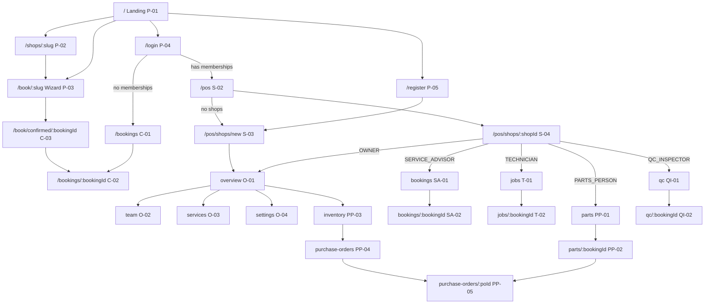

# 10 — Screens

**Status:** Draft

## Purpose

This spec is the inventory of every page and overlay in `apps/web`. For each screen it gives:
- the route;
- who can open it;
- what it is for;
- which API endpoints it loads (IDs `E-nn` in §13);
- the components it uses;
- the actions it offers, with glossary slugs and the roles and statuses that show them;
- empty and edge states;
- mobile notes.

Every view and action listed in the brief's §7.2, §7.3, §7.4, §7.7 and §8.1–8.2 has a screen here. §12 proves the coverage.

Architecture, tokens, shared components and UX rules are defined in [09-frontend-and-ux.md](09-frontend-and-ux.md); this spec refers to them as "09 §x". Names follow [18-glossary.md](18-glossary.md). Decisions in [17-decisions.md](17-decisions.md) win. Booking buttons follow `allowed_actions` from [08-booking-state-machine.md](08-booking-state-machine.md).

## 0. Conventions

- **Screen IDs:** `P-` public · `C-` customer · `S-` POS shell · `SA-` Service Advisor · `T-` Technician · `PP-` Parts Person · `QI-` QC Inspector (D75: `QC-xx` is the QC test-ID prefix) · `O-` Owner · `X-` shared · `B-` bonus (P2).
- **Roles** use glossary values: `OWNER`, `SERVICE_ADVISOR` (SA), `TECHNICIAN`, `PARTS_PERSON`, `QC_INSPECTOR`, plus the customer (any logged-in user acting on their own bookings). "RO" means a read-only view (D16, glossary §1 "Read-only view").
- **Actions.** A booking action button appears **only** when its slug is in the booking's `allowed_actions` (D48). The "Status" and "Role" columns describe *when the API will list it* (08). They are not checks the UI performs.
  - Non-booking buttons appear only when the membership's server-computed `capabilities` include the needed capability (D66, glossary §2.4, 09 §2.8).
  - Bodies always include `expected_version` (D30).
  - Labels, dialogs and toasts come from the action registry (09 §4.6).
- **Data.** "live" means the always-on 15 s refetch plus WebSocket invalidation (09 §2.7, D14). The refetch is the P0 path; the WebSocket layer (E-05, `WS`) is P1 (D88), so no screen depends on a push. Server Components fetch with `cache: 'no-store'`. Every `/api/*` response is `Cache-Control: no-store` (D61); TanStack Query is the only client cache.
- **Every screen** has loading skeletons, an `ErrorState` with retry, a unique `<title>`, one `<h1>` and the skip link (09 §4, §5). These are not repeated per card.
- **Times** are shown in the shop's timezone (D38). **Money** is shown with `formatPKR` (D41). The **booking reference** appears wherever a booking appears (UX rule R3).
- **API shapes and field limits** are spec 03's: every endpoint below is an `E-nn` of §13 (aligned with spec 03 §4 and §8.1), and every form limit quoted here equals spec 03's request schema (09 §2.10).
- **As built (2026-10-10).** Every screen is built in the D101 design language, on the mock store of D102 (spec 11's data, the API's rules) until the API client is wired; the `E-nn` rows are what each screen reads once it is. A **"Built (2026-10-10)"** line under a screen records where the build differs from the row above it, and why; a gap with no reason given is a code change still owed, not a new requirement. The booking actions on the page follow 09 §4.6: one blue primary pill per view (R7), others `outline`, destructive ones last as `destructive-outline` (DESIGN.md §6.15), each confirmed in an `AlertDialog` with a solid `destructive` button.

---

## 1. Navigation map and route table

| Route | Screen | Group | Access | Pri |
|---|---|---|---|---|
| `/` | P-01 Landing | `(public)` | Everyone | P0 |
| `/shops/:slug` | P-02 Shop detail | `(public)` | Everyone | P0 |
| `/book` | P-03 Booking wizard, step 1 (choose a shop) | `(public)` | Everyone | P0 |
| `/book/:slug?step=&service=` | P-03 Booking wizard, steps 2–5 (shop slug in the path, D68) | `(public)` | Everyone | P0 |
| `/login?next=&reason=` | P-04 Login + demo credentials | `(auth)` | Everyone | P0 |
| `/register` | P-05 Owner registration | `(auth)` | Everyone | P0 |
| `/bookings` | C-01 My bookings | `(customer)` | Logged in | P0 |
| `/bookings/:bookingId` | C-02 Booking detail (customer) | `(customer)` | Booking's customer | P0 |
| `/book/confirmed/:bookingId` | C-03 Booking confirmed | `(customer)` | Booking's customer | P0 |
| `/pos` | S-02 POS hub (redirect) | `(pos)` | Logged in | P0 |
| `/pos/shops/new` | S-03 Create shop / first-run onboarding | `(pos)` | Logged in (D17) | P0 |
| `/pos/summary` | O-07 Multi-shop summary | `(pos)` | Owners of ≥ 2 shops | P1 |
| `/pos/shops/:shopId` | S-04 Role-home redirect | `(pos)` | Members of the shop | P0 |
| `/pos/shops/:shopId/overview` | O-01 Shop overview | `(pos)` | `OWNER` | P0 |
| `/pos/shops/:shopId/bookings` | SA-01 Bookings list | `(pos)` | `SERVICE_ADVISOR`, `OWNER` | P0 |
| `/pos/shops/:shopId/bookings/:bookingId` | SA-02 Booking detail | `(pos)` | `SERVICE_ADVISOR`, `OWNER` | P0 |
| `/pos/shops/:shopId/jobs` | T-01 My jobs | `(pos)` | `TECHNICIAN`; `OWNER` RO | P0 |
| `/pos/shops/:shopId/jobs/:bookingId` | T-02 Job detail | `(pos)` | Assigned `TECHNICIAN`; `OWNER` RO | P0 |
| `/pos/shops/:shopId/parts` | PP-01 Jobs awaiting parts | `(pos)` | `PARTS_PERSON`; `OWNER` RO | P0 |
| `/pos/shops/:shopId/parts/:bookingId` | PP-02 Parts job detail | `(pos)` | Assigned `PARTS_PERSON`; `OWNER` RO | P0 |
| `/pos/shops/:shopId/inventory` | PP-03 Inventory | `(pos)` | `PARTS_PERSON`; `OWNER` (catalogue only) | P0 |
| `/pos/shops/:shopId/purchase-orders` | PP-04 Purchase orders | `(pos)` | `PARTS_PERSON`; `OWNER` RO | P0 |
| `/pos/shops/:shopId/purchase-orders/:poId` | PP-05 PO detail and receive | `(pos)` | `PARTS_PERSON`; `OWNER` RO | P0 |
| `/pos/shops/:shopId/qc` | QI-01 QC queue | `(pos)` | `QC_INSPECTOR`; `OWNER` RO | P0 |
| `/pos/shops/:shopId/qc/:bookingId` | QI-02 Inspection | `(pos)` | `QC_INSPECTOR`; `OWNER` RO | P0 |
| `/pos/shops/:shopId/team` | O-02 Team | `(pos)` | `OWNER` | P0 |
| `/pos/shops/:shopId/services` | O-03 Services catalogue | `(pos)` | `OWNER` | P0 |
| `/pos/shops/:shopId/settings` | O-04 Shop settings | `(pos)` | `OWNER` | P0 |
| `/pos/shops/:shopId/calls` | B-04 AI calls and tasks | `(pos)` | `SERVICE_ADVISOR`, `OWNER` | P2 |
| `/admin` | A-01 Platform overview | `(admin)` | Platform admins (D94) | P1 |
| `/admin/shops`, `/admin/shops/:shopId` | A-02 Shops, A-03 Shop detail (suspend / reactivate) | `(admin)` | Platform admins | P1 |
| `/admin/users`, `/admin/users/:userId` | A-04 Users, A-05 User detail (deactivate, admin access) | `(admin)` | Platform admins | P1 |
| `/admin/bookings`, `/admin/bookings/:bookingId` | A-06 Bookings, A-07 Booking detail (read-only) | `(admin)` | Platform admins | P1 |
| `/admin/audit` | A-08 Audit log (filters, export) | `(admin)` | Platform admins | P1 |
| *(overlays)* | X-01 Notifications panel · B-01 Incoming call · B-02 In-call bar | — | Logged in | P0 / P2 |
| *(fallbacks)* | X-02 404 · X-03 403 · X-04 Session expired · X-05 Error and offline | — | — | P0 |

---

## 2. Public surface

### P-01 · Landing

| | |
|---|---|
| **Route** | `/` (`app/(public)/page.tsx`): marketing content only; it loads no shop data. |
| **Access** | Everyone. The header switches to the logged-in state when `GET /api/v1/me` returns a user (E-04, client). |
| **Purpose** | Brief §7.3 landing page and goal G1 (09 §1). As built it is the previous marketing landing, which the owner chose to keep (see "Built"); the brief's shop grid (name, city, rating placeholder, services offered), basic search and city filter are the directory on `/book` (P-03 W1). |
| **Data** | None on `/`. The directory loads E-06 (shops) and E-07 (cities) on `/book`. |
| **Layout** | 1. **Hero** (light, D101: white with grid paper fading out and a soft brand-blue glow): headline, subline, **"Book a Demo"** (`outline`) and **"Get Started"** (the blue primary pill, R7), then GarageBox's hero images, a "5-Star Rated based on 200+ reviews" line with review-site logos, and app-store badges. 2. **Marketing sections** with GarageBox's feature illustrations and phone mock-up, testimonials, and a closing sign-up band; the footer carries GarageBox's contact e-mail and phone. The GarageBox material and the claims BayFlow cannot back are risk A25 (spec 16, open). |
| **Actions** | Navigation only: the hero buttons, the header's menus, "Sign In" (→ `/login`) and the footer links. Nothing on `/`, in the header or in the footer links to `/book` (see "Built"). |
| **Empty and edge states** | Nothing on `/` depends on the API; the directory's empty, loading and error states are W1's. |
| **Mobile** | One column; the header's menus fold into a drawer that ends with a blue "Book a Demo / Get Started" pill → `/register` (09 §4.1). |
| **Built (2026-10-10)** | The owner chose to keep the previous landing, public header and footer (2026-10-10; the replacement in `ef510c5` was reverted), so `/` lists no shops and — **a known gap against G1 and brief §7.3** — has no direct link to the directory. `/book` is reached from the shop pages ("All shops" on P-02), the login page's "Book a service", My bookings ("Book a service", "Find a shop") and the README, so from `/` it takes at least three clicks to start a booking (through "Sign In" and the login page), not G1's two. The directory itself is W1: search by workshop, area or street, "All cities" plus one pill per city, and cards with the shop photo, rating or "New" (D56), address, the first 3 services plus "+N more", "Book now" (the blue primary pill → `/book/<slug>?step=services`) and the shop name → P-02. Closing the gap (a link, or the grid itself on `/`) is the owner's call (spec 15 R-7.3-1, spec 16 A25). |
| **Traceability** | §7.3 Landing, §5.1 step 1, §6 step 1 ("sees 6 shops"), D51, D55, D56, D64, D68 |

### P-02 · Shop detail

| | |
|---|---|
| **Route** | `/shops/:slug`. A Server Component that awaits `params`. `generateMetadata` sets the title "{Shop} · BayFlow". |
| **Access** | Everyone |
| **Purpose** | Lets a customer judge the shop before booking: services, prices, opening hours, contact. |
| **Data** | E-08 public shop detail (server): name, address, city, phone, `logo_url`, `rating`, `timezone`, `slot_duration_minutes`, `working_hours[]`, active `services[]` (`id`, `name`, `description`, `estimated_duration_minutes`, `base_price`, …) and `is_bookable` (at least one active service, D64). |
| **Layout** | Header (a hero with the shop's photo, `lib/shop-photos.ts`): h1 name, rating or "New", today's hours in shop time, address with an "Open in Google Maps" link, `tel:` phone link, and "Book a service" (the blue primary pill, R7) → `/book/<slug>`. **Services** list: name, description, "≈ 60 min", and "from Rs 2,500" when `base_price` exists, otherwise "Price after inspection". Each service has its own "Book" link → `/book/<slug>?service=<id>`, which preselects it. **Opening hours** table, Monday to Sunday (glossary weekday 0 = Monday). Closed days read "Closed". Today's row is highlighted. Times are in the shop's timezone. "How booking works" mini-steps. Back link "All shops" (→ `/book`, the directory). |
| **Actions** | Navigation to P-03 |
| **Empty and edge states** | Unknown, unlisted or suspended (D96) slug → the in-page "We couldn't find that shop" (X-02's rule: nothing says the shop exists) with the directory below it. `is_bookable: false` (no active service; `services` is `[]`) → hide the CTAs and show "This shop isn't taking online bookings yet" (D34: at least one service is required, so the CTA would fail; such a shop is also left out of the directory, D64). Every day closed → "No opening hours published". |
| **Mobile** | Single column, with a sticky bottom bar holding "Book a service" (44 px). |
| **Traceability** | §7.3, §5.1, §7.2 (catalogue shown publicly), D34, D38, D55, D56, D64, D68 |

### P-03 · Booking wizard

| | |
|---|---|
| **Route** | `/book` for step 1 (choose a shop) and `/book/<slug>?step=<step>&service=<id>` for steps 2–5, with the shop slug in the path (D68). `step` is `services` (the default), `time`, `details` or `review`. The server pages await `params` and `searchParams` and render `<BookingWizard>` (client) inside `<Suspense>` (09 §2.4). |
| **Access** | Everyone. Logged-in users skip the account fields (D32). |
| **Purpose** | Brief §7.3 wizard: shop → services/problems → time slot → personal and vehicle details → review and confirm. The slot picker shows only available slots. Goal G2. |
| **Data** | E-06 (step W1, client); E-08 (selected shop); E-09 availability (live while on W3); E-04 me; E-16 my vehicles (P1, logged in); E-10 create; E-01 inline login. |
| **State** | One React Hook Form instance across all steps, using the zod schema typed against `BookingCreate`. Each step validates only its own fields (`trigger([...])`). `step` lives in the URL so the browser Back button works. Everything except the password is saved to `sessionStorage['bf:wizard:<slug>']` (R9). Deep-linking to a later step while an earlier step is invalid redirects to the first incomplete step. |
| **Shell** | A progress `<nav aria-label="Booking steps"><ol>`: 1 Shop · 2 Services · 3 Time · 4 Details · 5 Review. Completed steps are clickable. The current step has `aria-current="step"`. Focus moves to the step's `<h2>` on change. A summary panel ("Your booking": shop, services, date and time, vehicle) is sticky on the right at `lg`, and collapsible at the top on mobile. |
| **Mobile** | One step per screen. A sticky bottom bar holds Back / Continue (44 px) and respects safe areas. Time chips run 3 per row. The calendar is full width. |
| **Traceability** | §5.1, §7.3, §6 steps 1–3, D10, D32–D35, D37, D38, D62, D68, SM-07 |

**W1 · Shop**
- On `/book/<slug>` the step is shown as done in the summary, with a "Change" link → `/book`.
- `/book` (no slug) shows a compact searchable list (E-06, client). Choosing a shop goes to `/book/<slug>?step=services`.
- An unknown or unlisted slug (E-08 answers 404), or a shop with `is_bookable: false`, shows the inline `Alert` "That shop isn't taking bookings" and the list.

**W2 · Services (problems)**
- Checkbox cards for active services: name, description, duration, and "from Rs …" when a base price exists.
- 1–10 services (D34; `service_ids` 1–10, each once). The errors read "Choose at least one service" / "Choose at most 10 services".
- Textarea "Describe the problem (optional)", ≤ 2,000 characters, sent as `customer_notes`. Placeholder from the worked example: "Light came on yesterday, car vibrates at idle".
- `?service=` preselects a card.

**W3 · Time**
- A shadcn `Calendar` enables dates from today to today + 30 in shop time (D37), and only weekdays that have working hours.
- The default date is the first open day that still has a free slot: today while today has one, otherwise the next such day (so an evening visit never opens on an empty day). It shows in the summary only once the visitor reaches this step.
- Selecting a date fetches E-09 with `date=YYYY-MM-DD`, computed by `shopDateKey` in the shop's timezone.
- Times show as a `RadioGroup` of chips ("10:00 am") built from E-09's `slots[{slot_start, slot_end, remaining}]`. **Only free slots exist in the response:** the API omits full slots, so every returned slot has `remaining ≥ 1` (§7.3 "only available slots"; `remaining` = free places in the slot, D68). A slot with `remaining === 1` shows the hint "1 left".
- No free slots (`slots: []`, also for past dates, closed days and dates beyond 30 days) → `Empty` "No free times on Fri 16 Oct" with a "Next open day" button.
- The note "Times are shop local time (Asia/Karachi)" appears on this step, using E-09's `timezone`.
- The stored value is the chosen slot's `slot_start` (UTC ISO string), sent as `slot_start`.
- Availability is refetched on focus and every 15 s on this step. If the chosen slot disappears, the selection is cleared and the user sees "That time was just taken — please pick another".

**W4 · Details**
- **Logged in:** "Booking as Ayesha Khan · ayesha.customer@bayflow.test (Not you? Log out)". There are no name, e-mail or password fields. Phone is shown only when `me.phone` is empty (D33).
- **Anonymous:**
  - Full name (1–120 characters).
  - E-mail (≤ 254 characters; reserved `.test` addresses are accepted, D62; 09 §2.10).
  - Password, 12–128 characters (D10; show/hide toggle), with helper text "At least 12 characters. Create a password to track your booking. Already have a BayFlow account? Enter your existing password." and a "Log in instead" link that opens an inline `LoginDialog` (E-01).
  - Phone (optional; 7–20 characters of digits, spaces and hyphens, optional leading `+`), with helper "Helps the shop find your booking when you call."
- **Vehicle:**
  - P1, logged in: a "Your vehicles" select from E-16 (`{items}`) that prefills the fields, or "Add another vehicle".
  - Fields: Registration number (2–20 characters, displayed in upper case, e.g. LEA-1234; letters and digits once spaces and hyphens are removed), Make (1–60), Model (1–60), Year (1900 to next year), Color (optional, ≤ 30), Mileage in km (optional, 0–2,000,000).
- Field names equal the API body (`customer.full_name`, `vehicle.registration_number`, …; 09 §2.9).

**W5 · Review and confirm**
- Read-only sections, each with an "Edit" link back to its step: Shop and time; Services and notes; Your details (the password is never echoed); Vehicle.
- The note "The final price comes from the technician's inspection estimate — you'll approve it online before any work starts."
- **"Confirm booking"** (the blue primary pill, R7) calls E-10 `POST /api/v1/bookings` (`CREATE`, 08 T01). The button shows "Booking…" with a spinner and blocks double submits.
- **On success:**
  - The API sets the cookie and returns `{access_token, token_type, expires_in, account_created, booking}`, with the new booking nested under `booking` (D32). The cookie is the normal path; the token is used only in the Bearer fallback (D7, 09 §2.8).
  - Refetch `qk.me` (`exact: true`) and clear `sessionStorage`.
  - `router.replace('/book/confirmed/{booking.id}?new_account=1')` when `account_created` is true, otherwise without the parameter.

**W5 error handling**

| Response | UX |
|---|---|
| 409 `SLOT_FULL` | Go to W3, refetch availability, clear the slot. `Alert`: "That time was just booked by someone else. Please pick another slot." Everything else is kept. |
| 422 `INVALID_SLOT` | Same as above, with "That time is no longer available." The `slot_start` field error carries the reason (`off_grid`, `in_past`, `beyond_horizon`, `closed_day`, `outside_hours`; spec 03 §2.3); the recovery is the same for all, and `in_past` may read "That time has already started." |
| 409 `EMAIL_ALREADY_REGISTERED` | Stay on W5. `Alert`: "There's already a BayFlow account for ahmed@mail.com and the password didn't match. Log in to finish — your booking details are saved." The "Log in" button opens `LoginDialog` with the e-mail prefilled. On success, `me` is refetched, W4 switches to the logged-in state and the password is discarded; the user presses Confirm again. Nothing was created (D32). |
| 422 `VALIDATION_ERROR` | Map field errors and jump to the first step that has one (09 §2.9). |
| 404 `NOT_FOUND` | The shop was unlisted in the meantime. Show "This shop is no longer taking bookings" and a link back to `/`. |
| 401 `UNAUTHENTICATED` | A stale session cookie (spec 04: never silently downgraded to an anonymous booking). The session-expired flow runs (X-04); the wizard state survives in `sessionStorage` and `next` brings the user back to W5. |
| 429 `RATE_LIMITED` / network | Show the message and keep all data. Retry is the user's choice. |

### P-04 · Login (with demo credentials)

| | |
|---|---|
| **Route** | `/login?next=<path>&reason=expired` |
| **Access** | Everyone. If `me` already exists, redirect via `resolveHome(me, next)` (09 §2.8) without flashing the form. |
| **Purpose** | One login for everyone (brief §7.1: owner, staff created by the owner, customers created by the wizard) and the demo credentials judges need (§7.7, D52). |
| **Data** | E-01 login (returns `{access_token, token_type, expires_in, user}` and sets the cookie; **no memberships**, D81), then E-04 me (memberships and capabilities for routing) |
| **Layout** | Auth layout. From `lg`, a light brand panel on the left (a rounded canvas panel with grid paper and a soft blue glow, D101) with the logo, the tagline "Every hand-off, on the *record*." (the handwritten word) and a sample booking's hand-offs. The right `Card` holds h1 "Log in to BayFlow". When `reason=expired`, an `info-subtle` banner reads "Your session has expired. Please log in again." (X-04). Form: E-mail (`autocomplete="email"`), Password (`current-password`, show/hide toggle with `aria-pressed`; checked only for 1–128 characters — the 12–128 rule applies where passwords are set, 09 §2.10), and a primary "Log in" button. Links: "New customer? Book a service — your account is created as you book." → `/book` (the directory); "Own a garage? Register your shop" → `/register`. |
| **`DemoCredentialsPanel`** | Plain, selectable text (09 §4.12). A card "Demo accounts" listing Role · Name · E-mail: Owner · Fatima Raza · `fatima.owner@bayflow.test` (Lahore Auto Care + a second shop) Service Advisor · Bilal · `bilal.sa@bayflow.test` Technician · Imran · `imran.tech@bayflow.test` (second technician: Hamza · `hamza.tech@bayflow.test`) QC Inspector · Sara · `sara.qc@bayflow.test` (second inspector, for "first pick wins": Hina · `hina.qc@bayflow.test`) Parts Person · Usman · `usman.parts@bayflow.test` Platform admin · Areeba Hashmi · `admin@bayflow.test` (the admin console, spec 19 §8) Customer · Ayesha Khan · `ayesha.customer@bayflow.test` Then "Password for all: `BayFlow@2026`" (with a copy button), "Ahmed (worked example) isn't seeded — book through the wizard with a fresh e-mail such as `ahmed.<your-initials>@bayflow.test`" (glossary §14.1, spec 11 judge notes) and the D71 tip "Friday 10:00 full or parts used up by earlier testers? Pick another slot; Usman can adjust stock." Picking an account fills the e-mail and the shared password; the user still presses Log in (D52, amended 2026-10-10). No "log in as" button, no auto-login and no role or account switcher anywhere in the app (D52). |
| **Actions** | "Log in" → E-01 → `fetchQuery({ ...meQuery, staleTime: 0 })` (E-04; the login body is never used for routing, D81, 09 §2.8) → `router.replace(resolveHome(me, next))` |
| **Edge states** | 401 `INVALID_CREDENTIALS`: form-level alert, the e-mail is kept, the password is cleared and focused. 401 for a deactivated user gets the same message (no account enumeration). 429 `RATE_LIMITED`: submit is disabled until `Retry-After`. An unsafe `next` (absolute URL or `//…`) is ignored. |
| **Mobile** | Single column. The demo panel sits under the form. Inputs use 16 px text. |
| **Traceability** | §7.1, §7.7, §9.2 "Demo accounts", D8, D52, D69, D71, glossary §14 |

### P-05 · Owner registration

| | |
|---|---|
| **Route** | `/register` |
| **Access** | Anonymous. A logged-in user instead sees "You're logged in as {name}" and "Create a new shop" → `/pos/shops/new` (D17: any logged-in user may create a shop). |
| **Purpose** | Owner sign-up (brief §7.1, §4 Owner "Registers an account"). |
| **Data** | E-03 register-owner, E-04 me |
| **Layout** | h1 "Register your shop on BayFlow". Copy: "Create your owner account. Next you'll set up your shop and add your team." Fields: Full name (1–120), E-mail (≤ 254; `.test` accepted, D62), Password (12–128 characters, D10; helper "At least 12 characters"; show/hide, `new-password`), Phone (optional; 7–20 characters of digits, spaces and hyphens, optional leading `+`). Button "Create account". Staff note: "Staff accounts are created by the shop owner — ask your owner for your login." (brief §4: staff never self-sign-up). |
| **Actions** | "Create account" → E-03 (sets the cookie and returns `{access_token, token_type, expires_in, user}`, D81) → `fetchQuery({ ...meQuery, staleTime: 0 })` (E-04, `memberships: []`) → `router.replace('/pos/shops/new')` (S-03, first-run variant) |
| **Edge states** | 409 `EMAIL_ALREADY_REGISTERED`: "An account with this e-mail already exists. Log in, then create your shop from the POS." with a link to `/login?next=/pos/shops/new`. 422: field errors. 429 `RATE_LIMITED` (D69). |
| **Mobile** | Single column |
| **Traceability** | §7.1, §6 step 0, D17, D10, D62, D69 |

---

## 3. Customer surface

### C-01 · My bookings

| | |
|---|---|
| **Route** | `/bookings` |
| **Access** | Any logged-in user. The API returns only the caller's own bookings (D21). |
| **Purpose** | The customer dashboard list with pending actions highlighted (§7.3). |
| **Data** | E-11 (live), queried as `?active=true` for the Active tab and `?active=false` for Past. Each item (`CustomerBookingSummary`): `reference`, `status`, `slot_start`, `shop {id, slug, name, city, phone, timezone}`, `vehicle` (registration, make, model, year), `service_names`, `estimate_summary {version, grand_total, status, …}`, `allowed_actions`, `version`, `updated_at`. |
| **Layout** | h1 "My bookings", "Book a service" (the blue primary pill, R7 → `/book`), and segmented `Tabs` Active · Past with their counts. Each card: an `ActionNeededCallout` on top **when `allowed_actions` asks for it**: • `approve-estimate` → "Estimate awaiting your approval — Rs 16,100" with "Review estimate". • `complete` → "Your vehicle is ready — confirm when collected". Then the shop name, `BookingReference`, `StatusBadge` (customer audience), slot "Fri, 16 Oct 2026 · 10:00 am", vehicle "LEA-1234 · Honda Civic 2016", services, and a link to C-02. Sort order: action-needed first, then upcoming by `slot_start`, then by `updated_at` descending. |
| **Actions** | Navigation only. Decisions happen on C-02, where the full estimate is visible. |
| **Empty and edge states** | Active is empty → "No active bookings" with "Find a shop" (→ `/book`; "No bookings yet" when there are none at all). Past is empty → "No past bookings yet". When a status changes live, the badge fades (09 §3.10). A suspended shop's bookings (D96) get one notice above the tabs ("… is temporarily unavailable on BayFlow": no approving, declining or confirming a pick-up there; cancelling still works until the repair starts) and no callouts. |
| **Mobile** | Full-width cards. The callout's CTA is full width. |
| **Built (2026-10-10)** | Cards also show the shop's photo. An estimate shows on a card only once the shop has sent it (D39). Someone else's booking reads exactly as an unknown id, here, on C-02 and on C-03 (D21, D102). |
| **Traceability** | §7.3 Customer dashboard, §3 "Customer anxiety", D48 |

### C-02 · Booking detail (customer)

| | |
|---|---|
| **Route** | `/bookings/:bookingId` |
| **Access** | The booking's customer. Anyone else gets 404 (08 SM-17), shown as X-02 in-page. |
| **Purpose** | Live status timeline, the itemised estimate with its version, approve or reject with a reason, cancel when allowed, the ready-for-pick-up message and mark-as-picked-up (§7.3, §4 Customer). |
| **Data** | E-12 detail (live, `CustomerBookingDetail`). It includes the booking, `shop {id, slug, name, address, city, phone, timezone}`, vehicle, services, `customer_notes`, `estimate` (the latest `SENT`, `APPROVED` or `REJECTED` version, with lines and totals; spec 04 §C), `estimate_revision_in_progress`, `allowed_actions`, `version`, `ready_notified_at`, `cancelled_by_customer`, `cancel_reason`, `status_changed_at`. Also: E-13 events (`{items}`, customer projection); E-14 versions (P1, "Previous versions", `{items}`); E-56 calls (P2). |
| **Layout** | Mobile-first single column; main content plus a side column once the page is 58rem wide (`DetailLayout`, 09 §4.14). 1. **Header**: shop name, `BookingReference` (large, copyable), `StatusBadge` (customer), slot time, and "Times are shop local time". 2. **Banners**, driven by `allowed_actions` and status: `ActionNeededCallout` (estimate) or `ReadyForPickupBanner`, which contains "I've collected my vehicle" when `complete` is allowed. 3. **Estimate** (when `estimate` exists): `EstimateView` (customer) + `EstimateDecisionBar` (09 §4.5). Decided states read "Approved by you on 16 Oct 2026, 2:31 pm" (green), or "You declined this estimate on … — the shop will follow up" plus your reason. In `ESTIMATE_REVIEW` with no visible estimate: "Your estimate is being prepared — we'll notify you when it's ready." When `estimate_revision_in_progress` is true (a newer version exists that you can't see yet, e.g. after you declined): "The shop is preparing a revised estimate." 4. **Status timeline**: `StatusTimeline` (customer audience), including upcoming steps. 5. **Vehicle and services** card: vehicle, services booked, your notes. 6. **Shop** card: address, `tel:` phone, today's hours. P2: `CallButton` "Call the shop" (B-01). 7. **Cancel booking**: a `destructive-outline` button (DESIGN.md §6.15) in a "Need to cancel?" card at the bottom, only when `cancel` is allowed. |
| **Mobile** | While `AWAITING_CUSTOMER`, the decision bar is sticky at the bottom. Estimate tables stack each line as "name · qty × price = total". |
| **Built (2026-10-10)** | The estimate shows only once sent (D39); a booking without one shows no total. Cancel follows the 11 cancellable statuses (glossary §3), so a customer who declined can still cancel. At a suspended shop (D96) approve, decline and "I've collected my vehicle" are unavailable; cancel stays. "Call shop" dials the booking's own shop. The quality-check card appears only after a pass. |
| **Traceability** | §7.3, §5.2 rows 6 and 15, §5.3 (cancellation), §6 steps 7 and 16, D27, D28, D39, SM-08, SM-14 |

**Actions** (customer endpoint E-15):

| Slug | API lists it when | UI |
|---|---|---|
| `approve-estimate` | `AWAITING_CUSTOMER` (booking's customer) | The blue primary pill "Approve · Rs 16,100" (R7, DESIGN.md §6.11) → confirm dialog → `{estimate_id, expected_version}` |
| `reject-estimate` | `AWAITING_CUSTOMER` | "Decline" (`outline`) → dialog "Decline the estimate for BF-…?" with optional reason ≤ 500 → `{estimate_id, reason}` |
| `complete` | `READY_FOR_PICKUP` (D28) | "I've collected my vehicle" → confirm |
| `cancel` | Any of the 11 cancellable statuses (glossary §3) | "Cancel booking" → `AlertDialog`, optional reason. The copy states the consequence: "Your slot will be released." |

**Edge states**

| Situation | UX |
|---|---|
| 409 `STALE_ESTIMATE` | Refetch, then show the banner "The shop updated this estimate — please review v3". |
| `CANCELLED` | Grey banner "Cancelled on … by you" (`cancelled_by_customer` true) or "Cancelled on … by the shop", plus `cancel_reason` when the shop gave one. Then "Book again" → `/book/<slug>`. |
| `COMPLETED` | "Completed on …", plus "Book again". |
| QC fail loop | The timeline shows "Quality check found something to fix — back in repair" (09 §4.4). |

### C-03 · Booking confirmed (wizard success)

| | |
|---|---|
| **Route** | `/book/confirmed/:bookingId?new_account=1` |
| **Access** | The booking's customer. The cookie was just set by E-10. A refresh works. Without a cookie, `proxy.ts` sends the user to `/login` and back. |
| **Purpose** | Confirms the booking, shows the reference and points to tracking (wizard "success" step). |
| **Data** | E-12 |
| **Layout** | A success hero (`bg-hero`): `CircleCheckBig` icon (success ink), h1 "Booking *received*" (the handwritten word), and the reference `BF-7K2M9Q` large, in mono, with Copy. "We've sent your booking to Lahore Auto Care. A service advisor will confirm it shortly." A summary card: slot, shop address and photo, services, vehicle, live status. **"What happens next"**: 1 The shop confirms → 2 A technician inspects your car → 3 You approve the estimate online → 4 Repair and quality check → 5 Pick up your car. When `new_account=1`: "Your BayFlow account is ready — log in with {email} next time." CTAs: "Track this booking" (the blue primary pill, R7 → `/bookings/:bookingId`) and "Go to my bookings" (`outline` → `/bookings`). |
| **Actions** | Navigation only |
| **Mobile** | Single column, full-width CTAs |
| **Built (2026-10-10)** | The page `<title>` is "Booking received" without the reference (an exception to R3): the server can't tell whose booking it is, and a reference in the title would confirm to anyone with the link that the booking exists (D21). An unknown id, or someone else's booking, shows "We couldn't find that booking" — never a fallback reference or shop. |
| **Traceability** | §5.1 last bullet, §7.3, D32, D33 |

---

## 4. POS shell

### S-01 · POS shell (header, shop switcher, sidebar)

| | |
|---|---|
| **Where** | `(pos)/pos/layout.tsx` provides `RequireSession`, the sidebar state (`SidebarProvider`), the canvas and `PosHeader`. `[shopId]/layout.tsx` provides `ShopScope`, `PosSidebar`, the section gate and the content landmark (`<main id="main">` with `max-w-7xl`, `px-4 sm:px-6 lg:px-8`, `py-6 lg:py-8`) (09 §2.8, §3.7, §4.1). `/pos`, `/pos/shops/new` and `/pos/summary` have no sidebar and render their own `<main>`. |
| **Look** | Light (D101, 09 §4.1): a white 64 px bar (90 % with a blur, sticky) over the `#F2F7FE` canvas, and a white 256 px sidebar. No navy surfaces. |
| **Header** | Left: the sidebar toggle (shop pages only) · logo (→ `/pos`; a "POS" tag from `lg`) · `ShopSwitcher` pill showing the current shop's name; its menu lists "All shops summary" first (owners of ≥ 2 shops, P1), then the user's shops (`shop_name` and the role per membership — `/me` memberships carry no city) with a check on the current one, and "Create new shop" last (D17). It lists only the person's own active memberships, switching takes their role in the chosen shop, and a shop they don't belong to is never named: the pill reads "Choose a shop" off a shop page, or "No shop yet" without any membership (then the menu offers the hub and "Create new shop"). Right: the role pill (`RoleChip`: their role in this shop, a chip and never a switch — there is no role or account switcher, D52) · `NotificationBell` (X-01; orange unread badge, 1–9 or "9+") · `AccountMenu` (avatar; "My bookings", "Website", "Sign out"). `RealtimeIndicator` joins the right side with the P1 WebSocket (D88). |
| **Sidebar** | Items per role, in the matrix below. The Owner gets two groups: **Manage**, and **Role views (read-only)**; every other role gets **Your work**. The current item has the `#BFDBFE` fill, a semibold dark label, a brand-blue icon and `aria-current="page"`. **Shop membership gate** (glossary §1, D20): anyone who is not an active member of the shop — another shop's staff, a customer, a platform admin without a membership — gets X-02's "We couldn't find that shop" with no sidebar and no shop name, exactly as for a shop that doesn't exist. Members then meet, in the API's order: a suspended shop's suspended state (D96, every member, the Owner too), then `ForbiddenState` (X-03) on another role's section, judged by their role in this shop. |
| **Data** | E-04 me (flat active memberships `{membership_id, shop_id, shop_name, shop_slug, role, capabilities}`, D66), E-22 the current shop (`city`, `timezone`, `logo_url`, which `/me` does not carry; `ShopScope`, 09 §2.8), E-18 unread count (live), the realtime socket |
| **Mobile** | Below `md` (768 px) the sidebar is a 288 px `Sheet` opened from the bar's toggle; from `md` up the same toggle (or ⌘B / Ctrl+B, or the rail) collapses it to a 64 px icon rail. Below `sm` the logo shows the mark only, the shop name truncates and the role pill shows only its icon (the role name stays in `sr-only` text). |
| **Traceability** | §7.2 "Shop switcher", §5.4 bell, §3 "Each role only sees the work that is theirs", D15, D16 |

**Role navigation matrix.** This is navigation scope only; the API enforces permissions (09 §2.8).

| Nav item (icon) | Route | `OWNER` | `SERVICE_ADVISOR` | `TECHNICIAN` | `PARTS_PERSON` | `QC_INSPECTOR` |
|---|---|---|---|---|---|---|
| Overview (`LayoutDashboard`) | `/overview` | ✓ Manage | | | | |
| Bookings (`CalendarCheck`) | `/bookings` | ✓ Manage | ✓ home | | | |
| My jobs / Technician jobs (`Wrench`) | `/jobs` | RO | | ✓ home | | |
| Parts queue (`PackageSearch`) | `/parts` | RO | | | ✓ home | |
| Inventory (`Boxes`) | `/inventory` | ✓ Manage (catalogue) | | | ✓ | |
| Purchase orders (`Truck`) | `/purchase-orders` | RO | | | ✓ | |
| QC queue (`ClipboardCheck`) | `/qc` | RO | | | | ✓ home |
| Team (`Users`) | `/team` | ✓ Manage | | | | |
| Services (`Tags`) | `/services` | ✓ Manage | | | | |
| Settings (`Settings`) | `/settings` | ✓ Manage | | | | |
| AI calls and tasks (`Sparkles`), P2 | `/calls` | ✓ | ✓ | | | |

### S-02 · POS hub `/pos`

| | |
|---|---|
| **Route** | `/pos` (client redirect, with a skeleton header while `me` loads) |
| **Access** | Logged in |
| **Behaviour** | 0 memberships → `/pos/shops/new`. 1 → `/pos/shops/:id`. More than 1 → the last used shop (`bf:lastShopId`) if still valid, else the first `OWNER` membership, else the first membership by name (09 §2.8). |
| **Edge states** | `me === null` → `/login?next=/pos`. A customer-only user reaches S-03, which offers "Looking for your bookings? Go to My bookings". |
| **Built (2026-10-10)** | On the mock session (D102) the shop opened last decides: a member with one goes straight to their role's home in it, behind a skeleton. Without one, `/pos` lists their own active memberships as cards (shop, address, role chip → that role's home) with "Create shop" as the primary and "All shops summary" for owners of 2+ shops; with no membership it shows the first-run welcome (R12) and "Create your first shop", plus "Go to My bookings" for a customer, instead of redirecting to S-03. `bf:lastShopId` is not stored yet (S-04). |

### S-03 · Create shop / first-run onboarding

| | |
|---|---|
| **Route** | `/pos/shops/new` |
| **Access** | Any logged-in user (D17). The creator becomes the shop's `OWNER`. |
| **Variants** | **First run** (0 memberships): "Welcome, Fatima — let's set up your first shop", with three steps ahead: Create shop → Add your team → Add services and parts (UX rule R12). **Additional** (reached from the switcher's "Create a new shop"): "Create a new shop — each shop has its own team, services, slots and inventory" (§7.2). |
| **Data** | E-21 `POST /api/v1/shops` (`ShopCreate`; `working_hours` with 7 rows is required, `timezone` is optional and left to its `Asia/Karachi` default) → `ShopRead` |
| **Form** | **Shop details:** Name (1–120), City (1–80), Address (1–255), Phone (required; 7–20 characters of digits, spaces and hyphens, optional leading `+`), Logo URL (optional `https://` URL ≤ 2,048; live Avatar preview with initials fallback, D55). **Opening hours:** 7 rows Mon → Sun, each with an Open `Switch` (off = `is_closed`) and open/close time selects that offer only times on the slot grid — multiples of the chosen slot duration from local midnight (D37); close must be later than open. Changing the duration re-snaps the times to the new grid (open rounds up, close rounds down) and highlights the changed rows. Default Mon–Sat 09:00–18:00, Sunday closed. **Slots:** duration (select of every multiple of 15 from 15 to 240 min, default 60), capacity (integer 1–50, default 2), and a preview "Mon: 9 slots × 2 cars". **Directory:** `is_listed` switch, default on, "Show on the BayFlow shop directory" with the helper "Your shop appears once it has at least one active service" (D64). Timezone is shown read-only as "Asia/Karachi (PKT)" (D38). |
| **Actions** | "Create shop" → E-21 → refetch `qk.me` (`exact: true`; new `OWNER` membership) → `/pos/shops/{id}/overview?welcome=1` (O-01 with the setup checklist) |
| **Edge states** | 422 → field errors (working-hours rows map to `working_hours.<i>.<field>`, codes `not_on_grid` / `invalid_range` / `duplicate`). A name whose slug is taken is never an error: the API appends `-2`, `-3` … to the slug (spec 03 §4.9). 429 `RATE_LIMITED` (shop creation is rate-limited, 10 per day per user, D69). |
| **Mobile** | Single column, native time selects |
| **Built (2026-10-10)** | Four `FormSection`s (details, opening hours, booking slots with a live capacity preview, directory listing), inline validation with the API's rules instead of native browser pop-ups, and a full-width "Create shop" on phones. Saving makes the creator the shop's `OWNER` (D17), so the shop appears in the hub, the switcher and O-07 at once; a name already used gets a `-2`, `-3` … id instead of replacing another tenant's shop; a double click creates one shop. |
| **Traceability** | §7.2 create shop (name, address, city, phone, working hours, slot duration/capacity, logo optional), §6 step 0, D17, D37, D38, D55, D64, D69 |

### S-04 · Role-home redirect `/pos/shops/:shopId`

| | |
|---|---|
| **Behaviour** | `ShopScope` resolves the membership. No membership → `NotFoundState` (same as the API's 404, D20; the shop membership gate, S-01). Otherwise redirect by role: `OWNER` → `/overview`, `SERVICE_ADVISOR` → `/bookings`, `TECHNICIAN` → `/jobs`, `PARTS_PERSON` → `/parts`, `QC_INSPECTOR` → `/qc`, behind a skeleton (never a flash of the workspace). It also stores `bf:lastShopId` (built 2026-10-10 without it: `ShopScope` reads the mock session's memberships, D102, and the store comes with `GET /api/v1/me`). |
| **Traceability** | §3 "Each role only sees the work that is theirs", §10 "role dashboards that show only relevant work" |

---

## 5. Service Advisor

### SA-01 · Bookings list

| | |
|---|---|
| **Route** | `/pos/shops/:shopId/bookings?filter=…&status=…&q=…&date=…&page=…` |
| **Access** | `SERVICE_ADVISOR`, `OWNER`. Both see all bookings of the shop (D21). |
| **Purpose** | Brief §7.4 SA "Bookings list with filters by status", with a count per status. |
| **Data** | E-33 list (live): repeatable `status`, `q` (reference, customer name or plate), `date_from` / `date_to` (shop days), `sort`, `limit=20`, `offset`. Also E-34 status counts (live), and P1 E-25 technicians for a technician filter. |
| **Layout** | `PageHeader` "Bookings · Lahore Auto Care". **`FilterBar`** (09 §4.7): • status chips grouped by phase, each with its count from E-34; • presets: **"Needs SA action"** (`PENDING`, `CONFIRMED`, `ESTIMATE_REVIEW`, `ESTIMATE_APPROVED`, `ESTIMATE_REJECTED`, `READY_FOR_PICKUP` — the statuses whose step owner is the SA, glossary §3; this is the default on first visit), "In progress" (every other non-terminal status: `ASSIGNED`, `INSPECTING`, `AWAITING_CUSTOMER`, `PARTS_PENDING`, `PARTS_ORDERED`, `PARTS_READY`, `IN_REPAIR`, `QC_PENDING`, `QC_IN_PROGRESS` — the reporting module's `in_progress` group, so the counts match O-01 and O-07) and "All"; • date preset Today / Next 7 days / All; • search (≤ 100 characters). **`DataTable`** columns: Reference (mono link) · Slot · Customer · Vehicle (plate · make model) · Services · Status (`StatusBadge` staff) · Assigned (technician and parts person; "inactive" warning chip, D19) · Updated (relative) · **Next step** (the label of the first forward action in the row's `allowed_actions`, e.g. "Confirm" or "Send estimate", as an `attention` chip; empty when the SA has nothing to do). Default sort: `slot_start` ascending for active presets, `-updated_at` for "All". |
| **Actions** | Row → SA-02. No inline transitions, because every SA action either has a dialog or benefits from context. |
| **Empty and edge states** | "Needs SA action" empty → "All caught up — nothing needs your action right now." Filtered empty → "No bookings match …" with Clear filters. New bookings appear live (`BOOKING_CREATED` toast plus refreshed counts). |
| **Mobile** | Cards showing reference, status, slot, customer, vehicle and the next-step chip. The filters collapse into a "Filters (2)" sheet. |
| **Built (2026-10-10)** | The URL is the state, read on every render so the overview's links and Back work: `?filter=needs_action\|in_progress\|all` (`ready`, `completed` and `cancelled` are shortcuts to that one status), `?status=<STATUS>` (one status, shown under "All"), `?date=today\|next_7_days`, `?q=`, `?page=`. The toolbar has the three preset pills with counts, a status menu grouped by phase with counts, a day menu and removable filter chips; 20 rows a page. When the next step is someone else's, the column says who the advisor waits on ("Waiting on technician", "… customer", "… parts", "… QC"). Rows become stacked cards when the card is narrower than 672 px; the toolbar wraps instead of folding into a "Filters" sheet. The header's "New walk-in booking" primary (→ the shop's public wizard) is not specified here: staff walk-ins are out of scope (`modules/bookings.md` §2), and with D32 an advisor who is signed in would book in their own name. |
| **Traceability** | §7.4 SA, §5.2 rows 1, 5, 7 and 14, §5.4 "New booking created → SAs", D21 |

### SA-02 · Booking detail (Service Advisor / Owner)

| | |
|---|---|
| **Route** | `/pos/shops/:shopId/bookings/:bookingId` |
| **Access** | `SERVICE_ADVISOR`, `OWNER` (D16: the Owner may perform every SA action) |
| **Purpose** | Every SA decision on one booking: confirm or decline, assign, review/edit/send the estimate, handle a rejected estimate, assign parts, notify ready, complete, cancel, reassign. |
| **Data** | E-35 staff detail (live, `BookingDetail`): `customer {user_id, full_name, email, phone}` (`email` and `phone` are filled only for SA and Owner callers), vehicle, `mileage_km`, services (`service_id`, `name`, `base_price` — snapshots taken at booking time, D34), `customer_notes`, `inspection_notes`, `technician`, `parts_person`, `qc_inspector` (`user_id`, `full_name`, `is_active`), `estimate_summary`, `parts_summary {all_available, …}`, `open_qc_issues_count`, `qc_round`, `repair_started_at`, `ready_notified_at`, `completed_at`, `cancelled_at`, `cancelled_by`, `cancel_reason`, `status_changed_at`, `last_event`, `allowed_actions`, `version`. Also: E-36 events (`{items}`); E-38 estimate versions (`{items}`); E-40 booking parts; E-41 QC inspections (`{items}`); E-25 members (filtered by role and `is_active=true`, for the assign dialogs); E-57 calls (P2). |
| **Layout** | **Main column (`lg` 2/3):** • Header: `BookingReference` (large), `StatusBadge`, slot, created time, then the `ActionBar`. • **Estimate panel**: `EstimateView` with the version selector. When `edit-estimate` is allowed, its header shows "Edit estimate", which opens `EstimateEditor` (09 §4.5). Context lines: &nbsp;&nbsp;– in `ESTIMATE_REVIEW`: "Submitted by Imran at 11:20 am — v1 Rs 16,600", plus the technician's inspection notes; &nbsp;&nbsp;– in `ESTIMATE_REJECTED`: the customer's reason, prominently ("Ahmed declined v2: 'Skip the engine oil'"), and both paths explained — "Revise estimate (you edit a new version)" or "Return to technician (Imran edits)" (D23). • **Parts panel** (from `PARTS_PENDING` on): read-only booking parts (required, reserved, consumed) and linked PO links. • **QC panel** (once inspections exist): each round (`round`) with its `inspector`, result, checklist summary and issues with status. • **Timeline** (staff). **Side column:** Customer card (`mailto:`, `tel:`; P2 "Call customer") · Vehicle · Services and customer notes · Assignments (technician, parts person, QC inspector; an inactive assignee gets a warning chip and the hint "Use More ▸ Reassign", D19) · Booking facts (created, ready notified at, completed at). |
| **Mobile and tablet** | `Tabs`: Overview · Estimate · Parts · QC · History. The `ActionBar` becomes a sticky bottom bar with the primary action and "More". |
| **Built (2026-10-10)** | `PageHeader` with the mono reference, a copy button and the `StatusBadge`; `DetailLayout` (09 §4.14) with the aside first: a sticky **Next step** card that says whose turn it is in each of the 17 statuses and holds the `ActionBar` (the first forward action as the one blue primary, the others `outline`, `decline` / `cancel` last after a separator), then a customer, vehicle and team card. The main column holds the customer's request, the estimate (Parts and Labour lines, version and state badges, the technician's findings, totals; stacked rows when narrow), the quality check and the activity. Below `md` the primary is pinned in a `StickyActionBar` with every other action under "More"; there are no tabs. After an action, focus moves to the new next step; each action re-reads the stored booking first, so a change from another tab is caught (09 §2.9). `send-estimate` and `complete` confirm first; `decline` and `cancel` need a reason (1–500, with a live counter); the SA's first estimate save creates v2, rounding half-up (D39, D41); after `notify-ready` the card shows "Customer notified" with the time and `complete` becomes the primary. Not built yet: the version selector, the parts panel, the per-round QC panel and reassign (P1). |
| **Traceability** | §7.4 SA, §5.2 rows 1, 2, 5, 7 and 14–15, §5.3 (estimate rejected, cancellation), §6 steps 4, 6, 8, 15 and 16, D16, D19, D23, D27, D28, D39, SM-08, SM-09 |

**Actions** (E-37, plus E-39 for estimate edits):

| Slug | API lists it in | Role | UI (09 §4.6) |
|---|---|---|---|
| `confirm` | `PENDING` | SA, Owner | Primary, no dialog |
| `decline` | `PENDING` | SA, Owner | Destructive (`destructive-outline`, last). `AlertDialog` with a **required** reason |
| `assign-technician` | `CONFIRMED` | SA, Owner | Dialog: select active technicians (E-25, `role=TECHNICIAN`), each with their `open_jobs` count |
| `edit-estimate` | `ESTIMATE_REVIEW` | SA, Owner | `EstimateEditor` → `PUT …/estimate`. The first SA save creates a new version (D39). |
| `send-estimate` | `ESTIMATE_REVIEW` | SA, Owner | Confirm showing the version and grand total. Saves a dirty editor first. |
| `revise-estimate` | `ESTIMATE_REJECTED` | SA, Owner | Confirm, then the editor opens on the new draft |
| `return-to-technician` | `ESTIMATE_REJECTED` | SA, Owner | Dialog with an optional note |
| `assign-parts-person` | `ESTIMATE_APPROVED` | SA, Owner | Dialog: select active parts persons |
| `notify-ready` | `READY_FOR_PICKUP` | SA, Owner | Primary. Shows "Last notified …" and is repeatable (D27). |
| `complete` | `READY_FOR_PICKUP` | SA, Owner | Confirm |
| `cancel` | 11 cancellable statuses | SA, Owner | Destructive (`destructive-outline`, last). `AlertDialog` with a **required** reason and consequence copy (parts released, slot freed) |
| `reassign-technician` (P1) | `ASSIGNED`, `INSPECTING`, `IN_REPAIR` | SA, Owner | "More" menu → dialog |
| `reassign-parts-person` (P1) | `PARTS_PENDING`, `PARTS_ORDERED`, `PARTS_READY` | SA, Owner | "More" menu → dialog |

**Edge states**
- Terminal statuses have empty `allowed_actions`, so the page is read-only, with "Completed on …" or "Cancelled on … by … — {reason}".
- 409 `CONCURRENT_UPDATE` / `INVALID_TRANSITION`: refetch and keep the dialog's input (09 §2.9).
- 422 `MEMBER_NOT_ELIGIBLE` inside an assign dialog: refetch members and keep the dialog open.
- 404: `NotFoundState` "We couldn't find that booking".

---

## 6. Technician

### T-01 · My jobs

| | |
|---|---|
| **Route** | `/pos/shops/:shopId/jobs` |
| **Access** | `TECHNICIAN`: only their own bookings (`technician_user_id` = me, D21). `OWNER`: RO "Technician jobs" for all technicians, with a Technician column and filter, plus `ReadOnlyBanner`. |
| **Purpose** | Brief §7.4 Technician "My assigned jobs". The work that needs the technician comes first. |
| **Data** | E-33 (live). The Technician omits `status`, because visibility already scopes the list. The Owner passes `status=ASSIGNED&status=INSPECTING&status=IN_REPAIR` and an optional `technician_user_id`. Fields used: `open_qc_issues_count`, `estimate_summary`, `parts_summary`, `repair_started_at`, `status_changed_at`, `allowed_actions`. |
| **Layout** | Grouped sections, as cards on tablet and a table on desktop: 1. **QC sent back**: `IN_REPAIR` with `open_qc_issues_count > 0`. Danger chip "QC failed — 1 open issue". Always first. 2. **To inspect**: `ASSIGNED`. 3. **Inspecting**: `INSPECTING`, with the chip "Estimate draft v1 · 3 lines", or "Returned for revision" when the draft version is greater than 1. 4. **Repair**: `IN_REPAIR` without open issues, with "Repair started 10:15 am" when it applies. 5. **Waiting on others** (compact, informational): "With service advisor", "Waiting for customer", "Parts on order", "With QC". 6. **Done in the last 7 days** (collapsed): `READY_FOR_PICKUP`, `COMPLETED`. Each card shows the reference, vehicle (plate · make model year), services, slot and status. |
| **Actions** | Inline primary buttons for actions that need no input, only when `allowed_actions` contains them: `start-inspection` (`ASSIGNED`) and `start-repair` (`IN_REPAIR`, before the round's repair has started). Everything else opens T-02. Owner RO: none. |
| **Empty and edge states** | "No jobs assigned yet — new assignments appear here instantly." Toasts for `TECHNICIAN_ASSIGNED`, `PARTS_READY`, `QC_FAILED` and `ESTIMATE_RETURNED` (09 §4.10). |
| **Mobile and tablet** | Cards with 48 px buttons (technicians on the floor, 09 §5; DESIGN.md §6.11) |
| **Built (2026-10-10)** | The six groups above, each card with the mono reference and plate, the concern, the requested work, a "Next:" line and its 48 px button; focus follows a job into its new group. "Done" lists every finished job (collapsed), not only the last 7 days. The Owner's read-only view adds technician filter pills ("All technicians" and one per technician) and the "Read-only view" notice linking to Bookings. |
| **Traceability** | §7.4 Technician, §4 Access rules ("Technician sees only bookings assigned to them"), §5.4, D21 |

### T-02 · Job detail

| | |
|---|---|
| **Route** | `/pos/shops/:shopId/jobs/:bookingId` |
| **Access** | The assigned `TECHNICIAN`. `OWNER` RO: no `ActionBar`, editor read-only. |
| **Purpose** | Booking and vehicle detail, inspection, estimate line items (part, quantity, unit cost, labour), submit to SA, start repair, send to QC, and the QC issues sent back (§7.4). |
| **Data** | E-35 (live), E-38 estimates (`{items}`), E-41 QC inspections and issues (`{items}`, each round with `round` and `inspector`), E-40 booking parts (after allocation), E-36 events (collapsed), E-43 parts search (editor; `stock_state` per part) |
| **Layout** | Tablet-first, single column: 1. **Vehicle header**: large plate, make/model/year/color, mileage, reference, status, slot. 2. **"Customer says"** quote (`customer_notes`) and the requested services. 3. **Alerts:** &nbsp;&nbsp;• **QC sent back** panel (`danger-subtle`): every `OPEN` issue — title, description, "raised by Sara at 2:05 pm". Resolved issues from earlier rounds are collapsed. &nbsp;&nbsp;• **Returned by Bilal** panel when the latest transition was `RETURN_TO_TECHNICIAN`: the SA's note plus the customer's rejection reason. 4. **`ActionBar`**. 5. **Inspection notes** textarea (in `INSPECTING`, ≤ 4,000 characters). It is saved on the server with "Save draft" (`PUT …/estimate` carries `inspection_notes`, D40), so it survives a device change, and is sent again with `submit-estimate` (08 T06); it is read-only afterwards. `UnsavedChangesGuard` covers it with the editor. 6. **Estimate**: `EstimateEditor` with live stock per part line when `edit-estimate` is allowed (09 §4.5), otherwise `EstimateView`. 7. **Parts allocated** (in `IN_REPAIR`): "Ignition coil × 1 · Oil filter × 1 · Engine oil 4 L × 1" from E-40 `consumed_qty`. 8. **Timeline** (collapsed). |
| **Mobile** | Sticky bottom `ActionBar`. Editor rows become cards (part search, quantity stepper, price). |
| **Built (2026-10-10)** | The vehicle is the title, with plate and status. A "Next step" card holds the one primary action; the page stays one column until `xl`, so the action is pinned to the bottom of the screen below 1280 px (`StickyActionBar pinnedUntil="xl"`). The estimate shows stacked rows when narrow and a table when wide (parts, labour, total); the line editor's Part / Labour toggles are 48 px; the activity timeline is collapsed. Lines and notes are editable only while `INSPECTING`; the editor waits for the stored estimate, so a reload never overwrites it; an empty estimate cannot be submitted; "Submit estimate" and "Send to QC" ask for confirmation. Another shop's job, opened by URL, is "not found" (D20). |
| **Traceability** | §7.4 Technician, §5.2 rows 3, 4 and 11, §5.3 QC loop, §6 steps 5 and 11–13, D25, D39, D40, D47, SM-10 |

**Actions** (E-37, plus E-39):

| Slug | API lists it in | Role | UI |
|---|---|---|---|
| `start-inspection` | `ASSIGNED` | Assigned Technician | Primary; creates the v1 draft (08 T05) |
| `edit-estimate` | `INSPECTING` | Assigned Technician | `EstimateEditor` → "Save draft" (`PUT …/estimate`, lines + `inspection_notes`, D40) |
| `submit-estimate` | `INSPECTING` | Assigned Technician | Dialog with the summary (version, total) and the inspection notes. Saves a dirty editor first. An empty estimate is blocked client-side (`ESTIMATE_EMPTY`). |
| `start-repair` | `IN_REPAIR` | Assigned Technician | Primary while the current round's repair hasn't started (`repair_started_at` is null or older than `status_changed_at`). After that: the text "Repair started at 10:15 am", with the action moved to "More" (D25 operation, repeatable per round). |
| `send-to-qc` | `IN_REPAIR` | Assigned Technician | Dialog with optional repair notes (≤ 2,000). When issues are open, the copy reads: "The 1 open QC issue will be marked resolved." (D47) |

**Edge states**
- 403 `NOT_ASSIGNED`, or a 404 after a reassignment: `NotFoundState` "This job is no longer assigned to you", with a link to My jobs.
- 409 `ESTIMATE_LOCKED`: the editor turns read-only.

---

## 7. Parts Person

### PP-01 · Jobs awaiting parts

| | |
|---|---|
| **Route** | `/pos/shops/:shopId/parts` |
| **Access** | `PARTS_PERSON`: bookings where `parts_person_user_id` = me (D21). `OWNER`: RO view of all bookings in `PARTS_*` statuses. |
| **Purpose** | Brief §7.4 Parts "jobs awaiting parts". Shows readiness at a glance. |
| **Data** | E-33 (live), `status=PARTS_PENDING&status=PARTS_ORDERED&status=PARTS_READY`. Uses `parts_summary {required_count, available_count, shortage_count, all_available}`. The linked open POs come from E-48 (`status=ORDERED&status=PARTIALLY_RECEIVED`), matched on `booking.id`. A partial PO receipt also refreshes this list (`booking.updated`, D83). |
| **Layout** | `PageHeader` "Parts queue". Sections: **To check** (`PARTS_PENDING`) · **On order** (`PARTS_ORDERED`, showing PO numbers and receipt progress) · **Ready to allocate** (`PARTS_READY`). Each row: reference, vehicle, technician, status, a `Progress` bar "2 of 3 parts available", and "waiting since" from `status_changed_at`. Row → PP-02. |
| **Empty and edge states** | "No jobs waiting for parts." A `PARTS_NEEDED` toast arrives on assignment. |
| **Mobile** | Cards |
| **Built (2026-10-10)** | A one-line summary, then the three sections as stage cards with counts: a board when the page is wide, stacked when narrow. Each job is a single link with reference, vehicle, plate, technician, a stock chip in words, "Waiting …" and "2 of 3 parts in stock" with its `Progress` bar. The Owner's view carries the "Read-only view" notice. |
| **Traceability** | §7.4 Parts, §5.2 rows 8–10, §5.4 "parts needed → Parts Person" |

### PP-02 · Parts job detail (required vs available)

| | |
|---|---|
| **Route** | `/pos/shops/:shopId/parts/:bookingId` |
| **Access** | The assigned `PARTS_PERSON`. `OWNER` RO. |
| **Purpose** | Compares required parts with stock, then orders, marks ready or allocates (§7.4, §7.6 "required parts compared to stock automatically to show shortages"). |
| **Data** | E-35 (live), E-40 booking parts (a partial PO receipt changes them without a version bump, D83: the `booking.updated` push refetches them and `parts_summary` at once, and the panel is also polled on this page as the safety net; 09 §2.7): `required_count`, `available_count`, `all_available`, `items[{part {id, sku, name, unit_cost, is_active, on_hand, reserved, available, reorder_level, stock_state}, required_qty, reserved_qty, consumed_qty, outstanding_qty, shortage_qty}]` and `purchase_orders[{id, po_number, status, ordered_qty_total, received_qty_total}]` (the POs linked to this booking). Also E-38 (the approved version, for reference). |
| **Layout** | Header: reference, status, vehicle, technician. **Requirements table:** Part (SKU · name) · Required · Reserved for this job · Available in stock · **Short by** = `shortage_qty` (server-computed: max(0, outstanding − available), with outstanding = required − reserved − consumed) · state chip (Allocated / Reserved / Available / Short). The summary line reads "2 of 3 parts available — short: ignition coil × 1". **Linked purchase orders** (from E-40 `purchase_orders`): PO number (mono), status badge, received x/y, and "Open" → PP-05. Then the **`ActionBar`**. |
| **Mobile** | Each part becomes a card with a three-up stat row (Required · Reserved · Available) and the short chip. |
| **Built (2026-10-10)** | The requirements show as a table once the card is 40rem wide, otherwise one card per part. A next-step card holds the one blue primary (sticky on phones). The order, mark-ready and allocate dialogs name the reference; mark ready and allocate confirm first (09 §4.6). An ordered job still short of stock offers its own open order first ("Open PO-…": a PO remembers the booking it was ordered for, D43), or the purchase orders list when none is found, with "Mark parts ready" second. On the mock store (D102) the columns are Required · On hand · Short by, and the shortage is required − on hand: per-job reservations and `available` (on hand − reserved, D42) arrive with E-40. Linked purchase orders are not listed on this page yet. |
| **Traceability** | §7.4 Parts, §5.2 rows 8–10, §5.3 (parts in stock skip ordering; partial delivery), §6 steps 9–10, D31, D42, D43, SM-11, SM-12, SM-13 |

**Actions** (E-37):

| Slug | API lists it in | Role | UI |
|---|---|---|---|
| `order-parts` | `PARTS_PENDING` | Assigned Parts Person | Primary **when any row is short**. Dialog: one row per short part with quantity (min and default = shortage, max 10,000), plus an optional supplier (1–120) → `items[{part_id, quantity}]`, `supplier_name`. Copy: "Parts already in stock are reserved for this job now." (D42). Success: "PO-4H8K2M created". When nothing is short it stays under "More", because the server would answer 409 `CONFLICT` "all parts available — use mark-parts-ready" (08 T13). |
| `mark-parts-ready` | `PARTS_PENDING`, `PARTS_ORDERED` | Assigned Parts Person | Primary when `parts_summary.all_available` is true. Confirm: "Reserve all required parts". A 409 `INSUFFICIENT_STOCK` refetches and highlights the short rows. |
| `allocate-parts` | `PARTS_READY` | Assigned Parts Person | Primary. The confirm dialog lists the consumption. Success: "BF-… is in repair — Imran has been notified." (08 T16) |
| *(link)* Receive PO | `PARTS_ORDERED` | Any `PARTS_PERSON` (`stock.manage`) | "Receive" on a linked PO → PP-05 (`RECEIVE_PARTS`, 08 T15) |

**Labour-only job (D31).** The table is empty: "No parts on the approved estimate — mark parts ready, then allocate to release the job to repair." Both actions work with zero parts.

### PP-03 · Inventory (with part create/edit)

| | |
|---|---|
| **Route** | `/pos/shops/:shopId/inventory?q=&stock_state=&inactive=1`, where `stock_state` repeats with `LOW` and/or `OUT` (passed through to E-43) |
| **Access** | `PARTS_PERSON` (catalogue plus stock operations). `OWNER` (catalogue edit only, D44, with `ReadOnlyBanner`: "Stock operations are done by Parts Persons; you can edit the parts catalogue."). |
| **Purpose** | Brief §7.4 Parts "Inventory table (SKU, name, quantity, reorder level, cost)" and the per-shop parts catalogue (§7.6). |
| **Data** | E-43 parts list (live, `Page[PartRead]`): `id`, `sku`, `name`, `unit_cost`, `on_hand`, `reserved`, `available`, `reorder_level`, `stock_state` (`OK` / `LOW` / `OUT`, D45), `on_order` (outstanding on open POs), `is_active`; filters `q`, repeatable `stock_state`, `include_inactive`, `sort` (`sku`, `name`, `available`, each with optional `-`). Mutations: E-44 create, E-45 edit (`parts.manage`), E-46 adjust incl. opening stock (**P0**, D82, `stock.manage`). E-47 movements (P1). |
| **Layout** | `PageHeader` "Inventory". Summary chips: Total parts · Low · Out. Header buttons: "Add part" (`parts.manage`) and "New purchase order" (`stock.manage`; preselects the low or out parts when that filter is active → PP-04 dialog). Filters: search (SKU, name; ≤ 100 characters), stock state (All / Low / Out → `stock_state=LOW` / `stock_state=OUT`, both allowed), show inactive. **Table:** SKU (mono) · Name · On hand · Reserved · **Available** · On order · Reorder level · Unit cost (Rs) · Stock badge from `stock_state` (In stock / Low / Out, D45) · Active · row menu: Edit (`parts.manage`), Adjust stock (`stock.manage`), Movement history (P1). |
| **Part create/edit `Sheet`** | SKU (1–40 characters, upper case, `^[A-Z0-9][A-Z0-9._/-]{0,39}$`, unique in the shop), Name (1–120), Unit cost (whole rupees), Reorder level (integer 0–100,000, default 0), Active `Switch`. **There is no "On hand" field**, on create or edit (E-44 and E-45 take no stock quantities): every new part starts at `on_hand = 0` (D44), and stock changes only through stock operations, keeping the ledger exact (D42). Create helper for a Parts Person: "New parts start at 0 — set the opening stock with Adjust stock." After a Parts Person creates a part, the success toast offers **"Set opening stock"**, which opens the Adjust stock dialog. Helper for the Owner: "New parts start at 0 — your Parts Person sets the opening stock." A 409 `CONFLICT` (duplicate SKU) becomes a field error on SKU. |
| **Adjust stock dialog (P0, D82)** | Parts Person only (`stock.manage`, D44; 403 for every other role). Signed `quantity_delta` (+/−, a non-zero integer from −100,000 to 100,000) and a required reason (1–500) → E-46 → one `ADJUST` movement; the response `{part, movement}` updates the row in place. This is the only way to enter **opening stock** for a new part (D44, D82) and how counts are corrected (also the D71 recovery when replays use up the demo stock). If the result would leave `on_hand` below `reserved` or below 0, the server answers **409 `INSUFFICIENT_STOCK`** and changes nothing; the dialog stays open with "That adjustment would leave less stock on hand than is reserved for jobs, or below zero." (09 §2.9) and the part is refetched. |
| **Movement history (P1)** | A `Sheet` from E-47 (`Page[StockMovementRead]`, newest first): when, `movement_type`, quantity, `on_hand_delta` / `reserved_delta`, the linked `booking` (`BF-…`) or `purchase_order` (`PO-…`) as links, actor and note. |
| **Empty and edge states** | No parts → "No parts yet — add your first part" (CTA only with `parts.manage`). The low filter is empty → "Nothing is running low". A part just created shows "Out" until its opening stock is set (D44, D45). |
| **Mobile** | Cards: name, SKU, a large "Available", stock badge, and a menu. |
| **Built (2026-10-10)** | `PageHeader` "Inventory" with the one primary "Add part"; summary cards (stock value — the overview's figure — needs restock, on order); search with a live count and All / Low stock / Out of stock pills with counts; the table from `lg` (reorder level and unit cost from `xl`) and stacked cards below. Add part, **Edit part** (the brief's catalogue edit, now built) and Adjust stock are right `Sheet`s that return focus to their opener. Adjust stock is entered as Add / Remove and a quantity, shows the result live ("on hand 3 → 8") and needs a reason, with quick reason chips; a change of 0 is refused, and one that would go below zero or below what is reserved gets the 409 message above. Stock state is judged on `available` (D45). A duplicate SKU is refused on the SKU field. The Owner's view (D44) has no Adjust stock and an `info` notice "Catalogue only" with the sentence above. Not built yet: "New purchase order" in this header, the show-inactive filter, the On order and Active columns, and Movement history (P1). |
| **Traceability** | §7.4 Parts, §7.6, D42, D44, D45, D66, D71, D82 |

### PP-04 · Purchase orders

| | |
|---|---|
| **Route** | `/pos/shops/:shopId/purchase-orders?status=` |
| **Access** | `PARTS_PERSON`. `OWNER` RO (no create or receive). |
| **Purpose** | Brief §7.4 "create purchase orders" and §7.6 "Purchase orders with items and statuses (ORDERED, PARTIALLY_RECEIVED, RECEIVED)". |
| **Data** | E-48 list (live, `Page[PurchaseOrderSummary]`, open POs first): `po_number`, `status`, `supplier_name`, `booking {id, reference, status, version} \| null`, `item_count`, `ordered_qty_total`, `received_qty_total`, `total_cost`, `created_at`, `created_by`, `received_at`. E-49 create. |
| **Layout** | `PageHeader` "Purchase orders" and "New purchase order" (`stock.manage`). Status chips `ORDERED`, `PARTIALLY_RECEIVED`, `RECEIVED`; the default shows open ones. **Table:** PO number · Supplier · Linked booking (`BF-…` link to PP-02) · Status badge · Received x/y · Created (date, by). Row → PP-05. |
| **New PO dialog (general restock, D43)** | Supplier (optional, 1–120) and 1–50 item rows, each part once (a searchable part picker — `Popover` + `Command`, 09 §3.12; shadcn's Base UI `combobox` is not used, D1 — over E-43, showing available stock; quantity 1–10,000; optional unit cost in whole rupees, defaulting to the part's cost). It can open prefilled from Inventory's low/out filter. → E-49 (`booking_id` is not accepted: booking-linked POs come only from `order-parts`, D43). Field errors map to `items.<i>.part_id` (`invalid_reference`, `duplicate`) and `items.<i>.quantity`. |
| **Empty and edge states** | "No purchase orders yet. They're created from a job's parts screen (Order missing parts) or here for restocking." |
| **Mobile** | Cards |
| **Built (2026-10-10)** | `PageHeader` with the one primary "New purchase order" (Parts Persons only; the Owner's view is read-only, D16, with the "Read-only view" notice). A `DataTableCard` with search (PO number, supplier, part or SKU), Open / Received / All pills with counts and an "N orders · Rs total" line; open orders by default, open first then newest. The table appears once the card is 1024 px wide (mono PO link, supplier, "2 parts · 21 units", status chip, right-aligned total, Receive or View), stacked rows below. Quantities are whole numbers from 1 to 10,000 and costs whole rupees; a new PO number never reuses an existing one. Not built yet: the Linked booking and Received x/y columns, and more than one item row in the new-PO dialog (it takes one part, with a searchable picker showing stock chips). The dialog also requires a supplier and a unit cost of at least Rs 1, where E-49 makes both optional. |
| **Traceability** | §7.4 Parts, §7.6, D43 |

### PP-05 · PO detail and receive

| | |
|---|---|
| **Route** | `/pos/shops/:shopId/purchase-orders/:poId` |
| **Access** | Any `PARTS_PERSON` can receive (08 T15, `stock.manage`). `OWNER` RO. |
| **Purpose** | Brief §7.4 "receive orders (stock increases)", including partial receipts (§5.3). |
| **Data** | E-50 PO detail (`PurchaseOrderRead`): `items[{id, part {id, sku, name}, ordered_qty, received_qty, outstanding_qty, unit_cost, line_cost}]`, `total_cost`, `booking {id, reference, status, version} \| null`. E-51 receive. |
| **Layout** | Header: PO number, status badge, supplier, linked booking (reference and its `StatusBadge`), created by/at, total cost. **Items table:** Part · Ordered · Received · Outstanding · Unit cost · **Receive now** (integer input 0..`outstanding_qty`; shown only when the status is not `RECEIVED` and the user has `stock.manage`). Shortcut "Receive all outstanding". Submit "Confirm receipt" → E-51 `{items[{item_id, quantity, expected_received_qty}]}`, where `expected_received_qty` is the `received_qty` the row was rendered with, so a duplicated or concurrent receipt fails instead of counting twice. |
| **Result** | Toast "Received 1 × Ignition coil — PO received". If the response's `receive_parts_applied` is true (`RECEIVE_PARTS` fired, 08 T15; the booking's new status is `purchase_order.booking.status`, i.e. `PARTS_READY`): a banner "BF-7K2M9Q is now Parts ready — allocate parts" linking to PP-02. On a partial receipt: status `PARTIALLY_RECEIVED` and the message "The booking stays Parts ordered until everything arrives." (§5.3). Stock reserved for the linked booking by a partial receipt reaches the parts screens through `booking.updated` (D83). |
| **Edge states** | A quantity above outstanding gets a 422 field error on that row (`items.<i>.quantity`, `exceeds_outstanding`). Every quantity 0 is blocked client-side ("Enter at least one quantity"; the server's `nothing_to_receive`). 409 `CONFLICT` for an already `RECEIVED` PO, or 409 `CONCURRENT_UPDATE` when another receipt got there first (`expected_received_qty` no longer matches): refetch the PO and show the new quantities (09 §2.9). |
| **Mobile** | Each item is a card with a − / + stepper (44 px) |
| **Built (2026-10-10)** | `PageHeader` with a back link, the mono PO number and its status chip; `DetailLayout` with the items table and a sticky side card (next step, supplier, dates, contents, total and "Receive into stock"). Receiving opens a confirmation that previews each line's on hand before → after, with the receive's own arithmetic, and the order is re-read first so it is never received twice; a focused "Delivery received" notice follows. **Not built yet: per-line "Receive now" quantities and so partial receipts** (`PARTIALLY_RECEIVED`, brief §5.3): the mock receives every line in full. |
| **Traceability** | §7.4 Parts, §7.6 "Receiving increases inventory", §5.3 partial delivery, §6 step 10, D42, D43, SM-12 |

---

## 8. QC Inspector

### QI-01 · QC queue (shared)

| | |
|---|---|
| **Route** | `/pos/shops/:shopId/qc` |
| **Access** | `QC_INSPECTOR`: the shared queue, i.e. `QC_PENDING` and `QC_IN_PROGRESS` in the shop plus their own past inspections (D21). `OWNER` RO. |
| **Purpose** | Brief §7.4 QC "Shared QC queue; pick a job". FAQ: first to pick locks it. |
| **Data** | E-33 (live) as spec 03 §4.8 defines the queue: `status=QC_PENDING&status=QC_IN_PROGRESS&sort=status_changed_at` (the same query serves the Owner's RO view). "Recently inspected by you" is E-33 without a status filter, which D21 scopes to the inspector's own past inspections. Uses `qc_inspector {user_id, full_name}`, `status_changed_at` (waiting since), `qc_round`, technician name, vehicle, `service_names`. |
| **Layout** | `PageHeader` "QC queue". **Waiting** (`QC_PENDING`, oldest first): reference, vehicle, technician, "Waiting 25 min", and a "Re-test · round 2" chip when `qc_round > 1`, with a large **"Pick job"** button. **In progress** (`QC_IN_PROGRESS`): your own rows first, with "Continue inspection"; other rows show "Sara is inspecting since 11:40 am". **Recently inspected by you**: collapsed. |
| **Edge states** | 409 `ALREADY_PICKED` → toast "Sara picked this job first", then refetch; the row moves to In progress with her name (08 SM-06). |
| **Mobile and tablet** | Cards, 48 px "Pick job" (09 §5 target sizes for QC) |
| **Built (2026-10-10)** | "Waiting for inspection" (oldest first) and "In progress" (yours first) side by side when the page is wide; rows show reference, vehicle, plate, technician, services, the waiting time and a "Re-test" chip; "Recently inspected" is collapsed; 48 px actions and one blue button per page. The Owner's view carries the "Read-only view" notice and offers no Pick. |
| **Traceability** | §7.4 QC, §5.2 rows 12–13, FAQ "Who can pick a QC job?", §5.4 "Sent to QC → QC queue", D30, SM-06 |

**Actions** (E-37):

| Slug | API lists it in | Role | UI |
|---|---|---|---|
| `pick-qc` | `QC_PENDING` | Any active `QC_INSPECTOR` | Primary "Pick job". On success, go to QI-02. |

**Empty state:** "No cars waiting for a quality check — you'll be notified when one arrives." (`QC_REQUESTED`)

### QI-02 · Inspection

| | |
|---|---|
| **Route** | `/pos/shops/:shopId/qc/:bookingId` |
| **Access** | `QC_INSPECTOR`. Pass and fail only appear for the picker. `OWNER` RO. |
| **Purpose** | Brief §7.4 QC "checklist/notes; pass or create issue (title, description) which returns the job to the technician". |
| **Data** | E-35 (live); E-42 checklist template `{items: [{key, label}]}` (the D46 default, fixed order; keys are glossary §5 `QcChecklistKey`); E-41 earlier rounds and issues (`{items}`, each with `round` and `inspector`); E-38 approved estimate (work done); E-36 events (the technician's `SEND_TO_QC` note) |
| **Layout** | Tablet-first. 1. **Header**: reference, status, large plate, technician, "QC round 2". 2. **Context**: customer complaint (`customer_notes`), services, work done (approved estimate lines), technician's notes, and the issue history of earlier rounds. 3. **`QC_PENDING`**: "Pick this job to start the inspection" with `pick-qc`. 4. **`QC_IN_PROGRESS` and I am the picker**: a **checklist form**. Each D46 item is a row with a segmented **Pass / Fail** control (`RadioGroup`, 48 px, must be chosen) and an optional note (≤ 500), followed by optional inspection Notes (≤ 2,000). The form state is kept in `sessionStorage` per booking (R9). Footer: **Pass QC** (primary) and **Fail QC** (`destructive-outline`, DESIGN.md §6.15). 5. **`QC_IN_PROGRESS` by someone else**: read-only "Sara is inspecting this job since 11:40 am". `allowed_actions` is empty. |
| **Mobile and tablet** | Full-width checklist rows. Sticky footer holding Pass and Fail. |
| **Built (2026-10-10)** | The checklist comes first and starts unanswered: the five D46 checks, each chosen Pass or Fail, with the note field shown on a fail. A "Your decision" card holds Pass and Fail beside it on a wide page; below 1024 px a progress line and the Fail / Pass bar follow the checklist (sticky on phones). The fail dialog needs both the title and the description, prefilled from the failed checks, and the technician's `QC_FAILED` notification quotes the issue title (D92). Only the picking inspector decides, recorded as the signed-in inspector; outside QC (a completed booking, say) the page is read-only; another shop's booking is "not found" (D20); the Owner's view is read-only (D16). |
| **Traceability** | §7.4 QC, §5.2 rows 12–13, §5.3 QC failure loop, §6 steps 12–14, D46, D47, SM-06, SM-10 |

**Actions** (E-37):

| Slug | API lists it in | Role | UI |
|---|---|---|---|
| `pick-qc` | `QC_PENDING` | Any active QC Inspector | Primary |
| `pass-qc` | `QC_IN_PROGRESS` | QC picker | "Pass QC" validates on click that every item is Pass; otherwise it says "One or more items failed — use Fail QC". Body: `{checklist: [{key, passed: true, note?}] (all five keys, each once), notes?}`; the server's matching codes are `checklist_incomplete` and `checklist_item_failed`. Result: `READY_FOR_PICKUP`, toast "QC passed — the service advisor has been notified" (`QC_PASSED`). |
| `fail-qc` | `QC_IN_PROGRESS` | QC picker | `AlertDialog`. Issue title (1–120) is prefilled from the failed items ("Failed: No leaks"). Description (1–2,000) is required. Body: `{issue_title, issue_description, checklist, notes}`; the checklist and notes are stored on a fail too (D46, 08 T20). Result: `IN_REPAIR` with the same technician, toast "Returned to Imran with an issue" (`QC_FAILED`). |

**Edge states**
- 403 `FORBIDDEN` when the QC user is the booking's technician (D47; cannot happen with one role per shop membership).
- 409 `INVALID_TRANSITION`: refetch.
- After pass or fail, the page turns read-only with a result banner and "Back to QC queue".

---

## 9. Owner

### O-01 · Shop overview

| | |
|---|---|
| **Route** | `/pos/shops/:shopId/overview?welcome=1` |
| **Access** | `OWNER` |
| **Purpose** | Brief §7.4 Owner: "Overview of each shop: bookings by status, team list, inventory summary". |
| **Data** | E-31 overview (live, `OverviewRead`): `shop {id, slug, name, city, is_listed}`, `status_counts [{status, count}]`, `today {date, bookings, ready_for_pickup, completed}`, `team[{membership_id, user_id, full_name, role, is_active, open_jobs}]`, `inventory {parts_count, low_stock_count, out_of_stock_count, stock_value, open_purchase_orders}`, `low_stock[]` (up to 5 parts, `OUT` first), `setup {has_services, has_team, has_parts, is_listed}`. Also E-33 `?sort=-updated_at&limit=5` for the 5 most recently updated bookings. |
| **Layout** | 1. Header: shop name and city (from `shop`), plus "Open bookings" → SA-01. 2. **Setup checklist** (when any `setup` flag is false or `welcome=1`): Add services → O-03 · Add your team → O-02 · Add parts → PP-03 · List your shop → O-04. Each has a check state (R12). 3. **KPI tiles**: Needs SA action (sum of the SA-owned statuses) · In progress (the reporting module's `in_progress` group, as SA-01) · Ready for pick-up · Completed today. 4. **Bookings by status**: the 7 phase groups (glossary §5 `StatusPhase`), each status as a horizontal bar in the phase color, with its count and label. Each row links to SA-01 `?status=<VALUE>`. 5. **Team**: name, role chip, active/inactive, open jobs, "Manage team". 6. **Inventory summary**: parts count, low, out, stock value (`formatPKR`), open purchase orders, the top low-stock parts, "Open inventory". 7. **Recent activity**: the last 5 updated bookings with their status. |
| **Empty and edge states** | A new shop shows zeros, and the setup checklist is emphasised. |
| **Mobile** | Tiles 2-up; sections stacked |
| **Built (2026-10-10)** | The header is a greeting hero (`bg-hero`): "{Shop} · {date}", "Good afternoon, *Fatima*" (the page's one handwritten word), the address and slot set-up, the public page link, "Settings" (`outline`) and "Open bookings" (the blue primary). The KPIs are `StatCard`s linking to their filtered lists; "Completed today" counts completions today in shop time. A "Needs attention" card lists what waits on the advisor and the low or out-of-stock parts; a bookings card has Recent and Today tabs; "Bookings by status" is a pipeline linking to SA-01 `?status=`; then Team and "Inventory health". The setup checklist also shows whenever a step is undone. An unknown shop id is "We couldn't find that shop" (D20), and a skeleton shows until the store is read, never the seed's figures. |
| **Traceability** | §7.4 Owner, §7.2, §2 "Owner has no visibility", D16 |

### O-02 · Team management

| | |
|---|---|
| **Route** | `/pos/shops/:shopId/team` |
| **Access** | `OWNER` (`team.manage`) |
| **Purpose** | Brief §7.2 "Add team members to a shop with a role (SA, Technician, QC, Parts Person); edit or deactivate them". |
| **Data** | E-25 members (`Page[MemberRead]`), including inactive: `membership_id`, `user {id, full_name, email, phone}`, `role`, `is_active`, `created_at`, `open_jobs`. E-26 add, E-27 edit. |
| **Layout** | `PageHeader` "Team" and "Add team member". **Table:** Name · E-mail · Role chip · Status (Active / Inactive) · Added · Open jobs · row menu (Change role, Deactivate / Reactivate). The Owner's own row shows an "Owner" chip and **no menu** (glossary §2.1: the `OWNER` membership cannot be deactivated or re-roled). |
| **Add member dialog** | Full name (1–120), E-mail (≤ 254; `.test` accepted, D62), Role (a `StaffRole`: `SERVICE_ADVISOR`, `TECHNICIAN`, `PARTS_PERSON`, `QC_INSPECTOR` — never `OWNER`), Initial password (12–128 characters, D10; `new-password`) with the helper "At least 12 characters. Needed only if this person doesn't have a BayFlow account yet — share it with them privately.", Phone (optional; 7–20 characters of digits, spaces and hyphens, optional leading `+`) → E-26 (`password`, `phone`). A new e-mail without a password gets a 422 field error on the password (`missing`). For an existing account the password, name and phone are ignored (D18). |
| **Results** | New account: toast "Imran added as Technician". Existing account (`account_created: false`, **D18**, spec 04): `Alert` "This e-mail already has a BayFlow account — we added them to Lahore Auto Care as Technician. Their existing password is unchanged." A 409 `CONFLICT` (already a member) becomes a field error on the e-mail: "Already a member of this shop". 429 `RATE_LIMITED` (member creation is rate-limited, D69). |
| **Change role** | Dialog with a role select → E-27 `{role}`. Copy: "Bookings already assigned to them stay assigned." |
| **Deactivate / reactivate** | `AlertDialog` "Deactivate Imran? He loses access to Lahore Auto Care immediately. Bookings assigned to him stay assigned — reassign them from each booking." (D9, D19) → E-27 `{is_active: false}`. Reactivate uses a plain confirm → `{is_active: true}`. |
| **Empty state** | Only the owner exists → "Add your service advisor, technicians, QC inspector and parts person to start taking bookings." with a CTA. |
| **Mobile** | Cards |
| **Built (2026-10-10)** | `PageHeader` "Team" with the one primary "Add team member"; four role `StatCard`s (orange "None active yet" when a role has nobody); the members in a `DataTableCard` (a table once the content is 768 px wide, stacked rows below) with avatar, a "You" chip, e-mail, role and status chips, open jobs (counted as on O-01) and a 40 px actions menu. Add member is a right `Sheet` with role cards. Deactivate confirms, with focus on Cancel and a warning about open jobs; reactivate confirms too. An e-mail already in the shop is refused; D10's password length and the name and e-mail limits are checked; an e-mail that already has an account only gains the membership, with the D18 notice above. Not built yet: the Added column and the Phone field. |
| **Traceability** | §7.2, §4 Access rules, §6 step 0, D10, D15, D18, D19, D62, D69 |

### O-03 · Services catalogue

| | |
|---|---|
| **Route** | `/pos/shops/:shopId/services` |
| **Access** | `OWNER` (`services.manage`) |
| **Purpose** | Brief §7.2 "Configure the service catalog (name, description, estimated duration, base price optional)". |
| **Data** | E-28 (`include_inactive=true`), E-29 create, E-30 edit |
| **Layout** | **Table:** Name · Description · Est. duration · Base price ("—" when blank) · Active `Switch` · Edit. "Add service" opens a dialog: Name (1–120), Description (optional, ≤ 1,000), Estimated duration (minutes, 5–10,080), Base price (optional, whole rupees, "Leave blank to price after inspection"), Active. |
| **Behaviour** | Turning Active off hides the service from P-02 and P-03. Existing bookings keep their snapshot (D34), and the switch's helper text says so. A 409 `CONFLICT` (another active service already has that name, case-insensitive) becomes a field error on Name. |
| **Empty state** | "No services yet — customers can't book until you add at least one." P1 quick-add for the brief's examples (Oil change, Brake failure, Check engine light, Tire rotation, §5.1). |
| **Mobile** | Cards |
| **Built (2026-10-10)** | `PageHeader` with the one primary "Add service"; D64 notices when customers can't book the shop (no active service) or can't find it (unlisted); search and All / Active / Inactive filters with counts; the table stacks when narrow. Add and Edit open a right `Sheet` (name, description with a counter, duration, base price — blank means "Price after inspection", Rs 0 stays a price — and Active with the D34 note). The quick-add is built: in a new service's sheet, chips fill in the brief's §5.1 examples the shop doesn't have yet, worded as in spec 11; the owner sets the price. |
| **Traceability** | §7.2, §5.1, D34 |

### O-04 · Shop settings

| | |
|---|---|
| **Route** | `/pos/shops/:shopId/settings` |
| **Access** | `OWNER` (`shop.manage`) |
| **Purpose** | Edit everything set at creation (§7.2): address, phone, working hours per weekday, slot duration, capacity, logo URL. |
| **Data** | E-22 shop (`ShopRead`, including `working_hours` and `has_future_bookings`), E-23 `PATCH` shop → `ShopRead`, E-24 `PUT` working hours with body `{working_hours: [7 rows]}` → `ShopRead` |
| **Layout** | Four sections, each its own form with its own Save button and `UnsavedChangesGuard`: 1. **Shop profile**: Name (1–120), Address (1–255), City (1–80), Phone (7–20 characters of digits, spaces and hyphens, optional leading `+`), Logo URL (optional `https://` URL ≤ 2,048, clearable; Avatar preview, initials fallback D55), "View public page" → `/shops/<slug>` (the slug never changes). 2. **Directory**: `is_listed` switch (the shop appears once it also has an active service, D64). 3. **Scheduling**: slot duration (select of every multiple of 15 from 15 to 240 min), capacity (integer 1–50), timezone read-only "Asia/Karachi (PKT, UTC+5)" (D38). The form PATCHes only the fields that changed, so a capacity change never carries the duration. While `has_future_bookings` is true the duration select is disabled. Helpers: capacity — "Applies to every slot from now on; existing bookings are kept."; slot duration — "Can only change while the shop has no upcoming bookings." (D37). 4. **Working hours**: rows Mon → Sun (weekday 0 = Monday, glossary §5), each with an Open switch (`is_closed`) and open/close times on the slot grid, close later than open (D37), plus a "Copy Monday to all weekdays" shortcut. Always editable; existing bookings are kept (D37). |
| **Edge states** | 422 → field errors per row (`working_hours.<i>.opens_at` / `closes_at` with `not_on_grid` or `invalid_range`). 422 `hours_not_on_grid` on `slot_duration_minutes`: "Your working hours don't fit the new slot length — adjust them first." Success toasts per section. **409 `CONFLICT` on a grid change (D37)** (a race with a new booking, since the select is disabled while `has_future_bookings` is true): changing the slot duration (or the timezone, which the UI does not offer) is rejected while the shop has future non-cancelled bookings. The Scheduling section shows the server's `detail` in an `Alert` (default copy "Slot duration can't change while the shop has upcoming bookings. Capacity and working hours can still be changed."), resets the duration field to its saved value and keeps any capacity edit so it can be saved again. The profile, directory and working-hours sections are unaffected. |
| **Mobile** | Stacked sections, native time inputs |
| **Built (2026-10-10)** | Four `FormSection`s, each saved on its own with an unsaved-changes guard, Discard and Save: Shop profile; Directory listing, a switch that saves at once (DESIGN.md §6.7) and shows what customers see; Slots and capacity (15-minute steps, capacity 1–50, the time zone read-only, the slot length locked while upcoming bookings exist, D37); Opening hours, Monday to Sunday as dropdowns on the slot grid, with "Copy Monday". After a reload the form shows the saved shop, so saving never overwrites real edits with seed values; free-text hours are gone, so a typo can't make a day unbookable. |
| **Traceability** | §7.2, D37, D38, D55, D56, D64 |

### O-05 · Create an additional shop

Reached from the `ShopSwitcher` item "Create a new shop". It opens **S-03** in the "Additional" variant (brief §7.2 "Create additional shops later; each shop has an independent team, services, slots and inventory"). Afterwards the switcher lists both shops (worked-example Owner Fatima has two, glossary §14).

### O-06 · Read-only role views (Owner)

D16: the Owner opens the Technician, Parts and QC views read-only (brief §7.4 "can open any role view for support"; glossary §1 "Read-only view"). Each screen shows the `ReadOnlyBanner` — an `info` notice titled "Read-only view" that says who acts — with a link to Bookings (SA-01 / SA-02), where the Owner can act as SA; on PP-04 / PP-05 it points to Inventory, and the inventory's own notice reads "Catalogue only". Built (2026-10-10): these views no longer let the Owner pick, pass or fail QC, mark parts ready, allocate, or create and receive POs, as the screens did before the redesign.

| Owner opens | Screen | Scope | What is hidden |
|---|---|---|---|
| Technician jobs | T-01 → T-02 | All technicians' jobs, filterable by technician | `ActionBar`; the editor is read-only |
| Parts queue | PP-01 → PP-02 | All bookings in `PARTS_*` statuses | `ActionBar`, Receive links |
| Inventory | PP-03 | All parts | Stock operations (no `stock.manage`). The catalogue stays editable (`parts.manage`, D44). |
| Purchase orders | PP-04 → PP-05 | All POs | New PO, Receive |
| QC queue | QI-01 → QI-02 | `QC_PENDING`, `QC_IN_PROGRESS` | Pick, Pass, Fail. These are never in the Owner's `allowed_actions` (08). |

### O-07 · Multi-shop summary (P1)

| | |
|---|---|
| **Route** | `/pos/summary` |
| **Access** | Users with ≥ 2 `OWNER` memberships. Entry: switcher item "All shops summary". |
| **Purpose** | One glance across branches (brief §2 "Owner has no visibility across locations"; 00 P1). |
| **Data** | E-32 `{items: [...]}`, one per owned shop, by name: `{shop {id, slug, name, city}, today_bookings, needs_sa_action, in_progress, ready_for_pickup, low_stock_count}` |
| **Layout** | Table with one row per shop, linking to that shop's O-01. Cards on mobile. |
| **Built (2026-10-10)** | `StatCard` totals above a `DataTableCard`: a table from 1024 px with an "All shops" row, stacked cards below. "Today" is each shop's own date in its time zone. Suspended shops are left out of the figures and named in a notice (D99); when every owned shop is suspended the page says there is nothing to summarise. |
| **Traceability** | §2, §7.2, 00 P1 |

---

## 10. Shared

### X-01 · Notifications panel

| | |
|---|---|
| **Where** | `NotificationBell` in `PublicHeader` (logged in) and `PosHeader`. Behaviour as in 09 §4.10. |
| **Access** | Any logged-in user. Notifications belong to the recipient and span all their shops and customer bookings. |
| **Data** | E-18 unread count (live); E-17 list (`limit=20`, "Load more"); E-19 mark read; E-20 mark all read; WebSocket `notification.created` |
| **Item** | Type icon, title, body (2 lines), `BF-…` · shop name · relative time, unread dot, and a role chip from `recipient_role` when the user holds more than one role. Click → mark read and navigate to the notification's server-computed `link` (D67, 09 §4.10); the client never builds the route itself. |
| **Types shown** | Every `NotificationType` in glossary §6 (`BOOKING_CREATED` … `VEHICLE_READY`, `BOOKING_CANCELLED`). P2 adds `CALL_MISSED` and `AI_TASK_CREATED`. |
| **Empty state** | "You're all caught up" |
| **Mobile** | A right-side `Sheet` |
| **Traceability** | §5.4 "In-app notifications (bell icon with unread count)", D14, D26, D67 |

### X-02 · 404 Not found

`app/not-found.tsx` for unknown URLs. `NotFoundState` in-page for API 404s, e.g. a booking from another shop or another customer, and the shop membership gate (S-01) for a shop the user is not a member of. Copy: "We couldn't find that." (built as "… that shop", "… that booking", "… that job"). Primary link: the user's home (`resolveHome`), or `/` when anonymous. The page never says whether the resource exists elsewhere (D20, D21).

### X-03 · 403 Forbidden

An in-page `ForbiddenState`. Next's `forbidden()` is still experimental (09 §8), so it is not used.
- **Shown when** a role opens another role's section (S-01 matrix), or an action returns 403 `FORBIDDEN` / `NOT_ASSIGNED` and the page reloads into a state the user cannot see.
- **Copy:** "This area is for Service Advisors and Owners." plus "Go to my home".

### X-04 · Session expired

Triggered by the first 401 from a non-probe call (09 §2.8), including a 401 from the realtime ticket endpoint (D70). The cache is cleared, realtime stops, and logout is called best-effort. The user lands on `/login?reason=expired&next=<path>` (P-04 banner). After logging in they return to `next`.
- A deactivated **user account** sees the same flow (D9).
- A deactivated **membership** (O-02, D19) gets 404 on that shop's routes instead. The UI refetches `me`, and `ShopScope` shows "You no longer have access to {shop}" with a link to `/pos` (09 §2.8).

### X-05 · Error and offline

- **Error boundaries.** `error.tsx` in `(public)`, `(customer)` and `(pos)/pos`. It is a client component using `retry()` (stable in Next 16.3+) and reads "Something went wrong — Try again" plus "Go home". `global-error.tsx` renders its own `<html>` and `<body>` with the same message.
- **`OfflineBanner`** (09 §4.8) appears whenever the browser is offline. Mutations are blocked until it reconnects.

---

## 11. Bonus (P2 — only after P0 works on the live URL, D36)

Calling and AI flows are owned by spec 05, and **spec 05 §9 is authoritative for this UI (D78)**; these screens only place it. Every element is hidden unless `NEXT_PUBLIC_CALL_PROVIDER_URL` is set.

### B-01 · Call button and incoming-call popup

| | |
|---|---|
| **Where** | `CallButton`: "Call the shop" on C-02 (customer → every online SA of the shop; first accept wins, D57) and "Call customer" on SA-02 (SA or Owner → the booking's customer), with no phone numbers shared (§8.1). Technicians, Parts Persons and QC Inspectors never see it (D21). `IncomingCallDialog` is global, mounted by `CallProvider` in the shared authenticated layouts (customer area and POS). |
| **Data** | E-52 / E-53 start a call → `CallStartRead {call, connection}` (`connection` = LiveKit `url`, `room`, `token`, `identity`, `expires_at`); E-54 / E-55 `accept` → `CallStartRead`, `decline` and `end` → `CallRead`; WebSocket `call.incoming` and `call.updated` (still-ringing calls are re-sent on reconnect) |
| **Popup** | **A non-modal stacked panel (D78), never a modal `AlertDialog`:** a labelled `role="region"` ("Incoming calls") of cards in the top-right corner, with no focus trap or backdrop, so the page the SA is working on stays usable. **Up to 3** simultaneous incoming calls stack. Each card shows, for staff, the caller's name, `BF-…` and the vehicle label; for the customer, "Bilal · Lahore Auto Care" and the reference; with **Accept** (primary) and **Decline** (`destructive-outline`). The panel never takes focus (a keystroke meant for a form can never answer a call); an `aria-live` announcement reads the call out and Accept/Decline are ordinary keyboard-reachable buttons; a **ring sound** generated with the Web Audio API plays (silent when the browser blocks autoplay) while a countdown bar runs to `ring_deadline`. Accept = microphone check → E-54/E-55 `accept` → connect; Decline = `decline`. A card closes on `call.updated` with a toast such as "Answered by Bilal" or "Missed call". A customer → shop call rings for the full `AI_RING_TIMEOUT_SECONDS` (default 20) unless every rung SA declines first (D77); it then ends `MISSED` (`CALL_MISSED` → SAs: "Missed call from Ahmed (BF-…)") and the AI Front Desk answers (D58), while the caller's bar reads "Our advisors are busy — connecting you to the AI assistant…". |
| **Mobile** | The same non-modal panel docked at the bottom (not a modal `Sheet`), with large Accept / Decline buttons (56 px) |
| **Traceability** | §8.1, D57, D58, D77, D78, spec 05 §9.2–§9.3 |

### B-02 · In-call bar

A sticky bar in the layout from the moment a call rings until it ends (spec 05 §9.4). It shows the other party (or "AI Front Desk · Lahore Auto Care") and the `BF-…` link; the state ("Ringing…", "Connected 01:23", or "Our advisors are busy — connecting you to the AI assistant…"); mute (`Mic` / `MicOff`), hang up (`PhoneOff`) and the connection quality; `StartAudio` when the browser blocks playback; and a `BarVisualizer` during the AI leg. Hanging up calls E-54 / E-55 `end` (idempotent). A `beforeunload` warning is active during a call, and the end shows the toast "Call ended · 2:10". It survives navigation, because `CallProvider` lives in the shared authenticated layouts.

### B-03 · Call log on booking

A "Calls" section on C-02 and SA-02, from E-56 / E-57 (`Page[CallRead]`), newest first (spec 05 §9.5). Each row: a direction icon (`CallDirection`) and a "who" line ("You called Lahore Auto Care" or "Bilal called you" for the customer; "Ahmed called" or "Bilal called Ahmed" for staff), the time in shop time, a `CallStatus` chip with its `MissedReason`, the durations and an "AI Front Desk" badge where relevant. Staff also see "View AI summary" (`has_summary`) and task chips (`open_task_count`), linking to B-04; customers never see summaries, transcripts or tasks. Brief §8.1 "Call log stored against the booking (who, when, duration, outcome)".

### B-04 · AI calls and tasks (SA dashboard)

| | |
|---|---|
| **Route** | `/pos/shops/:shopId/calls` |
| **Access** | `SERVICE_ADVISOR`, `OWNER`. The nav item, the panel and "Mark as done" show only from the membership's `tasks.manage` capability, which the API includes only when the bonus calls module is enabled (glossary §2.4, spec 05 §6.5). |
| **Purpose** | Brief §8.2 "SA dashboard section: AI call summaries and open tasks, with mark-as-done". |
| **Data** | E-59 tasks (`Page[TaskRead]`; `?status=OPEN` (default) or `DONE`, repeatable `kind`; urgent first, then newest; live), E-58 the shop's calls (`?ai_handled=true`) with `GET …/calls/{call_id}` (`CallDetailRead`: summary, transcript, tasks) loaded when a summary is expanded, E-60 mark done (`{note?}`, ≤ 500 → `TaskRead`); WebSocket `task.created` |
| **Layout** | `Tabs`: **Open tasks** (default, with a count badge mirrored on the nav item). Rows: kind icon, title ("Call back Ahmed about estimate"), linked `BF-…` (to SA-02), customer name, age ("from AI call at 3:12 pm"), urgent ones on top, and a **"Mark as done"** button that asks for an optional note (≤ 500) → E-60 (`POST …/tasks/{task_id}/mark-done`); the task moves to Done, showing who closed it and when. **AI call summaries**: caller name and how they were verified ("Caller verified by booking reference", from `identity_method`), booking link, intent, details, `Sentiment` chip, duration, a transcript drawer, link to the task. Done tasks sit in a collapsed history. |
| **Edge states** | Empty → "No AI calls yet — missed calls are answered by the AI Front Desk." A `task.created` toast reads "New task from AI Front Desk", and the bell gets `AI_TASK_CREATED`. |
| **Mobile** | Cards |
| **Traceability** | §8.2, §6 bonus path, D58, D66, spec 05 §6.5 |

---

## 12. Coverage

### 12.1 Brief requirement → screen

| Brief | Requirement | Screen(s) |
|---|---|---|
| §7.1 | Owner sign-up and login; staff login with owner-created credentials; customer login with wizard credentials | P-05, P-04, P-03 W4 |
| §7.2 | Create a shop (name, address, city, phone, working hours, slot duration/capacity, logo optional) | S-03, O-04 |
| §7.2 | Add team members with a role; edit or deactivate them | O-02 |
| §7.2 | Create additional shops; shop switcher | O-05 → S-03; S-01 |
| §7.2 | Service catalogue (name, description, estimated duration, base price optional) | O-03 |
| §7.3 | Landing: hero, grid of all shops (name, city, rating placeholder, services offered), search or city filter | P-01 |
| §7.3 | Wizard: shop → services/problems → time slot → personal and vehicle details → review and confirm | P-03 (W1–W5) → C-03 |
| §7.3 | Slot picker shows only available slots for the chosen date | P-03 W3 |
| §7.3 | Customer dashboard: list, live status timeline, pending actions highlighted, itemised estimate, accept/reject, ready-for-pick-up message | C-01, C-02 |
| §7.3 | Works on mobile | All screens (09 §6) |
| §7.4 SA | Bookings list with filters by status | SA-01 |
| §7.4 SA | Confirm/decline; assign technician; review/edit estimate; send to customer; assign parts person; notify ready; complete booking | SA-02 |
| §7.4 SA | Notification bell | S-01, X-01 |
| §7.4 Technician | My assigned jobs; booking and vehicle detail | T-01, T-02 |
| §7.4 Technician | Add estimate line items (part, quantity, unit cost, labour); submit to SA; start repair; send to QC; view QC issues sent back | T-02 |
| §7.4 Parts | Inventory table (SKU, name, quantity, reorder level, cost) | PP-03 |
| §7.4 Parts | Jobs awaiting parts with required vs available | PP-01, PP-02 |
| §7.4 Parts | Create purchase orders; receive orders (stock increases); allocate parts to booking | PP-02 (`order-parts`, `allocate-parts`), PP-04, PP-05 |
| §7.4 QC | Shared QC queue; pick a job; checklist/notes; pass or create issue (title, description) | QI-01, QI-02 |
| §7.4 Owner | Overview of each shop: bookings by status, team list, inventory summary | O-01 |
| §7.4 Owner | Can open any role view for support | O-06 |
| §5.3 | Estimate rejected path; parts already in stock; partial delivery; QC loop; slot conflicts; cancellation | SA-02, PP-02, PP-05, QI-02/T-02, P-03 W3/W5, C-02/SA-02 |
| §5.4 | In-app notifications with bell and unread count | X-01 |
| §7.7 | Demo credentials on the live site's login page | P-04 |
| §8.1 | Call button on both sides; incoming popup with accept/decline; ringing/connected/ended/missed; call log; missed call recorded | B-01, B-02, B-03 |
| §8.2 | SA dashboard: AI call summaries, open tasks, mark-as-done | B-04 |
| §10 | Clear landing page and booking wizard; role dashboards showing only relevant work | P-01, P-03, S-04 role homes |

### 12.2 Booking action → screen

Every action in glossary §4 has a screen. `CREATE` and `RECEIVE_PARTS` are not `/actions/` slugs (08).

| Action (slug) | Screen(s) | Role(s) | API lists it in |
|---|---|---|---|
| `CREATE` (`POST /api/v1/bookings`) | P-03 W5 | Customer | — → `PENDING` |
| `confirm` | SA-02 | SA, Owner | `PENDING` |
| `decline` | SA-02 | SA, Owner | `PENDING` |
| `assign-technician` | SA-02 | SA, Owner | `CONFIRMED` |
| `start-inspection` | T-01 (inline), T-02 | Assigned Technician | `ASSIGNED` |
| `edit-estimate` | T-02 (`INSPECTING`), SA-02 (`ESTIMATE_REVIEW`) | Assigned Technician; SA, Owner | as listed |
| `submit-estimate` | T-02 | Assigned Technician | `INSPECTING` |
| `send-estimate` | SA-02 | SA, Owner | `ESTIMATE_REVIEW` |
| `approve-estimate` | C-02 | Booking's customer | `AWAITING_CUSTOMER` |
| `reject-estimate` | C-02 | Booking's customer | `AWAITING_CUSTOMER` |
| `revise-estimate` | SA-02 | SA, Owner | `ESTIMATE_REJECTED` |
| `return-to-technician` | SA-02 | SA, Owner | `ESTIMATE_REJECTED` |
| `assign-parts-person` | SA-02 | SA, Owner | `ESTIMATE_APPROVED` |
| `order-parts` | PP-02 | Assigned Parts Person | `PARTS_PENDING` |
| `mark-parts-ready` | PP-02 | Assigned Parts Person | `PARTS_PENDING`, `PARTS_ORDERED` |
| `RECEIVE_PARTS` (PO receive) | PP-05 | Any Parts Person | `PARTS_ORDERED` → `PARTS_READY` |
| `allocate-parts` | PP-02 | Assigned Parts Person | `PARTS_READY` |
| `start-repair` | T-01 (inline), T-02 | Assigned Technician | `IN_REPAIR` |
| `send-to-qc` | T-02 | Assigned Technician | `IN_REPAIR` |
| `pick-qc` | QI-01, QI-02 | Any QC Inspector | `QC_PENDING` |
| `pass-qc` | QI-02 | QC picker | `QC_IN_PROGRESS` |
| `fail-qc` | QI-02 | QC picker | `QC_IN_PROGRESS` |
| `notify-ready` | SA-02 | SA, Owner | `READY_FOR_PICKUP` |
| `complete` | SA-02; C-02 | SA, Owner; booking's customer | `READY_FOR_PICKUP` |
| `cancel` | SA-02; C-02 | SA, Owner; booking's customer | 11 cancellable statuses |
| `reassign-technician` (P1) | SA-02 | SA, Owner | `ASSIGNED`, `INSPECTING`, `IN_REPAIR` |
| `reassign-parts-person` (P1) | SA-02 | SA, Owner | `PARTS_PENDING`, `PARTS_ORDERED`, `PARTS_READY` |

---

## 13. Assumed endpoints

> **[03-api-contracts.md](03-api-contracts.md) is the authoritative endpoint catalogue** (glossary §9). This table began as the screens' **requirement list** for spec 03; it is now aligned with spec 03 §4 and its traceability table §8.1 (2026-10-09). Where spec 03 names a path or field differently, spec 03 wins and this table is corrected.

Every endpoint the screens rely on, following glossary §9:
- public routes under `/api/v1/public/…`;
- current-user routes under `/api/v1/me/…`;
- shop-scoped routes under `/api/v1/shops/{shop_id}/…`;
- booking actions under `…/actions/{slug}`.

Paths that the glossary, 08 or 17 had already named before spec 03 are marked **(given)**; spec 03 §4.1 now defines every path below, with its `operationId`.

"Key fields" lists only what the UI reads or sends; full schemas are in spec 03 §3. Errors follow glossary §10, and 422 bodies carry `errors: [{field, message, code}]` (09 §2.9). All JSON is `snake_case`, money is a decimal string, timestamps are UTC ISO. Collections return `Page` (`{items, total, limit, offset}`); bounded lists (a booking's children, the checklist, cities, vehicles, owner summary) return `{items}` without pagination (spec 03 §1.6).

| ID | Method | Path | Pri | Used by | Key fields the UI relies on |
|---|---|---|---|---|---|
| E-01 | POST | `/api/v1/auth/login` **(given, glossary §9)** | P0 | P-04, P-03 inline login | Body `{email, password}` (`password` 1–128). → 200 `{access_token, token_type, expires_in, user}` and sets `bf_session` (D81: **no memberships** — the web then calls E-04). 401 `INVALID_CREDENTIALS`. 429 `RATE_LIMITED`. |
| E-02 | POST | `/api/v1/auth/logout` **(given, glossary §9)** | P0 | `AccountMenu` ("Sign out"), X-04 | Clears the cookie. 204, idempotent, no credentials needed. |
| E-03 | POST | `/api/v1/auth/register-owner` **(given, D17)** | P0 | P-05 | Body `{full_name, email, password, phone?}` (`full_name` 1–120, password 12–128, D10). → 201 `{access_token, token_type, expires_in, user}` and sets the cookie (D81); then E-04 (`memberships: []`). 409 `EMAIL_ALREADY_REGISTERED`. 429 (D69). |
| E-04 | GET | `/api/v1/me` **(given, D66)** | P0 | All (session, redirects, ShopScope) | Flat `MeRead`: `{id, email, full_name, phone, memberships[{membership_id, shop_id, shop_name, shop_slug, role, capabilities[]}]}`. **Active memberships only** (so there is no `is_active`), sorted by shop name; `capabilities` per glossary §2.4. No city, timezone or logo: those come from E-22. 401 means anonymous. |
| E-05 | GET | `/api/v1/realtime/ticket` **(given, glossary §11)** | P1 (D88) | `RealtimeProvider` | `{ticket, expires_in}`: a `typ` = `ws` JWT valid 60 s, for the handshake only (D70). A fresh ticket for every connect and reconnect. 401 = the session expired. |
| WS | — | `wss://<api-host>/api/v1/ws?ticket=` **(given)** | P1 (D88) | `RealtimeProvider` | Server → client: `notification.created`, `booking.updated` (+ P2 `call.incoming`, `call.updated`, `task.created`). Client → server: `ping`; server replies `{"type": "pong", "data": {}}`. An invalid or expired ticket → the server closes with 1008 before accepting (D70; a browser sees 1006, 09 §2.12). `booking.updated` also follows parts-state changes without a status change, e.g. a partial PO receipt (D83). |
| E-06 | GET | `/api/v1/public/shops` | P0 | P-01, P-03 W1 | `?q (≤ 100), city, limit, offset` → `Page[ShopPublicSummary]`. Items `{id, slug, name, city, logo_url, rating, services[{id, name}], services_count}`. Listed shops with at least one active service (D64), by name. |
| E-07 | GET | `/api/v1/public/cities` | P0 | P-01 | `{items: string[]}`: the cities of directory shops, alphabetical |
| E-08 | GET | `/api/v1/public/shops/{shop_slug}` **(given, glossary §9, D68)** | P0 | P-02, P-03 | `ShopPublicDetail`: `{id, slug, name, address, city, phone, logo_url, rating, timezone, slot_duration_minutes, working_hours[{weekday, is_closed, opens_at, closes_at}]` (7 rows, D37), `services[{id, name, description, estimated_duration_minutes, base_price, …}]` (active only), `is_bookable}` (`false` when the shop has no active service, D64). 404 when unknown or unlisted. |
| E-09 | GET | `/api/v1/public/shops/{shop_slug}/availability` **(given, glossary §9, D68)** | P0 | P-03 W3 | `?date=YYYY-MM-DD` (shop-local) → `{shop_id, date, timezone, slot_duration_minutes, slots[{slot_start, slot_end, remaining}]}` (`remaining` = free places, ≥ 1, D68). **Full slots are omitted.** Only slots that start after now and within 30 days (D37); past dates, closed days and dates beyond the horizon give `slots: []`. |
| E-10 | POST | `/api/v1/bookings` **(given)** | P0 | P-03 W5 | Body `{shop_id, service_ids[] (1–10), slot_start, customer_notes?, customer? {full_name, email, password, phone}` (anonymous: name, e-mail and password required; logged in: only `phone` is used), `vehicle {registration_number, make, model, year, color?, mileage_km?}}`. → 201 `{access_token, token_type, expires_in, account_created, booking}` with the `CustomerBookingDetail` nested under `booking`; sets the cookie (D32). 401 (stale credentials, never downgraded to anonymous); 404 (shop unlisted or not bookable); 409 `SLOT_FULL` / `EMAIL_ALREADY_REGISTERED`; 422 `INVALID_SLOT` / `VALIDATION_ERROR`; 429 (D69). |
| E-11 | GET | `/api/v1/me/bookings` | P0 | C-01 | `?active=true\|false, sort (slot_start, -slot_start, -updated_at), limit, offset` → `Page[CustomerBookingSummary]`. Items `{id, reference, status, version, slot_start, slot_end, status_changed_at, shop {id, slug, name, city, phone, timezone}, vehicle {registration_number, make, model, year}, service_names[], estimate_summary {estimate_id, version, status, grand_total, line_count} \| null, allowed_actions, created_at, updated_at}` |
| E-12 | GET | `/api/v1/me/bookings/{booking_id}` | P0 | C-02, C-03 | `CustomerBookingDetail`: booking, `shop {id, slug, name, address, city, phone, timezone}`, vehicle, `mileage_km`, services, `customer_notes`, `estimate` (latest `SENT`, `APPROVED` or `REJECTED` version: `{id, version, status, lines[], parts_total, labour_total, grand_total, sent_at, decided_at, customer_note}`), `estimate_revision_in_progress`, `allowed_actions`, `version`, `status_changed_at`, `ready_notified_at`, `completed_at`, `cancelled_at`, `cancelled_by_customer`, `cancel_reason`. 404 unless it is the caller's own booking. |
| E-13 | GET | `/api/v1/me/bookings/{booking_id}/events` | P0 | C-02 | `{items: [{id, action, from_status, to_status, by_customer, note, created_at}]}`, oldest first: the customer projection (spec 03 §3.3) — no staff names, roles or metadata; `note` only for the customer-facing reasons of `DECLINE`, `CANCEL` and `REJECT_ESTIMATE`. |
| E-14 | GET | `/api/v1/me/bookings/{booking_id}/estimates` | P1 | C-02 | `{items: CustomerEstimateRead[]}`: `SENT`, `APPROVED` and `REJECTED` versions only, ascending (D39, spec 04 §C) |
| E-15 | POST | `/api/v1/me/bookings/{booking_id}/actions/{slug}` **(given)** | P0 | C-02 | Slugs: `approve-estimate` `{estimate_id}`, `reject-estimate` `{estimate_id, reason?}`, `cancel` `{reason?}`, `complete`. All send `expected_version`. → the E-12 shape. Any other slug in this family → 404. |
| E-16 | GET | `/api/v1/me/vehicles` | P1 | P-03 W4 | `{items: [{id, registration_number, make, model, year, color, mileage_km, created_at, updated_at}]}` (D35), most recently updated first |
| E-17 | GET | `/api/v1/me/notifications` | P0 | X-01 | `?limit, offset, unread_only` → `Page[NotificationRead]`, newest first. Items `{id, type, title, body, link, recipient_role, booking_id, booking_reference, shop_id, shop_name, read_at, created_at}`; `link` is the server-computed deep link the panel navigates to (D67) |
| E-18 | GET | `/api/v1/me/notifications/unread-count` | P0 | Bell | `{count}` |
| E-19 | POST | `/api/v1/me/notifications/{notification_id}/read` | P0 | X-01 | 204, idempotent; 404 for another user's notification |
| E-20 | POST | `/api/v1/me/notifications/read-all` | P0 | X-01 | 204 |
| E-21 | POST | `/api/v1/shops` | P0 | S-03 | `ShopCreate` `{name, address, city, phone, logo_url?, timezone?, slot_duration_minutes, slot_capacity, is_listed?, working_hours[]}` (7 rows as in E-24; limits in 09 §2.10) → 201 `ShopRead`. The caller becomes `OWNER` (D17); a taken slug gets a `-2`, `-3` … suffix, never a 409. 429 (D69). |
| E-22 | GET | `/api/v1/shops/{shop_id}` | P0 | O-04, S-01 (`ShopScope`) | `ShopRead`: the full shop including `slug`, `timezone`, `is_listed`, `working_hours` and `has_future_bookings` (duration and timezone are locked while it is true, D37). Readable by every member, so `ShopScope` takes the city, timezone and logo from it. |
| E-23 | PATCH | `/api/v1/shops/{shop_id}` | P0 | O-04 | Partial `ShopUpdate` (only the changed fields; `slug` and `rating` are refused) → `ShopRead`. 409 `CONFLICT` when `slot_duration_minutes` or `timezone` changes while the shop has future non-cancelled bookings; 422 `hours_not_on_grid` (field `slot_duration_minutes`) when the working hours don't fit the new grid; capacity changes are always allowed (D37). |
| E-24 | PUT | `/api/v1/shops/{shop_id}/working-hours` | P0 | O-04 | `{working_hours: [7 × {weekday 0–6, is_closed, opens_at, closes_at}]}`, one row per weekday (D37); open days' times on the slot grid (`not_on_grid`), close after open (`invalid_range`), distinct weekdays (`duplicate`) → `ShopRead`. Always allowed; existing bookings are kept (D37). |
| E-25 | GET | `/api/v1/shops/{shop_id}/members` | P0 | O-02, SA-02 assign dialogs, O-01, T-01 (Owner filter) | `?role (repeatable), is_active, limit, offset` → `Page[MemberRead]`: `{membership_id, user {id, full_name, email, phone}, role, is_active, open_jobs, created_at, updated_at}`. The Owner sees all members, including inactive ones and the `OWNER` row. The SA sees only active technicians and parts persons, for the assign pickers (spec 04 §A). 403 for T, PP, QC. |
| E-26 | POST | `/api/v1/shops/{shop_id}/members` | P0 | O-02 | `{email, full_name, role, password?, phone?}` (`role` is a `StaffRole`; `full_name` 1–120; `password` 12–128, required only for a new e-mail, D10) → 201 `MemberCreatedRead` (the member + `account_created`; `false` = existing account, only the membership was added, D18). 409 `CONFLICT` when already a member (active or not). 429 (D69). |
| E-27 | PATCH | `/api/v1/shops/{shop_id}/members/{membership_id}` | P0 | O-02 | `{role?, is_active?}` → `MemberRead`. 403 `FORBIDDEN` for the `OWNER` membership (D19). |
| E-28 | GET | `/api/v1/shops/{shop_id}/services` | P0 | O-03 | `?include_inactive, limit, offset` → `Page[ServiceRead]`, by name |
| E-29 | POST | `/api/v1/shops/{shop_id}/services` | P0 | O-03 | `{name, description?, estimated_duration_minutes, base_price?, is_active?}` → 201 `ServiceRead`. 409 `CONFLICT` for a duplicate active name. |
| E-30 | PATCH | `/api/v1/shops/{shop_id}/services/{service_id}` | P0 | O-03 | Partial (`description` and `base_price` nullable) → `ServiceRead`. 409 `CONFLICT` for a duplicate active name. |
| E-31 | GET | `/api/v1/shops/{shop_id}/overview` | P0 | O-01 | `OverviewRead`: `{shop {id, slug, name, city, is_listed}, status_counts [{status, count}], today {date, bookings, ready_for_pickup, completed}, team[], inventory {parts_count, low_stock_count, out_of_stock_count, stock_value, open_purchase_orders}, low_stock[], setup {has_services, has_team, has_parts, is_listed}}` (reporting module). 403 for every role but the Owner. |
| E-32 | GET | `/api/v1/me/owner-summary` | P1 | O-07 | `{items: [{shop {id, slug, name, city}, today_bookings, needs_sa_action, in_progress, ready_for_pickup, low_stock_count}]}`; `items: []` for non-owners |
| E-33 | GET | `/api/v1/shops/{shop_id}/bookings` | P0 | SA-01, T-01, PP-01, QI-01, O-01 | `?status (repeatable), q (≤ 100), date_from, date_to, technician_user_id, parts_person_user_id, sort (slot_start \| updated_at \| status_changed_at \| created_at, optional "-"; default -updated_at), limit, offset` → `Page[BookingSummary]`, visibility per D21 (filters narrow it, never widen it). Items `{id, shop_id, reference, status, version, slot_start, slot_end, status_changed_at, customer {user_id, full_name}, vehicle {registration_number, make, model, year}, service_names[], technician / parts_person / qc_inspector {user_id, full_name, is_active}, estimate_summary, parts_summary {required_count, available_count, shortage_count, all_available}, open_qc_issues_count, qc_round, repair_started_at, allowed_actions, created_at, updated_at}` |
| E-34 | GET | `/api/v1/shops/{shop_id}/bookings/status-counts` | P0 | SA-01 | `{items: [{status, count}], total}`: all 17 statuses in glossary §3 order, zeros included, over the bookings visible to the caller |
| E-35 | GET | `/api/v1/shops/{shop_id}/bookings/{booking_id}` | P0 | SA-02, T-02, PP-02, QI-02 | `BookingDetail` (fields listed in SA-02) including `allowed_actions`, `version` and `last_event`; the customer's `email` and `phone` only for SA and Owner callers |
| E-36 | GET | `/api/v1/shops/{shop_id}/bookings/{booking_id}/events` | P0 | SA-02, T-02, QI-02 | `{items: [{id, action, from_status, to_status, actor {user_id, full_name}, actor_role, note, metadata, created_at}]}`, oldest first by `(created_at, seq)` (08 metadata examples) |
| E-37 | POST | `/api/v1/shops/{shop_id}/bookings/{booking_id}/actions/{slug}` **(given)** | P0 | SA-02, T-01, T-02, PP-02, QI-01, QI-02 | Bodies per 09 §4.6 and spec 03 §5 (+ `expected_version`) → the E-35 shape with fresh `allowed_actions` and `last_event` |
| E-38 | GET | `/api/v1/shops/{shop_id}/bookings/{booking_id}/estimates` | P0 | SA-02, T-02, PP-02, QI-02 | `{items: [{id, version, status, created_by {user_id, full_name}, created_at, submitted_at, sent_at, sent_by, decided_at, decided_by, customer_note, lines[{id, position, line_type, part {id, sku, name, unit_cost, is_active, on_hand, reserved, available, reorder_level, stock_state} \| null, description, quantity, unit_price, line_total}], parts_total, labour_total, grand_total}]}`, every version ascending (stock fields `null` for QC callers) |
| E-39 | PUT | `/api/v1/shops/{shop_id}/bookings/{booking_id}/estimate` **(given)** | P0 | T-02, SA-02 | `{lines[{line_type, part_id?, description?, quantity, unit_price?}] (1–50), inspection_notes?, expected_version?}` (`inspection_notes` only while `INSPECTING`, D40; whole rupees, D41) → `EstimateEditRead`: the editable version plus `booking_version` and `created_new_version` (`EDIT_ESTIMATE`, 08 O1). 403, 409 `ESTIMATE_LOCKED`, 422. |
| E-40 | GET | `/api/v1/shops/{shop_id}/bookings/{booking_id}/parts` | P0 | PP-02, SA-02, T-02 | `BookingPartsRead`: `{booking_id, all_available, required_count, available_count, items[{part {id, sku, name, unit_cost, is_active, on_hand, reserved, available, reorder_level, stock_state}, required_qty, reserved_qty, consumed_qty, outstanding_qty, shortage_qty}], purchase_orders[{id, po_number, status, ordered_qty_total, received_qty_total}]}`. 403 for QC. |
| E-41 | GET | `/api/v1/shops/{shop_id}/bookings/{booking_id}/qc-inspections` | P0 | QI-02, T-02, SA-02 | `{items: [{id, round, inspector {user_id, full_name}, picked_at, completed_at, result, checklist[{key, label, passed, note}] \| null, notes, issues[{id, qc_inspection_id, title, description, status, created_by, created_at, resolved_at, resolved_by}]}]}`, one row per QC round in order |
| E-42 | GET | `/api/v1/shops/{shop_id}/qc/checklist` | P0 | QI-02 | `{items: [{key, label}]}`: the D46 default checklist in fixed order (keys = glossary §5 `QcChecklistKey`) |
| E-43 | GET | `/api/v1/shops/{shop_id}/parts` | P0 | PP-03, estimate editor (T-02, SA-02), PP-04 dialog | `?q (≤ 100), stock_state (repeatable OK \| LOW \| OUT), include_inactive, sort (sku \| name \| available, optional "-"; default sku), limit, offset` → `Page[PartRead]`: `{id, sku, name, unit_cost, is_active, on_hand, reserved, available, reorder_level, stock_state, on_order, created_at, updated_at}`. Readable by Owner, SA, Technician (estimate part picker, D40) and Parts Person; 403 for QC (spec 04 §B). |
| E-44 | POST | `/api/v1/shops/{shop_id}/parts` | P0 | PP-03 | `{sku, name, unit_cost, reorder_level?, is_active?}`, no stock quantity (`on_hand` or `reserved` in the body → 422 `extra_forbidden`): the part starts at `on_hand = 0` (D44). `parts.manage` (Owner, Parts Person). → 201 `PartRead`. 409 `CONFLICT` for a duplicate SKU. |
| E-45 | PATCH | `/api/v1/shops/{shop_id}/parts/{part_id}` | P0 | PP-03 | Partial `{sku?, name?, unit_cost?, reorder_level?, is_active?}`, never stock quantities (D44) → `PartRead` |
| E-46 | POST | `/api/v1/shops/{shop_id}/parts/{part_id}/adjustments` | **P0** (D82) | PP-03 | `{quantity_delta, reason}` → 201 `{part: PartRead, movement: StockMovementRead}` (one `ADJUST` movement). Opening stock and corrections; Parts Person only (`stock.manage`, D44). 409 `INSUFFICIENT_STOCK` when `on_hand` would drop below `reserved` or below 0 (nothing changes). |
| E-47 | GET | `/api/v1/shops/{shop_id}/parts/{part_id}/movements` | P1 | PP-03 | `Page[StockMovementRead]`, newest first: `{id, part_id, movement_type, quantity, on_hand_delta, reserved_delta, booking {id, reference} \| null, purchase_order {id, po_number} \| null, actor {user_id, full_name}, note, created_at}`. Owner and Parts Person. |
| E-48 | GET | `/api/v1/shops/{shop_id}/purchase-orders` | P0 | PP-04, PP-01, PP-02 | `?status (repeatable), booking_id, limit, offset` → `Page[PurchaseOrderSummary]` (open first, then newest). Owner (read) and Parts Person. |
| E-49 | POST | `/api/v1/shops/{shop_id}/purchase-orders` | P0 | PP-04 | `{supplier_name?, items[{part_id, quantity, unit_cost?}]}` (general restock; a `booking_id` → 422, D43) → 201 `PurchaseOrderRead`. Parts Person only. |
| E-50 | GET | `/api/v1/shops/{shop_id}/purchase-orders/{po_id}` | P0 | PP-05 | `PurchaseOrderRead`: `{id, po_number, status, supplier_name, booking {id, reference, status, version} \| null, item_count, ordered_qty_total, received_qty_total, total_cost, items[{id, part {id, sku, name}, ordered_qty, received_qty, outstanding_qty, unit_cost, line_cost}], created_by, created_at, received_at, updated_at}` |
| E-51 | POST | `/api/v1/shops/{shop_id}/purchase-orders/{po_id}/receive` **(given, 08 T15)** | P0 | PP-05 | `{items[{item_id, quantity, expected_received_qty?}]}` → `{purchase_order: PurchaseOrderRead, receive_parts_applied}`; when `receive_parts_applied` is true the booking moved to `PARTS_READY`, and its status is `purchase_order.booking.status`. 409 `CONFLICT` (already `RECEIVED`), 409 `CONCURRENT_UPDATE` (`expected_received_qty` mismatch), 422 (`exceeds_outstanding`, `nothing_to_receive`). A partial receipt for a booking also pushes `booking.updated` (D83). |
| E-52 | POST | `/api/v1/me/bookings/{booking_id}/calls` | P2 | B-01 (C-02) | → 201 `CallStartRead {call: CallRead, connection {url, room, token, identity, expires_at}}`. 404, 409 `CALL_BUSY`, 429 (5 per 10 min), 503 `CALLING_DISABLED`. |
| E-53 | POST | `/api/v1/shops/{shop_id}/bookings/{booking_id}/calls` | P2 | B-01 (SA-02) | As E-52 (SA and Owner) |
| E-54 | POST | `/api/v1/me/calls/{call_id}/accept` · `/decline` · `/end` | P2 | B-01, B-02 | `accept` → `CallStartRead`; `decline` and `end` → `CallRead` (`end` is idempotent). 409 `CALL_NOT_ACTIVE`. |
| E-55 | POST | `/api/v1/shops/{shop_id}/calls/{call_id}/accept` · `/decline` · `/end` | P2 | B-01, B-02 | `accept` → `CallStartRead` (409 `CALL_ALREADY_ANSWERED` / `CALL_NOT_ACTIVE`); `decline` and `end` → `CallRead` |
| E-56 | GET | `/api/v1/me/bookings/{booking_id}/calls` | P2 | B-03 (C-02) | `Page[CallRead]`: `{id, booking_reference, direction, status, missed_reason, caller, callee_label, answered_by, started_at, answered_at, ended_at, duration_seconds, ai {status, …} \| null, …}` — never a phone number or e-mail |
| E-57 | GET | `/api/v1/shops/{shop_id}/bookings/{booking_id}/calls` | P2 | B-03 (SA-02) | `Page[CallRead]` as E-56, plus the staff fields `has_summary` and `open_task_count` |
| E-58 | GET | `/api/v1/shops/{shop_id}/calls` · `/api/v1/shops/{shop_id}/calls/{call_id}` **(spec 05)** | P2 | B-04 | The shop's call log (`?status, direction, ai_handled, booking_id`, paging → `Page[CallRead]`); the detail is `CallDetailRead`: `CallRead` + `identity_method`, `summary {intent, intent_category, details, sentiment, is_urgent, language, is_fallback, transcript, created_at} \| null`, `tasks[]` (spec 05 §8.3) |
| E-59 | GET | `/api/v1/shops/{shop_id}/tasks` **(spec 05)** | P2 | B-04 | `?status=OPEN\|DONE (default OPEN), kind (repeatable), limit, offset` → `Page[TaskRead]`, urgent first, then newest: `{id, booking_id, booking_reference, call_id, customer, kind, title, description, is_urgent, status, created_at, done_at, done_by, done_note, summary}`. SA and Owner (`tasks.manage`). |
| E-60 | POST | `/api/v1/shops/{shop_id}/tasks/{task_id}/mark-done` **(spec 05)** | P2 | B-04 | Body `{note?}` (≤ 500) → `TaskRead` (`DONE`; idempotent) |

## Dependencies

| Spec | Relationship |
|---|---|
| [09-frontend-and-ux.md](09-frontend-and-ux.md) | Every component, token, rule and behaviour referenced as "09 §x" |
| [08-booking-state-machine.md](08-booking-state-machine.md) | `allowed_actions`, action bodies and guards, error mapping, the worked-example trace (each step maps to a screen in §12) |
| [17-decisions.md](17-decisions.md), [18-glossary.md](18-glossary.md) | Statuses, slugs, roles, notification types, realtime types, API patterns, money and time, the demo cast |
| **03 — API contracts** | The authoritative catalogue (glossary §9). It now defines every E-nn above (spec 03 §4, traceability §8.1), including the fields fixed by decisions (`capabilities`, D66; `recipient_role` and `link`, D67; the booking-create token fields and nested `booking`, D32; `remaining`, D68; `inspection_notes` on `PUT …/estimate`, D40; the D81 login body), the fields this spec asked for (`account_created` on member add, `estimate_summary`, `parts_summary`, `open_qc_issues_count`, `qc_round`, `status_changed_at`, `receive_parts_applied` on PO receive, `open_jobs`), the customer-safe projections (E-12, E-13, E-14), and every request-field limit quoted in the screens (09 §2.10) |
| **04 — Auth & security** | RBAC for the non-booking endpoints (members readable by SA; parts readable by all staff; stock operations only for `PARTS_PERSON`); cookie and logout behaviour; member-create body and `account_created` flag (E-26); WebSocket ticket (D70) |
| **05 — Calling & AI Front Desk** | B-01…B-04 flows and E-52…E-60; §9 (and §6.5 for the tasks panel) is authoritative for the bonus UI (D78) |
| **06 — Workflows** | The per-role journeys and the demo script, using these screen IDs |
| **11 — Seed data** | Data that fills these screens on first visit: ≥ 6 listed shops, the demo cast, sample bookings for Ayesha in several statuses, low/out parts, open POs |
| **12 — Quality & testing** | Playwright smoke test (P1) of the worked example through P-03 → SA-02 → T-02 → PP-02/PP-05 → QI-02 → C-02, using role and label selectors |

## Open questions

1. **Public shop identifier.** ✅ Resolved by D68: public API paths and web routes use the shop slug (`/api/v1/public/shops/{shop_slug}`, `/shops/[slug]`, `/book/[slug]`), staff routes the UUID, and free places in a slot are called `remaining`.
2. **Customer list filter.** ✅ Resolved by spec 03 §4.7: E-11 takes `?active=true|false` (omitted = all) plus a `sort` allowlist.
3. **Inspection notes draft.** ✅ Resolved by D40: `PUT …/estimate` also saves `inspection_notes` while `INSPECTING` (T-02, E-39).
4. **`fail-qc` body.** ✅ Resolved by D46 (08 T20): the checklist and notes are stored on a fail too.
5. **Customer-visible cancel reason.** ✅ Resolved by spec 03 §5.2 and §3.3 (with spec 04 §C): the `decline` / `cancel` reason is customer-visible as `cancel_reason` and as the event `note` on the customer timeline.
6. **Overview composition.** ✅ Resolved by spec 03 §4.13: one reporting endpoint (E-31, `OverviewRead`); the five most recent bookings come from E-33 `?sort=-updated_at&limit=5`.
7. **Quick-add common services** on O-03 (P1). ✅ Resolved by the build (2026-10-10): kept. A new service's sheet offers the brief's §5.1 examples the shop lacks, worded as in spec 11; the owner sets the price (O-03).
8. **P2 endpoints (E-52…E-60).** ✅ Resolved by spec 03 §4.14 (copied from spec 05 §5.3 and §8, which stay authoritative) and D78 for the UI: shapes as in §13 (`CallStartRead {call, connection}`, `Page[CallRead]`, `Page[TaskRead]`, `mark-done` with `{note?}`).
9. **List sort parameter.** ✅ Resolved by spec 03 §4.8: E-33 takes `sort` ∈ `slot_start`, `updated_at`, `status_changed_at`, `created_at`, each with an optional `-` (default `-updated_at`).

## Proposed glossary additions

✅ Merged into the glossary or decided in the 2026-10-09 consolidation: QC checklist keys (glossary §5 `QcChecklistKey`, D46; the labels "Road test", "No warning lights", "No leaks", "Fluid levels OK", "Customer complaint resolved" stay UI copy served by E-42), staff status labels and status phases (glossary §3, §5 `StatusPhase`), capability names (glossary §2.4, D66), notification `recipient_role` and `link` (glossary §6, §8, D67), `remaining` (glossary §1, D68), the booking-create token fields (D32) and the WebSocket close code — the standard **1008** (glossary §11, D70). The `QI-` screen-ID prefix is fixed by D75.

Still pending:

| Item | Proposal |
|---|---|
| Web routes | The §1 route table as canonical page paths (for specs 06, 11, 12); D68 already fixes `/shops/[slug]` and `/book/[slug]` |
| API paths, response fields, query parameters | Not glossary items any more: glossary §9 makes spec 03 the endpoint catalogue, and §13 now mirrors it. The query parameters these screens use are `active` and `sort` (E-11), repeatable `stock_state` with `OK` / `LOW` / `OUT` (E-43; spec 03 proposes the `StockState` enum for the glossary), `unread_only` (E-17) and `include_inactive` (E-28, E-43). |
