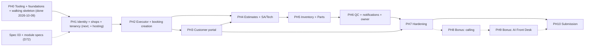

# 14 — Roadmap

**Status:** Draft

## Purpose

This spec turns the BayFlow blueprint into a build order that earns the most points before an unknown deadline. The brief states neither the hackathon's duration nor the team size (spec 00 open question), so the plan is built from three parts:

- **Phases** with relative effort: S/M/L/XL and % of total team effort.
- **Checkpoints** at fixed fractions of the available time, each with "if missed" rules.
- **Two example schedules** (48 hours and 7 days) and **three team splits** (2, 3 or 4 people). Pick one of each at kickoff.

Each phase ends with something a judge could click on the live URL, and its exit criteria cite test IDs from spec 12.

> **Status (2026-10-09).** Implementation started in parallel with the last spec work, at the owner's request (D72). **PH0 is done** (details in PH0 below): the API foundation (D84 — `app.core`, `app.shared`, every model, one baseline migration incl. the bonus tables, `/health`), the web foundation, the pure state-machine domain with its exhaustive tests, the root tooling (compose, Makefile, CI, pre-commit, PR template, smoke script) and the start/stop scripts (D73). Integration was verified locally: `./start.sh` → `GET /health` 200 and the web app 200 → `./stop.sh` frees ports 3000/4000. Gates green: 1,371 API tests (1,131 state-machine), 67 Vitest tests, Ruff, mypy, the eight import contracts, Alembic upgrade / check / downgrade. **Not done yet:** the hosting half of PH0 (Railway, Vercel, the day-1 checklist, branch protection) — the README still says the live URL is "to be added after the first deploy" — so it moves to the start of PH1. **Next: PH1** — spec 03 and the module specs now exist, so module features can start.

> **How to read this.**
> - **Naming (D75):** phases are written **PH0 … PH10**; a bare **P0 / P1 / P2 / P3** is always a D36 *priority* (core / cheap extra / bonus / post-hackathon). The earlier "Phase P0 … P10" labels read like priorities ("Phase P1 builds P0 features"), so D75 renamed them. Tables use a "Phase" column for phases and a "Pri" column for priorities.
> - **Effort key** (% of total team person-hours): **S** ≤ 3 % · **M** 4–8 % · **L** 9–14 % · **XL** ≥ 15 %. With several people, phases overlap, so the calendar comes from §3 (critical path) and §4 (schedules) below, not from summing percentages.
> - **Checkpoints CP1–CP5** sit at ≈ 10 / 25 / 50 / 75 / 90 % of the available time (§4.1).
> - **Section references:** "brief §n" is the hackathon brief, and brief subsections (§7.8, §9.1 …) always mean the brief. A bare top-level "§n" in prose means a section of this spec. "12 §n" means spec 12.

---

## 1. Planning principles

### 1.1 Principles

1. **Core first, in priority order** (D4, D36):
   - P0 brief core (brief §7), then P1 cheap extras, then P2 bonus (brief §8).
   - **Hard rule (D36):** no bonus work starts before the P0 core works end to end on the live URL (brief §8 "Do not start them until the core flow works end to end"; FAQ "Bonus … only count if the core flow works"). In this roadmap that moment is **CP4**: DEP-09 passes for every role.
   - **Default gate (stricter):** the bonus starts only after **PH7's exit criteria** are met, so the full seed, README, security review and polish are never traded for bonus points.
   - **Exception for a 4-person team:** once CP4 is met, one person (normally the bonus backend owner, §4.5) may start PH8 while the other three run PH7. Why: PH7's work does not split usefully four ways, while D36's hard rule is already satisfied. Conditions: the bonus stays disabled by its blank-by-default env vars, so the core is unchanged; core CI and the DEP checks stay green; and that person returns to PH7 at once if a PH7 exit criterion is at risk or CP5 approaches without PH7 exit. Teams of 2 or 3 always use the default gate.
   - P3 (spec 13 AI backlog) is never built during the hackathon (D59; the AI Front Desk, AI-09, is the bonus built under D58).
2. **Deploy on day 1 and keep deploying** (brief §10 tip: "Teams that deploy at the last hour usually discover environment problems too late").
   - The walking skeleton is live before any feature (PH0).
   - Every merge to `main` auto-deploys.
   - The scripted DEP checks (spec 12 §5) run after every deploy.
3. **Vertical slices.** Each phase ships API + UI + seed + tests for its part of the lifecycle. No phase ends with a layer nobody can use.
4. **The worked example is the acceptance test** (brief §6). The scenario test SM-18 grows with every phase (§1.3) and is replayed against the live URL (DEP-10). The judge path (DEP-09) is rehearsed at CP4 and before submission.
5. **Score weights drive priority** (§1.2). The 35 % core flow and the 20 % architecture/quality are earned or lost in PH0–PH6. Polish (15 % UX) gets protected time in PH7. The bonus (10 %) is worth nothing if the core is broken.
6. **Specs first.** Behaviour changes are recorded in spec 17 before code changes. New names go through the glossary process (spec 18).
7. **Quality is continuous, not a final phase.**
   - CI gates exist from PH0 (spec 12 §6).
   - Tests ship in the same PR as the code.
   - The spec 12 §7 definition of done applies to every feature.
8. **Everyone commits, small and often** (brief §9.1, §9.4). Every team member owns at least one PH0 deliverable, so the history shows the whole team from hour one.

### 1.2 Score weights → where the points are earned

| Criterion (brief §10) | Weight | Earned mainly in | Proof |
|---|---|---|---|
| Core flow completeness | 35 % | PH2–PH6; proven in PH7 | SM-18, SM-08, SM-09, SM-10, DEP-09, DEP-10 |
| Architecture & code quality | 20 % | Every phase: CI gates and the state-machine domain from PH0 (D72) | spec 12 gates, import contracts, SM-01, action matrix |
| Product & UX | 15 % | PH3 (customer portal); PH4–PH6 (POS); polish in PH7 | DEP-09, DEP-12, `allowed_actions`- and `capabilities`-driven UI |
| Deployment & docs | 10 % | PH0 (live on day 1; local start/stop scripts, D73); PH7 (README, `.env.example`); PH10 | DEP-01 to DEP-07, README test by a non-author |
| Multi-tenancy & security | 10 % | PH0 (tenancy dependency via `shop_scoped_router()`, D80; composite FKs); PH1 (first shop routes); SEC tests in every phase | SEC-01 (§7.1 acceptance), SEC-02 sweep, SEC-45 (composite FKs) |
| Bonus features | 10 % | PH8, PH9: after PH7 exit (default gate; D36's minimum and the 4-person exception are in §1.1) | brief §8 evidence table |

### 1.3 The worked example as the acceptance test

| Worked-example steps (brief §6) | Runs as an API test (SM-18, CI) by the end of | Clickable on the live URL by the end of |
|---|---|---|
| 0 — Fatima signs up, creates Lahore Auto Care, adds Bilal, Imran, Sara, Usman | PH1 | PH1 |
| 1–3 — Ahmed browses, uses the wizard, booking `PENDING` | PH2 | PH3 |
| 4–8 — confirm, assign, inspect, estimate (v1 16,600 → v2 16,100), send, approve, assign parts person | PH4 | PH4 (approval in the PH3 customer dashboard) |
| 9–10 — order coil, receive, allocate → `IN_REPAIR` | PH5 | PH5 |
| 11–16 — repair, QC fail (oil leak) → fix → QC pass, notify ready, complete | PH6 | PH6 |

The estimate-rejected path (SM-08, SM-09) and the QC-fail loop (SM-10) are part of the same exit criteria. Both are §7.8 requirements.

---

## 2. Phases

### PH0 — Bootstrap: tooling, foundations & walking skeleton *(done 2026-10-09; hosting moved to PH1)*

- **Goal:** An empty but real product is live — web on Vercel, API `/health` on Railway with PostgreSQL and the pre-deploy migration, CI gates green — and every foundation that depends only on the locked foundation (08, 17, 18) and the stable draft specs (01, 02, 07, 09) is in place, so module features can start the moment spec 03 and the module specs land (D72). Every environment risk the foundation specs flagged is checked on day 1.
- **Deliverables**, in D72's order (the four tracks run side by side):
  1. **Repo tooling + local dev scripts** (D5, D73): `apps/web`, `apps/api` (`apps/agent` is created in PH9). Root files: `README.md` skeleton, `.env.example` with every glossary §12 variable and a one-line comment, `docker-compose.yml` (PostgreSQL on host port **5434** via `POSTGRES_HOST_PORT`, + API + web), `Makefile` (targets per spec 07: `help`, `setup`, `up`, `down`, `db-up`, `migrate`, `seed`, `db-reset`, `api`, `web`, `dev`, `test`, `lint`, `fmt`, `gen-api`, `smoke`), **`start.sh` / `stop.sh` / `start.bat` / `stop.bat`** (start the DB container, migrate, run the seed, free ports 3000/4000 from any program except Docker/VM/SSH forwarders, start API :4000 + web :3000 with logs in `logs/` and PIDs in `.run/`; stop everything, free 3000/4000 and keep the DB volume — D73 amended), `.gitattributes`, `.editorconfig`, `.pre-commit-config.yaml`, `.github/workflows/ci.yml` (jobs `api`, `web`, `contract`, `secrets` per spec 07; gates per spec 12 §6), `.github/pull_request_template.md`, `.gitignore`, `scripts/smoke.sh`.
     - **Toolchain pins (D1, D11):** Node 24 LTS; **pnpm 10.34.6** via `"packageManager"` in `apps/web/package.json` (no root `package.json`, D5; Vercel supports pnpm 6–10); **TypeScript 5.9.3** and **ESLint 9.39.x**, because npm `latest` TypeScript 7 and ESLint 10 break the peer ranges of `openapi-typescript`, `typescript-eslint` and `eslint-config-next`'s plugins (spec 12 §1.2); `uv` with Python 3.12 and **`sqlalchemy[asyncio]`** (SQLAlchemy 2.1 ships `greenlet` only with that extra). Web scripts per D80: `lint` = `eslint . --max-warnings 0`, `typecheck` = `next typegen && tsc --noEmit`.
     - CI installs pnpm with the official `pnpm/action-setup` (reading `apps/web/package.json`) followed by `actions/setup-node` (spec 07, spec 12 §6).
  2. **API foundation** (spec 01, 02): app factory and settings; `GET /health` checks the database; `app.core` (config with production guards, database, security: Argon2id hashing (D10) and JWT issue/decode with `now` passed in (D8, D63); problem+json errors for every glossary §10 code (D49); logging with redaction, middleware: CORS allowlist, security headers, `Cache-Control: no-store` on every `/api/*` response (D61), request ID); `app.shared` (auth dependencies incl. `require_shop_member` and `shop_scoped_router()` (D9, D20, D80), event bus, unit of work, pagination, `clock` (D63), `email` — the project `Email` type (D62), `enums` (D74)); SQLAlchemy models for **every table** in spec 02 and **one** Alembic baseline revision (`23165172278b`) that creates them all — the bonus tables and `ix_users_phone` included — with CHECKs (enums through the `render_item` hook), composite FKs, indexes and the ledgers' `seq` (D79, D84); Dockerfile (`--no-server-header`).
  3. **Web foundation** (spec 09): Next.js 16 + Tailwind 4 + shadcn/ui on Radix (D1); design tokens; the route skeleton with placeholder pages; the `/api/*` rewrite to `API_BASE_URL` (D7); the typed client — `make gen-api` exports `apps/web/src/lib/api/openapi.json` and runs the web script `api:types` → `schema.d.ts` (D76) — behind the central `openapi-fetch` client (D50). A placeholder landing page.
  4. **State-machine domain** (`app/modules/bookings/domain/state_machine.py`, spec 08): the full `RULES` table for all 27 actions, `check`, `allowed_actions` (pure), with the exhaustive tests in `apps/api/tests/unit/bookings/` (spec 12 §3.2).
  - **Test infrastructure** (spec 12 §4.1, §4.2, §4.4): the `<db>_test` derivation, migrate-once, truncation, `NullPool`, the `clock` fixture with `SimulatedClock`.
  - **Hosting:**
    - Railway project: API service (Docker, health check `/health`) + PostgreSQL + pre-deploy command `/bin/sh -c "alembic upgrade head && python -m app.scripts.seed"` (D13: Railway runs exec form, so `&&` needs a shell; the seed acts only when `SEED_ON_DEPLOY=true` and has nothing to seed until PH1).
    - Vercel project for `apps/web` (D6).
  - **Repo hygiene:**
    - The GitHub repo is **public from day 1**. GitHub push protection then blocks secrets, and branch protection is free for public repos (spec 12 §2.2, §2.5).
    - Branch protection on `main` is enabled once CI is green.
- **Day-1 verification checklist** (details in spec 07; record results in spec 16):
  1. **PostgreSQL version.** Run `SHOW server_version` on Railway and set the docker-compose and CI images to the same major (D12, DEP-05).
  2. **Pre-deploy runs migrations** and `alembic_version` exists in production (D13, DEP-06). A failing pre-deploy must stop the deploy.
  3. **`Set-Cookie` survives the Vercel rewrite** (D7 risk). Use a throwaway diagnostic route that sets a dummy httpOnly + Secure cookie; check the browser stores it for the web origin; then delete the route in the same PR. If it fails, switch to the D7 fallback (Bearer token held in memory) and record a decision in spec 17.
  4. **WebSocket reaches Railway directly.** Use a throwaway diagnostic echo socket (`ping` → `pong`) that the browser opens over `wss` at the API host (D7, D14), then delete it in the same PR. The real `/api/v1/ws` ships with tickets, because spec 04's SEC-33 forbids an unauthenticated socket; it is P1 (D88), built in PH6, so this check only de-risks it.
  5. **Env vars** are set in Vercel and Railway: `COOKIE_SECURE=true`, `CLIENT_URL` = the Vercel URL, `API_BASE_URL` = the Railway URL. `.env.example` matches glossary §12.
  6. **CI** runs `api`, `web`, `contract` and `secrets` green on `main`.
  7. **No edge caching of `/api/*`** (D61): responses through the rewrite carry `Cache-Control: no-store` and never show a Vercel cache `HIT` (DEP-15 once `/api/v1/me` exists).
  8. **Local scripts** work on every team member's OS: `./start.sh` → `/health` → `./stop.sh` leaves ports 3000/4000 free (`start.bat` / `stop.bat` on Windows; DEV-01, D73).
- **Exit criteria:**
  - Live web URL shows the placeholder.
  - DEP-01, DEP-05 and DEP-06 pass.
  - Checklist items 3, 4 and 7 have recorded results.
  - CI is green and branch protection is on; `alembic check` is clean on the full core schema.
  - Green: **SM-01 ★** and SM-19 (domain halves), QC-08, API-08.
  - *(P1)* DEV-01.
  - **Every team member has at least one merged commit.**
- **Exit status (2026-10-09):**
  - ✅ Met: deliverables 1–4 and the test infrastructure exist and are green locally (spec 12 §5 status); `alembic check` is clean on the full schema, bonus tables included (D84); **SM-01 ★**, SM-19 (domain halves), QC-08 and API-08 pass; *(P1)* DEV-01 passed by hand on Linux (`./start.sh` → `/health` 200, web 200 → `./stop.sh` frees 3000/4000).
  - ⏳ Carried into PH1 (the hosting half): the live web URL, DEP-01, DEP-05, DEP-06, day-1 checklist items 3, 4 and 7, CI running green on GitHub with branch protection on, and a merged commit from every member (so far the repository holds one initial commit). They are PH1's first tasks and part of its exit criteria.
- **Milestones:** the walking skeleton (deliverable 1, hosting, CI) is live at **CP1**; the foundation code (deliverables 2–4) is finished by **CP2** at the latest, overlapping PH1 as soon as spec 03 lands.
- **Dependencies:** none beyond the locked foundation (08, 17, 18) and the stable draft specs (01, 02, 07, 09) (D72).
- **Specs to read:** 00, 18, 17, 08, 07, 01 (repo layout, `app.core` / `app.shared`), 02 (schema), 09 (structure, tokens, client), 12 (§1, §2, §3.2, §4, §6).
- **Not in this phase:** module endpoints, services and screens — they wait for spec 03 and the module specs (D72).
- **Effort:** **L — 14 %** (it now carries the schema, `app.core` / `app.shared`, the web foundation and the state-machine domain, moved here from PH1 and PH2 by D72).

### PH1 — Identity, shops & team, tenancy on real routes, seed skeleton

- **Goal:** Owners, staff and customers can authenticate, and tenancy is enforced on real routes through the PH0 dependency. This is the first module-feature phase: it starts once spec 03 and `modules/identity.md` / `modules/shops.md` are written (D72) — both exist now. The schema, `app.core` and `app.shared` already exist (PH0).
- **Deliverables:**
  - **First, PH0's hosting half** (moved here, PH0 exit status): Railway (`api` + `Postgres` + pre-deploy + `/health`), Vercel, the day-1 checklist, branch protection on `main`.
  - **Read port (D86):** shops' `ShopActivityReader` with `register_activity_reader`, bookings' `shop_activity_reader` (`has_future_bookings`, `count_open_jobs`) and the bookings `ShopGridChanging` handler, all wired in `create_app()` through `wire_modules()` (D89) — plain reads of bookings' own tables, built here with shops (`modules/shops.md` §13, `modules/bookings.md` §13); the veto has nothing to block until PH2 creates bookings.
  - **identity:** `register-owner`, login, logout — they set the cookie and return `{access_token, token_type, expires_in, user}` without memberships (D81); the 12–128-character password policy (D10).
  - **shops** (staff routes built with `shop_scoped_router()`, D80): `GET /api/v1/me` with every active membership and its server-computed `capabilities` (D66; served by the shops module, and the web calls it right after login, D81); create shop (+ `OWNER` membership, D17); working hours and slot settings on the midnight-anchored grid (D37 — the veto that blocks grid changes while future bookings exist arrives with bookings in PH2); service catalogue CRUD; team management (D18 new/existing e-mail, D19 deactivate/reactivate); membership list for the shop switcher.
  - **Rate limits** (D69, spec 04): login and owner registration (per-account failure limit first, per-IP ceiling second), shop creation, member creation.
  - **Seed skeleton** (D51, spec 11): idempotent, through services. 6 shops, full teams, service catalogues, working hours, the glossary §14 cast, and the demo-cast reconciliation on every run (D60). Parts catalogues get their opening stock as one `ADJUST` per part by each shop's Parts Person (D44), so the inventory catalogue and the `ADJUST` service are built here, ahead of the rest of PH5. Runs in pre-deploy with `SEED_ON_DEPLOY=true`, and locally from `./start.sh` (D73).
  - **Web:**
    - The app shell with role-based navigation and the **shop switcher**; non-booking buttons only from `capabilities` (D66).
    - Login page with the demo-credentials panel (D52) and the login `next` sanitiser; owner sign-up.
    - Owner team page and services page.
  - **Tests:** builders `make_user`, `make_shop`, `add_member`, `make_team`, `make_parts` (spec 12 §4.3).
- **Exit criteria:**
  - Green (SEC IDs are spec 04's): SEC-02 (sweep over the routes that exist so far), SEC-03–SEC-05, SEC-13–SEC-17, SEC-21–SEC-26, SEC-28–SEC-32, SEC-37–SEC-40, SEC-44–SEC-46, SEC-48, API-01 ★–API-05, **API-12 ★**, API-13, WEB-09, INV-21, INV-23, SEED-01, **SEED-02 ★**, SEED-05, **SEED-07 ★**, SEED-08, SEED-09, SEED-19, IDN-01, IDN-03–IDN-06, SHP-01–SHP-10; *(P1)* IDN-02.
  - PH0's carried hosting criteria: DEP-01, DEP-05, DEP-06 pass; day-1 checklist items 3, 4 and 7 recorded; CI green on GitHub with branch protection on.
  - On the live URL: Fatima signs up, creates a shop, adds four staff; each staff member logs in and lands on their (empty) role dashboard; the shop switcher works across her two seeded shops.
  - DEP-03 passes (the real login cookie survives the rewrite). DEP-07 and DEP-15 pass.
- **Dependencies:** PH0 foundations; spec 03 (auth, shops, team endpoints) and `modules/identity.md`, `modules/shops.md` written (D72).
- **Specs to read:** 03 (auth, shops, team endpoints), 04, `modules/identity.md`, `modules/shops.md`, 11, 09/10 (auth screens, shell), 12 §4.3.
- **Not in this phase:** bookings endpoints; WebSocket tickets.
- **Effort:** **M — 6 %**.

### PH2 — Action executor, booking creation, scheduling, booking events

- **Goal:** Bookings exist and move only through spec 08's rule table. The generic action executor (locks, versions, events, after-commit hooks) is in place, so later phases only add side effects.
- **Deliverables:**
  - **Domain:** already built in PH0 (D72) — the `RULES` table for all 27 actions, `check` and `allowed_actions`, with their exhaustive tests. This phase wires them into the executor.
  - **Action executor:**
    - Spec 08 "How an action is executed", steps 1–16: `SELECT … FOR UPDATE`, glossary §10 check order, `expected_version`, `booking_events` (timeline ordered by `(created_at, seq)`, D79), the `BookingActionApplied` event, commit, after-commit hook.
    - **scheduling:** the midnight-anchored slot grid from working hours (D37, D38); public shop detail and availability **by slug**, with free places reported as `remaining` (D68); the directory hides shops without an active service (D64); `slot_counters` lock + capacity; grid changes blocked while future bookings exist (the bookings module vetoes `ShopGridChanging`; booking creation holds `FOR SHARE` on the shop row, D37).
  - **bookings:**
    - `POST /api/v1/bookings` (D32 account rules — session cookie **and** `access_token` in the body; D33 reference; D34 service snapshot; D35 vehicle upsert; D65 mileage snapshot).
    - Customer and staff lists with status filters; detail with timeline and `allowed_actions`.
    - Transitions T02 `confirm`, T03 `decline`, T04 `assign-technician`, and T22 `cancel` (slot release now; parts release arrives in PH5).
    - The credential rate limiter shared by login and the wizard, and the booking-creation limits (D69, spec 04).
  - **Tests:** `drive_booking_to` (extended by each later phase); the lock gate (spec 12 §3.5); the start of the action matrix.
- **Exit criteria:**
  - Green: **SEC-01 ★** (the brief §7.1 acceptance test, now that booking routes exist), SEC-07 (booking-action matrix so far), SEC-08, SEC-09, SEC-11, SEC-12, SEC-18–SEC-20, SEC-27, **SM-01 ★** (API half: the action matrix so far), **SM-03 ★** (domain + matrix so far), **SM-05 ★**, **SM-07 ★**, SM-15, SM-17, SM-19 (API half so far), CON-01, BK-01–BK-19, BK-21, BK-22, BK-26–BK-32, BK-34–BK-36, BK-40–BK-42, SCH-02–SCH-07, API-06, API-10; *(P1)* CON-05, SCH-01.
  - SM-18 runs steps 0–4.
  - On the live URL: a booking created through Swagger appears for the SA, who confirms and assigns it.
- **Dependencies:** PH1; spec 03 (booking endpoints) and `modules/bookings.md`, `modules/scheduling.md` written (D72).
- **Specs to read:** **08 (in full)**, 02 (bookings and scheduling tables), 03 (booking endpoints), `modules/bookings.md`, `modules/scheduling.md`, 12 §3–§4.
- **Not in this phase:** estimates, stock, QC side effects.
- **Effort:** **L — 10 %**.

### PH3 — Customer portal

- **Goal:** A customer can do everything in §7.3 on a phone: discover a shop, book, track, approve or reject, and mark pick-up.
- **Deliverables:**
  - Landing page: hero, shop grid (listed shops with at least one active service, D64; name, city, rating placeholder D56, services), search and city filter. Shop detail page `/shops/[slug]` (D68).
  - **Booking wizard** (`/book/[slug]`, D68): shop → services/problems → time slot (only slots with `remaining` > 0) → personal + vehicle details (optional mileage, snapshotted on the booking, D65; a new account's password is 12–128 characters, D10) → review and confirm. Handles the D32 account rules in the UI: logged-in users skip the password; on `EMAIL_ALREADY_REGISTERED` the wizard offers login.
  - **Customer dashboard:**
    - Bookings with a live status timeline; pending actions highlighted.
    - Estimate detail with itemised parts and labour, and accept/reject buttons driven by `allowed_actions`.
    - Ready-for-pick-up message; cancel; complete ("mark pick-up", D28).
  - Responsive layouts. Shared formatters (money D41, time D38). Error messages mapped from problem `code`s.
- **Exit criteria:**
  - Green: WEB-01–WEB-06; DEP-02.
  - On the live URL at phone width, a new customer completes the wizard and sees the booking `PENDING`.
  - The seeded customer Ayesha sees her sample bookings, including one awaiting approval. Approve/reject work end to end once PH4 lands.
- **Dependencies:** the PH2 booking API. The UI can start during PH2 against generated types once spec 03 is fixed.
- **Specs to read:** 09, 10 (customer screens), 06 (customer journey), 03, 12 §1.2.
- **Not in this phase:** POS screens.
- **Effort:** **L — 10 %**.

### PH4 — Service Advisor + Technician flows, estimates (versioning)

- **Goal:** Worked-example steps 4–8 can be clicked through: SA review, technician inspection, versioned estimates, customer decision, and both estimate-rejected paths.
- **Deliverables:**
  - **estimates module:**
    - Versions `DRAFT` / `SUBMITTED` / `SENT` / `APPROVED` / `REJECTED` / `SUPERSEDED` (D39).
    - `PUT …/estimate` (O1; outside the caller's own status → 409 `ESTIMATE_LOCKED`). Server-side `Decimal` totals in whole rupees, line totals rounded half-up (D40, D41). `PART` lines from the shop catalogue with live availability (D40).
    - T05–T11 (start inspection, submit, send, approve, reject, revise, return to technician); T12 `assign-parts-person` creates `booking_parts`.
  - **SA screens:** bookings list with status filters; booking detail; confirm/decline; assign technician; review, edit and send estimate; revise or return after a rejection; assign parts person; notification bell placeholder.
  - **Technician screens:** my assigned jobs; booking and vehicle detail; estimate editor (part, quantity, unit cost, labour) with stock hints; submit to SA.
  - *(P1)* `reassign-technician` (O4).
- **Exit criteria:**
  - Green: EST-01–EST-18, EST-20–EST-27, BK-38, **SM-08 ★**, SM-09, SM-14, SM-04 (technician rows), SEC-35.
  - SM-18 runs steps 0–8.
  - On the live URL: Bilal, Imran and Ahmed click through steps 4–8, then repeat with a rejection (SM-08 path).
- **Dependencies:** PH2 and PH3 (customer approval UI); `modules/estimates.md` written (D72).
- **Specs to read:** 08 (T04–T12, O1), `modules/estimates.md`, 10 (SA and technician screens), 06, 03.
- **Not in this phase:** stock reservation (PH5).
- **Effort:** **L — 12 %**.

### PH5 — Inventory, purchase orders, Parts flows

- **Goal:** Stock numbers stay explainable (spec 00 narrative 3). Worked-example steps 8–10 work, including partial delivery and release on cancellation.
- **Deliverables:**
  - **inventory module:**
    - Parts catalogue (D44: new parts start at `on_hand = 0`) and the `ADJUST` service, both already built in PH1 for the seed. Stock ledger (`RECEIVE`, `RESERVE`, `RELEASE`, `CONSUME`, `ADJUST`; history and running balances ordered by `(created_at, seq)`, D79).
    - T13 `order-parts`, T14 `mark-parts-ready`, T15 PO receive (partial → `PARTIALLY_RECEIVED`; the `PurchaseOrderReceiving` pre-event locks the linked booking first, and received stock is reserved only while that booking is `PARTS_ORDERED`, D43), T16 `allocate-parts`, T22 release on cancel.
    - **Stock adjustment** (`POST …/parts/{part_id}/adjustments`, Parts Person only; going below `reserved` → 409 `INSUFFICIENT_STOCK`). It is P0, not an extra (D82): the only way to enter opening stock (D44) and to correct drift (D71).
    - Parts changes without a status change (e.g. a partial receipt reserving stock) publish `BookingPartsChanged`, which pushes `booking.updated` once the P1 WebSocket ships (D83, D88).
    - **Read port (D86):** inventory's `BookingRefReader` with `register_booking_ref_reader`, implemented by `bookings.service.get_booking_refs` and registered in `create_app()` and the seed's start-up through `wire_modules()` (D89), for the `BookingRef` on purchase orders and stock movements (`modules/inventory.md`).
    - Low/out flags (D45). Owner inventory summary.
  - **Parts Person screens:** inventory table (SKU, name, quantity, reorder level, cost); jobs awaiting parts (required vs available); create PO; receive, including partial; allocate; adjust stock.
  - *(P1)* `reassign-parts-person` (O5).
- **Exit criteria:**
  - Green: **INV-01 ★**, INV-02–INV-34 (INV-19 is the concurrency test; INV-34's push half is P1), BK-33 and BK-37 (BK-33's push half is P1, D88), **SM-11 ★**, **SM-12 ★**, SM-13, SEC-06; *(P1)* CON-04.
  - The ledger invariant is asserted in every scenario test.
  - SM-18 runs steps 0–10.
  - On the live URL, Usman clicks through steps 8–10, and a partial delivery is demonstrable.
- **Dependencies:** PH4 (approved estimate → `booking_parts`); `modules/inventory.md` written (D72). The catalogue and ledger can be built in parallel with PH4.
- **Specs to read:** `modules/inventory.md`, 08 (T12–T16, T22, parts reservations table), 02 (stock CHECKs), 10 (Parts screens).
- **Effort:** **L — 9 %**.

### PH6 — QC, notifications (bell + 15 s polling P0; WebSocket P1, D88), owner overview

- **Goal:** The full lifecycle with the QC-fail loop works on the live URL, every role is notified at the right step, and the owner can oversee each shop. Reaching this goal is CP4.
- **Deliverables:**
  - **qc module:**
    - QC queue; T18 `pick-qc` (first wins); default checklist (D46); T19 `pass-qc`; T20 `fail-qc` with an issue.
    - T17 `send-to-qc` resolves open issues (D47). O2 `start-repair`, O3 `notify-ready`, T21 `complete`.
    - `GET …/qc/checklist`, the qc module's only route (spec 03 §4.11).
    - *(P1, D87)* `reassign-qc-inspector` (operation `REASSIGN_QC_INSPECTOR`, SA/Owner, in `QC_IN_PROGRESS`; new inspector an active QC member, not the booking's technician; `QC_REQUESTED` to them), built together with the other reassign operations (O4 in PH4, O5 in PH5); it needs glossary §4, spec 08 O6, `app.shared.enums` and the state machine updated first. Until then the Owner reactivates a deactivated inspector to finish a stuck pick.
  - **notifications module:**
    - Event handlers for the 11 Minimum types, plus the 4 Extra types (P1). Recipients follow glossary §6, including the D26 SA → Owner fallback; every row stores `recipient_role` and a server-computed deep `link` (D67).
    - Bell with unread count, list, mark read. The unread count and the current view are **polled every 15 s, always** — with or without the socket (D14).
    - *(P1, D88 — brief §8.3 lists real-time updates as optional; the bonus calling needs it)* WebSocket: the ticket endpoint in the notifications module (D70: `typ` = `ws`, 60 s; the client fetches a new ticket on every reconnect and treats any close the same way, since browsers report a rejected handshake as 1006), and pushes of `notification.created` / `booking.updated` after commit, only to users who can see the booking (D14, glossary §11).
  - **reporting:** owner overview per shop (bookings by status, team list, inventory summary). *(P1)* multi-shop summary.
  - **Screens:**
    - QC: queue, pick, checklist/notes, pass, fail with issue.
    - Technician: start repair, send to QC, view issues sent back.
    - SA: notify ready, complete.
    - Bell in every dashboard. Owner overview + read-only access to the role views (D16).
- **Exit criteria:**
  - Green: QC-01–QC-11, **SM-06 ★**, **SM-10 ★**, **SM-16 ★**, **SM-18 ★** (steps 0–16), **SM-20 ★**, SM-02 (all rows), NOT-01, NOT-03–NOT-07, NOT-10, NOT-11, NOT-14, NOT-15, NOT-21, QC-12–QC-17, BK-39, WEB-11, RPT-01, RPT-03–RPT-08, BK-23, BK-24, SEC-07 (complete), SEC-10, SEC-34; *(P1, D88 — with the WebSocket)* SEC-33, NOT-08, NOT-12, NOT-16–NOT-18, NOT-20, WEB-10, and the push halves of BK-33 / INV-34; *(P1)* RPT-09.
  - **CP4 = DEP-09 passes:** the §7.8 judge path is clicked through on the live URL in two browsers, including the QC-fail loop, the estimate-rejected path, and refused cross-role and cross-shop attempts.
- **Dependencies:** PH5; `modules/qc.md`, `modules/notifications.md`, `modules/reporting.md` written (D72).
- **Specs to read:** `modules/qc.md`, `modules/notifications.md`, `modules/reporting.md`, 08 (T17–T21, O2, O3), 03 (realtime, notifications), 10 (QC Inspector screens QI-xx, Owner screens, bell), 18 §6 and §11.
- **Effort:** **L — 10 %**.

### PH7 — Hardening

- **Goal:** A stranger, or a judge, gets a correct, polished, documented product with zero setup. Every §7.8 item is proven on the live URL.
- **Deliverables:**
  - **Full seed** (spec 11, D51):
    - 6 shops (D51); sample bookings for Ayesha in several statuses (through services).
    - Worked-example stock ready at Lahore Auto Care.
    - The non-demo shop that scripted live checks use (spec 11; spec 12 Open question 4).
    - Judge notes in the README (spec 11): shared data drifts and is not reset (D71: pick another slot; Usman adjusts stock), while broken demo accounts are repaired by the next seed run (D60).
  - **Worked-example E2E green on the live URL:** DEP-10 scripted replay; DEP-09 rehearsed twice by someone who didn't build those screens.
  - **README.md** with every §9.1 / §9.2 item (§7 below). **`.env.example`** complete with placeholders and one-line comments (§9.3).
  - **UX polish:**
    - Loading, empty and error states; copy from the glossary labels; success toasts.
    - **Mobile pass** of landing, wizard and customer dashboard (§7.3, DEP-12).
  - **Security review** against spec 04 Tier 1: all of SEC-01…SEC-40, SEC-44…SEC-46 and SEC-48 green (SEC-36, SEC-49 and SEC-50 only with the bonus). Tier 2 (SEC-41…SEC-43) and SEC-47 only if time allows.
  - **Performance sanity** (spec 12 §8): `EXPLAIN` the five busiest queries; N+1 guard.
  - Remaining **P1 extras**, most valuable first (reverse cut-list order: e-mail, owner multi-shop summary, then the item 1 extras), only while the exit criteria are already met.
- **Exit criteria:**
  - **Every P0 test in spec 12 §5 is green**, including the 21 ★ tests.
  - Every P0 SEED test green (SEED-01…SEED-14, SEED-16, SEED-17, SEED-19). DEP-01–DEP-10, DEP-14 and DEP-15 pass on the live URL.
  - A teammate who did not write the README follows it on a clean machine (`./start.sh`, `start.bat` on Windows, or `docker compose up`): app running and tests passing in **under 15 minutes** (brief §10 "let a stranger run it in minutes").
  - No open P0 bugs.
  - *(P1)* SEC-41–SEC-43, SEC-47, API-11, WEB-08 / DEP-11, DEP-12, DEP-13, DEV-01 on every OS the team uses; NOT-09 and NOT-19 if e-mail ships.
- **Dependencies:** PH6 (and PH3).
- **Specs to read:** 11, 07 (README, env, deploy), 04 (headers, rate limits), 06 (demo script), 12 (§5 P0 list, §7, §8), 15.
- **Effort:** **L — 9 %**.

### PH8 — Bonus: in-app calling *(P2 — after PH7 exit; D36's minimum and the 4-person exception are in §1.1)*

- **Goal:** SA and customer call each other from the booking page without sharing phone numbers (brief §8.1).
- **Deliverables:**
  - LiveKit Cloud (D57). A `calls` module that issues room tokens and records the `call_logs` lifecycle (`RINGING`, `CONNECTED`, `ENDED`, `MISSED`; `MissedReason`). Call starts are rate-limited: 5 per caller per 10 minutes (D69).
  - Call buttons for both parties; the incoming-call panel — non-modal, up to 3 stacked calls, Accept / Decline, ring sound and a screen-reader announcement (D78, spec 05 §9.3); a call log on the booking.
  - A missed call fires `CALL_MISSED` by direction (glossary §6): a customer → shop call notifies the SAs of the shop (the Owner if there are none, D26); a shop → customer call notifies the customer.
  - Env: `CALL_PROVIDER_URL`, `CALL_PROVIDER_API_KEY`, `CALL_PROVIDER_API_SECRET`, `NEXT_PUBLIC_CALL_PROVIDER_URL`. Blank values disable the feature, and the core keeps working.
- **Exit criteria:**
  - Brief §8 evidence: "Two browsers calling each other on the live site; call log entry".
  - Missed calls are recorded, and `CALL_MISSED` reaches the right side for each direction.
  - Spec 05's calling tests CALL-01…CALL-16 are green, plus CALL-17…CALL-21 proposed by `modules/calls.md` (numbered in spec 12 §5; CALL-17 shares CALL-15's subject), with spec 04's bonus SEC-49 (webhook) and SEC-50 (calls and tasks RBAC). The realtime layer (P1, D88) must exist first: calling needs the socket.
  - All core DEP checks are still green: the bonus must not break the core.
- **Dependencies:** PH7 exit (default gate), or CP4 for the one person the 4-person exception allows (§1.1).
- **Specs to read:** 05, `modules/calls.md`, D57, D69, D78.
- **Effort:** **M — 5 %**.

### PH9 — Bonus: AI Front Desk + demo video *(P2)*

- **Goal:** Deliver brief §8.2: an unanswered call is picked up by the AI, which answers from real data and leaves the SA a summary and a task. Record the demo video.
- **Deliverables:**
  - `apps/agent` (LiveKit Agents, Python) deployed as a separate Railway service.
  - Dispatch only after the full `AI_RING_TIMEOUT_SECONDS` — even when no SA is online — or once every rung SA declined (D77, D58); caller identification by name, phone, e-mail or booking reference.
  - Tools call `/api/v1/internal/*` with `AGENT_SERVICE_TOKEN`, scoped to the caller (D58); the agent never invents data.
  - `ai_call_summaries` (intent, details, sentiment); a `tasks` row, the `AI_TASK_CREATED` notification to the SAs of the shop (glossary §6), and an SA dashboard section with mark-as-done.
  - **Demo video (3–5 min, §9.1 optional):** the judge path, then the bonus path from brief §6: Ahmed phones, the AI answers, a task appears for Bilal.
- **Exit criteria:**
  - Brief §8 evidence: "Demo video or live demo of unanswered call, conversation, then summary and task in SA dashboard".
  - Spec 05's AI Front Desk tests FD-01…FD-12 (plus FD-13…FD-15 from `modules/calls.md`, spec 12 §5) and agent tests AG-01…AG-03 are green (AG-04…AG-06 call a real LLM and are run by hand before recording), and spec 04's SEC-36 too (the AI cannot read another customer's data).
  - Core DEP checks are still green.
- **Dependencies:** PH8 (same LiveKit rooms and call lifecycle).
- **Specs to read:** 05, D58, D77, 18 §5 (bonus enums), §6, §11.
- **Note:** if PH9 is cut, the demo video moves to PH10 as a core-only recording.
- **Effort:** **M — 5 %**.

### PH10 — Submission

- **Goal:** Hand in exactly what the brief asks for, verified on the deployed commit.
- **Deliverables:** the submission checklist (§7 below) completed and the submission form filed: GitHub repo link, live URL, and optionally the video link. README and `.env.example` sit in the repo root.
- **Exit criteria:**
  - Every checklist box ticked.
  - The deployed commit equals the submitted commit, and CI is green on it.
  - DEP-09 passed in the final 3 hours.
- **Dependencies:** PH7 (PH8 / PH9 if built).
- **Specs to read:** this spec §7, 07 (README), 12 (DEP group).
- **Effort:** **S — 3 %**.

### Effort summary

| Phase | Name | Size | % of effort | Priority content | Status / ends at |
|---|---|---|---|---|---|
| PH0 | Bootstrap: tooling + start/stop scripts, API foundation (schema, `app.core`, `app.shared`), web foundation, state-machine domain, walking skeleton | L | 14 | P0 (+P1 DEV-01) | **Done 2026-10-09** (foundations, scripts, local integration); hosting half moved to PH1 · CP1 (walking skeleton) |
| PH1 | Identity, shops & team, tenancy on real routes, seed skeleton (+ PH0's hosting half) | M | 6 | P0 | **Next** · CP2 (with PH2 under way) |
| PH2 | Action executor, booking creation, scheduling | L | 10 | P0 | — |
| PH3 | Customer portal | L | 10 | P0 | — |
| PH4 | SA + Technician flows, estimates | L | 12 | P0 (+P1 reassign technician) | — |
| PH5 | Inventory, POs, Parts flows | L | 9 | P0 (+P1 reassign parts) | — |
| PH6 | QC, notifications, owner overview | L | 10 | P0 (+P1 WebSocket push (D88), Extra notifications, multi-shop summary, reassign QC inspector (D87)) | CP3 (its API, with the PH4–PH5 APIs) · CP4 (its UI) |
| PH7 | Hardening | L | 9 | P0 + remaining P1 | PH7 exit |
| PH8 | Bonus: in-app calling | M | 5 | P2 | — |
| PH9 | Bonus: AI Front Desk + video | M | 5 | P2 | CP5 |
| PH10 | Submission | S | 3 | P0 | Submitted |
| — | **Buffer** | — | **7** | — | Deadline |
| | **Total** | | **100** | | |

Core (PH0–PH7) is 80 % of the effort. The bonus is 10 %. Submission plus buffer is 10 %. If any checkpoint slips, the bonus 10 % becomes extra buffer (§6 below). D72 moved the schema, `app.core` / `app.shared`, the web foundation and the state-machine domain into PH0 (from PH1 and PH2), so PH0 grew from 6 % to 14 % while PH1 (12 → 6) and PH2 (12 → 10) shrank; the core total is unchanged. PH1 and every later module phase also wait for spec 03 and their module spec (D72).

---

## 3. Critical path and parallel work

**Critical path (backend-led):** PH0 → PH1 → PH2 → PH4 → PH5 → PH6 → PH7 → PH10. Every core transition sits on this chain, so **backend capacity decides the calendar until CP3**. Since D72 the chain has one more input: each module phase waits for its module spec. **PH0 is done** (2026-10-09) and spec 03 plus every module spec now exist, so **PH1 is next** and starts with PH0's carried-over hosting half. The schedules (§4 below) staff the backend first and move everyone onto the UI after CP3.

| While this runs … | … this can run in parallel | Why it's safe |
|---|---|---|
| PH0 (done, D72) | Repo tooling and scripts, API foundation, web foundation, and the state-machine domain + SM-01 exhaustive tests, side by side | Each depended only on the locked foundation (08, 17, 18) and the stable draft specs (01, 02, 07, 09) |
| PH0 | Writing spec 03 and the module specs (done: spec 03 and all ten module specs exist) | Module features (PH1 onwards) start only once their spec exists (D72) |
| PH1 | App shell, static landing layout (design tokens are PH0) | Specs 09/10; no data needed |
| PH2 (booking API) | Booking wizard UI against generated types | Spec 03 fixes the contract; mock the client until the endpoint lands |
| PH4 (estimates) | Stock ledger and PO flows (PH5 backend; the catalogue and `ADJUST` already exist from PH1) | Separate modules and tables (glossary §7); transitions T12–T16 are wired once PH4 lands |
| PH4–PH5 | Notifications handlers (PH6 backend) | They react to `BookingActionApplied`; the recipient matrix is fixed in glossary §6 |
| PH4–PH6 | QC module backend | Tests reach `QC_PENDING` through `drive_booking_to` |
| Every phase | Seed growth, README, `.env.example` | Each PR adds its seed part and docs (spec 12 §7) |

---

## 4. Schedules and team splits

### 4.1 Checkpoints

| CP | ≈ Time | Must be true |
|---|---|---|
| **CP1** | 10 % | Walking skeleton live; DEP-01, DEP-05, DEP-06 pass; CI green with branch protection; day-1 checklist recorded (PH0's deploy deliverables — its foundation code may continue until CP2) |
| **CP2** | 25 % | PH0 foundations done: full core schema migrated in production, `app.core` / `app.shared`, web foundation, the state-machine domain with SM-01 green. Identity and tenancy live with seeded demo accounts (PH1 exit); the SEC-02 sweep green on the existing shop routes |
| **CP3** | 50 % | **The worked example runs on the live URL:** SM-18 (steps 0–16), SM-08 and SM-10 green in CI, and the DEP-10 scripted replay passes against the live API. The ★ minimum proof set exists. Wizard + customer dashboard live. POS screens, WebSocket push and P1 extras may still be missing |
| **CP4** | 75 % | **The judge path works through the UI:** DEP-09 passes on the live URL for every role; all P0 tests green (PH6 exit). D36's hard rule for the bonus is met from here (§1.1) |
| **CP5** | 90 % | **Feature freeze.** PH7 exit met; any bonus works on the live URL or is dropped. From here on only fixes, docs, video and submission |

### 4.2 Example: 48-hour hackathon

This assumes about 38 working hours per person, with sleep staggered so someone is awake at every checkpoint. Never merge risky changes right before sleeping.

| Hours | Phase | Backend track | Frontend track | Ops / docs | Checkpoint |
|---|---|---|---|---|---|
| H0–H1 | Kickoff | Read 00 / 18 / 17 / 08; agree on the split (§4.5) | — | Public repo, invites, toolchain pins | — |
| H1–H5 | PH0 | API skeleton, `/health`, Alembic baseline, Dockerfile | Next.js + Tailwind + shadcn, `/api/*` rewrite | Railway (API + PostgreSQL + pre-deploy + health), Vercel, CI, compose, Makefile, start/stop scripts, `.env.example`; day-1 checklist | **CP1 @ H5** |
| H5–H12 | PH0 foundations → PH1 | Full schema (one baseline migration, D84), `app.core` / `app.shared` (auth dependencies, problem+json, clock, `Email`), **state machine domain + SM-01** (PH0); identity, shops/team/services API, seed skeleton (PH1, once spec 03 is ready) | Tokens, route skeleton, typed client (PH0); app shell + shop switcher, login with demo panel, owner sign-up, team and services pages (PH1) | Branch protection on; contract job on | **CP2 @ H12** |
| H12–H18 | PH2 (+ PH3) | Action executor; booking creation (D32, D35, D65); lists, detail, timeline; confirm/decline/assign/cancel; scheduling + slot lock (SM-07) | Landing, shop detail, booking wizard | DEP-02, DEP-03 | — |
| H18–H24 | PH4 + PH5 + PH6 (backend) | Estimates (T05–T12); parts flows (T13–T16 + PO receive); QC (T17–T20); in-app notifications; SM-18 to step 16 | Customer dashboard (timeline, estimate approve/reject); SA bookings list | DEP-10 live replay | **CP3 @ H24** |
| H24–H36 | PH4–PH6 (UI) | Backend developers join the UI: SA, Technician, Parts, QC screens; owner overview API; *(P1)* WebSocket push; full seed | Bell + notifications, owner overview, mobile layout, error and empty states | DEP-09 rehearsal | **CP4 @ H36** |
| H36–H40 | PH7 | Rate limits, headers, CORS; fix list; cheap P1 extras | UX polish, mobile pass | README and `.env.example` final; README test by a non-author; SEED and DEP checks | **PH7 exit @ H40** |
| H40–H43 | PH8 *(only if PH7 exit is met; a 4-person team may start one person at CP4, §1.1)* | `calls` module, LiveKit tokens, `call_logs`, missed calls | Call buttons, incoming-call panel | LiveKit env vars | **CP5 @ H43** |
| H43–H46 | PH10 | — | — | Final DEP-09, gitleaks full scan, 3–5 min video, submission | Submitted by H46 |
| H46–H48 | Buffer | | | | Deadline |

In 48 hours, **PH9 (AI Front Desk) is cut by default** (cut item 2). Attempt it only if CP4 is reached by about H30.

### 4.3 Example: 7-day hackathon

| Day | Phase(s) | Backend track | Frontend track | Checkpoint |
|---|---|---|---|---|
| D1 | PH0 → PH1 | Skeleton live (morning); PH0 foundations: schema, `app.core` / `app.shared`, state machine domain; then identity, tenancy | Tokens, route skeleton, typed client; shell, auth pages | **CP1** (D1 midday–evening) |
| D2 | PH1 → PH2 | Shops / team / services, seed skeleton; executor, booking creation, scheduling | Team and services pages, landing, shop detail | **CP2** (end of D2) |
| D3 | PH2 → PH4/PH5 backend; PH3 | Estimates; inventory, ledger, POs | Wizard, customer dashboard | — |
| D4 | PH6 backend; PH4 UI | QC + notifications → **SM-18 + DEP-10 by midday**; then SA and Technician UI | SA and Technician screens | **CP3** (D4 midday) |
| D5 | PH5 / PH6 UI | Parts and QC screens, owner overview, *(P1)* WebSocket push, full seed | Bell, owner overview, mobile | **CP4** (end of D5) |
| D6 | PH7 → PH8 | Hardening (morning) → **PH7 exit around midday** → calling (afternoon) | Polish, mobile pass → call UI | PH7 exit (D6 midday) |
| D7 | PH9 → PH10 | AI Front Desk (morning) | Tasks UI; demo video | **CP5** (D7 morning) → submit in the afternoon; the rest is buffer |

### 4.4 Choosing a schedule

| Real duration | Use | Bonus by default |
|---|---|---|
| ≤ 36 h | The 48-hour plan compressed: merge CP2 into CP3, PH7 ≈ 3 h | Off |
| 37–72 h | The 48-hour plan stretched proportionally | Calling (PH8) only if PH7 exits by ≈ 85 % |
| 4–7 days | The 7-day plan | Calling, then AI Front Desk |
| > 7 days | The 7-day plan, with all P1 extras done before the bonus and a longer PH7 | Both |

PH0 work already done (D72) counts toward CP1 and CP2; it never changes the gates.

Record the chosen schedule and the real deadline in spec 16 at kickoff.

### 4.5 Team splits

**Rule: backend-first until CP3, then everyone on the UI.** Every core transition is on the backend critical path (§3 above). So before CP3 at least half the team's hours go to the API, and after CP3 backend developers build the POS screens of the modules they wrote. Each module has **one accountable owner**; anyone may contribute through a PR the owner reviews.

| Team | Before CP3 | After CP3 |
|---|---|---|
| **2 people** | **A:** all API modules on the critical path: core/shared, identity, shops, bookings (state machine, executor), estimates, inventory, qc. **B:** PH0 ops (Vercel, Railway, CI, start/stop scripts), web shell, auth pages, landing, wizard, customer dashboard; plus the edge backend modules with clean boundaries: scheduling, notifications, seed | **A:** SA, Technician and QC screens. **B:** Parts and Owner screens, bell, polish, README, video |
| **3 people** | **A (workflow):** bookings, estimates, qc, notifications. **B (platform + ops):** core/shared, identity, shops, scheduling, inventory, reporting, seed, CI/deploy, README. **C (web):** design system, shell, auth pages, customer portal | **A:** SA, Technician, QC screens. **B:** Parts and Owner screens, full seed, DEP checks. **C:** bell, shop switcher, mobile pass, polish, video |
| **4 people** | **A (platform + ops):** core/shared, identity, shops, scheduling, reporting, seed, CI/deploy, README. **B (workflow):** bookings, estimates, inventory, qc, notifications. **C (customer web):** design system, landing, wizard, customer dashboard, auth pages. **D (POS web):** app shell, shop switcher, SA/Technician screens (against generated types) | **A + B:** fixes, full seed, hardening, then the bonus backend — with the §1.1 exception, one of them may start PH8 at CP4 while the rest finish PH7. **C:** mobile pass, polish, video. **D:** Parts, QC, Owner screens, bell + realtime client |

**Module ownership** (accountable owner per team size):

| Area | 2 people | 3 people | 4 people |
|---|---|---|---|
| Repo, CI, compose, Makefile, Vercel + Railway | B | B | A |
| `app.core` / `app.shared` (errors, auth + `shop_scoped_router()`, tenancy, pagination, event bus, clock, `Email`, enums) — PH0 | A | B | A |
| identity, shops | A | B | A |
| scheduling | B | B | A |
| bookings (state machine, executor, wizard API) | A | A | B |
| estimates | A | A | B |
| inventory (+ POs) | A | B | B |
| qc | A | A | B |
| notifications (+ realtime hub) | B | A | B |
| reporting | B | B | A |
| Seed + demo data (spec 11) | B | B | A |
| Web: design system, shell, auth, shop switcher | B | C | C (design system) / D (shell, switcher) |
| Web: landing, shop detail, wizard, customer dashboard | B | C | C |
| Web: SA + Technician screens | A | A (after CP3) | D |
| Web: Parts, QC, Owner screens, bell | A (QC) / B (Parts, Owner, bell) | A (QC) / B (Parts, Owner) / C (bell) | D |
| README, `.env.example`, demo video | B | B + C | C (video) / A (README) |
| Bonus — calling (`calls` module + UI) | A (API) + B (UI) | B (API) + C (UI) | A + D |
| Bonus — AI Front Desk (`apps/agent`, internal API, tasks UI) | A | A | B + C |

**Reviews.**
- With 3 or 4 people: backend PRs are reviewed by the other backend developer; web PRs by the other web developer, or by the backend owner of the endpoint.
- With 2 people: each reviews the other.
- Any API contract change is reviewed by one backend and one web person, because the `contract` job will flag it anyway.

---

## 5. Cut list (if time runs out)

Cut in this order. Drop item 1 first and go further down the list only when a checkpoint is missed (§6 below). Record every cut in spec 16. If a cut changes a decision, record it in spec 17.

1. **P1 extras**, except items 4 and 5 below:
   - `reassign-technician` / `reassign-parts-person` (O4, O5) and the planned `reassign-qc-inspector` (D87);
   - the 4 Extra notification types (NOT-02);
   - the WebSocket push with its ticket endpoint and realtime client (P1 by D88; the 15 s polling, D14, is the P0 path and stays — but the bonus calling needs the socket);
   - Playwright smoke (WEB-08);
   - N+1 guard and the domain coverage gate (the migration round trip already runs in CI inside pytest, spec 12 §6);
   - optional phone (D33);
   - the local-script check DEV-01 (the scripts themselves are PH0 tooling and stay, D73);
   - spec 04 Tier 2 security items (SEC-41–SEC-43) and SEC-47. Tier 1 items (rate limits, headers, CORS …) are never cut.
   
   No longer on this list: the OpenAPI drift job (D76 makes it a standing CI rule; WEB-07 is P0) and stock adjustment (P0 by D82: the only way to enter opening stock, D44, and to correct drift, D71).
2. **AI Front Desk** (PH9).
3. **In-app calling** (PH8).
4. **Owner multi-shop summary** (RPT-02).
5. **E-mail notifications** (NOT-09). The in-app bell stays.
6. *Last resort, needing a spec 17 entry:* edited demo video → a raw screen recording of the judge path. (The WebSocket push used to be here; D88 made it P1, so it is cut with item 1 and needs no new decision.)

**Never cut:**
- **Every §7.8 item:**
  - a judge completes the full lifecycle, from customer booking to `COMPLETED`, on the live URL with seeded accounts;
  - the QC-fail loop works;
  - the estimate-rejected path works;
  - no role can perform another role's action.
- **Tenant isolation:** the membership dependency, shop-scoped repositories and composite FKs (D20), proven by SEC-01 (the §7.1 acceptance test) and the SEC-02 sweep.
- **README.md and `.env.example`** in the repo root (§9.1, §9.2).
- **The live deployment**, with seeded demo data and demo accounts for every role (§7.7, §9.1).
- These are implied by the items above, so they are never cut either: the spec 12 ★ minimum proof set, and a meaningful commit history from every member.

---

## 6. Risk buffers and checkpoints

**Buffers.**
- **7 %** explicit buffer at the end, before the deadline.
- The **10 % bonus budget** is a second buffer: it goes back to the core whenever CP3 or CP4 slips.
- **Phase timebox:** a phase that overruns its share by more than 25 % triggers a cut review at the next sync.

**If a checkpoint is missed:**

| Missed | Do this immediately |
|---|---|
| CP1 (10 %) | Stop feature work. Everyone works on deploy and CI until DEP-01, DEP-05 and DEP-06 pass. Nothing else counts if it can't be deployed (brief §10 tip) |
| CP2 (25 %) | Drop the P1 items in PH1/PH2. The frontend continues; the backend pairs on the executor and booking creation |
| CP3 (50 %) | Activate cut items 1–3 (no bonus). All backend hands go to the missing transitions. UI work is limited to the judge path |
| CP4 (75 %) | Activate cut items 1–5. PH7 shrinks to: full seed, README, `.env.example`, two DEP-09 rehearsals |
| CP5 (90 %) | Freeze anyway. Only fixes with green CI, docs, video and submission from here |

**Cadence.**
- A 10-minute sync every 6 hours (48 h) or every morning (7 days): checkpoint status, blockers, cut decisions (recorded in spec 16).
- At each checkpoint, every member explains one piece of code they did not write. This is cheap insurance for the judges' review (brief FAQ "understand and explain all code").

**Deploy rules.**
- Every merge to `main` deploys. The scripted DEP-01 to DEP-03 run after each deploy (about 1 minute).
- DEP-09 runs at CP4 and again in the final 3 hours.
- In the last 10 % of the time: no merges touching migrations, auth or deploy config, and only fixes with green CI.

**Top risks** (tracked in detail in spec 16):

| Risk | Mitigation | Where |
|---|---|---|
| `Set-Cookie` lost through the Vercel rewrite (D7) | Day-1 check; fallback Bearer token in memory | PH0 |
| WebSocket to Railway fails (D7, D14) | Day-1 check; the 15 s polling always runs anyway (D14) and is the P0 path — the socket is P1 (D88), needed only for the bonus calling | PH1 (day-1 check, carried from PH0), PH6 |
| Local/CI vs Railway PostgreSQL drift (D12) | PostgreSQL 16 everywhere; `SHOW server_version` on day 1 (DEP-05) | PH0 |
| Vercel caches `/api/*` responses that carry personal data (external-rewrite caching is on by default for projects created on or after 2026-04-06) | `Cache-Control: no-store` on every `/api/*` response (D61); API-13, DEP-15 | PH0 |
| `*@bayflow.test` demo e-mails rejected by Pydantic's `EmailStr` | Resolved by D62: the project `Email` type (`test_environment=True`); API-12 and SEC-48 guard it | PH0 |
| npm `latest` TypeScript 7 and ESLint 10 break the toolchain's peer ranges | Resolved by D11: TypeScript 5.9.3, ESLint 9.39.x | PH0 |
| SQLAlchemy 2.1 async without `greenlet` | Resolved by D11: `sqlalchemy[asyncio]` | PH0 |
| CI installs the wrong pnpm (pnpm's newer `pnpm/setup` action installs 11+ only; Vercel supports ≤ 10) | The official `pnpm/action-setup` reading `apps/web/package.json` (pnpm 10.34.6; D1, D5, D11) + `actions/setup-node` (spec 07, spec 12 §6) | PH0 |
| Spec 03 and the module specs lag behind the parallel implementation (D72) | PH0 builds only what depends on the locked foundation and the stable drafts; module phases start only when their spec exists; finishing those specs is on the critical path (§3) | PH0–PH1 |
| A pre-deploy seed or migration failure blocks deploys (D13) | SEED and migration tests in CI; `SEED_ON_DEPLOY=false` as an emergency switch | PH1, PH7 |
| A judge breaks a shared demo account (deactivates Bilal, changes a password) | Every seed run reconciles the demo cast (D60, SEED-19); a redeploy repairs it during judging | PH1, PH7 |
| Live data drifts after rehearsals or judging (stock, filled slots) | Accepted (D71): judge notes (pick another slot; Usman adjusts stock); DEP-08 detects it; scripted runs only at a non-demo shop (spec 07 smoke script; spec 12 Open question 4) | PH7 |
| Backend critical path overloaded | Backend-first staffing until CP3 (§4.5); the state-machine domain is already PH0 work (D72) | Throughout |
| AI-generated code nobody can explain | Review rule + PR attestation (spec 12 §2); explain-it round at each checkpoint | Throughout |
| Unknown duration / team size | Choose the schedule at kickoff (§4.4) | Kickoff |

---

## 7. Submission checklist (brief §9.1, §9.2, FAQ "What goes in the submission?")

**Repository (§9.1)**
- [ ] The GitHub repository is **public**; the link works when logged out.
- [ ] **Meaningful commit history:** many small Conventional Commits, from **every** team member, not a single squashed commit.
- [ ] Organised folders: `apps/web`, `apps/api`, `apps/agent` (if built), specs, root files.
- [ ] **No committed secrets:** gitleaks full-history scan clean (DEP-14), `.env` untracked, anything ever exposed rotated.

**Live URL (§9.1)**
- [ ] Deployed and reachable without local setup. DEP-01 to DEP-03 pass.
- [ ] Seeded demo data present. DEP-08 shows the worked example is ready at Lahore Auto Care.
- [ ] **Demo accounts for every role** (Owner, SA, Technician, QC, Parts, Customer) log in (DEP-07). Credentials are listed in the README and on the login page (D52).
- [ ] The judge path (§7.8) passed on the live URL in the final 3 hours (DEP-09): QC-fail loop, estimate-rejected path, cross-role and cross-shop attempts refused.

**README.md in the repo root (§9.1, §9.2)**
- [ ] Project overview, tech stack, architecture summary, and project structure with the key design decisions.
- [ ] **Prerequisites with exact versions:** Node 24 LTS, pnpm 10.34.6, Python 3.12, uv, PostgreSQL 16 (D12), Docker.
- [ ] Exact install commands for each app (`cd apps/web && pnpm install`; `cd apps/api && uv sync` — no root `package.json`, D5).
- [ ] Environment setup: copy `.env.example` to `.env`, with each variable explained.
- [ ] Database: create, migrate (`alembic upgrade head`), seed (`python -m app.scripts.seed` / `make seed`).
- [ ] Run: one command — `./start.sh` (`start.bat` on Windows: DB on 5434, migrations, seed, API :4000, web :3000; `./stop.sh` / `stop.bat` to stop, D73) or `docker compose up` — or a few clear commands.
- [ ] **How to run tests:** `make test`, `uv run pytest`, `pnpm test`, plus the live checks (spec 12 §4.7).
- [ ] Demo credentials for every role; the judge notes (shared data drifts, D71; broken demo accounts are repaired by the next seed run, D60; spec 11); deployment notes (Vercel + Railway, pre-deploy, health check).

**`.env.example` in the repo root (§9.1, §9.3)**
- [ ] Every glossary §12 variable (bonus ones left blank), each with a placeholder and a one-line comment. No real values.

**Optional (§9.1)**
- [ ] Demo video, 3–5 minutes: the judge path, plus the bonus if built.
- [ ] Architecture diagram (in the README or linked).
- [ ] API docs: Swagger at `/docs` on the live API and/or the committed `apps/web/src/lib/api/openapi.json`.

**Bonus evidence (brief §8, only if built)**
- [ ] In-app calling: two browsers calling each other on the live site; a call-log entry.
- [ ] AI Front Desk: a video or live demo of an unanswered call → conversation → summary and task in the SA dashboard.

**Final gate**
- [ ] CI is green on the submitted commit, and the deployed commit equals the submitted commit.
- [ ] Submission form filed: GitHub repo link, live URL, optional video link (FAQ).

## Dependencies

- **Foundation:** [00-overview.md](00-overview.md) (scope tiers; the open question on duration and team size), [17-decisions.md](17-decisions.md) (in particular D1, D4–D14, D26, D36, D37, D41, D43, D44, D51, D52, D57–D88 — D84 the as-built foundation, D86 read ports, D87 the planned QC reassign, D88 realtime as P1), [18-glossary.md](18-glossary.md) (names, env vars, demo cast, ID prefixes), [08-booking-state-machine.md](08-booking-state-machine.md) (worked-example trace, transitions per phase).
- **[12-quality-and-testing.md](12-quality-and-testing.md):** test IDs in every exit criterion, the ★ minimum proof set, CI gates, definition of done, DEP and DEV checks.
- **Sibling specs per phase:** 01, 02, 03, 04 (SEC test IDs), 05 (CALL-xx / FD-xx / AG-xx tests, build steps B0–B7), 06, 07 (Makefile, CI, smoke script, pnpm pin, start/stop scripts), 09, 10 (screen IDs; QC Inspector screens are QI-xx), 11 (SEED-11…SEED-19, judge notes), `modules/*.md`.
- **Used by:** 15 (requirement → phase → test), 16 (risks, chosen schedule, cut decisions), the README "Roadmap / status" note if the team adds one.

## Open questions

1. **Duration and team size** (spec 00) are still unknown. Pick the schedule (§4.4) and split (§4.5) at kickoff and record them in spec 16.
2. **Submission mechanics.** The deadline time zone, whether judges evaluate the repository state at the deadline or a tagged commit, and whether there is a live demo slot. These change the freeze timing (CP5) and how much the video matters.
3. ✅ Resolved by D36: **Bonus gate.** D36's minimum — the P0 core works end to end on the live URL, i.e. CP4 — is the hard rule. This roadmap keeps the stricter PH7-exit gate as its default, with one exception: in a 4-person team one person may start PH8 at CP4 while the other three run PH7, under the conditions in §1.1.
4. **Specs in the public repo.** Recommend keeping `.claude/specs/` in the public repo and linking it from the README's design-decisions section. It shows judges the spec-driven process. Confirm with the owner.
5. ✅ Resolved by D75: **Phase vs priority labels.** Phases are PH0…PH10; P0–P3 stay the D36 priorities.

## Proposed glossary additions

| Name | Meaning |
|---|---|
| `PH0` … `PH10` | ✅ merged — build phases of this roadmap (D75; glossary change log "implementation start") |
| CP1 … CP5 | Checkpoints at ≈ 10 / 25 / 50 / 75 / 90 % of the available time (§4.1) — *pending* |
| Walking skeleton | The deploy half of PH0: empty web + API `/health` + database, deployed with CI — *pending* |
| Judge path | The §7.8 manual run on the live URL (DEP-09) — *pending* |
| Minimum proof set (★) | The 21 spec 12 tests that must exist by CP3 and are never cut — *pending* |
| Feature freeze | From CP5 on: only fixes, docs, video and submission — *pending* |
| Non-demo smoke shop | The seeded shop that scripted live checks use (spec 07 smoke script, DEP-10, WEB-08), so Lahore Auto Care stays clean (spec 12 Open question 4) — spec 11 names it: Lyallpur Motors (`lyallpur-motors`); glossary entry *pending* |
